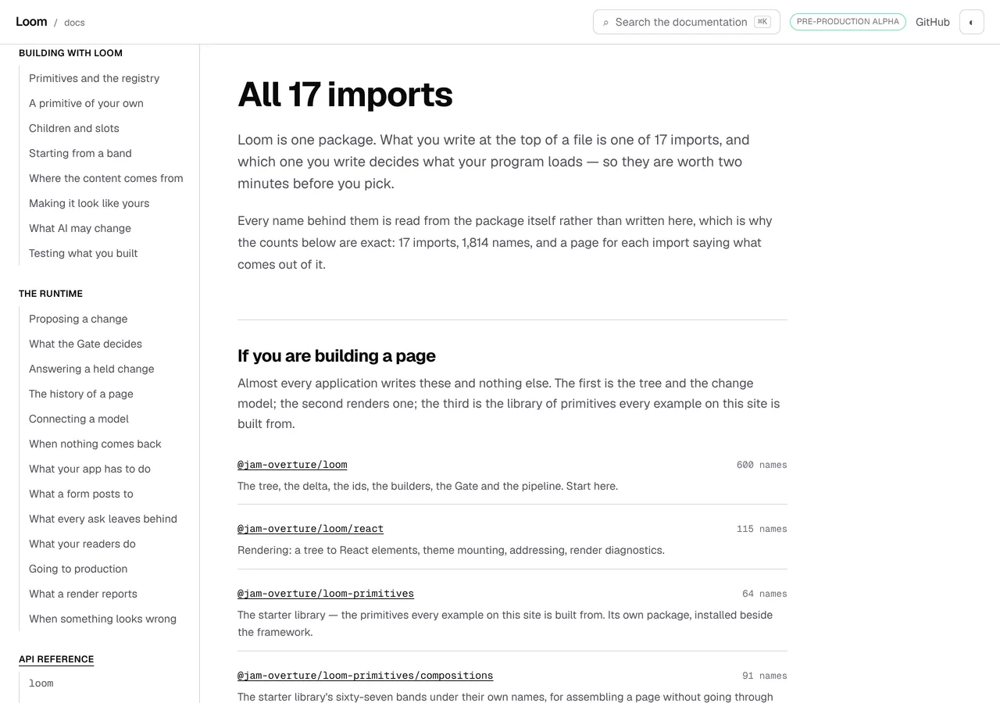
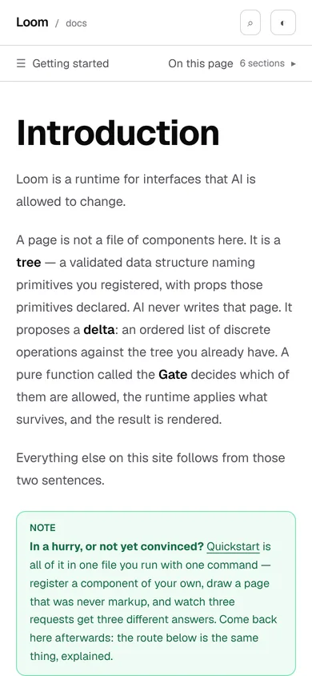

# 31 October 2026 — the plain version first

**Routine:** `Loom docs` · **Branch:** `docs-72-the-plain-version-first` ·
**Section:** §4c

No open pull request from this lane at the start of the run. #727 merged
overnight as `482081a`. Four were open — #730 (`Loom marketing`), #729, #728 and
#706 (`Loom signals`) — none of them this lane's, none touching the `(docs)`
route group.

**No maintainer comment is outstanding for this lane.** The only non-bot comment
on #727 is this lane's own. The question it asks is unanswered and is repeated
under *Needs your input*, for the sixth run.

Branch cut from `origin/main` at `482081a` (#727), after `git fetch origin main`.

## The plain version

The brief for this surface has one instruction in bold that outranks the rest of
it, and it is about a reader rather than a file:

> *"the plain-language version comes first and the precise version is one scroll
> or one disclosure later — never the reverse. A page that opens with
> `TreeDelta`, `baseRevision` and `disposition` has lost the reader before it
> has said what any of them are for."*

**This site keeps that rule everywhere, and nothing was holding it.** Measured
across the thirty-five written pages this morning:

| where a reader meets a page before it has shown them anything | how many | naming a published export |
| --- | --- | --- |
| the one-line summary the rail, the pager and the search results carry | 35 | **0** |
| the opening, above the first `##` | 35 | **0** |
| the `##` and `###` headings | 216 | **0** |

**Seventy published names appear in this site's prose. Not one appears in a
summary or an opening.** Two hundred and eighty-six places, held by whoever
happened to be writing, with no check anywhere in this repository that would
have noticed the first page to break it.

That is the condition `voice.ts` was written for, and its sentence needs no
editing to apply here: *a site edited by routines with no memory of each other
cannot hold a convention that is only written down. It can hold one that goes
red.* Spelling was the first claim over that reader. This is the second, and it
is the one the brief shouts.

## What shipped

**One module and one test**, plus one line exported from an existing file.

- **`plain.ts` — the two places a reader meets a page before it has shown them
  anything, and the rule that both are plain language.** `openingOf` is
  everything above the first `##`, including the page's own `#` title, with MDX
  machinery dropped and fenced code already blanked by `outsideFences`.
  `plainFaults` is the list, empty today.
- **`plain.test.ts` — 18 tests.** Split the way `landing.test.ts` is: the
  **rule** against the thirty-five real pages, the **reader** against markdown
  written here to exercise it. A reader held only against the site is a reader
  whose rules are whatever today's pages happen to do, which is how a check goes
  quietly vacuous.
- **`publishedNamesIn`, exported from `api/mentions.ts`.** `namesNamedIn` hands
  each backticked span to it rather than comparing against the published set
  directly, so `result.ok` in a sentence stays the property rather than the
  export that shares its spelling. One reader of that question, not a fourth.

**No page was edited and no prose was added.** The site already passed.

## A name is a name when it is in backticks

The convention this whole surface already runs on. `api/mentions.ts` says why —
*"prose is where a page says 'the registry' and means the idea rather than
`createPrimitiveRegistry`"* — `search/prose.ts` strips exactly those spans out
of the body index, and `fences/lent.ts` and `fences/landing.ts` both ask their
question of them.

It draws the boundary honestly in one direction, and the direction is stated
rather than left to be discovered: **a summary that writes a name with no
backticks is outside what this can see.** The alternative was measured and
rejected — matching bare words against the published set flags a sentence
containing *ok*, *unavailable* or *result*, all three of which this package
exports and all three of which are ordinary English. A rule that flags the word
*ok* in a summary is a rule somebody turns off.

## The judgement this run had to make

**Whether the rule covers headings. It does not, and that is the half of
yesterday's lesson this would otherwise have contradicted.**

A heading is an **address** — it is what the search box and the contents rail
hand out, and what a reader lands on. Somebody who typed `renderLoomTree` and is
sent to a heading called *`renderLoomTree`* has been answered exactly.
Forbidding a name there would forbid the one case where the name is the right
title. So the 216 headings are **measured and recorded** in the module's own
doc comment, and required of nobody.

## What a mutation moved

**A name put into a page summary did not fail**, and the summary it landed on
says why: `/docs/api-reference` is written by hand in `nav.ts`, under a section
whose *pages* are generated, so a check reading `writtenDocsSections` alone
could not see it.

The written/generated split is right for an **opening**, which is read off a
file a generated page does not have, and wrong for a **summary**, which is one
hand-written line either way. Summaries are now read for every written page and
for each section's landing page.

**The reference's sixteen doors stay excluded, and the exclusion is the point
rather than an omission.** Their summaries are `entry.summary`, arriving from
the runtime's own declaration files — so a rule over them would be this lane's
test going red because another lane wrote a sentence. `search/build.test.ts`
already names that shape as the mistake to avoid (*"this lane's number about
somebody else's growth"*), and it is the same landing-page exclusion
`search/build.ts` makes for `family`.

## Decisions taken that were not specified

- **The check is a test, not a module that throws at import.** Same reasoning as
  `lent.ts` and `landing.ts`: nothing renders an orientation, so there is no
  page for a throw to fail.
- **A fault prints which of a page's two openings it is about.** They are edited
  in two different files — a summary in `nav.ts`, an opening in the page's MDX —
  and a fault that did not say which would send its author to the wrong one.
- **The page's `#` title is part of the opening.** There is no reason to hold a
  title to a weaker rule than the sentence under it.
- **A fenced block in an opening is not read.** A block there is the precise
  version arriving on cue, which is what the rule asks for rather than what it
  forbids — *Quickstart* opens with the file you are about to save.

## Records

None added, none superseded. Nothing here touches the tree schema, the delta
model or an `Accepted` record, and nothing is escalated as `ARCHITECTURAL`.

## Cross-lane diff

**None.** Every file changed is inside `apps/loom/app/(docs)/`, plus
`FINDINGS.md`, this report and its pictures. Nothing in `src/`, nothing in
another surface's route group, and no primitive was wanted that does not exist.

## Findings

**Four filed, one closed on filing.**

- **Filed and closed on filing:** *the places a reader arrives were plain
  language two hundred and eighty-six times by hand, and nothing held them* —
  the unit above, with the table.
- **Filed, open — the stated limit of what this guarantees.** *The rule reads
  published exports, and two of the three names the brief's own example uses are
  not exports.* `baseRevision` and `disposition` are **fields** on a published
  type, not published names, so the check catches `TreeDelta` and is blind to
  the other two. Widening to field names was costed and left: `title`,
  `summary`, `kind`, `code`, `text` and `body` are all fields on something this
  package publishes and all six are words a summary legitimately uses. The
  recommendation is to revisit with a count rather than a rule.
- **Filed, open:** *the address-not-a-name remedy that saved 118 KB on the names
  index saves 700 bytes on the prose index.* Measured both ways on this branch,
  so the next run reaching for the obvious lever on the cap finds the number
  rather than the idea.
- **Filed, open:** *two prose rules about where a reader lands were costed and
  rejected, because neither can be stated as a fact.* 13 of 251 sections open
  their first sentence with an export's name, and 33 of 216 open with a pronoun
  — and both lists are mostly good writing, for reasons the entry sets out with
  the sentences. The page opening shipped instead because it **is** a fact.

Standing entries this run met again and did not duplicate:

- **`*.vercel.app` is denied by the environment's egress policy** (12 October,
  open). Every picture below was taken against a build in this container.
- **The composed preview URL** (16 October). The URL below is taken from the
  `vercel[bot]` comment rather than guessed from the branch name.
- **The commit author line** (23 October). Checked with `git config user.email`
  before the first commit: `Claude <noreply@anthropic.com>`.
- **Mutation testing before the first commit** (27 October, this lane's own).
  Followed: the unit was committed as `b46e6fa` before the first mutation, and
  every restore was `git restore --source=HEAD -- .`.
- **A screenshot taken while the merge gate is running turns the gate red**
  (29 October, this lane's own). Followed: every picture was taken and shrunk,
  and `FINDINGS.md` and this report were written, **before** the gate was
  started.
- **`pnpm reports:shrink` reads the git index** (30 October, this lane's own,
  owned by `Loom daily build`, still open). Worked around as that entry
  describes: the four PNGs were `git add`ed before `reports:shrink` ran, which
  is what made them visible to it, and unstaged afterwards.
- **Never let anything run after the gate on the same line**
  (`docs/routines.md`). Followed — the status was written to a file as the last
  thing on its line and read in a separate command.

## Test numbers

`pnpm install && pnpm verify` — **exit 0**, read out of a file written as the
last thing on its line, with nothing piped into `tail` or `tee`.

- framework: **243 files, 5,884 tests passed**
- application: **380 files, 6,855 tests passed**, of which **140 files and
  2,112 tests** are `(docs)`
- `findings:check`: 1,368 findings, 0 malformed
- `reports:check`: 2,027 visuals, 144.2MB, none over 1.1MB, 411 cited by no file
- `prerender:check`: **137 prerendered pages**, 1,943 text junctions, 0 run
  together; 3 metadata conventions, 0 unserved

Nothing failed, nothing was skipped, and no test was weakened.

**Eighteen tests are new**, all in `plain.test.ts`. No existing test was edited,
weakened or removed; `mentions.test.ts` keeps its 24 unchanged.

### The search index

| | `main` (482081a) | this branch |
| --- | --- | --- |
| prose index, gzipped | 79,661 | **79,661** |
| prose index, raw | 254,705 | **254,705** |
| code index, gzipped | 9,795 | **9,795** |

**Unchanged to the byte, in every band.** No page was edited, so there was
nothing for the index to read differently.

*(The 30 October report quotes 79,656 for the prose index. Measured here against
`main` it is 79,661 — the five bytes are `482081a` itself, which is that
report's own merge, and the raw figure is identical.)*

### Six mutations, six killed

Each applied on its own against the branch's committed code, restored with
`git restore --source=HEAD -- .`, with the suite re-run between.

| what was put in | what failed |
| --- | --- |
| **`A \`TreeDelta\` is an ordered list of operations.`** added to the opening of *Introduction* — the brief's own example | the rule, naming the page, the place and the sentence |
| **a name put into a page summary in `nav.ts`** | **nothing, the first time.** It landed on `/docs/api-reference`, whose summary is hand-written under a generated section. This is the mutation that moved the boundary; it kills the rule now |
| **`openingOf` reading past the first heading** | the rule, plus two of the reader's own checks — the opening is no longer bounded, so every name on every page is in it |
| **the dot exclusion dropped** from `api/mentions.ts`, so `result.ok` reads as the export | *does not read a property behind a dot as the export that shares its spelling* |
| **an `####` treated as closing an opening** | *is not closed by an `####`, which is a label rather than an address* |
| **`outsideFences` removed from `openingOf`**, so a block in an opening is read as prose | the rule — *Quickstart* and five other pages open with the file you are about to save, and every name in them becomes a fault |

## The pictures

Taken with `pnpm shoot --serve apps/loom` against two builds in this container.
Both viewports measured `scrollWidth 1280 / innerWidth 1280` and `390 / 390` —
no overflow at either.

### What the rule protects

The opening of *Introduction*, unchanged by this branch. **The three ideas it
introduces are `tree`, `delta` and `Gate` — and all three are bold English
words rather than the names the package exports for them.** That is the rule
being kept, by hand, on the first page a stranger reads, and it is what the
check now holds.

### The same page with the rule broken

The brief's own sentence, rendered. **Nothing above it moved** — the heading,
both paragraphs, the note and the rail are the same pixels at the same offsets.
What a reader meets is three boxed monospace names in the first thing the site
says to them, directly under three bold English words doing the same job.

**This is also the limit, visible.** The check fails this page because of
`TreeDelta` alone: `baseRevision` and `disposition` are fields on a published
type rather than published names, and are invisible to it. That is the second
finding above.

### The summary a mutation found

`/docs/api-reference` — the page whose summary is written by hand in `nav.ts`
under a section whose pages are generated. A name put here was missed until the
boundary moved.

### The opening on a phone

`scrollWidth 390 / innerWidth 390`.

## The preview

*Filled in from the `vercel[bot]` comment after the pull request was opened, not
composed from the branch name.*

PREVIEW_URL_PLACEHOLDER

Every picture above was taken against a build in this container, not fetched
from the preview: `*.vercel.app` is denied by the environment's egress policy,
which is the open finding of 12 October and still true.

## Needs your input

**One question, and it is the sixth run it has ended one of these.**

**Should a browser be sent the whole site's prose?** The prose search index is at
**79,661 gzipped bytes against a cap of 80,000** — 339 bytes, about one short
paragraph. Unchanged by this branch, to the byte, because no page was edited.

**This is the fifth consecutive unit chosen to fit around that number.** I said
last run I had no fifth thing of this shape queued; this is one, and I found it
by looking for work that adds no prose rather than by looking for the work this
site most needs. That is the cost of the cap, and it is now the thing selecting
what gets built.

Two things I checked this run so the question is cheaper to answer:

- **The obvious lever is not one.** Storing a name rather than an address saved
  118 KB on the names index. The same move on the prose index saves **700
  bytes** — measured both ways, filed. gzip has already eaten the repeated
  prefix inside each file.
- **The box fetches every section eagerly**, on open, before a reader has typed
  anything. So the 80,000 really is what a reader who opens the box receives,
  and the number means what the test says it means.

Raising it is forbidden by
[0157](../decisions/0157-the-catalogues-public-surface-is-the-list-and-the-lookup-not-every-band-by-name.md)
and by the test's own comment, which names the remedy as the question itself:
*sharding is finished as an answer, and the question becomes whether a browser
should be sent the whole site's prose at all.*

**My recommendation is unchanged: the search box should stop holding every
section it has fetched — it already knows which page the reader is on.** I did
not build it, and the reason is worth stating plainly: every version of it I
could find changes what the box **promises** — today it says *"Every page and
every section are searched"*, and any laziness makes that conditional. That is a
decision about what the search box *is*, which is yours. If you say yes, the
unit after it is the one that redefines the cap honestly — what a reader
receives **on open**, rather than the corpus total.

Two standing questions, neither new, neither blocking: whether a list-shaped
export may be given a list-shaped presentation (22 October), and whether a
produced table on this site should be composed from the library rather than
arranged locally (#709).

The pull request is **PR_NUMBER_PLACEHOLDER**.
