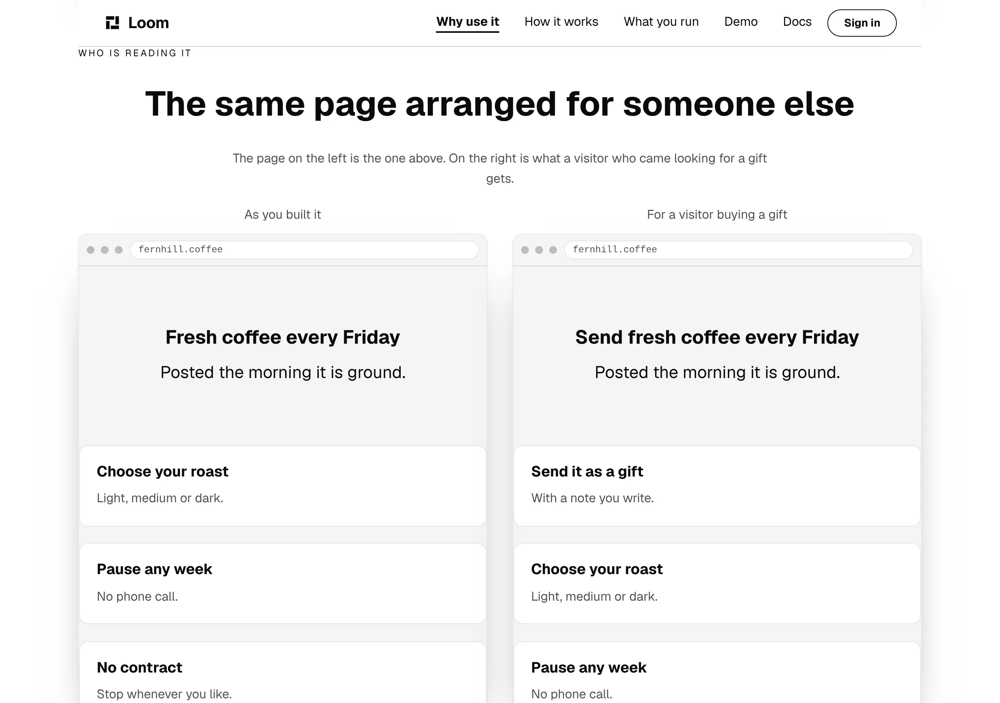
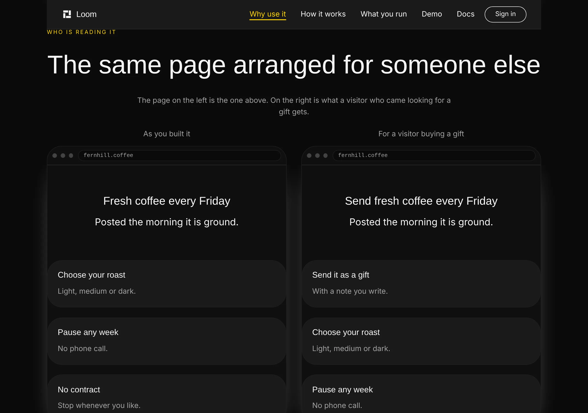
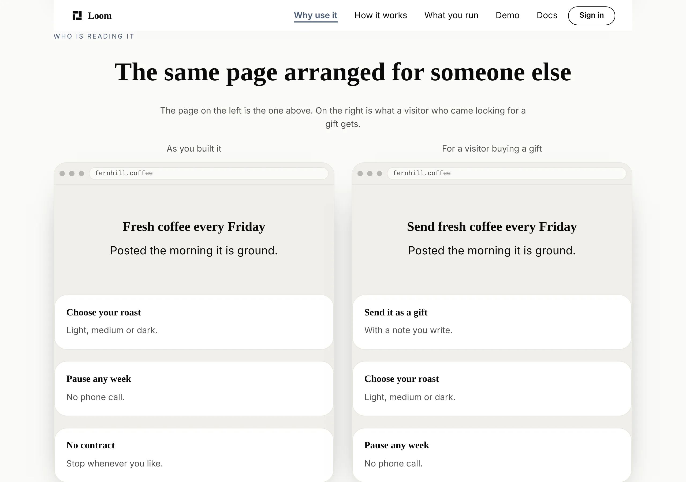
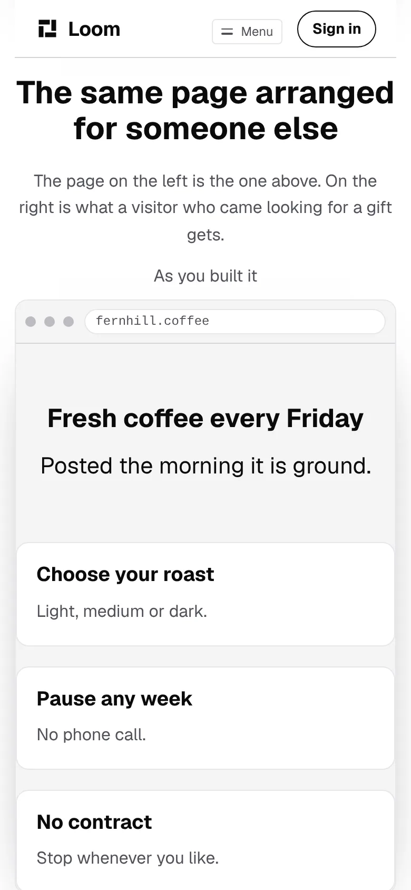
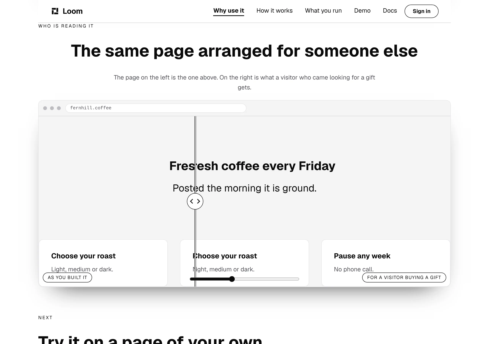

# The same page, for someone else

**31 October 2026 · `Loom marketing` · branch `marketing-22-the-same-page-for-someone-else`**

**Preview:** the pull request carries it. Not opened from this run: `*.vercel.app`
is denied by the environment's network policy, filed on 27 September. Every
picture below is off a local production build of this commit.

The headline of this site is the maintainer's of 24 October:

> **A web page that rearranges itself around the people using it.**

Until today **nothing a visitor could look at showed one doing it.**

That is not a small gap. `docs/positioning.md` records why anybody is here at
all — *"don't worry about the bad day that drives people to it, worry about how
to get people interested in it"* — and the reader it names is *"the casual web
developer… junior level"*. A developer who arrived by accident, reads a claim
in 64pt type, and then meets two full screens of prose has been given a promise
and no evidence.

## What was already there, and why neither one closes it

| | what it shows | why it is not this |
| --- | --- | --- |
| `/why-use-it#on-a-page` | a page built out of the starter set, in a browser | the page is **fixed**; it never rearranges |
| `/how-it-works#see-it-happen` | the demonstration, live, with the record beside it | it is Loom rearranging **Loom** — the one page a stranger cannot recognise as having changed, because they have never seen it before |

Both are good and neither is a reader watching a page they have just met get
rebuilt for somebody who is not them.

## What shipped

A band on `/why-use-it`, directly under the one that shows the example page:
**the same fictional coffee page, twice, for two different readers.**



The left-hand frame is the page from the band above. The right-hand frame is
what a visitor who came looking for a gift gets: a tile that was not there, two
that moved down to make room for it, one that came off, and a new heading. The
line under the heading is **the same string in both**, and that is the one a
reader uses to work out it is the same page.

Both frames carry `fernhill.coffee` in the chrome. That is the claim, made with
no copy at all.

Under Bold:



And Editorial:



On a phone the two stack, in order, each keeping its caption:



## The part a reviewer should read hardest: the first build of this was unreadable

**Every test I wrote for it passed, and the photograph is nonsense.**

The band was built as a `loom.before-after` — one frame, two arrangements
superimposed, a handle the reader drags. The primitive's own note names that
case: *"the redesign over the old page"*. It validated, it rendered, the suite
was green, and the headline came out as:

```
Fresesh coffee every Friday
```



A wipe clips one absolutely-positioned layer over another, and **the two layers
are laid out independently.** Two centred headings of different lengths do not
share a centre line, so the seam fell mid-word. The tiles were worse: the
arrangement is a reorder, so *Choose your roast* appeared on both sides of the
seam at once and read as a rendering fault rather than as a comparison.

Nothing in the tree was wrong. Both regions held valid trees of registered
parts. **The defect existed only in the compositing, which is to say only in a
photograph** — and I only have it because I took one after the tests went
green, which is the same sequence as the finding of 30 October and the reason
that habit is worth keeping.

### What the wipe is actually for, and why I believed otherwise

A wipe compares two states that **occupy the same pixels**: two photographs of
one scene, a retouch, a restyle. It is not two arrangements of a page, because
the entire content of the claim is that the second one is laid out differently.

I reached for it because the primitive invites exactly this. `LAYER`'s own note
records a band that put a `loom.stat-chart` in a region and the fix was to give
each region the full width — *"a chart, a table or a card now gets the width the
region was always promising it."* That is an invitation to put laid-out content
in a region, and it is safe only while the two regions are laid out the **same
way**. Nothing in the schema, the note or the registry says so.

**Filed for `Loom primitives`**, with the recommendation being one sentence in
the note rather than a prop or a rewrite: it costs nothing, and it is the thing
I read before making the choice.

## What it is instead, and why that is better rather than a fallback

`loom.split` with a `loom.frame` per arrangement, captioned above with the
reader each is for, stacking on a phone with the order kept.

Three things it does that the wipe could not:

- **A reader compares two whole pages** rather than two halves of one. The
  rearrangement is the subject, and half a rearrangement is not a smaller
  version of it.
- **The captions can say who, rather than when.** *As you built it* and *For a
  visitor buying a gift*, held by a test that refuses the words *before* and
  *after* — the claim is about people and a before/after is about time.
- **The address appears twice.** One page, two readers, said by the chrome.

The tiles collapse to one column at 540px, which is `loom.split`'s own
containment doing what it should. It reads as a narrower page and not as a
broken one.

## Decisions taken that were not specified

**It is on `/why-use-it` and not on the front door.** The front door is where
the headline is and where this band would do the most work. It is also at
**1,404 words against a 1,500 ceiling**, and this band is about ninety. Putting
it there means cutting ninety words of the maintainer's own argument to make
room, which is not a decision this lane gets to take quietly. `/why-use-it` is
at 710 and is already where three of the chain's six rungs point. **It is one
band and moving it later is cheap** — the question is in the pull request.

**The same fictional product as the band above, not a new one.** A second
invented company reads as a second example. The claim is about one page having
two arrangements.

**No marks on either frame.** `examplePage` carries two `loom.pin`s naming the
parts under them; that is the band above's argument. Here they would be drawn
twice and would be the only thing differing between the two screens for a
reason having nothing to do with the reader.

**At least one tile survives the rearrangement**, held by a test. A right-hand
screen sharing no tile with the left is a replacement rather than a
rearrangement, and *swap the whole page* is not one of the four things this
site says a change can be.

## The tests

`example.test.ts` gains eight and `why-use-it.test.ts` goes from one assertion
about the frame to four. The one worth reading is the one the count replaced.

It read:

```ts
it("is the one framed thing on the page", () => {
  expect(elementsOf("loom.frame")).toHaveLength(1)
})
```

with the reason *"a second would mean a band had been copied rather than
written."* That reason is still right and a count is no longer how to hold it,
because the second and third frames are written rather than copied. **A count
bumped to three would go green for a band that was genuinely a duplicate**,
which is the failure the original line was about. So it is four properties now:
three frames; the marks on the first and off the other two; the comparison
parts only in the pair; and **no two frames saying the same words**, which is
the one a copied band fails.

The height one is worth naming because it holds a defect nothing else would
see:

> **gives both arrangements the same number of tiles**

A `loom.split` set to `stretch` makes the shorter frame match the taller, so a
fourth tile on one side pads the other with empty chrome. It was the wipe that
made this fatal — the primitive crops rather than pads — and it is still worth
holding, because the band's argument is that these are the same page and two
visibly different heights say otherwise.

## Numbers

`pnpm install && pnpm verify`, exit code read out of a file written as the last
thing on its line:

```
Test Files  243 passed (243)      Tests  5884 passed (5884)    # framework
Test Files  379 passed (379)      Tests  6849 passed (6849)    # @loom/app
1365 findings, 0 malformed
2027 visuals in reports/, 144.3MB, none over 1.1MB
137 prerendered pages, 1943 text junctions, 0 run together
EXIT=0
```

The route group is **61 files and 1,693 tests**, up 12. No new source file and
no new test file: the change is one builder rewritten to take an arrangement, a
second arrangement, one band and one anchor.

**The word budget**, measured with the budget's own `wordsIn`:

| | `main` | this branch | ceiling |
| --- | --- | --- | --- |
| `/` | 1,404 | **1,404** | 1,500 |
| `/why-use-it` | 710 | **817** | 1,500 |
| `/how-it-works` | 857 | 857 | 1,500 |
| `/what-you-run` | 499 | 499 | 1,500 |
| **the site, as written** | 3,470 | **3,577** | 3,900 (0.92) |

**A hundred and seven words, and sixty-two of them are the second arrangement
of the example page** — a fictional coffee company's copy rather than
anything this site claims. The band's own copy is a heading, one sentence and
two captions. The front door did not move a word, which is the check that this
band went where the report says it did.

Nothing skipped, nothing weakened, and no ceiling moved.

## Findings

**One filed, none closed.**

- **`loom.before-after` lays its two regions out independently**, so a wipe over
  anything but two aligned pictures renders unreadable text with every test
  green. Owned by `Loom primitives`, with the evidence, the note that invited
  the mistake, three shapes costed and a recommendation.

## Open questions

Four, in the pull request comment. Three are older than this work and none of
them blocked it. The new one is where this band should live.
