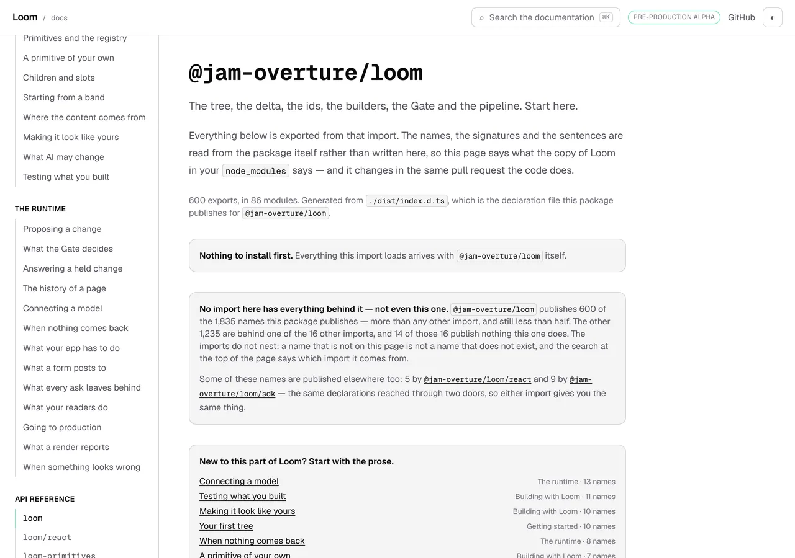
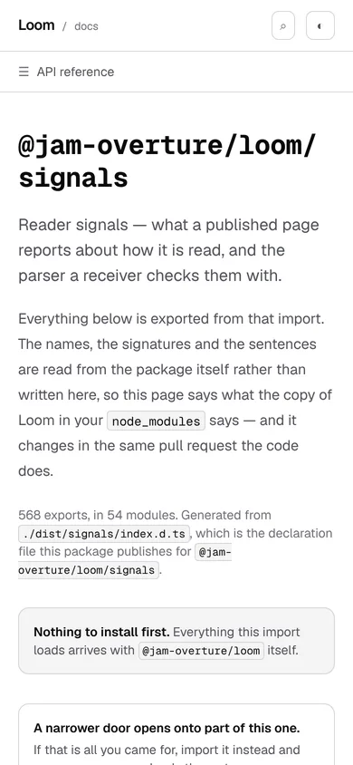

# 1 November 2026 — what a page costs

**Routine:** `Loom docs` · **Branch:** `docs-73-what-a-page-costs` ·
**Section:** §4c

No open pull request from this lane at the start of the run. #731 merged
yesterday at 15:53. Four were open — #742 (`Loom marketing`), #741 (`Loom
signals`), #740 (`Loom daily build`) and #739 (portal) — none of them this
lane's, none touching the `(docs)` route group.

**No maintainer comment is outstanding for this lane.** Every non-bot comment
on the recent pull requests is a routine's own; checked across #720–#742 by
reading each comment that does not open with the mention this lane's procedure
requires.

Branch cut from `origin/main` at `c6b5f52` (#738), after `git fetch origin main`.

## The number nobody had taken

This surface holds **five caps on what the search box sends a reader.** The
largest is 80,000 compressed bytes for the prose of all thirty-five written
pages at once, and the last five units of this lane were each chosen to fit
around it — the 31 October report said so and called it the cost of the cap.

**Nobody had ever asked the same question about a page.**

Measured against a production build in this container, served locally:

| page | HTML | gzipped |
| --- | --- | --- |
| `/docs/api-reference/signals` | **1,914,446** | **308,898** |
| `/docs/api-reference/runtime` | 1,428,536 | 160,113 |
| `/docs/building-with-loom/theming` | 537,630 | 104,795 |
| `/docs` | 35,749 | — |
| *the whole site's search prose, capped at* | — | *80,000* |

**One address sends a reader almost four times the entire search corpus,
compressed, before they have typed anything** — and it had no number on it at
all, while the corpus had five.

## The pair this unit is named after

`api/extract.ts` carries `SIGNATURE_CAP = 6000`, and the reason it gives is a
reader: a declaration that ran to a screen and a half is cut, and the page says
how much it kept. **Nothing capped how many of them go on one page.**

Six symbols in the whole reference are cut by the per-symbol rule.
`/docs/api-reference/signals` renders five hundred and sixty-eight uncut ones.
The page the two rules together permitted is 568 × 6,000 bytes.

*A cap on how long one of them may be, and none on how many.*

## What shipped

**One module and one test.** No page was edited and no prose was added.

- **`weight.ts` — what a page puts in front of a reader, in bytes**, counted off
  the same sources the pages render from. A written page is `readPageProse` plus
  `fencesOnPage`; a generated page is `generatedPageWords` plus the signatures
  in `reference.generated.json`. Both halves are readers the search index
  already uses, so a page that is heavy here is heavy there for the same reason
  and the two cannot drift.
- **Two caps**, `WRITTEN_PAGE_CAP` and `GENERATED_PAGE_CAP`, with the split the
  names cap already settled and the argument for each beside it.
- **`weightFaults`** — pure over its weights and its caps, so the rules can be
  held against pages written here rather than only against whatever shape the
  site is in this week.
- **`weight.test.ts` — 15 tests**, split the way `plain.test.ts` and
  `landing.test.ts` are: the **rule** against the fifty-three real pages, the
  **reader** against weights written in the test to exercise it.

## Where the bytes are, which is not where anybody would guess

| | pages | prose | code | total |
| --- | --- | --- | --- | --- |
| written | 35 | 208,399 | 29,734 | **238,133** |
| generated | 18 | 26,777 | 812,665 | **839,442** |

- **`/docs/api-reference/signals` is 452,513 bytes of text on its own — 1.9
  times all thirty-five written pages put together.**
- **1,924 bytes of it are prose. 450,589 are signatures.** The heaviest page on
  this documentation site is **99.6% a thing nobody here wrote.**
- **It is not that signals publishes the most names.** `runtime` publishes
  **600** symbols to signals' 568 and weighs 135,722 bytes — because its
  declarations average 166 bytes and signals' average 733.

That last row is why the second cap is written the way it is.

## The two caps, and why they are not the same kind of number

**`WRITTEN_PAGE_CAP = 24_000` is this lane's in both directions.** It moves when
somebody writes a long page here, and this surface is the one that would raise
it — which `search/build.test.ts` names as the property that makes a cap worth
having. Today's heaviest is *Where the content comes from* at 19,255, so the
headroom is about three or four more sections on the longest page on the site.
When it fires the question is whether the page is one page, and the site already
has the answer in its own shape.

**`GENERATED_PAGE_CAP = 600_000` is a trigger and nothing else.** It is this
lane's number about another lane's growth, which is the shape three findings in
one day once called out as the problem — so it is written as the names cap was,
with the remedy in the comment rather than a promise to defend the figure:

> When it fires, the answer is not to raise it. It is the answer the search
> index reached twice: cut the page up along the line it grows on. A reference
> page is already fifty-four groups with a heading each, the groups are modules
> rather than an invented grouping, and the browser already knows which group a
> reader is on.

## Decisions taken that were not specified

- **The test holds the page's *text*, not the served HTML.** The honest
  measurement of what a reader downloads needs a build, a server and a request,
  and it moves with Next's hydration payload rather than with anything this
  surface decides — `/docs/api-reference/signals` is 1.9MB of HTML of which
  1.06MB is the flight payload, and no editing here touches that half. What the
  test holds is the text those bytes are made of: the part this lane writes,
  build-free, moving in the same direction for the same reasons. The HTML
  figures are in this report, measured, and not in a test.
- **A generated page's code is read from the reference rather than from the
  walk that reads its prose.** `rendered.ts` elides `<pre>` and `<code>`
  deliberately — a reader searching *import* wants prose about importing, not
  every block that begins with the keyword. Right for an index, wrong for a
  scale, so the two halves come from the two places that have them.
- **`parts` is reported in a fault** — blocks on a written page, symbols on a
  generated one. The remedy depends on which: a page with forty blocks is a
  page somebody wrote long, and a page with 568 symbols is a page that was never
  cut up.
- **The cap is inclusive and the fault is the byte after it**, with a test at the
  boundary, because the two spellings differ by one character and the wrong one
  fires on a page nothing is wrong with.
- **No page was edited.** This unit adds nothing to the prose index, which is
  honest to state rather than quietly convenient — see *Needs your input*.

## Records

None added, none superseded. Nothing here touches the tree schema, the delta
model or an `Accepted` record, and nothing is escalated as `ARCHITECTURAL`.

## Cross-lane diff

**None.** Every file changed is inside `apps/loom/app/(docs)/`, plus
`FINDINGS.md`, this report and its pictures. Nothing in `src/`, nothing in
another surface's route group, and no primitive was wanted that does not exist.

## Findings

**Three filed, one closed on filing.**

- **Filed and closed on filing:** *there is a cap on how long one signature may
  be and none on how many go on a page* — the unit above, with both tables.
- **Filed, open:** *`weight.ts` counts bytes rather than characters and nothing
  would notice if it stopped.* The seventh mutation this run replaced
  `TextEncoder` with `.length` and **all fifteen tests passed**; the numbers move
  0.2–0.8%. Recorded with the measurement and a recommendation to leave it,
  because no cap here sits within 1% of its number by design.
- **Filed, open, and it is a correction to somebody else's entry:** *the demo
  removal lists a `(docs)` row that points at a fictional origin, and the one
  real row must come after the deletion rather than before it.* The 31 October
  entry has this lane blocking `Loom demo`. It is not. Details below.

### The demo row, checked rather than done

The 31 October entry lists two `(docs)` files under *order matters*. Both halves
are wrong, in opposite directions, and the useful output was the corrected order
rather than an edit:

- **`reporting/catalogue.ts` is not a prerequisite.** Its `/demo` is
  `${SELF_ORIGIN}/demo` where `SELF_ORIGIN` is `"https://loom.example"` — a
  made-up origin the bench uses to demonstrate *a frame from your own origin,
  whose sandbox grants it nothing*. It has never pointed at this deployment and
  cannot 404 for a reader.
- **`surfaces.ts` must come *after* the deletion, not before.**
  `surfaces.test.ts` derives the expected list from `readdirSync(apps/loom/app/)`
  on every run, so removing `/demo` from `OTHER_SURFACES` while `app/(demo)/`
  still exists turns this lane's suite red — and that suite is the merge gate for
  four surfaces.

**So `Loom demo` is not waiting on this lane.** Nothing was edited, and the
reason is in the finding.

### Standing entries this run met again and did not duplicate

- **`*.vercel.app` is denied by the environment's egress policy** (12 October,
  open). Every picture below was taken against a build in this container.
- **The composed preview URL** (16 October). The URL below is taken from the
  `vercel[bot]` comment rather than guessed from the branch name.
- **The commit author line** (23 October). Checked with `git config user.email`
  before the first commit.
- **Mutation testing before the first commit** (27 October). Followed: the unit
  was committed as `0ffc592` before the first mutation, and every restore was
  `git restore --source=HEAD -- .`.
- **A screenshot taken while the merge gate is running turns the gate red**
  (29 October, this lane's own). Followed: every picture was taken and shrunk,
  and `FINDINGS.md` and this report were written, **before** the gate was
  started.
- **`pnpm reports:shrink` reads the git index** (30 October, open, owned by
  `Loom daily build`). Worked around as that entry describes: the four PNGs were
  `git add`ed before `reports:shrink` ran.
- **Never let anything run after the gate on the same line**
  (`docs/routines.md`). Followed — the status was written to a file as the last
  thing on its line and read in a separate command.

## Test numbers

`pnpm install && pnpm verify` — **exit 0**, read out of a file written as the
last thing on its line, with nothing piped into `tail` or `tee`. The numbers are
transcribed in *The gate* at the foot of this report.

**Fifteen tests are new**, all in `weight.test.ts`. No existing test was edited,
weakened or removed.

### The search index

**Unchanged to the byte.** No page was edited, so there was nothing for the
index to read differently. The prose index stands at 79,661 gzipped against its
cap of 80,000, exactly as on `main`.

### Seven mutations, six killed

Each applied on its own against the branch's committed code, restored with
`git restore --source=HEAD -- .`, with the suite re-run between.

| what was put in | what failed |
| --- | --- |
| **`WRITTEN_PAGE_CAP` lowered to 19,000**, just under the heaviest written page | the rule, naming *Where the content comes from* and both its halves — and the headroom check |
| **a generated page weighing its prose only**, the signatures dropped | three: the single-signature pair, the prose/code shape, and the comparison with the search corpus |
| **each kind held to the other kind's cap** | seven, including the site rule — the two caps differ by a factor of twenty-five |
| **the generated half left out of `docsPageWeights`** | four, led by *weighs every page the rail carries, once each* |
| **`heaviestPage` ignoring the kind it was asked for** | the headroom check — the written cap measured against the signals page |
| **the fault firing at the cap rather than past it** | the boundary test, and only that one, which is what it is for |
| **`bytes()` counting characters instead of bytes** | **nothing.** All fifteen passed. Filed, with the three numbers it moves |

## The pictures

Taken with `pnpm shoot` against a production build in this container. Every
viewport measured no overflow: `scrollWidth 1280 / innerWidth 1280` at wide and
`390 / 390` on the phone.

### The page this unit is about

`/docs/api-reference/signals`. **The page says the number itself** — *568
exports, in 54 modules* — twelve lines below the heading. What it does not say
is that the five hundred and sixty-eight signatures below the fold are
**452,513 bytes of text, 1,914,446 bytes of HTML and 308,898 compressed**, which
is almost four times what the search box is allowed to send for the whole site.

Nothing on this branch changes a pixel of it. The change is that the number now
exists and has a cap over it.

### Six hundred symbols that weigh a third as much

`/docs/api-reference/runtime` — **600 published symbols to signals' 568, and
135,722 bytes of text against 452,513.** The same page, the same bands, three
times lighter, because a `runtime` declaration averages 166 bytes and a
`signals` declaration averages 733.

This is the picture that decides the shape of the second cap. The page is not
heavy because the reference is written badly; it is heavy because of
declarations written in another lane, which is why the number is a trigger with
a remedy rather than a figure this lane promises to defend.

### The heaviest page somebody actually wrote

*Where the content comes from*, at **19,255 bytes** — the largest written page on
the site, and **one twenty-third of the signals page**. The written cap sits at
24,000, a quarter of a page above it.

### The same reference page on a phone

`scrollWidth 390 / innerWidth 390`. The layout holds. **The 308,898 compressed
bytes arrive over whatever connection the phone has**, which is the reader this
cap is ultimately about.

## Needs your input

**One question, and it is now the seventh run it has ended one of these — but
it is a smaller question than it was this morning.**

**Should a browser be sent the whole site's prose?** The prose search index is
at **79,661 gzipped bytes against a cap of 80,000** — 339 bytes, about one short
paragraph. Unchanged by this branch, to the byte, because no page was edited.

**This is the sixth consecutive unit chosen to fit around that number**, and I
said last run that was the cost of the cap. It still is. What changed today is
that I now think the cap is also **measuring the wrong thing**, and that is
worth your minute because it makes the question cheaper rather than larger:

- The search box is held to **80,000 compressed bytes for the whole site.**
- `/docs/api-reference/signals` sends **308,898 compressed bytes down one
  address**, and until this branch nothing anywhere said so.

So this lane has spent six units protecting a reader's connection from the
search box while a single page spent four times as much, unmeasured. Both
numbers now exist, which is the part I could do without asking.

**My recommendation is unchanged and is now cheaper to act on: the search box
should stop holding every section it has fetched — it already knows which page
the reader is on.** I have still not built it, for the reason I gave last time:
every version changes what the box **promises**, which today is *"Every page and
every section are searched"*, and that is a decision about what the search box
*is*. If you say yes, the unit after it redefines the cap honestly — what a
reader receives **on open**, rather than the corpus total.

**And one new question, which I would rather you answered than guessed at.**
`GENERATED_PAGE_CAP` is set at 600,000 against today's 452,513. When it fires
the remedy in the comment is *shard the reference page by its fifty-four
groups*. That changes sixteen addresses into something closer to a hundred, and
a reader's link to `/docs/api-reference/signals#s-windowAssemblyOf` has to keep
working. **Recommendation: do it when it fires and not before**, because the
sharding is cheap and the address scheme is the expensive part, and nothing is
served by designing it against a number that has not arrived. If you would
rather it never fires — that is, the reference pages get cut up now — say so and
it becomes the next unit.

Two standing questions, neither new, neither blocking: whether a list-shaped
export may be given a list-shaped presentation (22 October), and whether a
produced table on this site should be composed from the library rather than
arranged locally (#709).

## The gate

`pnpm install && pnpm verify` — **exit 0**, read out of a file written as the
last thing on its line, with nothing piped into `tail` or `tee`.

- framework: **247 files, 5,984 tests passed**
- application: **374 files, 6,079 tests passed**, of which **141 files and
  2,127 tests** are `(docs)`
- `findings:check`: 1,384 findings, 0 malformed
- `reports:check`: 2,039 visuals, 145.1MB, none over 1.1MB, 411 cited by no file
- `prerender:check`: **137 prerendered pages**, 1,945 text junctions, 0 run
  together; 3 metadata conventions, 0 unserved

Nothing failed, nothing was skipped, and no test was weakened.

## The preview

*Filled in from the `vercel[bot]` comment after the pull request was opened, not
composed from the branch name.*
