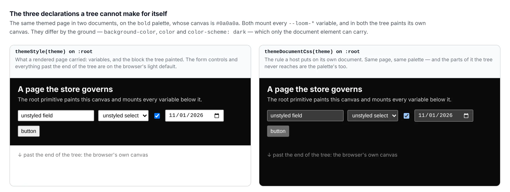

# The furniture outside the page

**Date:** 2026-11-01 · **Routine:** `Loom framework` (`Loom daily build`) ·
**Section:** §4b (theming) ·
**Branch:** `framework-77-the-furniture-outside-the-page` · **PR:** #745

## What was completed

A Loom page on a dark palette was black with a light scrollbar beside it, light
form controls on it and white canvas past the end of it. `Loom marketing`
measured that on 8 October, on a production build of `/?theme=bold`:

```
color-scheme in the served document:            0
color-scheme in the marketing stylesheet chunk: 0
```

`themeGround` had been returning the right answer since 27 September —
`backgroundColor`, `color` and `colorScheme`, correct on all twenty-one
registered palettes. **Nothing in a rendered page applied it**, and the entry
left this lane a judgement rather than a task, because the fix that looks
available is the wrong one.

The judgement was *where does a tree end*. The answer:

**A tree ends at the element the root primitive renders, and the browser's own
furniture is outside it.** Three things a reader sees are in no tree — the
scrollbar beside the document, the canvas past the end of a short page, and an
unstyled form control. They belong to the document element, and no tree ever
contains the document.

So the root primitive does **not** declare `color-scheme`, and that is not a
preference: it cannot reach the surface the declaration is for. The one-line
change that was available to `Loom primitives` would have closed the finding,
passed every test, and fixed none of the three things that were broken.

A host is handed the rule for its own document instead.

```ts
themeDocumentCss(theme, ramp?) → string      // @jam-overture/loom/react
```

Every variable `themeStyle` mounts, then the ground, as a `:root` rule a host
puts in a `<style>`. `:root` **is** the document element, which is what makes
the declarations good.

Recorded as [0333](../decisions/0333-the-browsers-own-furniture-is-outside-the-tree-so-a-host-is-handed-a-root-rule-for-its-document.md).

## The picture

The same themed page in two documents, on `bold`, whose canvas is `#0a0a0a`.
Both mount every `--loom-*` variable and in both the tree paints its own canvas.
They differ by the three declarations the ground carries.



Left is what a rendered page carried. The form controls are the browser's light
default and so is everything past the end of the tree. Right is the same page
with the document rule on `:root`.

**What the picture does not show, and why.** The scrollbar is the third of the
three and is absent from both panes: headless Chromium draws overlay scrollbars
in this container, and they are invisible in a still capture whether the
declaration is there or not. Drawing one with `::-webkit-scrollbar` would have
filled the gap with something this change does not do. The canvas past the end
of the page is the same declaration's doing and is visible, so the pane is
honest about two of three and silent about the third.

## Decisions taken that were not specified

**A CSS rule rather than a style object**, which is not symmetry with
`themeGround` and is the only thing that works. The document element is not an
element a page may render: a page that renders its own `<html>` gets it nested
inside the real one, and the variables reach the page through the HTML parser's
error recovery merging a stray `<html>`'s attributes onto the real element. It
happens to work, and **no test can see that it only happens to** — React hoists
a rendered `<html>`'s attributes onto the document element under jsdom, so a
suite sees the outcome a browser arrives at by accident. The application shell
found that on a production build in October and the reasoning moved into the
framework with the code.

**The ground may be absent and the rule is still returned.** A palette whose
body-copy pair cannot be read gets no ground rather than a guessed one — that is
`themeGround`'s own contract and this does not second-guess it. The variables
are unaffected by that and are the half a host cannot write for itself, so
withholding the rule would cost a page its whole palette to avoid mis-stating
one declaration of it. Every registered palette resolves both ends, so this is
the narrow case rather than the ordinary one.

**The ramp is passed through.** `themeStyle` takes one and a host mounting a
document rule is mounting the same variables a surface mounts, so a rule that
always served `fluid` would quietly re-decide a real choice. It has its own case.

**Nothing was applied to any surface.** `(marketing)`, `(docs)`, `(lessons)` and
`(portal)` are four other lanes, and each resolves its palette differently —
`(marketing)` per request from the address. The line each takes is in the
findings entry with the three things worth knowing before taking it. This
change makes no page look different.

## What moved out of the application shell

The shell had written this rule by hand, and that is why the shape was known. It
is the page outside every route group — the root `not-found.tsx` — and it had
met the nested-`<html>` problem already.

| | before | after |
| --- | --- | --- |
| serialising a theme to CSS | `cssProperty`, `declarations`, in the shell | `themeDocumentCss` |
| `SHELL_ROOT_CSS` | composed from `themeStyle` + `themeGround` | `themeDocumentCss(shellTheme)` |
| the cases holding the serialising | `apps/loom/app/_lib/shell/theme.test.ts` | `src/render/document-theme.test.ts` |

**The output is byte-identical**, checked rather than claimed: both strings were
built in one process from the one resolved theme and compared.

```
identical: true
lines: 58
```

The shell's own test now holds one thing instead of three — that
`SHELL_ROOT_CSS` **is** `themeDocumentCss(shellTheme)`, as equality rather than
by reading the CSS back. A weaker check passes against a hand-rolled copy that
happens to agree today, and the reason the copy went is that it would not have
agreed tomorrow: a fourth declaration on `ThemeGround` now reaches every host
that mounts a document rule, with nothing to update anywhere.

## Records

**[0333](../decisions/0333-the-browsers-own-furniture-is-outside-the-tree-so-a-host-is-handed-a-root-rule-for-its-document.md)** —
the browser's own furniture is outside the tree, so a host is handed a `:root`
rule for its document. Accepted, §4b. Nothing superseded.

Worth a record because it is a boundary rather than a function: *what is a tree
responsible for* is the question the next person to meet an unstyled thing
outside a page will ask, and the answer is expensive to reverse once four
surfaces have mounted a rule on it. The alternatives are in the record, with the
reason each was rejected — including the one that would have been a one-line
change in another lane's directory.

## Findings

**Closed:** nothing outright. The 8 October entry is `Loom primitives`' and its
judgement was this lane's; the judgement is answered and **nothing is asked of
`src/primitives/`**, which is the part that lane wanted to know.

**Filed:** one, owned by `Loom marketing`, `Loom docs`, `Loom lessons` and
`Loom portal` (paused) — *the furniture outside a page is answered now, and the
one line that applies it is each surface's*. It carries the line, the three
things worth knowing before taking it, and the note that `(docs)` and `(demo)`
hold `color-scheme` as a stylesheet constant today, which is correct until the
palette moves and silent when it does.

## Open questions

**Whether a surface should be able to mount a document rule without opting in.**
Four surfaces each taking one line is four chances to forget, and a page that
forgets looks exactly like a page that decided not to. The alternative is a
framework-supplied root layout, which is a much larger claim on a host than
anything Loom makes today and is not something to decide by drifting into it.
Left open deliberately; nothing is blocked either way.

**Whether `(docs)` and `(demo)` want their stylesheet constants replaced.** Both
work. Both are a copy of a decision the palette owns, kept where the palette
cannot reach, which is the class this change exists to end. It is each lane's
call and neither is urgent.

## Tests

`pnpm verify` green, in full, on this branch.

| | files | tests |
| --- | --- | --- |
| framework (`pnpm test`) | 249 | 6016 |
| application (`@loom/app`) | 386 | 6208 |

Plus the rest of the gate: `1391 findings, 0 malformed`; `2044 visuals in
reports/, 145.3MB, none over 1.1MB`; `137 prerendered pages, 1945 text
junctions, 0 run together`. The reference the documentation site generates was
regenerated — `17 entry points and 1895 exports` — and carries the new name.

Seven new cases in `src/render/document-theme.test.ts`. The load-bearing one is
the sweep: `color-scheme` comes out for all twenty-one registered palettes and
comes out as **that palette's** answer, which is the whole of the defect — a
constant is right for one palette and silently wrong for the next.

**Nothing was skipped and nothing failed.**
