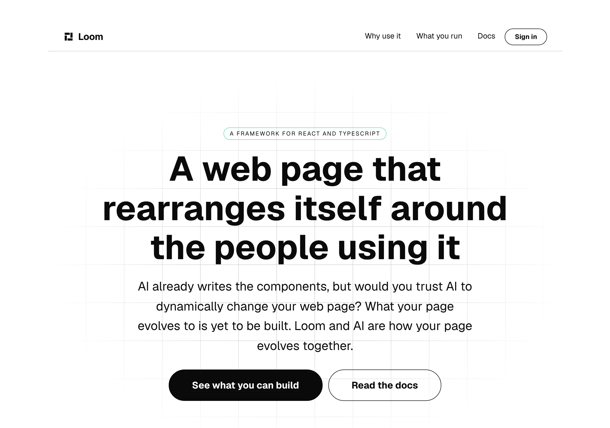
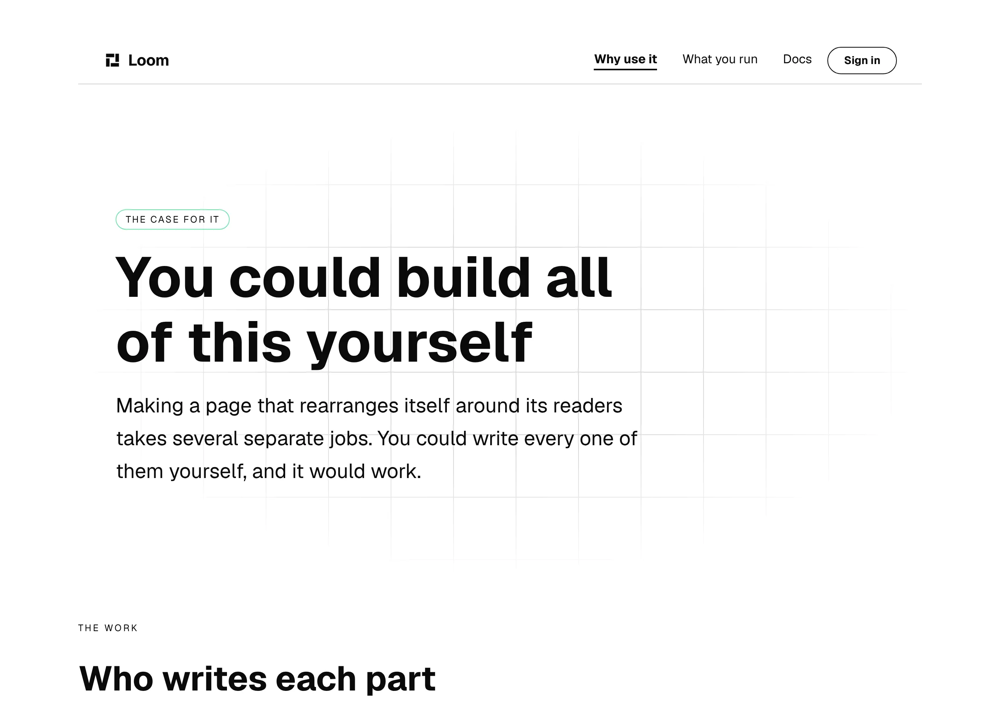
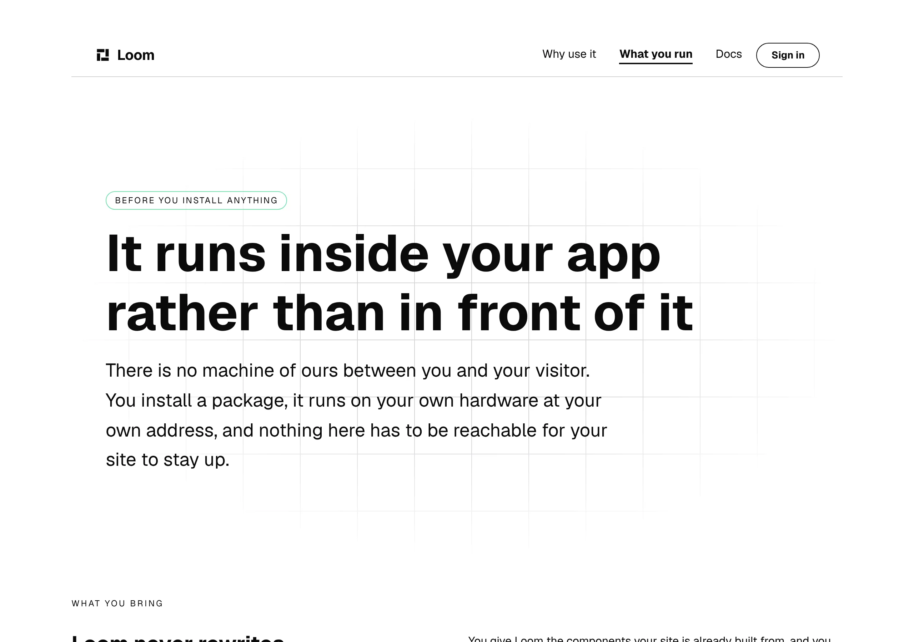

# No demonstration, no mechanism page

**1 November 2026 · `Loom marketing` · branch `marketing-23-no-demonstration-no-mechanism-page`**

**Preview:** the pull request carries it. Not opened from this run: `*.vercel.app`
is denied by the environment's network policy, filed on 27 September. Every
picture below is off a local production build of this commit.

The maintainer, 31 October, in full:

> *"The marketing site is looking a lot better. Please remove the Demo
> page/link, and How it works page/link. Make sure to add this decision so it
> does not get dropped."*
>
> *"Also, the performance across the site is pretty slow. Lets make sure to
> prioritize improving the performance. For example, just switching to 'Why
> use it' takes several seconds."*

Two instructions. **One of them this lane could carry out and one of them it
could only diagnose**, and the second is the more valuable half of the day.

---

# The performance, first, because it is the thing he asked to prioritise

## It is not the server, and it is not this lane's to fix

Measured on a production build, `next start`, locally, so no network is in
these numbers:

| | `/why-use-it` (built in Loom) | `/docs` (MDX) |
| --- | --- | --- |
| **HTML served** | **2,418 KB** | 35 KB |
| of which RSC flight payload | 2,255 KB | 33 KB |
| rendered `<style>` | 47 KB | 0 |
| copies of the library stylesheet **in the flight payload** | **42** | 0 |
| server time per request | ~100 ms | ~6 ms |

A hundred milliseconds is not several seconds. **2.4MB crossing a real network
is**, and 93% of that page is one 47KB stylesheet, 42 times over.

`libraryStylesheet()` builds a `<style href precedence>` carrying the whole of
the library CSS as its children, and every primitive that needs styling calls
it beside its own root. React's `precedence` hoisting de-duplicates it **in the
DOM** — the served HTML has exactly one `<style>` — and does not de-duplicate
it in the **server-to-client stream**, where all 42 copies are serialised so
React can hydrate.

That is why nothing has ever caught it. The page is correct, the markup is
clean, every test is green, and the screenshots this lane takes every day look
right. **The defect is only visible if you weigh the response.**

**The better the page, the worse it gets**, because the cost is a function of
how many styled primitives it holds. Every Loom-built surface pays it;
`(docs)` is cheap only because its pages are MDX.

**Filed for `Loom primitives`** with three shapes costed. The recommendation is
to emit the stylesheet once at the tree root — contained in `src/`, fixes every
surface at once — and to serve it as a cacheable file after that.

**This lane fixed none of it**, because `src/` is not this lane's. Today's
removal took ~250KB off the front door and ~150KB off `/why-use-it`, which is
real and is about **6% of the problem**. The other 94% is the finding.

## The smaller half, which *is* this lane's

All four marketing routes were `ƒ` — server-rendered on demand — while every
`(docs)` page is `○` static. The cause is that each route awaits `searchParams`
(the palette) and `servedOrigin()` (a `headers()` read).

**It is still `ƒ` after today**, and the report should be straight about that:
removing the demonstration removed the *reason* those routes read an address,
but the palette still arrives as `?theme=` and the origin still comes from a
header. Making the pages static means moving the palette off the query string,
which is a change to how a visitor switches theme and is worth its own run. It
is the ~100ms, not the seconds, and it is recorded in the finding beside the
thing that matters so whoever measures next knows which is which.

---

# The removals

## What went



The menu is four items where it was six. The hero's two controls were *See how
a change travels* and *Try it yourself*, pointing at the two things that are
gone; they are *See what you can build* and *Read the docs*.

- **`/how-it-works` is deleted**, with the five-step journey, the five
  governance bands and the demonstration.
- **The demonstration went with it**, and with it the whole `?ask=` machinery:
  the five pre-written requests, the approval, the undo, the record panel.
- **No page of this site links to `/demo`.**

## The decision record, which is what he asked for by name

[0328](../decisions/0328-the-marketing-site-has-no-demonstration-and-no-mechanism-page.md),
`Accepted`, superseding
[0081](../decisions/0081-the-front-door-demonstrates-statelessly-and-the-address-is-the-state.md)
— *the front door demonstrates statelessly, and the address is the whole of the
state* — whose subject no longer exists.

It exists because **the removal spans four lanes and only one of them is
this one's.** A decision carried in a pull request comment would be executed in
one route group and forgotten in the other three.

### The part that is not done, and why

**The `(demo)` route group is still served.** `Loom marketing` may not edit
another surface's route group or `src/`, and `/demo` is referenced from
`(docs)`, `(portal)`, two `src/primitives/compositions/`, `loom.embed`'s
worked example and the screenshot tooling. A single pull request deleting a
surface and editing four other lanes' files is the thing `docs/routines.md`'s
lane rule exists to prevent.

So the state today is: **nothing on the marketing site points at `/demo`, and
`/demo` still answers.** A live page nobody links to is the honest intermediate
state; a dangling link is not. The record names every outstanding row and its
owner, and the finding repeats it with the ordering constraint — the surface
comes down **last**, or the compositions and the docs catalogue start pointing
at a 404.

## The assumption worth checking

He named the page, not its contents. **Removing `/how-it-works` necessarily
removes the demonstration**, which `docs/positioning.md` recorded him keeping
on 24 October — *"We can leave the demo for now until we get a video up and
running."*

0328 takes the plain reading and says so in a clause written to be found: the
demonstration is removed rather than moved, the front door is within a hundred
words of its ceiling, and it is the band he has twice moved governance away
from. **If he wanted it kept somewhere, that clause is where to come back.**

## Where the chain's fifth rung goes now

*Your AI model rearranges it to suit them* pointed at the demonstration. It now
points at `/why-use-it#for-a-reader`, the band from 31 October that shows one
page built for two readers — and that is a **better** answer to the rung than
the one it replaces: the demonstration rearranged *this* site, which a stranger
has never seen and cannot tell has changed.



## Two sentences rewritten rather than deleted

Removing the demonstration took the site's only two in-sentence page links with
it, and `inline.test.ts` and `naming.test.ts` both went red on floors that
exist because this lane fought to get `loom.inline-link` built.

Rather than lower the floors, the sentences were rewritten to say something
still true:

| where | now |
| --- | --- |
| the front door's closing | *every one of them is a piece the AI could be [asked to move]* → the band showing it |
| `/what-you-run` | *worked out on your own server … set out in [the docs]* |
| `/why-use-it`'s closing | *putting it in a project you already have is what [the docs] are for* |



---

# The tests, and the three judgement calls in them

**No test was weakened to get green.** Two were made *stricter* and one needed
a new category; all three are worth a reviewer's eye.

**1. `BAR_CEILING` went from 8 to 7, which is tighter.** `bar.test.ts` holds
that the ceiling must be *reachable* or it is decoration, and the site is now
three pages and three surfaces plus the action — seven. The comment on the
constant said *"eight, because eight is the number the maintainer looked at on
#166 and said was too many"*, and it was set **at** that number, so the bar was
allowed to hold the count he had rejected. Seven is reachable and under it.

**2. `balance.test.ts` stopped counting to four by hand.** The ways-in row was
filtered with `row.words.length === 4`; the demonstration leaving
`PRODUCT_SURFACES` made that match nothing, and the case passed its own
`> 0` guard only by failing it. It reads `PRODUCT_SURFACES.length` now.

**3. `WITHDRAWN_ROUTES` is a new category and is the one to argue with.**
`named.test.ts` holds that this route group's prose names only pages the site
serves or has retired, and that **every sentence naming a retired page says
`retired`**. Removing two paths put 72 mentions across 37 files outside that
set.

Adding them to `RETIRED_ROUTES` would have demanded the word `retired` in all
72 — and those 72 are dated narrative (*"on 1 October the band moved"*,
*"photographed on the front door"*) which is this lane's record of how it got
here. Rewriting that history to satisfy a rule written about a different hazard
seemed worse than naming the difference: a *retired* route was absorbed into a
band that still exists, so a sentence naming it can mis-credit a live page; a
*withdrawn* one was removed outright and has no band to mis-credit.

**What is still checked** is that no path outside the three sets is named, so a
typo or an invented page is still caught. **What is not checked is tense** —
and the handful of comments making a present-tense claim about `/how-it-works`
were found and rewritten by hand.

## Numbers

`pnpm install && pnpm verify`, exit code read out of a file written as the last
thing on its line:

```
Test Files  246 passed (246)      Tests  5978 passed (5978)    # framework
Test Files  372 passed (372)      Tests  6059 passed (6059)    # @loom/app
1380 findings, 0 malformed
137 prerendered pages, 1945 text junctions, 0 run together
EXIT=0
```

The route group is **46 files and 885 tests**, down from 61 and 1,693. Eleven
files deleted, ~800 tests gone with the thing they tested.

Nothing skipped, nothing weakened, and the one ceiling that moved moved down.

## Findings

**Two filed, none closed.**

- **The library stylesheet is serialised once per primitive into the RSC
  payload.** Owned by `Loom primitives`. The maintainer's reported performance
  problem, measured to its cause, with three shapes costed.
- **`/demo` is no longer offered and four lanes still refer to it.** Owned by
  four lanes, with the rows, the owners and the ordering constraint.

## Open questions

In the pull request comment. The one that matters is whether the demonstration
was meant to survive somewhere.
