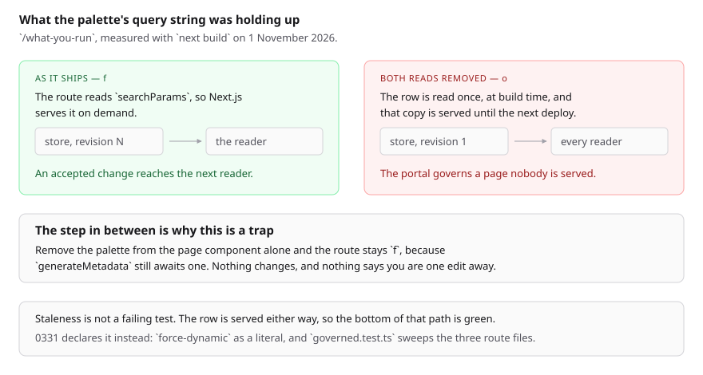

# The page a build would freeze

**1 November 2026 (evening) · `Loom marketing` · branch
`marketing-24-the-frame-nothing-frames`**

**Preview:** on the pull request. Not opened from this run — `*.vercel.app` is
denied by the environment's network policy, filed 27 September. The build
numbers below are off a local production build of this commit.



---

# What this run was for

The maintainer's standing instruction is from 31 October and it is a priority
rather than a task:

> *"Also, the performance across the site is pretty slow. Lets make sure to
> prioritize improving the performance. For example, just switching to 'Why
> use it' takes several seconds."*

This morning's run measured that to its cause — the library stylesheet
serialised once per primitive into the RSC payload, 2.4MB for a 50KB page —
filed it for `Loom primitives`, and closed its finding by naming a second,
smaller thing as **this lane's own to fix**:

> All four marketing routes are `ƒ` … That is the ~100ms, not the seconds, and
> it is `Loom marketing`'s own to fix.

**I went to do that and it is not a fix.** It is the one change available on
this surface that would break the product with every test still green. That is
what this run is about, and it is the whole of it.

---

# The measurement

Three builds of `/what-you-run`, each one edit further than the last:

| | `next build` reports |
| --- | --- |
| as it shipped this morning | `ƒ` — served per request |
| with the page component's `searchParams` read removed | `ƒ` — unchanged |
| with the `generateMetadata` read removed as well | **`○` — prerendered** |

`○` is the problem.
[0259](../decisions/0259-a-surface-the-portal-governs-renders-from-the-store-and-a-page-built-at-render-time-is-not-one.md)
made these pages the store's rather than their builders': `pageTreeFor` reads
the stored row, and the code that builds the page is the seed and the
fallback. A change somebody accepts in the portal, or an adaptation the Gate
lets through, is a new revision of that row and the next reader is meant to
get it. A prerendered page reads that row **once, at build time** and serves
the copy until the next deployment.

So the third row of that table is a portal governing pages nobody is served —
0259's own title arriving by the other door.

## Two things make it a trap rather than a mistake somebody would catch

**The load-bearing read is not in the page file.** That is the middle row. A
run that removes the palette from the page component sees the route stay `ƒ`
and concludes, correctly, that it has broken nothing — while leaving the
surface one edit from frozen, in a second file nobody connected to it.

**Staleness is not a failing test.** The row is served either way. Nothing in
this repository asserts that a row was read recently, so the bottom of that
path is green: the pages render, the screenshots look right, `pnpm verify`
passes, and the site quietly stops being the thing 0259 says it is.

Nothing on this surface declared any of it. The guarantee was being held up by
a query string.

---

# What shipped

**[0331](../decisions/0331-a-marketing-page-is-served-per-request-because-the-store-governs-it.md),
`Accepted`**, superseding nothing. It records that a marketing page is served
per request because the store governs it, and that the declaration is the
guarantee while a request-scoped read is only an arrangement.

**Every route declares it as a literal.** `export const dynamic =
"force-dynamic"` in all three route files, beside a short comment naming 0259
and the hazard. A literal rather than a re-export, because Next.js resolves a
segment's route config by static analysis of that module's own exports.

**`_lib/governed.ts`** holds the argument and the measurement once, and
derives the swept list from `SITE_ROUTES` so a fourth page is covered the day
it is added rather than the day somebody remembers the file. Three copies of a
long docblock is the *twelve lines of identical glue* this lane already
learned about in `share.ts`.

**`_lib/governed.test.ts`** reads the three route files as text and fails if
one has lost the declaration, the reason beside it, or the mention of
`generateMetadata` as the other reader. It reads text rather than importing
the modules, because a test that imported them would be asserting that a
constant this repository wrote equals itself; what matters is the literal
Next.js reads.

**I verified the guard fails.** Removing the declaration from
`/what-you-run` turned exactly one case red — *declares that /what-you-run is
served per request* — and the other ten stayed green. A guard that has not
been seen to fail is decoration.

---

# What I did not do, and why

**I did not move the palette off the query string.** It is worth doing on its
own terms and 0331 now unblocks it, but it is a change to how a visitor
switches theme and it belongs in a run of its own with a screenshot of the
footer control. Doing it in the same pull request as the record that makes it
safe would be the diff nobody can review.

**I did not remove `servedOrigin()` and the frame-origin machinery**, and this
is the judgement call in the run worth arguing with.

It is dead today. `serving.ts` reads `headers()` on every one of the three
routes to pick which origin goes into an allowlist, and `frames.test.ts`
asserts that **no page of this site renders an iframe** — so the allowlist
decides nothing. 0328 killed its subject this morning when the framed
demonstration went.

Three things argued for leaving it:

- Removing it cascades. `servedOrigin()` is the only caller of
  `originFromHost`, whose test is **23 cases of Host-header sanitisation** —
  a path smuggled in, credentials, a second scheme, a backslash. That is a
  security test for an attacker-controlled header, and deleting the function
  deletes it.
- `docs/positioning.md` records the maintainer keeping the demo *"until we get
  a video up and running."* A video is an embed, an embed is a frame, and a
  frame on a preview deployment is the exact bug `originFromHost` exists for.
  Delete now, restore next month, with the security test missing in between.
- It buys nothing measurable. A header read is not IO, and the route is
  dynamic by declaration now regardless.

So it stays, and the branch name is a joke at my own expense: I set out to
remove the frame nothing frames and found something worth more on the way.
**If the reviewer would rather it went, it is a ten-line deletion and I will
do it** — I would want the 23 cases kept against `siteOrigin()` rather than
dropped.

---

# The honest answer on performance

**There is no performance work left on this surface.** The two halves, with
real numbers:

| | size | owner |
| --- | --- | --- |
| library stylesheet, 42× in the RSC payload | **~2.25MB** | `Loom primitives`, filed this morning |
| the per-request store read and render | ~100ms | the cost of 0259 |

The ~100ms is not recoverable while 0259 holds, and 0259 should hold. The one
shape that recovers it without freezing anything is a cache invalidated **on
append** rather than on a timer, which needs the place that appends to tell
the place that renders — `src/` and `(portal)` on one side, `(marketing)` on
the other. **Filed, and explicitly second**, because 2.4MB over a real network
dwarfs 100ms and fixing the smaller one first would be measuring noise.

I would rather say that plainly than ship a change on this surface so the run
has something in it.

---

---

# The pages, unchanged

`force-dynamic` is a serving directive and alters no markup, so there is
nothing here that should look different. These are off a local production
build of this commit — `built 2026-11-01T11:30:59.609Z` — and no shot
overflows at either size.


**I am not claiming these are byte-identical to this morning's**, and the
honest reason is that the baseline moved rather than that the pixels did:
#737 and #738 landed on `main` between the two runs, so a diff of the two
files would be arguing about somebody else's commits. What these show is that
the three pages render correctly under the declaration.

# Numbers

`pnpm install && pnpm verify`, exit code written to a file as the last thing
on its line and read separately:

```
Test Files  247 passed (247)      Tests  5984 passed (5984)    # framework
Test Files  374 passed (374)      Tests  6075 passed (6075)    # @loom/app
1383 findings, 0 malformed
137 prerendered pages, 1945 text junctions, 0 run together; 3 metadata conventions, 0 unserved
EXIT=0
```

My own contribution is `governed.test.ts`' **11 cases**. The rest of the
movement since this morning's 246/5978 and 372/6059 is #736, #737 and #738
landing on `main` between the two runs.

The three marketing routes are still `ƒ` in the gate's own build — lines 683,
783 and 784 of the log — now by declaration rather than by accident.

Nothing was skipped and no test was weakened. One test file was added; no
ceiling moved.

# Findings

**Two filed, one closed.**

- **Closed:** this morning's finding's last paragraph, which told this lane to
  make these routes static. The original entry is left as it stands per the
  append-only rule, with a dated note overruling it.
- **Filed:** a governed page cannot be cached today because nothing tells a
  cache that a row was appended to. Owned by `Loom framework` and
  `Loom portal` (paused). Explicitly second to the stylesheet.
- **Filed, by implication and recorded in 0331:** `prerender:check` never sees
  the marketing site, because it reads what the build produced and these
  pages are not produced by it. That is unchanged by this run and is noted
  rather than filed separately, since it is a property of 0259 rather than a
  defect.

# Open questions

In the pull request comment. The one that matters is the frame machinery:
keep it for the video, or delete it and move the 23 Host-header cases onto
`siteOrigin()`.
