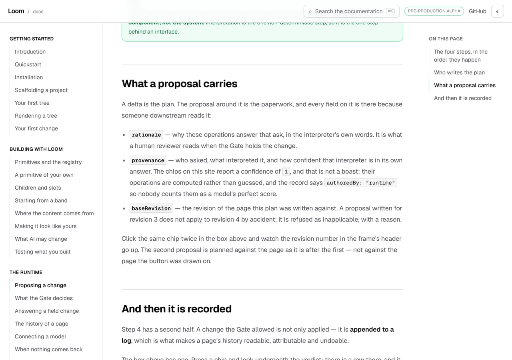
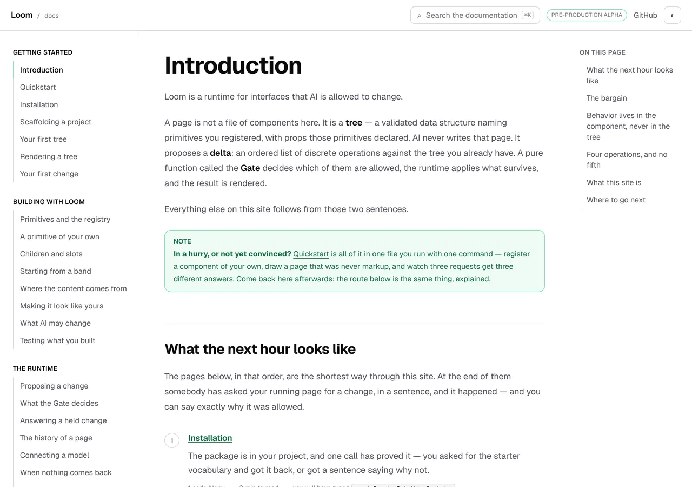
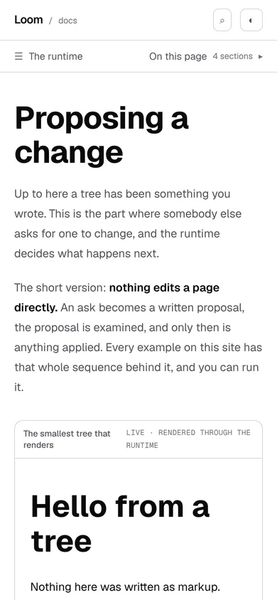

# 2 November 2026 — a field is not an export

**Routine:** `Loom docs` · **Branch:** `docs-74-a-field-is-not-an-export` ·
**Section:** §4c

No open pull request from this lane at the start of the run. #743 merged
yesterday afternoon as `83fb7a5`. Three were open — #749 (`Loom marketing`),
#748 (`Loom signals`) and #747 (`Loom daily build`) — none of them this lane's,
none touching the `(docs)` route group.

**No maintainer comment is outstanding for this lane.** Every non-bot comment on
#730–#749 opens with the mention this lane's procedure requires, which makes it
a routine's own; checked by reading each comment that does not.

Branch cut from `origin/main` at `749e4c1` (#745), after `git fetch origin main`.

## The brief's own example, and what the rule could see of it

The direction this surface is held to says the failure plainly:

> *A page that opens with `TreeDelta`, `baseRevision` and `disposition` has lost
> the reader before it has said what any of them are for.*

`plain.ts` has enforced that since 31 October. **It caught one of the three.**
What it reads is the set of published export names, and only `TreeDelta` is one.
`baseRevision` and `disposition` are **fields** — lines inside a type the
package publishes, with no page of their own and nowhere on this site to look
them up.

That gap was filed the day the rule shipped, with one condition attached:
*revisit only with a measurement.* This is the measurement, and then the half of
it that turned out to be worth building.

## The wide rule, measured, and why it is not the answer

Reading **every** field name of every published type — 823 that were not
exports when the branch was cut — against the thirty-five openings and the
summaries the rail carries:

**Eleven hits. Not one of them is a defect.**

| the hit | what it really is |
| --- | --- |
| `loom` ×3, `primitives` ×1 | the matcher reading `` `@jam-overture/loom/primitives` `` as prose — and both **are** field names on something this package publishes |
| `resolver`, `validator` | *Rendering a tree*, where the sentence that names them is the sentence that defines them: *`resolver` answers "what component is this node"* |
| `theme`, `system`, `signal` | the same shape, on two other pages |

The 31 October costing predicted the ordinary-English problem — `code`, `body`,
`summary`, `title` and 425 others are all field names. **It did not predict the
specifier.** Four of eleven hits are the one construction this site writes in
every installation paragraph, which would have made the wide rule intolerable
rather than merely noisy.

## The fact that makes a subset safe

**No English word is camelCase.**

That is the same *kind* of claim that holds the export set up — *an export name
is almost never ordinary English* — except it is a fact about a spelling rather
than a hope about a vocabulary. It is also this lane's twice-written
preference, stated once more: **an exception stated as a fact is stronger than
an exception stated as a list.**

| | how many |
| --- | --- |
| names the package publishes | 1,860 |
| declared inside a published `type`, `interface` or `class`, not exports | 826 |
| **of those, camelCase — now checked** | **294** |
| of those, one lowercase word — out of reach | 532 |
| printed somewhere in this site's written prose | 20 |
| **in a summary, an opening or a heading** | **0** |

The vocabulary is **live on these pages**: `policyId` eight times, `treeId` and
`idFactory` seven each, **`baseRevision` three.** It has simply never been handed
to a reader who had not met it. And **no segment of any of the seventeen
published specifiers is camelCase**, so the narrow rule cannot make the mistake
the wide one makes — measured, not hoped for.

## What shipped

**Two modules touched, one added, 28 tests.** No page was edited and no prose was
added to the search index.

- **`api/fields.ts`** — the names a published type declares inside itself, the
  jargon rule, and the two limits with numbers on them.
- **`plain.ts`** — a fault carries the two vocabularies **apart** rather than
  pooled, because the remedy differs: an export has a reference page an author
  can link to, and a field has nowhere on this site to go. The failure sentence
  says so: *names `baseRevision` (a field, with no page of its own) before the
  page has said what it is for.*
- **`api/mentions.ts`** — `identifiersIn` is exported, so both rules read an
  identifier the same way. The case that makes it load-bearing is the dot:
  `delta.baseRevision` shows a reader exactly where the name lives and is the
  one spelling neither rule should fire on, as `result.ok` is not the exported
  `ok`.

## Decisions taken that were not specified

- **A `value`'s insides are not a vocabulary.** A `type` describes a shape and
  its names are names a reader will meet; a `value`'s members are its
  **contents**. Reading them adds 28 camelCase names and every one is either a
  key of `LIBRARY_CLASS` (`railBody`, `coverLink`) or a third party's column
  internals leaking through a published declaration (`isAutoincrement`,
  `driverParam`, `notNull`). None is a word this documentation would write.
- **A parameter name counts, and the module says so.** The member rule reads
  lines, not braces — the economy `ApiCut` already chose, *a parser where a line
  count will do* — so a multi-line function type's parameters look exactly like
  members. Left that way deliberately: a reader who meets `renderOptions` in the
  first sentence of a page is equally lost whether it is a field or an argument,
  and the remedy is the same either way. Asserted in a test so nobody later
  reads it as a bug.
- **The two vocabularies are two lists on one fault, not one pooled list.** A
  place naming one export and four fields is **one** fault naming five things —
  the author opens one file and rewrites one paragraph.
- **The export names are subtracted.** Nine names are both an export and a
  field; `plain.ts` already reports those as exports, and a name counted twice
  would be printed twice in the one sentence its author reads.

## The vacuity this found on the way, which is not today's

**The mutation run turned up something older than this branch.**

`plainFaults()` returns the empty list and is meant to keep returning it — which
makes every assertion over it satisfiable by **a decision that reports nothing**.
Two mutations went through forty-six tests unharmed:

| what was put in | what failed |
| --- | --- |
| the field half replaced with an empty list | **nothing** |
| `names.length === 0 && fields.length === 0` flipped to `\|\|`, which switches **both** rules off | **nothing** |

The second is the one worth reading twice: with `\|\|`, a place naming an export
and no field reports nothing, so **the export rule that has held this surface
since 31 October was switched off and the suite was green.** That hole was in
the one-vocabulary version too. Nothing had pointed a mutation at it.

The fix is the split the rest of this surface already uses: `faultIn` is
exported and handed a situation the site does not have. Four cases, and they
kill both mutations. The general lesson is in `FINDINGS.md` under its own entry,
because `landing.ts` and `weight.ts` publish lists of the same shape.

## Records

None added, none superseded. Nothing here touches the tree schema, the delta
model or an `Accepted` record, and nothing is escalated as `ARCHITECTURAL`.

## Cross-lane diff

**None.** Every file changed is inside `apps/loom/app/(docs)/`, plus
`FINDINGS.md`, this report and its pictures. Nothing in `src/`, nothing in
another surface's route group, and no primitive was wanted that does not exist.

## Findings

**Three filed, two closed on filing.**

- **Filed and closed:** *the brief's own example names three things and the rule
  could see one* — the measurement above, both tables, and the stated limit.
- **Filed and closed:** *the decision at the centre of the rule was held by
  nothing* — with the general version, because two other modules here publish a
  list that is empty by design.
- **Filed, open:** *a reader who meets a field name cannot look it up, and the
  names index cannot hold the answer.* Measured below.

### The lookup that does not exist, costed

The rule says an opening may not hand a reader `baseRevision`, and the reason it
may not is that **there is nowhere to send them.** Typing it into the search box
finds the three pages whose prose prints it and nothing that says what it is.

Putting the 292 names in the names index, each pointing at the declarations that
hold it:

| | raw | gzipped |
| --- | --- | --- |
| the names file today | 36,174 | 10,238 |
| **its caps** | **40,000** | **12,000** |
| with 292 fields and their 649 pairs | 61,067 | 14,183 |
| the delta | **+24,893** | **+3,945** |

**Over both caps.** Today's headroom is 3,826 raw bytes and the addition wants
24,893 — a 69% growth in a file every reader downloads, to answer a question it
has never been asked. The cheaper shape is an anchor within a signature on the
page that already renders it, which is a unit of its own and is in the finding.

### Standing entries this run met again and did not duplicate

- **`*.vercel.app` is denied by the environment's egress policy** (12 October,
  open). Every picture below was taken against a build in this container.
- **The composed preview URL** (16 October). The URL below is taken from the
  `vercel[bot]` comment rather than guessed from the branch name.
- **The commit author line** (23 October). Checked with `git config user.email`
  before the first commit: `noreply@anthropic.com`, the session default.
- **Mutation testing before the first commit** (27 October). Followed — the unit
  was committed as `32c5312` before the first mutation, and every restore was
  `git restore --source=HEAD -- .`.
- **A screenshot taken while the merge gate is running turns the gate red**
  (29 October, this lane's own). Followed: every picture was taken and shrunk,
  and `FINDINGS.md` and this report were written, **before** the gate was
  started.
- **`pnpm reports:shrink` reads the git index** (30 October, open, owned by
  `Loom daily build`). Worked around as that entry describes: the four PNGs were
  `git add`ed before `reports:shrink` ran.
- **Never let anything run after the gate on the same line**
  (`docs/routines.md`). Followed — the status was written to a file as the last
  thing on its line and read in a separate command.

## Test numbers

**28 tests are new** — 18 in `api/fields.test.ts`, and `plain.test.ts` goes
from 18 to 28. No existing test was edited, weakened or removed; the one
existing fixture changed is a fault literal that gained `fields: []`, because
the type it stands for gained a field.

### The search index

**Unchanged to the byte.** No page was edited, so there was nothing for the index
to read differently. The prose index stands at 79,661 gzipped against its cap of
80,000, exactly as on `main`.

### Nine mutations, nine killed — six on the first pass, three after

Each applied on its own against the branch's committed code, restored with
`git restore --source=HEAD -- .`, with the suite re-run between.

| what was put in | what failed |
| --- | --- |
| **`isJargon` matching any lowercase name** — the camelCase fact dropped | seven, led by `disposition`, `summary` and `body` arriving in the set |
| **the export subtraction dropped** | the no-name-reported-twice check |
| **a `value`'s insides read as a vocabulary** | two: the map keys and the third party's column names |
| **the dot rule replaced with a bare identifier scan** | two, both the `delta.baseRevision` cases |
| **`isJargon` requiring two capitals** | seven — the same cases, from the other side |
| **the two vocabularies pooled into one list** | two: one fault's two lists |
| **the leading indent dropped from the member rule** | *first pass:* **nothing.** Now the left-margin case |
| **the field half of the decision replaced with an empty list** | *first pass:* **nothing.** Now two of the four situation cases |
| **`&&` flipped to `\|\|`, switching both rules off** | *first pass:* **nothing.** Now two of the four situation cases |

The last two are the finding above, and they are the reason this branch has a
second commit.

## The pictures

Taken with `pnpm shoot` against a production build in this container. Every
viewport measured no overflow: `scrollWidth 1280 / innerWidth 1280` at wide and
`390 / 390` on the phone.

### The opening this rule is about

`/docs/the-runtime/proposing-a-change`. **Everything above the first heading is
plain language**: *"Up to here a tree has been something you wrote. This is the
part where somebody else asks for one to change."* No export, no field, no name
a reader has not met — and until today the second of those three was something
nothing on this site could have told you.

### The same page, sixty lines down, where the name arrives

This is the whole bargain in one screenshot. **`baseRevision` is named here, and
the sentence beside it is one a person could repeat** — *the revision of the page
this plan was written against.* The rule does not forbid the name; it forbids
the name **arriving before that sentence**.

It also shows the limit exactly. Three bullets, three field names, and **only
`baseRevision` is camelCase.** `rationale` and `provenance` are single lowercase
words, so this check cannot tell them from *summary* or *body* and does not try.
`authoredBy`, two paragraphs up inside the `provenance` bullet, it can see.

### The page a stranger reads first

*Introduction* is the page with the most to lose from this failure, and it is the
cleanest instance of keeping the rule. **`tree`, `delta` and `Gate` are set in
bold, not in backticks** — they are the ideas, and the names come later. The
convention the two checks both run on is doing real work here, not just marking
code.

### The opening on a phone

`scrollWidth 390 / innerWidth 390`. **The reader with the least context gets the
plain version at the top of the screen**, which is the whole of what this rule
buys.

## Needs your input

**Nothing is blocked on you this run.** Two questions carried over, both smaller
than they were.

**The search box still holds the whole site's prose**, at 79,661 gzipped against
a cap of 80,000 — unchanged by this branch, to the byte, because no page was
edited. This is the seventh run to end on it and my recommendation has not
changed: **the box should stop holding every section it has fetched, because it
already knows which page the reader is on.** I have not built it because every
version changes what the box *promises* — today, *"Every page and every section
are searched"* — and that is a decision about what the search box **is**. One
word from you and the unit after it redefines the cap as *what a reader receives
on open* rather than the corpus total.

**And a new one that is cheap to answer.** `baseRevision` now has a rule
forbidding it in an opening and still has **nowhere on this site to be looked
up**. I costed the obvious fix and it does not fit: the names index would have
to grow 69% (table above). The shape that does fit is **an anchor on the
declaration that holds the field**, so `/docs/api-reference/runtime#s-TreeDelta`
could answer *what is `baseRevision`* without a byte at the door.
**Recommendation: worth a unit, but not before you have said whether the
reference pages are being cut up** — the 1 November question about
`GENERATED_PAGE_CAP`. Anchors designed against a page shape that is about to
change are anchors designed twice.

Two standing questions, neither new, neither blocking: whether a list-shaped
export may be given a list-shaped presentation (22 October), and whether a
produced table on this site should be composed from the library rather than
arranged locally (#709).

## The merge, and the figures that moved

**`Loom merge` brought `main` in at 16:37** (`d1fa53a`), picking up #747, #748
and #749. Both regenerators were run on the merged head —
`pnpm decisions:index` and `pnpm docs:api` — because `merge=ours` is the trap
`docs/routines.md` names and a stale generated file fails somewhere that names
neither the merge nor the file. **Neither produced a diff**: this branch never
touched `decisions/README.md` or `reference.generated.json`, so `main`'s copies
came through the merge intact. 0335 and 0336 are both in the index.

The reference did move, and so did four numbers in this report. **Re-measured
on the merged head**, with the tables above already carrying the new figures:

| | at `749e4c1` | at `d1fa53a` |
| --- | --- | --- |
| names the package publishes | 1,855 | **1,860** |
| field names that are not exports | 823 | **826** |
| of those, camelCase | 292 | **294** |
| cut declarations / lines hidden | 11 / 514 | 11 / 514 |
| camelCase fields printed in this site's prose | 20 | 20 |

**And it found a mistake in this branch's own test**, which is the part worth
the paragraph. `fields.test.ts` asserted `cutDeclarations.length` is **exactly
11**. That is this lane's test going red because another lane published a long
type — the shape `search/build.ts` and `weight.ts` both name as the one to
avoid, *this lane's number about somebody else's growth*, and the reason
`GENERATED_PAGE_CAP` is written as a trigger rather than a figure to defend. It
survived the merge by luck: 57 exports arrived and not one of them was cut.

It is now a floor (`toBeGreaterThan(5)`) plus the two claims this lane can
honestly make — that `RenderDiagnostic` is among them and that every one hides
lines. The exact count is in this report, where it is dated, and in the module's
doc comment, where it now says *eleven of them on 2 November* rather than
*eleven*.

## The gate

`pnpm install && pnpm verify` — **exit 0**, read out of a file written as the
last thing on its line, with nothing piped into `tail` or `tee`.

**Run twice: once on the branch as cut, and again on the merged head** after
`Loom merge` brought `main` in. The numbers below are the second run,
`d1fa53a`.

- framework: **252 files, 6,069 tests passed**
- application: **388 files, 6,273 tests passed**, of which **142 files and
  2,155 tests** are `(docs)`
- `findings:check`: 1,403 findings, 0 malformed
- `reports:check`: 2,054 visuals, 145.7MB, none over 1.1MB, 411 cited by no file
- `prerender:check`: **137 prerendered pages**, 1,947 text junctions, 0 run
  together; 3 metadata conventions, 0 unserved

The first run, on `0fed261` before the merge, was also exit 0: 251 files /
6,041 tests framework, 387 / 6,236 application.

Nothing failed, nothing was skipped, and no test was weakened. The one test
changed after the merge is this branch's own `cutDeclarations` count, loosened
from an equality to a floor for the reason given above — a strictly weaker
assertion about **another lane's** growth, alongside two new ones about the
property this lane actually owns.

## The preview

*Taken from the `vercel[bot]` comment after the pull request was opened, not
composed from the branch name.*

https://loom-git-docs-74-a-field-is-73d164-jpizzolato36-6341s-projects.vercel.app

The two pages the unit is most about:

- https://loom-git-docs-74-a-field-is-73d164-jpizzolato36-6341s-projects.vercel.app/docs/the-runtime/proposing-a-change#what-a-proposal-carries
- https://loom-git-docs-74-a-field-is-73d164-jpizzolato36-6341s-projects.vercel.app/docs/getting-started/introduction

Every picture above was taken against a build in this container, not fetched
from the preview: `*.vercel.app` is denied by the environment's egress policy,
which is the open finding of 12 October and still true.
