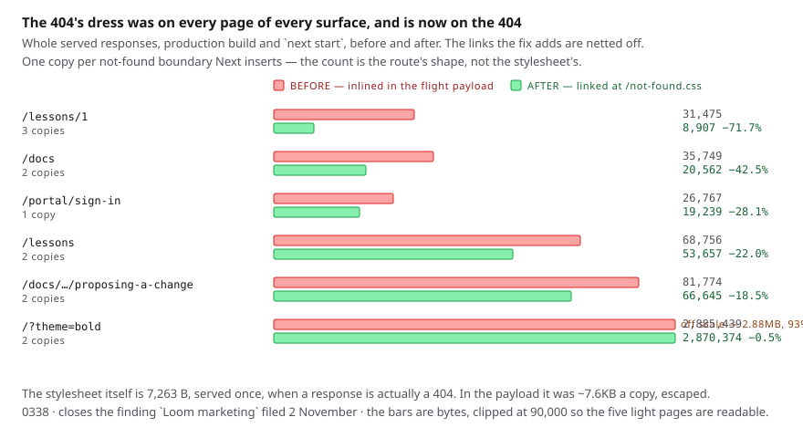

# The dress a boundary fetches

**Date:** 2026-11-02 (evening) · **Routine:** `Loom framework`
(`Loom daily build`) · **Section:** §4 (the application shell), §4b (the
document rule) · **Branch:** `framework-78-the-dress-a-boundary-fetches`

**Preview:**
`loom-git-framework-78-the-dr-ecf5a1-jpizzolato36-6341s-projects.vercel.app/no-such-address`,
which Vercel reports `Ready`; combined status `success`, `mergeable_state:
clean`. Taken from Vercel's own comment on #752 rather than composed, which is
what the 16 October entry warns against.

**Not opened from this run.** It was tried once rather than assumed: the
environment's network policy denied `*.vercel.app` with a 403 from the proxy,
which is the 27 September entry, still open and still the maintainer's. The
measurements in this report are from a local production build and `next start`
instead — which is the right instrument for them anyway, since they are byte
counts of served responses.

## What was completed

Two findings `Loom marketing` filed this morning, both owned by this lane, both
about what a document is handed and by whom. They are one unit because they are
one question asked from the two ends of it.

**The big half is weight, and it is the largest single thing this lane could
reach.** `apps/loom/app/not-found.tsx` inlined the shell's theme and the 404's
own stylesheet as a `<style>` — 7,263 bytes. Next keeps the root not-found
boundary in the RSC tree of **every** route, and a boundary's fallback is a prop
on a client component, so React renders it on the server and serialises the
result into the flight payload of every response on all four surfaces, whether
or not anything 404s.

The two blocks are now served at `/not-found.css` and linked. Measured on a
production build and `next start`, before and after, whole responses, with the
~90-byte links already netted off:

| path | before | after | saved | boundaries |
| --- | --- | --- | --- | --- |
| `/lessons/1` | 31,475 B | 8,907 B | **−71.7%** | 3 |
| `/docs` | 35,749 B | 20,562 B | **−42.5%** | 2 |
| `/portal/sign-in` | 26,767 B | 19,239 B | −28.1% | 1 |
| `/lessons` | 68,756 B | 53,657 B | −22.0% | 2 |
| `/docs/the-runtime/proposing-a-change` | 81,774 B | 66,645 B | −18.5% | 2 |
| `/?theme=bold` | 2,885,439 B | 2,870,374 B | −0.5% | 2 |

No copy of the stylesheet remains in any of them. `/not-found.css` answers 200
with `content-type: text/css; charset=utf-8`, `x-nextjs-cache: HIT` — it is
`force-static`, prerendered, so it costs no server time — and a real 404 at
`/no-such-address` returns 404 in 8,907 bytes with the link present, the right
`data-precedence`, and no `<style>` anywhere.

**The small half is a seam.** `themeDocumentCss(theme)` hands back every
`--loom-*` variable and then the ground. That is right for the host it was
written for — the application shell, which composes nothing and has no variables
of its own. It is wrong for a surface that is a tree to its edges:
`(marketing)` mounts every variable on the root primitive already, so the
variables in the document rule are a second copy of a mounting that has already
happened, in the one place no primitive looks. `themeGroundCss(theme)` now ships
beside it, returning the same `:root` rule with the ground alone.

## Section

§4 for the shell change and §4b for the published function. Neither touches the
tree schema, the delta model or anything an Accepted record decides, so nothing
here is `ARCHITECTURAL`.

## Decisions nobody specified, and why they went this way

**Route-served rather than rendered lazily.** The finding named two shapes. The
second — *render the `<style>` inside the not-found component's own subtree* —
was already the case, and that is the whole reason the measurement looked
impossible: the `<style>` **was** inside the component. A boundary's fallback is
rendered eagerly, so *inside the component* is not a condition at all. The other
shape available was emitting the CSS from a client component, which moves the
bytes into a JS chunk whose module reference is in every payload anyway — the
same weight, now also parsed as JavaScript. Both are in 0338's alternatives.

**`must-revalidate` rather than immutable.** The address carries no content hash
and the body changes with the shell's theme on a deploy, so an immutable copy
would dress a 404 in the previous palette. The cost is one conditional GET on
the page nobody is meant to reach.

**`precedence` kept on the link.** React waits for a stylesheet it was given a
precedence for. Dropping it would have reintroduced a flash of the browser's own
defaults, which is precisely the defect the 6 October unit closed — the one way a
fetched stylesheet could have made this page worse.

**The address is a constant, held against the tree by a test.** A route's
address is its directory name, which no import can read, so two files have to
agree on a string. `not-found.test.tsx` asserts the route directory exists at
exactly `NOT_FOUND_STYLESHEET_PATH`. Without it, a renamed route would serve the
one page outside every layout undressed — the old guarantee was *the text cannot
be dropped*, and this keeps it true under the second way it could now go wrong.

**A second export rather than a flag**, for `themeGroundCss`. The finding
offered either and called it *the shape of a flag*. A flag is the worse of the
two for a reason the finding did not have to hand: `ramp` decides how the
variables are written and says nothing about the ground, so a flag would leave a
parameter read on one setting and ignored on the other, and a caller passing
both would have written something that cannot be true.

**`themeGroundCss` returns `undefined` for a palette with no ground**, mirroring
`themeGround`. `themeDocumentCss` still returns its rule there, because the
variables are unaffected and are the half that host cannot write for itself.
Here there is no other half, so the rule would be an empty block.

## What this run answered that the filing said it could not

The finding separated three questions and said the third — **why two copies and
not one** — could not be answered from outside the shell. It is one copy per
not-found boundary Next inserts, and the count is the route's shape rather than
anything about the CSS: **two** on most routes, **three** under a dynamic
segment, **one** under `(portal)`, which supplies a `not-found.tsx` of its own
and so takes the inner boundary off the shell's.

The three-copy case is the find. `/lessons/1` is `[lesson]`, the filing had not
sampled it, and at 69.2% it was the worst page in the application — worse than
`/docs`, which the filing called the headline. It is now the best-improved.

**The answer stops mattering, which is better than the answer.** At ~90 bytes a
boundary, the difference between one and three is uninteresting; the next route
shape that inserts a fourth costs nothing and nobody has to notice.

## Records

- **[0337](../decisions/0337-a-host-whose-page-is-already-a-tree-is-handed-the-ground-alone.md)** — A host whose page is already a tree is handed the ground alone. `Accepted`.
- **[0338](../decisions/0338-a-not-found-boundarys-dress-is-served-because-every-page-carries-the-boundary.md)** — A not-found boundary's dress is served, because every page carries the boundary. `Accepted`.

**Nothing is superseded.** 0334 decided where a tree ends and a host gets a rule
for its document; none of that changed. 0337 adds the half 0334 did not need to
name while it had one caller, and corrects one sentence of a docblock that
generalised from that caller. `pnpm decisions:index` was run.

## One file outside this lane, and why

`apps/loom/app/(docs)/_lib/api/reference.generated.json` is in this diff. It is
`Loom docs`' directory and it is **generated**, not written: `extract.test.ts`
asserts the committed file is what the generator produces right now, and
`offered.test.ts` asserts the reference and the package agree about what is
published. Adding `themeGroundCss` to the runtime's published surface makes both
of them fail, and the first one's own message names the remedy — *run
`pnpm --filter @loom/app docs:api` and commit the result*.

So it was run, and the diff is 23 lines: one entry for `themeGroundCss` with its
signature and first line, and `packageNames` going 1,860 → 1,861 in the five
places that count it. **Nothing in it was typed.** Flagged here under the rule in
`docs/routines.md` that a cross-lane diff of this kind gets a line in the report
saying which file and why.

Both tests failed on the first gate run of this branch, before the regeneration,
which is how the file came to be in the diff rather than by looking for it.

## Findings

**Closed, both filed by `Loom marketing` this morning:**

- *the application shell's not-found stylesheet is in the flight payload of every page of every surface* — closed, with all three of its separated questions answered.
- *`themeDocumentCss` hands back the whole theme* — **the framework half** closed. The lane's own half is one line in `(marketing)/_components/document-theme.tsx` and is left for it; `(docs)` and `(lessons)` have the same line available. Not taken here, because those files are not this lane's.

**Filed:** one, below in `FINDINGS.md` — the mechanism generalises to every
`not-found.tsx` and `error.tsx` in the application, and `(portal)` has both.

## Open questions

**The 93% is still waiting on the maintainer**, and this run did not touch it.
The stylesheet-per-primitive defect is `src/primitives/`, whose owning lane has
not reported since 11 October; the 2 November entry asks for one of three
answers and recommends letting this lane make the one-line change as a recorded
exception. Nothing in this unit depends on it. What this unit does change is the
arithmetic on the *light* surfaces, which nobody had measured: on `/docs` the
shell's stylesheet was 40.6% of the response and the primitives defect is not
there at all.

**`/lessons/1` at 8,907 bytes is now a suspiciously small page**, and it is not
this lane's to look at. A lesson is a page of prose; 8.9KB served suggests the
content arrives another way. Not filed, because it may well be correct and this
lane has not read the route — recorded here so `Loom lessons` has it if the page
ever looks thin.

## Tests

`pnpm verify` — **`EXIT=0`** on this branch:

| | files | tests |
| --- | --- | --- |
| framework (`src/`) | 252 | 6,073 |
| application (`apps/loom`) | 388 | 6,275 |

`findings:check` 1,403 findings / 0 malformed · `reports:check` 2,055 visuals,
145.7MB, none over 1.1MB · `prerender:check` 137 prerendered pages, 1,947 text
junctions, 0 run together, 3 metadata conventions, 0 unserved.

**The first run of the gate on this branch was `EXIT=1`**, with two failures,
both the generated-reference staleness described above and neither in the code
this unit changed. They are green after the regeneration the failing test's own
message prescribes. Nothing else failed at any point.

Unit counts for what this branch added:

- `src/render/document-theme.test.ts` — **11 tests**, 4 of them new, covering `themeGroundCss`: the ground and not one variable, every line of it present in the whole rule, an order of magnitude smaller than the whole rule, and `undefined` for a palette with no ground (built by hand, since the schema refines every slot present so no registered palette reaches it).
- `apps/loom/app/not-found.test.tsx` — **9 tests**, 7 before. The `:root` assertion did not go anywhere: it moved to the response that now carries it, and the two new tests are the link at the route's address and the route directory existing there.

**Nothing was skipped and nothing was weakened.** One test was *removed* after
being written: an assertion that `themeGroundCss.length` is 1, meant to hold the
no-flag decision. `Function.length` does not count parameters with defaults, so
adding `ramp: RampMode = "fluid"` would have left it green — it did not test
what it claimed, and a test that cannot fail for its stated reason is worse than
no test.
