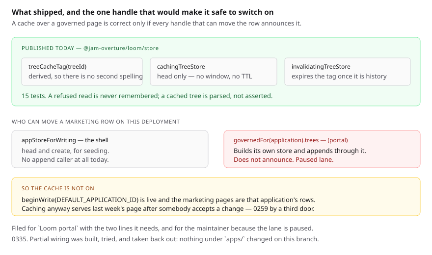

# Told that the row moved

**Date:** 2026-11-02 · **Routine:** `Loom framework` (`Loom daily build`) ·
**Section:** §5, §3 (persistence — a cache over a page the store governs) ·
**Branch:** `framework-77-told-that-the-row-moved` · **PR:** #PR

**Preview:** `PREVIEW`. Not opened from this run: `*.vercel.app` is denied by
the environment's network policy, filed on 27 September. Nothing on this branch
is rendered — the whole diff is one new module under `src/store/`, its tests, a
record, this report and `FINDINGS.md` — so the preview should be byte-identical
to `main`.

## What was completed

The runtime can now be told that a stored page moved, and a host can read one
through a cache without inventing a window.

This is the framework half of the finding `Loom marketing` filed on 1 November,
which is the small half of the maintainer's reported performance problem:

> Every marketing request makes one query — `siteStore.head` for the page's row
> — and renders the tree. ~100ms per request, on a pool where every query waits
> for the last.

`src/store/cache.ts` publishes three things, and
[0335](../decisions/0335-a-cache-over-a-governed-page-is-told-the-row-moved-by-the-handle-that-appended.md)
is the argument for their shape:

| | what it is |
| --- | --- |
| `treeCacheTag(treeId)` | the tag a cached reading of one tree carries, derived rather than written down |
| `cachingTreeStore(store, cache)` | a handle whose `head` is answered through a read-through the host supplies |
| `invalidatingTreeStore(store, invalidate)` | a handle that expires the tree's tag once an append is history |

Four properties are what make it a cache a governed page may have rather than a
faster way to be wrong:

- **No duration anywhere in it.** An entry leaves because the row moved, never
  because a clock ran out. That is the whole of why it does not contradict
  [0331](../decisions/0331-a-marketing-page-is-served-per-request-because-the-store-governs-it.md),
  which refused the `revalidate`/TTL family on exactly that ground.
- **A refusal is never remembered.** `not-found` is what an unseeded page
  answers; remembering it would freeze a surface on its authored fallback until
  something appended to a row that does not exist. Rejection is the only decline
  a read-through cache can express, so the seam states it as an obligation on
  the host and the wrapper turns the rejection back into the refusal the caller
  is owed.
- **A cached tree is parsed, not asserted.** The value has been somewhere, at
  minimum through JSON. One that does not parse is refused as `unavailable` in
  the same words `postgres.ts` already refuses a row it cannot read back.
- **The invalidation is on the handle that appends.** What a cache has to be
  told is *this row is not what it was*, which is true of an accepted change, a
  revert, a reseed and a migration alike. Wrapping the store catches the
  category; listening to `change-committed` would catch whichever members of it
  happen to be proposed.

## What was not completed, and why it is the more useful half of this report

**This deployment does not cache, and the wiring for it was built, tried and
taken back out.** Nothing under `apps/` changed on this branch.

A cache over `siteStore` is correct only if **every** handle that can append to
one of those rows is the invalidating one. Two can:

| appends through | lane | announces? |
| --- | --- | --- |
| `appStoreForWriting` — `app/_lib/app/store.ts` | shell | would, trivially — and has **no `append` caller at all** today; it is `head` and `create` for seeding |
| `governedFor(application).trees` — `(portal)/_lib/write.ts` | `Loom portal` | **no** |

`beginWrite(DEFAULT_APPLICATION_ID)` is a live path, and the marketing pages are
rows of the default application, so the portal appends to exactly the row a
marketing request would be holding — through a store it builds inside its own
lane from `postgresTreeStore(portalDatabase, { application })`. Caching anyway
would serve last week's page to everybody after somebody accepted a change,
which is
[0259](../decisions/0259-a-surface-the-portal-governs-renders-from-the-store-and-a-page-built-at-render-time-is-not-one.md)'s
own failure arriving by a third door and much worse than the ~100ms it saves.

`Loom portal` is paused and that file is its lane, so the two lines it needs are
filed rather than written. The partial wiring went in first and came out when
the gap was found, which is why there is a `tree-cache.ts` in neither this
branch nor the finding's diff — it would have been a module nothing imported.

**What this cost the run, stated plainly: the ~100ms is not recovered today.**
What is recovered is that the shape is decided, published, tested and reviewable
on its own, and the thing that switches it on is two lines with an owner.

## Decisions taken that were not specified

**`head` alone is cached.** The finding did not say which reads. `revisions` is
a history screen where somebody asking what happened is owed the answer as it is
now, and `list` spans trees — no tag derived from a tree id can clear it
correctly, so a page list that keeps a page somebody has since added would be a
worse screen than a slow one.

**`create` does not invalidate.** Nothing cached can be wrong about a tree that
has just come into existence, because a refusal is never remembered. Calling it
would also mean every seed reaching for a request scope it does not have, in
order to say something true of nothing.

**A throw from `invalidate` is contained.** The append is already history when
it is called; raising would report a durable change as a failure and the caller
would be entitled to retry something that has happened. The cost is that a
staleness nobody was told about is silent, which the docblock says out loud.

**The port is read-through rather than get/put.** A `put` the wrapper could
decline would have been a nicer shape and no real cache offers one —
`unstable_cache` and every other read-through decide what to keep by whether the
loader resolved. Rejection is therefore the vocabulary, and it is written down
as the port's one obligation rather than left as an accident of the first
adapter.

## Records

**Added:** [0335 — *A cache over a governed page is told the row moved, by the
handle that appended*](../decisions/0335-a-cache-over-a-governed-page-is-told-the-row-moved-by-the-handle-that-appended.md).

**Superseded:** none. 0331 needed no amendment, which was the point of caching
the read rather than the page: every marketing route keeps `force-dynamic` and
the palette and served origin stay per-request facts.

Two alternatives in it are worth a reviewer's eye because they are the ones that
would have let this deployment cache today, and both were rejected on the same
ground. A process-wide announcer the package holds would have made every store
invalidate without being handed anything — and every side effect in this package
enters through a seam, so ambient state a published `postgresTreeStore` reads
from a module variable is the opposite of how the rest of it is built. Hanging
the announcer on the `LoomDatabase` handle has the same problem plus a larger
blast radius: it is the narrowest Drizzle type two drivers share, and widening
it would reach every Postgres store, the migration, the PGlite harnesses and two
other lanes' journals in order to carry a cache concern.

## Findings

**Amended, not closed:** the 1 November entry *a governed page cannot be cached
today because nothing tells a cache that a row was appended to*. Its ask was the
per-request cost and that is not recovered, so it stays open with what is
published named on it. Three things in it turned out differently and are
recorded there: the invalidation belongs on the store rather than the event
stream; the cache belongs on the read rather than the page; and the lane
boundary it worried about — `(marketing)` — was never the one that bites.
**Nothing is asked of `Loom marketing`**, then or when this is switched on.

**Filed:** *the cache a governed page needs is built and this deployment cannot
switch it on, because the portal appends through a store the shell never sees* —
for `Loom portal`, with the two lines verbatim.

**Filed:** *the maintainer's reported performance problem is one function in a
lane whose last report is 11 October* — for `@jonathanbravecredit`. The 2.4MB
stylesheet is 94% of what he reported and it is owned by a routine whose most
recent report is three weeks old; `src/primitives/` has had one commit touching
it since 1 October and that one arrived on another lane's pull request. The
entry sets out that the fix is one line in one function rather than ninety, that
the ~90 call sites do not change under either shape, and that the renderer half
is this lane's and is deliberately not built because on its own it makes the
page one copy worse.

## Open questions

**One, and it is the maintainer's.** Both findings end in the same place: a lane
boundary that is correct and a schedule nobody inside a run can see. Whether
`Loom framework` may make a named one-line change inside `src/primitives/` and a
named two-line change inside `(portal)/_lib/` is his call, not a run's — and
`docs/routines.md` is explicit that a paused lane's directory is not open
season.

**Nothing else is blocking.** The seam is published and a host embedding Loom
can use it without any of the above.

## Test numbers

`pnpm verify` **exit 0** on `framework-77-told-that-the-row-moved`.

| gate | result |
| --- | --- |
| framework suite | **252 files, 6056 tests passed** |
| `@loom/app` suite | **386 files, 6208 tests passed** |
| `findings:check` | 1395 findings, 0 malformed |
| `reports:check` | 2046 visuals, 145.3MB, none over 1.1MB |
| `prerender:check` | 137 prerendered pages, 1945 text junctions, 0 run together |

`src/store/cache.test.ts` is new: **15 passed.** They cover the tag, one read
per tree however many readers ask, two trees kept apart, a `not-found` that is
asked again rather than remembered, a cached value that is not a tree, a cache
that throws being reported rather than raised, the four methods that pass
through, an append that announces and a refused append that does not, a write
kept when the cache could not be told, a `create` that announces nothing, and
the pair end to end — a reader after a writer is served the revision the append
produced.

Nothing was skipped and nothing was weakened. **An earlier `pnpm verify` on this
branch was also green while the application wiring was in place**, which is
worth saying because it is the point of the second half of this report: green
was not the question, and no test in this repository could have asked the one
that mattered.
