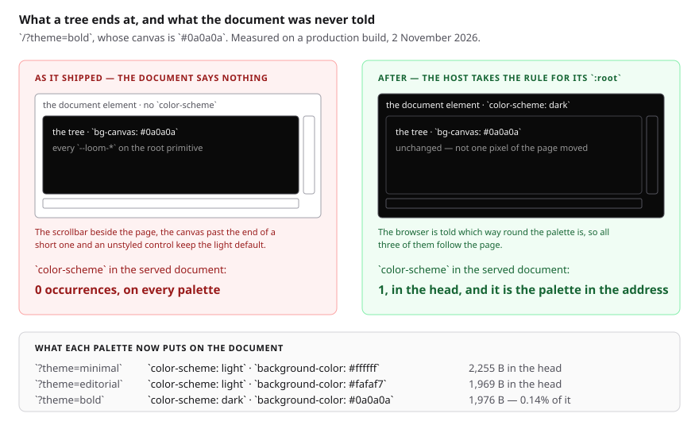
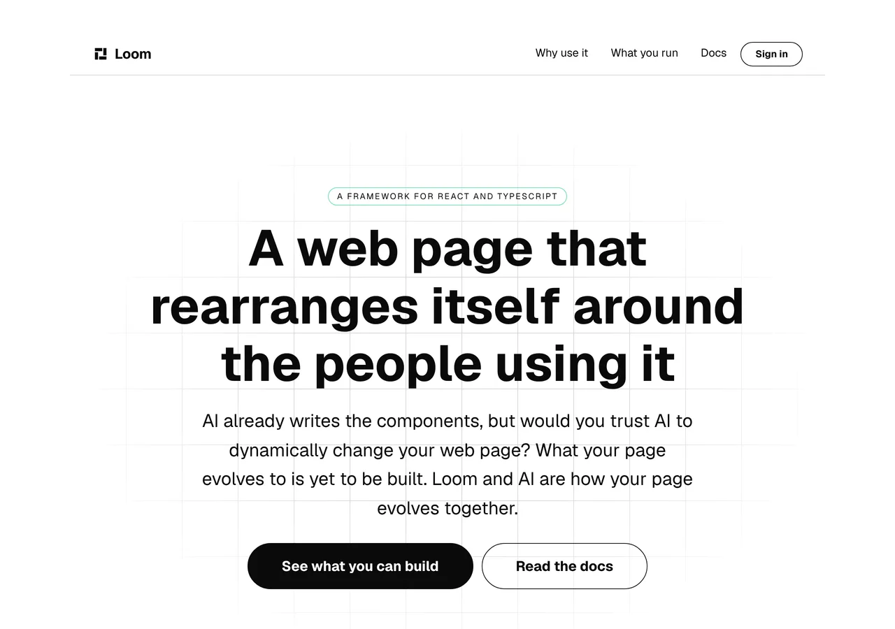

# The furniture around the page

**2 November 2026 · `Loom marketing` · branch `marketing-25-the-furniture-around-the-page`**

**Preview:** the pull request carries it. Not opened from this run: `*.vercel.app`
is denied by the environment's network policy, filed on 27 September. Every
number below is off a local production build of this commit.

**No maintainer comment was outstanding.** The two instructions of 31 October —
remove the demo and `/how-it-works`, and prioritise the slowness — were carried
out and answered on #735 and #742, and nothing has been added to either since.
So this run took the top of the findings queue, which is the entry the framework
lane filed yesterday evening naming this lane first.

---

# What shipped



Every page of this site now hands the document the rule for its own `:root`,
derived from the palette in the address. Three lines of wiring, one component,
and a defect that has been on the `bold` palette for as long as the palette
switcher has offered it.

## The defect, which this lane filed on 8 October and could not fix

A tree ends at the element the root primitive renders. Three things a reader
sees are outside it — **the scrollbar the browser draws beside the document, the
canvas it paints past the end of a short page, and the rendering it gives a form
control nobody styled** — and all three read one declaration, `color-scheme`.

Swept over the served markup of `/?theme=bold` with the scripts taken out, that
declaration appeared **nought times in the whole document**, the library's own
hoisted stylesheet included. `bold`'s canvas is `#0a0a0a`, so that palette has
been serving a black page with a light scrollbar beside it and a white band past
the end of it.

The filing named two candidate elements and said neither was this lane's. It was
right, and the better half of its reasoning was the judgement it declined to
make: whether the root primitive declaring `color-scheme` would be enough.

## Why the answer was not a line in `src/primitives/`

[0334](../decisions/0334-the-browsers-own-furniture-is-outside-the-tree-so-a-host-is-handed-a-root-rule-for-its-document.md),
merged yesterday as #745, answered it and the answer is **no, and not as a
matter of taste**. `color-scheme` is inherited: put on the tree's root it
reaches every primitive below — which needed it least — and reaches **none** of
the three surfaces the declaration is for, because no tree ever contains the
document. The one-line change that looked available would have closed the
finding, passed every test and fixed nothing.

So the framework publishes `themeDocumentCss(theme)` instead, and the entry it
filed beside it says what is left: *one line per surface, and each surface
decides when*. This is `(marketing)`'s line.

## It is on the page rather than in the layout

`layout.tsx` deliberately does not read the address, so it does not know which
palette the visitor asked for, and a layout emitting the house theme's white
would be wrong on exactly the palette that needs this. A rule rendered by the
*page* is hoisted into the head by React and lands in the same place — which is
the arrangement the framework's own entry said it would not argue with.

That puts `DocumentTheme` beside `StructuredData` and `BrowserBar`: the third
thing this surface renders itself, the third that draws nothing a visitor looks
at, and the third that is on the page for the same reason. The question 0067
asks of anything rendered outside the tree is whether a registered primitive is
missing, and none is — a primitive able to emit document metadata would be a
primitive able to put arbitrary tags into any page a model can edit.

## This surface is the first to follow the published recipe rather than copy it

`/docs/building-with-loom/theming` publishes the colour as
`themeGround(resolved).backgroundColor`, and the documentation site **cannot
follow its own recipe**: its sidebar and header are application furniture with
no theme mounted on them (0067), so it has nothing to resolve, and it
transcribes two hex values out of its stylesheet with a test holding the copies
together.

Every pixel of this surface is a tree, so the render that drew the page hands
back what its root is wearing and both halves come off that one reading. There
is no second resolution of the palette anywhere in this change, which is the
property that makes it impossible for the document and the page to disagree.

---

# The measurement, because a screenshot cannot show this

**Nothing anybody works on this site with can see the thing that changed.** A
desktop screenshot excludes the scrollbar, the overscroll canvas exists only
while a finger is dragging past the end of the page, and nothing else in this
route group reads the document element. The pictures below are here to show that
**the page is unchanged**, which is the other half of the claim.

Production build, `next start`, locally, with the script payloads removed the
way the 8 October sweep removed them:

| served document | `color-scheme` | on `:root` | `background-color` | in the head |
| --- | --- | --- | --- | --- |
| `/?theme=minimal` | `light` | yes | `#ffffff` | yes |
| `/?theme=editorial` | `light` | yes | `#fafaf7` | yes |
| `/?theme=bold` | **`dark`** | yes | `#0a0a0a` | yes |

One occurrence per document, and **nought outside the rule** — which is the
before-figure re-derived on this build rather than quoted from October.




## What it costs, said plainly because weight is what he asked about

| `/?theme=bold` | bytes |
| --- | --- |
| the rule in the head | 1,976 |
| the same rule in the flight payload | 1,976 |
| the response | 2,884,608 |
| **share** | **0.14%** |

The rule is the whole theme rather than the three declarations the furniture
reads, so a surface that is a tree all the way to its edges mounts its variables
twice. **It was taken as published anyway**, and the arithmetic is the argument:
a tenth of a percent does not justify this lane hand-writing a three-declaration
rule, which would be a copy of a decision the palette owns kept somewhere the
palette cannot reach — the hazard 0197 and 0334 both exist to refuse. The shape
is filed for the lane that owns the function.

---

# The tests, and the one judgement call in them

**No test was weakened.** `document-theme.test.tsx` is 37 new cases and
`addressed.test.ts` gained one line, which is the call worth a reviewer's eye.

The new file asserts one thing four ways — **the document and the page agree
about the palette** — against the registry, against the variables the page's own
root mounts, against the colour the strip above it was told, and across every
page of the site. Two of them are worth naming:

- **The selector.** `:root` *is* the document element, and the same declarations
  on a wrapper inside the document leave the browser's light default exactly
  where it was. A rule naming `body` would carry the right colour for the wrong
  element and every other assertion here would pass, so the selector is pinned
  on its own.
- **The ramps.** `themeDocumentCss` mounts `fluid` ramps by default and
  `renderTree` asks for the same, which are two defaults in two modules. If they
  ever diverge the document carries one set of lengths and the tree another, and
  nothing would say so, because the document's copy is read by nothing inside
  the page. Every `--loom-*` on `:root` is compared to what `themeStyle` mounts.

**The defect matrix**, each run against the whole new file:

| what was broken | tests that went red |
| --- | --- |
| the rule moved off the document, onto `html body` | 7 |
| `precedence` dropped, so nothing asks for the hoist | 2 |
| one page stops rendering it | 1 |
| the component emits nothing at all | 24 |

## `addressed.test.ts` now strips three tags instead of two

That file renders each page module and compares it **byte for byte** with the
markup this lane's own library produces for the same address — which is the
check that caught a route reading two of four parameters for eight days. It did
that by taking the two tags that draw nothing back off first. There are three
now, so there is a third `.replace`.

It is worth saying why that is not a weakening. The pattern matches **the
element and not what is inside it**, so a rule reporting the wrong palette would
be stripped exactly as a correct one is — this file cannot tell them apart and
is not being asked to. What it holds is unchanged: that the route handed the
library the address it was given. Whether the rule is *right* is the entire
subject of the new file beside it, where the palette is compared three ways.

The alternative — asserting the whole page including the rule — would have made
the expected value a second call to `themeDocumentCss`, which is a comparison of
one function against itself and the shape this lane filed on 8 October.

## Numbers

`pnpm install && pnpm verify`, exit code read out of a file written as the last
thing on its line:

```
Test Files  251 passed (251)      Tests  6041 passed (6041)    # framework
Test Files  387 passed (387)      Tests  6245 passed (6245)    # @loom/app
1395 findings, 0 malformed
137 prerendered pages, 1945 text junctions, 0 run together
EXIT=0
```

The `(marketing)` route group is **55 test files and 933 tests**, up from 54 and
896: one component, one test file of 37 cases, and one line in
`addressed.test.ts`.

Nothing skipped, nothing weakened, no ceiling moved.

---

# Findings

**One row closed, two filed.**

**Closed:** the marketing row of the framework lane's 1 November entry — *the
furniture outside a page is answered now, and the one line that applies it is
each surface's*. Open for `(docs)`, `(lessons)` and the paused `(portal)`, which
is one line each and each lane's own call. The 8 October entry this lane filed
is `Loom primitives`' and was answered rather than closed by 0334, which says in
as many words that nothing is asked of `src/primitives/`.

**Filed, both for `Loom daily build`:**

- **The application shell's not-found stylesheet is in the flight payload of
  every page of every surface.** Found while weighing this lane's own rule and
  counting four `:root` blocks on a page that should have had one. 7,263 bytes,
  once or twice per response: **40.7% of `/docs`**, 21.1% of `/lessons`, 27.2%
  of `/portal/sign-in`, 0.5% of a marketing page. It is weight and not a wrong
  colour — the rule only becomes a `<style>` if the boundary renders — but it is
  the largest single item in the response on the three light surfaces, which are
  the ones nobody has had reason to weigh.
- **`themeDocumentCss` hands back the whole theme**, so a surface whose every
  pixel is already a tree mounts its variables twice. A question about the
  published shape rather than a defect, with the 0.14% costed and a
  ground-only export suggested.

# Decisions

**None taken and none recorded.** This applies 0334, which is `Accepted` and
decides the question; the placement on the page rather than the layout is the
arrangement its own finding named, and `precedence="default"` follows the
application shell's `not-found.tsx` verbatim. A record for a lane taking a line
the framework published for it would be a record that decides nothing.

# Open questions

In the pull request comment. Nothing about this change is blocking; the
questions carried there are the standing positioning ones and the two findings
above.
