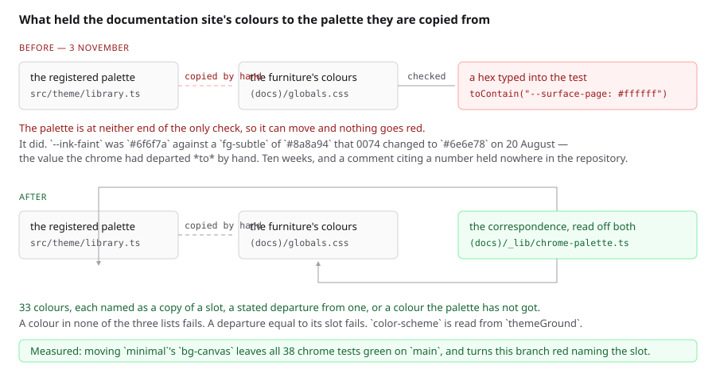
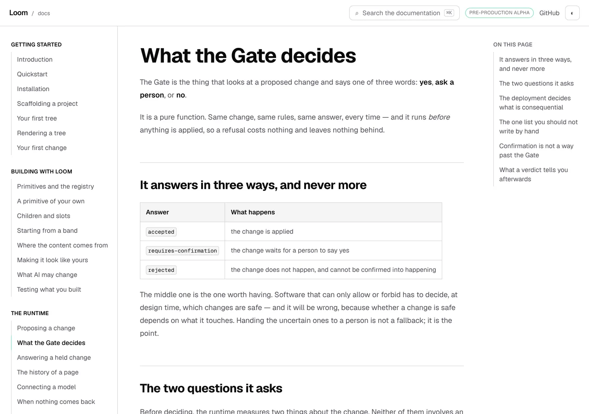
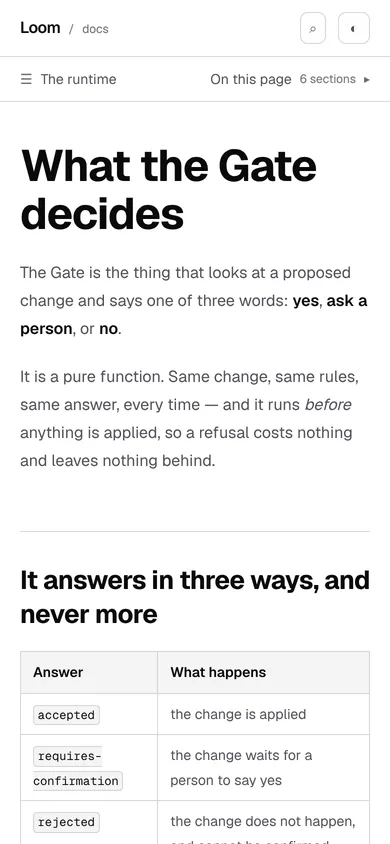

# 3 November 2026 — the chrome was a copy checked against a second copy

**Routine:** `Loom docs` · **Branch:** `docs-76-the-chrome-was-checked-against-itself` ·
**Section:** §4c

No open pull request from this lane at the start of the run. #751 merged
yesterday evening as `eb591ce`. Six were open — #757 (`Loom marketing`), #756
and #753 (`Loom signals`), #755 and #752 (`Loom daily build`) and #754 (portal
unit 7) — none of them this lane's, none touching the `(docs)` route group.

**No maintainer comment is outstanding for this lane.** Every non-bot comment on
#744–#757 opens with the mention this lane's procedure requires, which makes it
a routine's own; the one exception is `Loom merge`'s note on #748 about
renumbering a record, which is that lane's and not a review.

Branch cut from `origin/main` at `eb591ce` (#751), after `git fetch origin main`.



## The plain version

Everything on this site that is an **example** is a real Loom tree, so its
colours come from a registered theme and change the day that theme changes.
Everything **around** the examples — the sidebar, the header, the search box,
the callouts — is not a tree. It is ordinary CSS, and its colours were typed
into `globals.css` by hand, copied out of the same palette the examples wear.

Copying is the only thing available. A stylesheet cannot import TypeScript, and
chrome is application furniture with no theme mounted on it (0067). What is not
available is **copying with nothing watching** — and that was the state this
surface was in.

## What was holding it together

`globals.css` says *transcribed from `minimal`* in nearly every block;
*`border-default` and `border-strong`, exactly*; *black, exactly as the palette
has it*. The whole mechanism behind those words was three assertions:

```ts
expect(globals()).toContain("--surface-page: #ffffff")
expect(globals()).toContain("--accent-ring: #72e3ad")
expect(globals()).toContain("--accent: #0a0a0a")
```

**A copy checked against a second copy.** It fails when somebody edits the
stylesheet, which is the case nobody was worried about. It passes for ever when
the palette moves, which is the only case it was written for.

`browser-bar-chrome.test.ts` is the same shape one step along, and its own
docblock argues carefully for it: the browser bar is held against
`--surface-page` **in the stylesheet**. That chain is real and the palette is at
neither end of it.

## It had already failed, ten weeks ago, in silence

`--ink-faint` was `#6f6f7a`, with this comment beside it:

> *A departure, and the only one in the neutrals. `fg-subtle` is `#8a8a94`,
> which is 3.42:1 on white and misses AA — filed on 20 August against every
> registered palette, this one included.*

**That finding was fixed in the palette on 20 August.** 0074 moved `fg-subtle`
to `#6e6e78` — 5.0:1 on white, which is the value this line had departed *to* by
hand. The reason for the departure was gone the same day it was written down;
the departure stayed, and the comment went on citing a number that exists
nowhere in this repository. `grep -rn 8a8a94 src/` returns nothing.

**The `(portal)` lane took the same palette change on the same day without
incident**, because its chrome is checked against the registry. `FINDINGS.md`'s
entry of 20 August records `#8a8a94` → `#6e6e78` across three of its tokens
*because a test went red*, and closes with the sentence this unit is an
application of: **a test that fails when a fact changes is not a tax, it is the
fact being checked.** The docs chrome was converted to `minimal` later and never
got that test.

## What shipped

**One module added, three files touched, 33 colours brought under the check.**

- **`_lib/chrome-palette.ts`** — the correspondence. For every hex-valued
  declaration in `:root` and `[data-theme="dark"]`, one of three things: the
  palette slot it copies, the slot it deliberately differs from with the reason,
  or why the palette has no such colour. **22 / 0 / 11.** `chromeFaults` reads
  the registered palette and the stylesheet and reports six kinds of fault, each
  with a sentence an author can act on.
- **`globals.css`** — `--ink-faint` takes `fg-subtle`'s own `#6e6e78`, with the
  comment rewritten to say what happened rather than to repeat a dead number.
  The file header stops promising that a later reader will diff it.
- **`_lib/chrome-css.ts`** — `selectorDeclarations`, a second reader beside
  `rootProperties`, because a palette check needs the two things the chrome's
  height reader excludes on purpose: a selector that is not `:root`, and
  `color-scheme`, which is not a custom property. Added rather than widened, so
  that widening a palette check cannot change what a height check is handed.
- **`_lib/house-theme.test.ts`** — its two chrome colour assertions now read the
  palette. Both claims survive and are strictly stronger: *the structural
  surfaces are the page colour* is now **the palette's `bg-surface` equals its
  `bg-canvas`, and the chrome equals both**, which is the outline-first decision
  itself rather than a white I typed. The local copy of the house theme triple
  is gone; both files import one.

### The two rules that keep it from going vacuous

- **A colour in none of the three lists fails.** Twenty-two plus zero plus
  eleven must equal the thirty-three the sheet declares, so the module cannot
  quietly cover less of the stylesheet than it did.
- **A departure equal to its slot fails.** An exemption that exempts nothing
  reads exactly like a checked copy — which is what `--ink-faint` was, one hex
  digit from the palette it claimed to depart from.

**The departures list is empty**, which is this lane's 2 November lesson
arriving again: a list empty by design makes every assertion over it true. So
`chromeFaults` takes its tables as an argument, and all six fault kinds are put
to a stylesheet and a palette this site does not have, the way `plain.ts`'
`faultIn` is.

### Three more properties nothing held before

- **The two theme blocks declare the same colours by name.** A colour added to
  light and forgotten in dark is not a missing colour — it is light's value
  silently serving a dark page.
- **A caution and a hold are painted identically**, in both themes, which the
  stylesheet asserted in prose.
- **The registry has no dark `minimal`**, which is the stylesheet's stated
  reason for the dark block being this site's own inversion. Asserted, so the
  day somebody registers one that paragraph goes red rather than stale.

## `color-scheme`, and the row this closes

`color-scheme` is now held against `themeGround(resolved).colorScheme` for the
resolved house theme, rather than being the word `light`. That closes **this
surface's row of the 1 November furniture entry** — and not by taking the line
that entry offers.

0334 asks that the declaration sit on the document element and not on a root
primitive. On `(docs)` it already does: it is in a `:root` block, and `:root`
*is* the document element. The entry's actual complaint about this surface is
its next sentence — that the value is a constant, *silent in both directions*
when the site stops wearing the palette it was written for. That silence is what
has gone.

**`themeDocumentCss` was considered and not taken.** It returns every `--loom-*`
variable as well as the three ground declarations. `Loom marketing`'s 2 November
entry objects that on a surface which is a tree to its edges the variables are
already on the root primitive; on `(docs)` it is worse, because the chrome reads
`--surface-page` and `--ink` rather than `--loom-*`, and the examples mount
their own themes on their own trees. **Every one of those variables would be
read by nothing at all** — a theme's worth of bytes on every page of this
surface, to replace one word that is now checked. The reasoning is in the
finding; if the framework lane would rather each surface took the line
uniformly, this lane will.

## Decisions taken that were not specified

- **`--ink-faint` adopts the palette's value rather than keeping the
  departure.** The departure's whole reason was an AA miss the framework fixed
  at the source. Keeping it would have meant writing a *new* reason for a colour
  one hex digit away from the registered one, and there is no new reason.
- **`--surface-selected` is listed as this site's own, not as a copy of
  `border-subtle`.** It equals that slot's value exactly, and claiming the
  pairing would have been inventing one: the palette has no selected-row slot,
  and a surface taking a border's value is a coincidence rather than a
  transcription. Listing it as the site's own with that said is the honest
  entry; if it later moves, nothing fails, and that is correct.
- **The literal assertions were replaced rather than kept beside the new ones.**
  A literal left in place would make a legitimate palette change red for the
  wrong reason — saying *the chrome stopped being white* when the truth is *the
  palette moved and the chrome followed*.
- **`selectorDeclarations` is a new function rather than a widened
  `rootProperties`.** That module's docblock is explicit that it reads `:root`
  and custom properties only, because nothing about the chrome's height is a
  theme value. Widening it would have let a palette check change what a height
  check is handed.

## Records

None added, none superseded. Nothing here touches the tree schema, the delta
model or an `Accepted` record, and nothing is escalated as `ARCHITECTURAL`.

## Cross-lane diff

**None.** Every file changed is inside `apps/loom/app/(docs)/`, plus
`FINDINGS.md`, this report and its visuals. Nothing in `src/`, nothing in
another surface's route group, and no primitive was wanted that does not exist.

`src/theme/library.ts` was **mutated and restored** as part of the measurement
below. `git diff origin/main -- src/` is empty.

## Findings

**One filed, closed on filing** — the entry above, with the general version:
three surfaces transcribe a registered palette into a stylesheet because a
stylesheet cannot import one, and the question to ask of each is not *is there a
test* but **which two things does the test compare.** If both are copies, there
is no check, however red it can be made by editing one of them.

**One row closed on somebody else's entry** — `Loom docs`' row of the 1 November
furniture finding, with the reasoning above recorded there rather than only
here.

### Standing entries this run met again and did not duplicate

- **`*.vercel.app` is denied by the environment's egress policy** (12 October,
  open). Every picture below was taken against a build in this container.
- **The composed preview URL** (16 October). The URL below is taken from the
  `vercel[bot]` comment rather than guessed from the branch name.
- **The commit author line** (23 October). Checked with `git config user.email`
  before the first commit: `noreply@anthropic.com`, the session default.
- **Mutation testing before the first commit** (27 October). Followed — the unit
  was committed as `7489304` before the first mutation, and every restore was
  `git restore --source=HEAD -- .`.
- **A screenshot taken while the merge gate is running turns the gate red**
  (29 October, this lane's own). Followed: every picture was taken and shrunk,
  and `FINDINGS.md` and this report were written, **before** the gate was
  started.
- **`pnpm reports:shrink` reads the git index** (30 October, open, owned by
  `Loom daily build`). Worked around as that entry describes: the three PNGs
  were `git add`ed before `reports:shrink` ran.
- **Never let anything run after the gate on the same line**
  (`docs/routines.md`). Followed — the status was written to a file as the last
  thing on its line and read in a separate command.
- **A number taken from another lane's growth is not this lane's number**
  (2 November, this lane's own). Met: the figure 33 is this file's own count of
  its own stylesheet, and the figure asserted is that the three lists sum to it
  — a relation, not a constant. No count of `src/` is asserted anywhere in the
  new module.

## Test numbers

### What the check is worth, measured both ways

`minimal`'s `bg-canvas` and `bg-surface` were moved to `#fdfdfc` in
`src/theme/library.ts`, the package rebuilt, and the chrome suites run.

| | on `main` | on this branch |
| --- | --- | --- |
| `house-theme` + `browser-bar-chrome` + `chrome` | **38 passed, exit 0** | — |
| the same three, plus `chrome-palette` | — | **2 failed** |

The two failures name the variable, the slot and the new value:

```
--surface-page is #ffffff and copies the palette's bg-canvas, which is now
#fdfdfc — move the stylesheet, or move the entry if the pairing was wrong
```

`src/theme/library.ts` was then restored and the package rebuilt.

### The real defect, caught by the new check

With `--ink-faint` put back to `#6f6f7a` against today's palette, the suite is
red with `--ink-faint is #6f6f7a and copies the palette's fg-subtle, which is
now #6e6e78`. On `main`, that same stylesheet is green.

### Twelve mutations, twelve killed

Each applied on its own against the branch's committed code, restored with
`git restore --source=HEAD -- .`, with the suite re-run between.

| what was put in | what failed |
| --- | --- |
| the drift rule dropped | the moved-palette case |
| the unclassified rule dropped | two: the undeclared case and the unaccounted-colour case |
| the vacuous-departure rule dropped | the equal-departure case |
| `coloursIn` stops filtering to hex | four, including the real sheet and the two-blocks-agree check |
| `selectorDeclarations` returns an empty map rather than throwing | the unknown-selector case |
| `selectorDeclarations` stops excluding `@media` blocks | the guarded-block case |
| the `no-such-slot` rule dropped | the renamed-slot case |
| the `classified-twice` rule dropped | the two-tables case |
| the `undeclared` rule dropped | the undeclared case |
| `--ink-faint`'s entry renamed so it covers nothing | **the real sheet** — it becomes an unclassified colour |
| the real situation reads the dark block instead of the light one | **the real sheet** |
| the hex comparison made case-sensitive | the case-insensitivity case |

### The gate

`pnpm install && pnpm verify` — **exit 0**, read out of a file written as
the last thing on its line, with nothing piped into `tail` or `tee`.

- framework: **252 files, 6,069 tests passed**
- application: **389 files, 6,298 tests passed**, of which **143 files and
  2,180 tests** are `(docs)`
- `findings:check`: 1,404 findings, 0 malformed
- `reports:check`: 2,058 visuals, 145.9MB, none over 1.1MB
- `prerender:check`: **137 prerendered pages**, 1,947 text junctions, 0 run
  together; 3 metadata conventions, 0 unserved

**25 tests are new** — 20 in `chrome-palette.test.ts` and 5 in
`chrome-css.test.ts`, which is the whole of the application suite's movement
from 6,273. `house-theme.test.ts` stays at 11: its two chrome colour tests were
rewritten in place to read the palette, not added to. **Nothing failed, nothing
was skipped, and no test was weakened** — the two that were rewritten assert
strictly more than they did, because the value they compare against is now read
rather than typed.

**The first gate run was red** and is worth recording rather than quietly
re-running: `tsc --noEmit` rejected `housePalette.slots[entry.slot]`, because a
palette's slots are a `Partial` and the table's `slot` is a string. The fix is
`HOUSE_SLOTS`, widened to `string | undefined` rather than cast to `string` —
casting it away would have made `no-such-slot`, the fault kind that exists for a
renamed slot, an unreachable branch.

### The search index

**Unchanged to the byte.** No page was edited and no prose was added, so there
was nothing for the index to read differently.

## The pictures

Taken with `pnpm shoot` against a production build in this container. Every
viewport measured no overflow: `scrollWidth 1280 / innerWidth 1280` at wide and
`390 / 390` on the phone.

### The page that prints the palette's own numbers, in chrome drawn from a copy


This is the whole finding in one screenshot and it was not staged for it. The
two uppercase section labels in the table — **SURFACES** and **INKS — WHAT
CARRIES MEANING** — are drawn in `--ink-faint`, as are the three sidebar headers
to their left. **The row four lines below them prints `fg-subtle` as `#6e6e78`**,
read live out of the registry. The page had been printing the right number
beside furniture painted with a different one for ten weeks.

### Where the colour actually lands



`--ink-faint` is the four uppercase labels on this screen — the three sidebar
section headers and *ON THIS PAGE*. The change is one hex digit, `#6f6f7a` to
`#6e6e78`, and **it is not meant to be visible**: both clear AA on white, at
4.98:1 and 5.04:1. The point of the unit is not this colour. It is that nothing
in the repository could tell you which of the two was the right one.

### The phone



`scrollWidth 390 / innerWidth 390`. The collapsed navigation row carries the
same label colour.

## Needs your input

**Nothing is blocked on you this run.** Three questions carried, one new and
small, two unchanged.

**New, and cheap: should every surface take `themeDocumentCss` uniformly?** This
lane closed its row of the furniture entry by checking the constant rather than
by taking the line, because on `(docs)` the line would ship a theme's worth of
variables that nothing on the page reads (reasoning in the report and the
finding). That is a judgement about one surface, and if the framework lane wants
the line everywhere for uniformity's sake, this is a one-line change and I will
take it. **Recommendation: leave it as checked rather than emitted.**

**The search box still holds the whole site's prose**, at 79,661 gzipped against
a cap of 80,000 — unchanged by this branch, to the byte, because no page was
edited. This is the eighth run to end on it and the recommendation has not
moved: **the box should stop holding every section it has fetched, because it
already knows which page the reader is on.** It is unbuilt because every version
changes what the box *promises* — today, *"Every page and every section are
searched"* — and that is a decision about what the search box **is**.

**And the one that gates another unit.** `baseRevision` still has a rule
forbidding it in an opening and nowhere on this site to be looked up. The names
index cannot hold the answer (measured 2 November: +69% on a file every reader
downloads). The shape that fits is an anchor on the declaration that holds the
field — **worth a unit, but not before you have said whether the reference pages
are being cut up**, because anchors designed against a page shape that is about
to change are anchors designed twice.

Two standing questions, neither new, neither blocking: whether a list-shaped
export may be given a list-shaped presentation (22 October), and whether a
produced table on this site should be composed from the library rather than
arranged locally (#709).

## The preview

PREVIEW_URL

Every picture above was taken against a build in this container, not fetched
from the preview: `*.vercel.app` is denied by the environment's egress policy,
which is the open finding of 12 October and still true.
