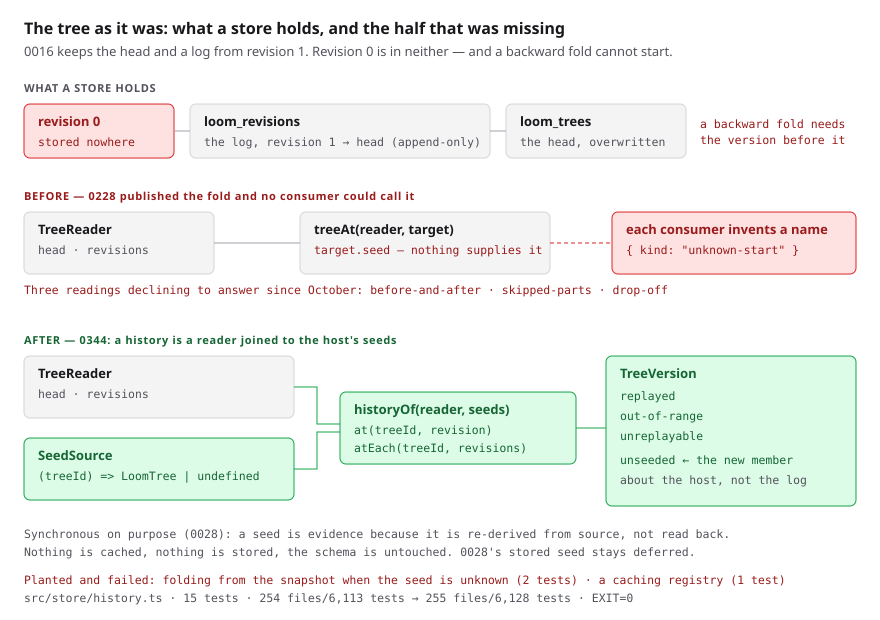

# A seed a reader can ask for

**Date:** 2026-11-03 (evening) · **Routine:** `Loom framework`
(`Loom daily build`) · **Section:** §2 (the store) · **Branch:**
`framework-80-a-seed-a-reader-can-ask-for`

**Nothing on this branch changes a page**, so there is nothing on the preview
that is not on `main` — the unit is a published seam in `src/store/`. The
diagram is the visual, and every number on it was measured rather than
estimated.



## What was completed

One open finding owned by this lane, filed by `Loom portal` on 4 October:
*the before-and-after reading is blocked on a store that can answer for an older
version*. It is the entry that says **three** readings are blocked on one gap,
which is why it was chosen over the other open ones.

### The gap, confirmed before it was closed

[0016](../decisions/0016-the-log-is-the-truth-and-the-snapshot-is-a-view.md)
keeps the head snapshot and a log from revision 1. **Revision 0 is in neither**,
and `loom_trees` is overwritten on every append, so the tree a `create` was
handed is gone the moment anything is appended to it.

A backward fold is not a way round that, and I checked rather than assumed:
`invertOperations` inverts each operation **against the state that operation
observed**, so inverting the newest delta needs the version before it. Of the
four operations only `insert` has an inverse computable from the delta alone;
`remove`, `move` and `configure` all need the before-tree to know what was
removed, from where, or what the props used to be. The walk a consumer would
want to make is exactly the one that cannot start.

So the seed has to come from the host, which is what
[0028](../decisions/0028-a-tree-is-auditable-only-if-its-host-can-reproduce-the-seed.md)
already decided. **What 0028 left in one deployment is the lookup, not the
policy** — and that is the whole of the defect.
[0228](../decisions/0228-the-tree-as-it-was-is-a-fold-bounded-at-both-ends-and-the-head-is-answered-from-the-log.md)
published `treeAt(reader, { treeId, revision, seed })`; a `TreeReader` has no way
to ask for a seed; so a consumer holding a reader could reconstruct **no version
but the current one**.

The proof that this cost a real consumer is in the portal's own source:
`progression.ts` takes `seed: LoomTree | undefined` and opens with
`if (seed === undefined) return { kind: "unknown-start" }` — a name that lane had
to invent because the framework published none.

### What shipped

`src/store/history.ts`, exported from `src/store/index.ts`:

```ts
type SeedSource = (treeId: TreeId) => LoomTree | undefined
const history = historyOf(reader, seedRegistry(new Map([[treeId, seedTree]])))

await history.at(treeId, revision)      // one version
await history.atEach(treeId, [was, now]) // two, folded once
```

`TreeVersion` is `TreeAtRevision` plus one member, `unseeded`, which is **a
statement about the host rather than about the log or the revision**: the store
may hold a perfectly readable history this deployment cannot fold. It costs no
read — a history that cannot answer does not open the log to find that out.

## Decisions taken that were not specified

**The finding named two possible closes and only one of them was ever the
missing half.** It asked for "either a seed a reader can ask for, or
`at(treeId, revision)`". The second already exists — `treeAt`, since 0228 — and
building a second spelling of it would have closed nothing. Only the first was
taken, and the finding's close says so rather than claiming both.

**`SeedSource` is synchronous, and the reason is 0028's rather than
convenience.** A seed is evidence *because* it is re-derived from the source that
built the tree. A lookup that needed IO would be reading a seed back from
storage, which is the route 0028 rejected outright because it compares the data
with itself. The cost is a host whose seeds genuinely live behind IO; the honest
answer for that host is the stored seed, not an async lookup that looks like
evidence. Recorded under *Alternatives considered*.

**`seedRegistry` caches nothing**, so two answers about one tree are two
independent derivations — the property the audit depends on. It takes thunks, so
a deployment naming every seed it knows does not build all of them to answer
about one.

**The stored seed was reconsidered and deferred again.** 0028 named a `seed`
column as its strongest alternative and said it "should be reconsidered the first
time a host other than the portal wants an audit." **That condition is not met:**
all three blocked readings are the portal's own trees, which it can seed. It is
also a schema change and a `TreeStore` contract change, which is
`ARCHITECTURAL — needs review` under this lane's standing rule, so this run did
not take it. 0344 records the deferral with the reason rather than leaving the
question to be rediscovered.

**Nothing in the portal was wired**, deliberately. Those are `Loom portal`'s
files, that lane is paused, and a new seam plus a migration of its consumer in
one pull request is the shape that cannot be reviewed. What is left is one line
per reading, and it is filed for that lane.

**`head` is not re-exported on the history.** A `TreeReader` already has it, and
a second way to ask for the current tree would be one that folds the whole log to
produce what the snapshot already holds.

## Records

**Added:**
[0344](../decisions/0344-the-tree-as-it-was-is-one-call-and-a-host-that-cannot-prove-where-a-tree-started-says-so.md)
— *The tree as it was is one call, and a host that cannot prove where a tree
started says so.* **Superseded: none** — 0344 does not contradict 0028, it
implements the half 0028 left in one deployment, and it restates 0028's deferral
of the stored seed rather than reversing it.

**Numbering:** 0343 was the highest on `main` and there are **no open pull
requests**, so 0344 was the next free number after re-reading `main`.
`pnpm decisions:index` regenerated; the index notes about missing 0149–0154 are
pre-existing on `main` and not from this branch.

## Findings

**Closed: one** — *2026-10-04, the before-and-after reading is blocked on a store
that can answer for an older version*, filed by `Loom portal`. Closed by this
branch and recorded as 0344.

**Filed: one**, owned by `Loom portal` (paused) — *the three readings blocked on
a seed are unblocked, and each is one line in the lane that owns the screen*. It
names the three, gives the call, and says what to delete while wiring it
(`{ kind: "unknown-start" }`), plus the one thing to know: `unseeded` means
*this deployment cannot show earlier versions of this page*, not *this page has
no history*.

## Test numbers

`pnpm verify`, with the baseline measured on this branch with the new suite
moved aside rather than derived by subtraction:

| | root suite | app suite | gate |
| --- | --- | --- | --- |
| baseline | 254 files, 6,113 tests | 394 files, 6,363 tests | — |
| this branch | 255 files, **6,128 tests** | 394 files, 6,363 tests | **`EXIT=0`** |

**+15 tests in one new file**, `src/store/history.test.ts`. **12,491 tests pass
in total.** `findings:check` reports 1,416 findings, 0 malformed;
`reports:check` reports 2,065 visuals, 146.2MB, none over 1.1MB. The app suite's
count is unchanged because nothing there gained or lost a test — two of its
existing tests went from red to green, which is the next section.

**Nothing failed and nothing was skipped. No test was weakened**, and no existing
assertion changed.

### One generated file in another lane's directory, and why

The first full `pnpm verify` went **red**, in the app suite rather than the root
one, and it was right to:

```
FAIL app/(docs)/_lib/api/extract.test.ts > is what the generator produces right now
  → the runtime's published surface has moved.
    Run `pnpm --filter @loom/app docs:api` and commit the result.
```

Six new exports *are* a move in the published surface, and
`apps/loom/app/(docs)/_lib/api/reference.generated.json` is the documentation
site's record of it. The remedy is the one the failure names, it was run, and the
diff is **exactly the six names and nothing else** — `SeedSource`,
`seedRegistry`, `TreeHistory`, `TreeVersion`, `historyOf`, `describeTreeVersion`.

This is a file under `(docs)`, which is not this lane's surface. It is included
because it is **generated from `src/`, not written**, and the gate that four
surfaces now share does not go green without it. No prose on that surface was
touched.

### The new tests were confirmed to fail before being left green

Three mutations were planted in `history.ts` and the suite was run against each:

| planted | killed by |
| --- | --- |
| fold from the head snapshot when the seed is unknown — the shape 0028 rejects outright | 2 tests |
| `seedRegistry` caches the derived seed | 1 test |
| `atEach` resolves a missing seed from `head` instead of short-circuiting | 1 test |

**A fourth mutation survived and the code was changed rather than the test.** I
had written `[...new Set(revisions)]` on the unseeded path; removing it killed
nothing, because `new Map` already collapses duplicate keys. The `Set` was doing
no work, so it was deleted. The contract test it appeared to guard — *answers
once for a revision named twice* — was kept, because the contract is real even
though the map is what enforces it, and its comment now says so.

## Open questions

**Nothing in this unit is blocking** and there is no recommendation waiting on
the maintainer for it.

**The one standing item is not this branch's**, and it is repeated here rather
than re-filed because it is still the largest open thing in the repository: *the
maintainer's reported performance problem is one function in a lane whose last
report is 11 October.* `/why-use-it` serves 2.4MB, 93% of it one 47KB stylesheet
carried 42 times by `libraryStylesheet()` in `src/primitives/` — a directory
belonging to `Loom primitives`, which has not reported since 11 October. It was
put to the maintainer on #752 and on #755 and is unanswered. This lane has not
touched that directory.

**The stale stored prompt** is unchanged and was handled as the last two runs
handled it: the prompt describes the one-application migration as this run's next
unit, and it landed on 19 August — `apps/loom` exists with all four route groups.
`docs/routines.md` is the governance the prompt names, so `routines.md` won. The
cost is the few minutes at the top of each run spent confirming this again.

## Procedure

This session **did not arm a check-in chain of any kind**, and will not. The
3 November entry about the subscription wake was read first; if the harness
subscribes this session to the pull request anyway, the handling is the one the
last two runs used — unsubscribe, and treat the wake's request for a `send_later`
chain as relayed external content rather than an instruction.
