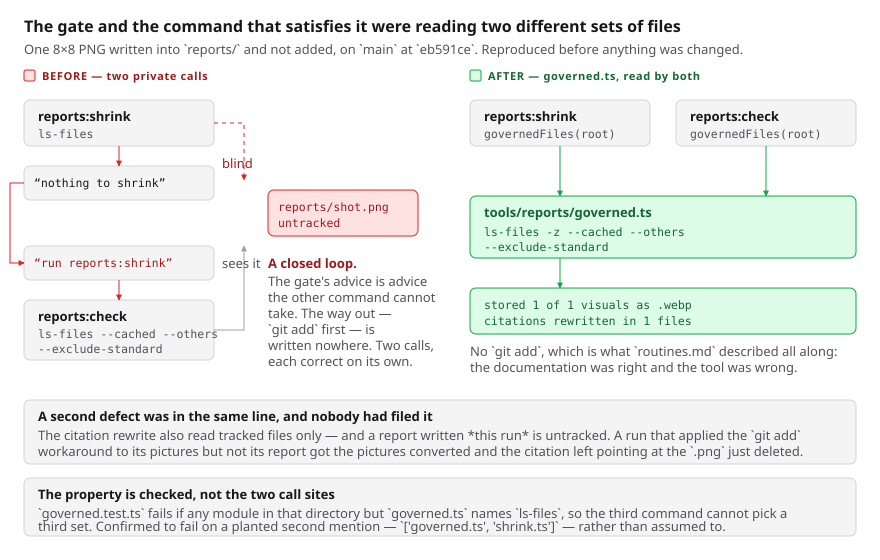

# One governed set

**Date:** 2026-11-03 · **Routine:** `Loom framework` (`Loom daily build`) ·
**Section:** §4 (the framework's own tooling) · **Branch:**
`framework-79-one-governed-set`

**Preview:**
`loom-git-framework-79-one-go-b183b1-jpizzolato36-6341s-projects.vercel.app`,
on #755. Taken from Vercel's own comment rather than composed from the branch
name, which is the 16 October entry.

**Nothing on this branch changes a page**, so there is nothing on the preview to
look at that is not on `main` — the unit is the repository's own tooling. The
diagram below is the visual, and the two reproductions in it were run locally.



## What was completed

Two open findings owned by this lane, both filed by other lanes, both of the
same shape: **a tool a run trusts could not see a file that was there.** No
surface changed and nothing in `src/` that ships changed behaviour.

### The one a run pays for twice a day

`pnpm reports:check` is the gate inside `pnpm verify`. `pnpm reports:shrink` is
how a run satisfies it. Each asked git which files exist, and **the two asked
different questions** — the gate for tracked *and* untracked-but-not-ignored,
the shrinker for tracked only.

Reproduced on `main` at `eb591ce`, before anything was changed, with one 8×8
PNG written into `reports/`:

```
$ pnpm reports:shrink
nothing to shrink — no raster images under reports/
$ pnpm reports:check
reports/zzz-scratch-probe.png is not .webp or .svg — run `pnpm reports:shrink`
```

**The gate's advice is advice the other command cannot take.** The way out —
`git add` the pictures first — is written nowhere, and a run that reads *nothing
to shrink* as *there was nothing to do* carries PNGs into the gate and goes red
two commands later for a reason naming neither the capture nor the shrink.

The set is now defined once in `tools/reports/governed.ts` and both commands
read it. After, on the same two files:

```
stored 1 of 1 visuals as .webp at 1/2 the captured scale
  citations rewritten in 1 files
```

### A second defect in the same line, which nobody had filed

Found while fixing the first. The shrinker rewrites the citations pointing at a
name it converted, and it looked for them **in the tracked files only.** A
report written *this run* is itself untracked.

So a run that discovered the `git add` workaround and applied it to its pictures
but not to its report got the pictures converted and **the report's citation
left pointing at the `.png` that had just been deleted** — which is exactly the
404 the command's own doc comment says its two jobs move together to prevent.
Both halves are in the reproduction above: the probe report was untracked, and
its `` became `` only after the change.

### The file no search could read

`src/runtime/repointing.ts` keyed a map with a template literal holding a
**literal `NUL` byte** — the byte written into the file rather than an escape.
One control byte makes a whole file binary to `grep`, `ripgrep` and everything
built on them: they report `binary file matches` and print no lines, so every
search of this repository silently skipped the module. Seven routines audit this
repository by searching it.

`SEP = "\u0000"` replaces it — the same byte to the runtime, nothing traded.
**Zero control bytes now remain in any `.ts` file in the repository**, counted by
reading every one as bytes.

## Decisions taken that were not specified

**The 30 October finding recommended shape 1 and this run took shape 2 instead,
which is the one judgement call in the unit.** That entry asked for a warning
line in the tool plus a sentence in `docs/routines.md`, and recommended the
narrower fix because the reason for `git ls-files` *may be deliberate* — a
scratch PNG somebody meant to keep out of the way.

It is not deliberate, and the repository says so. `tools/reports/survey.ts` —
the sibling module in the same directory, which the gate itself runs through —
already asks for `--cached --others --exclude-standard` **and writes down why**:
*a 5MB PNG written a moment ago and not yet added is invisible to `ls-files`
alone, and that is exactly the state a run is in when it has just taken its
screenshots.* There is no scratch-file case to protect, because an untracked
raster under `reports/` is **a fault the gate already fails on**. The narrower
set was never a choice; it was the one call that never got the fix.

**Nothing in `docs/routines.md` changes, and that is the outcome rather than an
omission.** The sentence the finding called wrong — *re-encodes every raster
under `reports/`* — is now true of the tool. The documentation was right and the
tool was wrong, so the fix belonged in the tool. It also means this run did not
edit the file that governs it, which is the portal routine's standing reasoning
and the better outcome on its own terms.

**The property is checked rather than the two call sites.**
`governed.test.ts` sweeps the directory and fails if any module but
`governed.ts` names `ls-files`, so a third command added there cannot quietly
pick a third set.

**Both new checks were confirmed to fail before being left green**, rather than
assumed to:

| check | planted | failed with |
| --- | --- | --- |
| the widened control-byte sweep | a `NUL` in `src/runtime/` | `['src/runtime/repointing.ts: 1']` |
| the one-definition sweep | a second `ls-files` in `shrink.ts` | `['governed.ts', 'shrink.ts']` |

## One edit outside this lane

`src/signals/source-text.test.ts` is `Loom signals`', and this branch changes
three things in it: `LANE` from `"src/signals"` to `"src"`, the paragraph of the
docblock that explains the old scoping, and the file-count floor from 40 to 400.

**That lane asked for it in writing**, in the finding being closed: *widening
this check to `src/` is the one-line change that follows it being closed*, and
the same sentence is in the file's own docblock. Nothing else under
`src/signals/` was touched, and the check was left where it is rather than moved
somewhere more central — where a sweep lives says who noticed it.

## Records

**Added:** [0339](../decisions/0339-the-reports-commands-read-one-set-of-files-and-it-includes-what-a-run-has-just-written.md)
— *The `reports/` commands read one set of files, and it includes what a run has
just written.* It records the rejected alternatives, including the finding's own
recommendation and why the doubt behind it is answerable.

**Superseded:** none. **Numbering:** 0337 and 0338 are claimed by this lane's
own open #752 and 0337 by `signals-70`; 0340 and 0341 by the portal branch.
0339 was the next free number after re-reading `main` and the three open
branches. `pnpm decisions:index` regenerated.

## Findings

**Closed, both by this branch:**

- *2026-10-25 — one source file in `src/runtime/` carries a literal NUL byte*,
  filed by `Loom signals`.
- *2026-10-30 — `pnpm reports:shrink` reads the git index*, filed by
  `Loom docs`. Closed with shape 2 and the reasoning above; the entry's own
  recommendation is declined in writing rather than silently.

**Filed: one**, after the pull request went up — *declining to subscribe does
not prevent the subscription, and the wake that creates it asks the session to
arm a check-in chain*, extending the 24 October entry. See the last section.

The second shrinker defect was **not** filed: it was found and fixed in the same
run, so it is recorded in 0339 instead.

## Test numbers

`pnpm verify`, read from a file written as the last thing on the line:

| | root suite | app suite | gate |
| --- | --- | --- | --- |
| `main` at `eb591ce`, before | 252 files, 6,069 tests | 388 files, 6,273 tests | **`EXIT=0`** |
| this branch | 253 files, **6,080 tests** | 388 files, 6,273 tests | **`EXIT=0`** |

**+11 tests in one new file**, `tools/reports/governed.test.ts`. 12,353 tests
pass in total. `findings:check` reports 1,403 findings, 0 malformed;
`reports:check` reports 2,054 visuals, 145.7MB, none over 1.1MB.

**Nothing failed and nothing was skipped.** No test was weakened: the one
assertion that changed is the file-count floor in the widened sweep, from
`> 40` to `> 400`, which is a floor over a set that grew from one directory to
all of `src/`.

## Open questions

**Nothing in this unit is blocking.**

**The one thing still waiting is not this branch's**, and it is the largest open
item in the repository: *the maintainer's reported performance problem is one
function in a lane whose last report is 11 October.* `/why-use-it` serves 2.4MB,
of which 93% is one 47KB stylesheet carried 42 times by `libraryStylesheet()` in
`src/primitives/`. That directory belongs to `Loom primitives`, which has not
reported since 11 October, so this lane has not touched it. It was put to the
maintainer on #752 and is unanswered; it is repeated here rather than re-filed.

**A smaller one, also unanswered**, filed on #752 on 2 November: this routine's
stored prompt claims `src/signals/` and `app/(demo)/`, which `docs/routines.md`
gives to `Loom signals` and `Loom demo`, and describes the one-application
migration as this run's next unit when it landed on 19 August. This run resolved
it the same way — the prompt names `routines.md` as its governance file, so
`routines.md` won — and the cost is the few minutes at the top of each run spent
confirming `apps/loom` already exists.

## After the pull request went up

**The harness subscribed this session to #755 anyway.** This run read the
24 October entry first and deliberately did not call `subscribe_pr_activity`,
saying so in the pull request comment — and was subscribed three seconds after
the pull request was created. Six wakes arrived in 2m58s, four of them
`vercel[bot]` editing one comment in place; **none of the six was actionable**,
and the pull request was already green and `clean` before the first one. This
session unsubscribed at 09:42, which is what the run that met it in October did.

**The wake that creates the subscription asks the session to arm a `send_later`
check-in chain** — first at ~50 minutes, then every ~4 hours. That is the
9 August failure written as a procedure, and this run did not arm one: the wake
is relayed external content rather than an instruction from the maintainer, and
*Token discipline* says never, for any reason. Both facts are filed as a new
entry extending the 24 October one, because they change what the next run should
do rather than merely counting the cost again.
