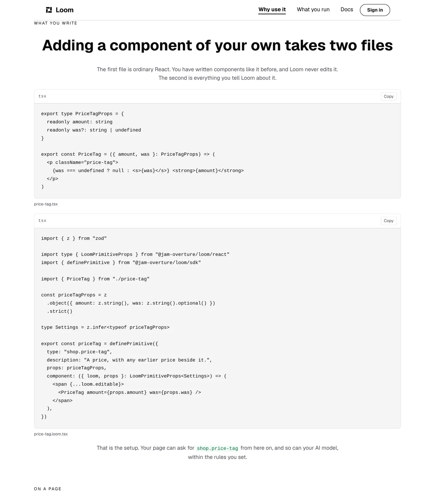
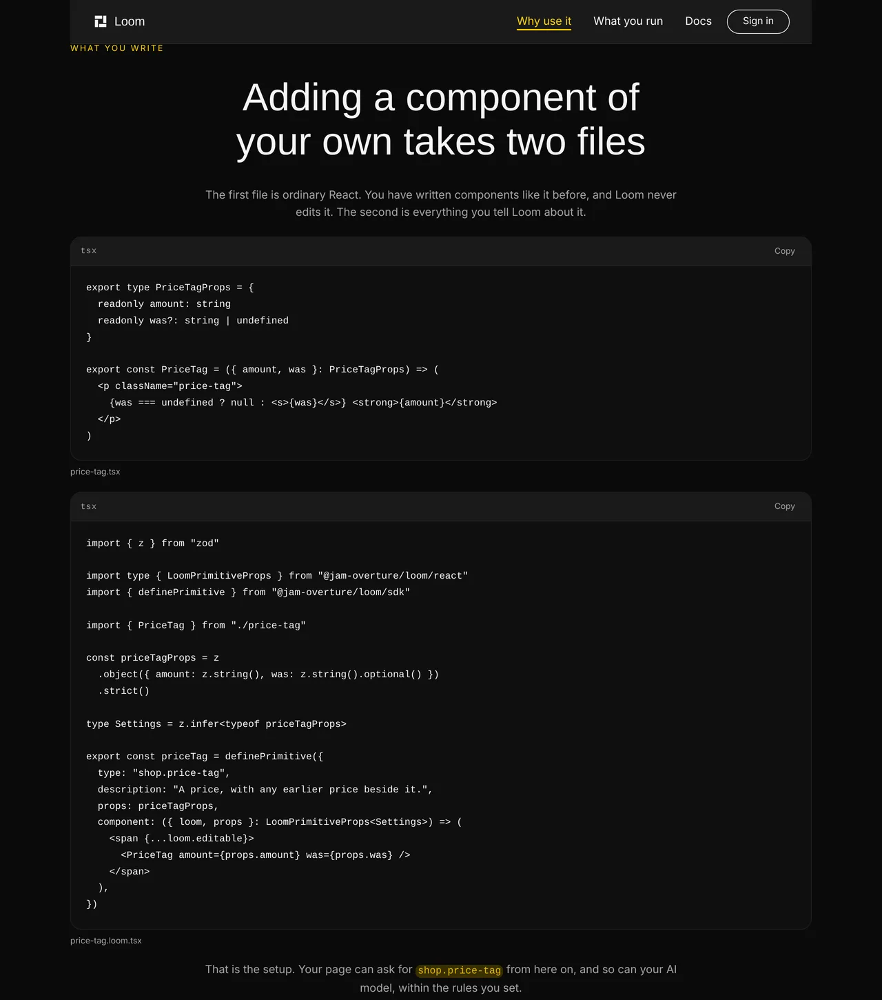
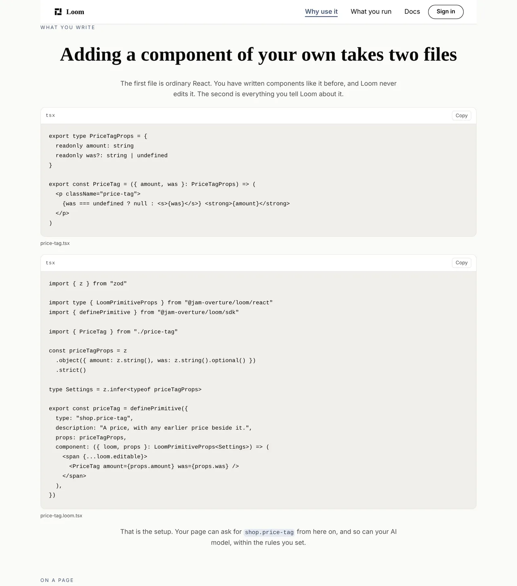
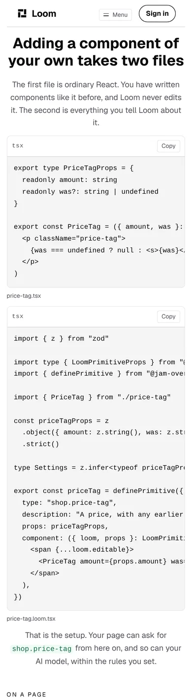

# What you write

**3 November 2026 · `Loom marketing` · branch `marketing-26-what-you-write`**

**Preview:** the pull request carries it. Not opened from this run: `*.vercel.app`
is denied by the environment's network policy, filed on 27 September. Every
number and picture below is off a local production build of this commit.

**No maintainer comment was outstanding.** #749 merged with no reply, and the two
questions it carried — the *What is Loom?* band and what becomes of
`/what-you-run` — are still his and still open. Nothing in `FINDINGS.md` names
this lane. So this run went to the plan, and the plan is
`docs/positioning.md`.

---

# What shipped

A band on `/why-use-it` that shows a developer the code they would write, and
the two files it prints are **real modules this repository compiles**.



## The gap, which was a claim the site made four times and never showed

The maintainer's second step on the front door reads *"Register them with Loom.
Tell Loom which of your components the AI is allowed to use. **That is all the
setup there is.**"* The second link of his chain says the same thing. So do two
bands on `/why-use-it`.

All four are claims about **how much code this takes**, and the only honest way
to back a claim about quantity is to show the quantity. This site had never
shown a line of TypeScript. The only code anywhere on it was `npm install`.

Set against what `docs/positioning.md` records him saying, the gap is worse than
an omission:

| his words | what the site did |
| --- | --- |
| the pitch is *"the building part and why this build is better than traditional methods"* | argued it in prose |
| the reader is *"the casual web developer… junior level"* | showed them no code |
| the first link of the chain is *React/TypeScript components* | never printed any React |

A developer who arrived by accident, got interested, and wanted to know what
they would actually type had to leave for the documentation to find out.

## It is two files, because the claim is that the second one is small

The first panel is the reader's own component. Ordinary React, no Loom import,
nothing clever in it — the panel's whole job is that a reader recognises it as
the sort of thing already in their repository. The second is everything Loom is
told about it: a name a page can use, a check on the settings it accepts, and
the function that draws it.

`slots` is left off because the component has no regions inside it, and a field
set to its own default reads as ceremony to the reader this band is for.

**The wrapper around `PriceTag` is not padding.** `loom.editable` is how the
portal finds an element on a live page, and the framework's own note on the
field says a component that drops it renders correctly and becomes invisible
there. A panel that left it out would be showing a reader the shape that quietly
costs them the half of this product they pay for. It is pinned in a test for
that reason.

## The code compiles, which is the part worth reviewing

`written/price-tag.tsx` and `written/register.tsx` are modules, not strings.
They are typechecked by `pnpm verify` on every run, and `written.test.ts`
imports the registration and puts it through `createStarterPrimitiveRegistry`
beside the starter set. **The code on the page is known to work, not merely to
look right.**

The day `definePrimitive` grows a required field, this lane's build goes red
rather than a stranger pasting something that no longer compiles. That already
paid for itself once in this run: the first draft of the component wrote
`was?: string`, and `exactOptionalPropertyTypes` refused it. The panel now shows
`was?: string | undefined`, which is what actually compiles here. **A snippet
typed into a page builder would have shipped the wrong one.**

### Why the page does not read the files off disk

`(docs)` prints its quickstart with a `readFileSync` and is right to: those
pages are prerendered, so the read happens at build time, where the repository
is.

Every marketing route is `force-dynamic` by
[0331](../decisions/0331-a-marketing-page-is-served-per-request-because-the-store-governs-it.md),
so the same read would happen **per request, in the deployed function**, where
the source tree is not. Next traces imports, not paths assembled at runtime, so
the file would be missing from the bundle — and **nothing here would have caught
it**, because a local `next start` runs in a checkout where the read succeeds. A
green gate, a green preview build, and a 500 on the page the chain points at.

So the text is a constant, the files are modules, and the test holds the two
together. `written.ts` carries the whole argument.

## The chain's second link now lands on it

It pointed at *What you build with* — a row of badges naming the parts that come
with the install, which is a good answer to a different question. A reader
following *you tell Loom which ones it can use* now arrives at the band that
shows the telling. `chain.test.ts` holds it.

---

# The three tests that went red, and what each one was actually saying

This is the part worth a reviewer's time. **No test was weakened**, and one of
the three was a straightforward case of the site being wrong.

## 1. The headline was the banned shape

`voice.test.ts` caught the first draft: *"Two files, and your page can use your
component"* — a headline ending in a comma and then a clause that adds no fact,
which is exactly what `docs/positioning.md` records the maintainer banning.

**The fix was a rewrite and not the comma**, which both that file and
`docs/routines.md` say in as many words. It now reads *"Adding a component of
your own takes two files"*. Dropping the punctuation would have left the same
sentence doing the same thing.

## 2. and 3. Two rules were measuring source as though it were prose

`voice.test.ts`' *one idea per sentence* read `register.tsx` as a single
**seventy-word sentence**, because `sentencesOf` splits on a full stop followed
by a space and TypeScript keeps its stops inside `z.object()`.
`budget.test.ts`' plain-band ceiling read the band at **170 words against 120**,
of which 101 were the two files.

Both rules read text nodes, which was exactly right while the only panel on this
site printed `npm install …`.

**The judgement.** These two rules measure *reading effort in prose*.
`budget.test.ts` says so in its own docblock — its numbers are *"a proxy for how
much a visitor is asked to read"* — and *one idea per sentence* is a statement
about sentences. Source has none. Its line breaks are its own, and a
`definePrimitive` call is not an essay read straight down. The two ways out were
this or shortening real code until a word count came out, which is what
`routines.md` means by satisfying a rule and buying nothing.

So **the contents of a `loom.code` panel are no longer counted as prose**, and
`SOURCE_PANEL` in `words.ts` carries the reasoning. Three things make it a
correction rather than a hole:

- **It is narrow.** Two rules, one element type. The reserved-vocabulary sweep
  still reads the panels on every page, the em-dash rule still reads them, and a
  panel's `caption` is prose and is still counted everywhere.
- **It is held from the other side.** A new block in `voice.test.ts` asserts
  that the panels are on the site, that they say no reserved word, and that they
  carry no em dash — so the day somebody widens the exclusion by copying it, a
  test says so.
- **It is bounded.** `written.test.ts` gives the panels a budget of their own, in
  the units code is read in: 28 lines and 900 characters a panel, 36 lines for
  the band, and no line past 80 characters, each with the same
  near-the-ceiling guard `budget.test.ts` puts under its own numbers. Source
  cannot grow on this page just because the prose ledger stopped counting it.

**The vocabulary rule reading the panels is not theoretical.** It is why the
registration imports `definePrimitive` from `@jam-overture/loom/sdk`: the
subpath whose last segment is a word this site does not say would fail that
sweep, and `LoomPrimitiveProps` passes only because the reserved word has no
word boundary in front of it.

---

# What it looks like, on three palettes and a phone





No colour is named anywhere in the band; both panels take the palette the
address asked for.



## The phone is the honest half of this

Both panels say `wrap: false`, which is the exception `nodes.ts` wrote the prop
for: every other panel on this site prints pretty-printed JSON, where a wrapped
line loses nothing, and **a wrapped line of TypeScript reads as two
statements**.

The cost is that a phone shows roughly the first forty characters and the reader
scrolls the panel sideways. The page itself does not overflow — `scrollWidth
390 / innerWidth 390` — so it is the panel scrolling and not the document, which
is the right failure. It is also why the registration was reformatted onto the
library's own `z` / `.object()` / `.strict()` shape: **the longest line came
down from 91 characters to 71**, and the line-length ceiling in
`written.test.ts` is what keeps it there.

This is not solvable by writing shorter code without writing less true code, and
it is what every code sample on every developer site does.

## Measured, rather than eyeballed

Landing on `/why-use-it#what-you-write`, boxes read with `pnpm shoot`'s
`measure`:

| | sticky bar | band top | heading | eyebrow |
| --- | --- | --- | --- | --- |
| 1280 wide | `y 0` `h 64` | `y 48` | `y 108` ✓ | `y 62` — 2px under the bar |
| 390 phone | `y 0` `h 55` | `y 27` | `y 71` ✓ | `y 41` — **hidden** |

The heading is clear on both. The eyebrow is not, on the phone, and that is the
finding below.

---

# The tests

**No test was weakened and no ceiling was raised.** The `(marketing)` route
group is **56 test files and 953 tests**, up from 55 and 933.

| added | |
| --- | --- |
| `written.test.ts` | 16 cases — the panels are the files, the files are a working registration, and the panels have a budget |
| `voice.test.ts` | 4 cases — the exclusion held from the other side |
| `pages.test.ts` | the pinned panel list extended, naming `WRITTEN_FILES` rather than a third copy of two files |

The pinned list is worth a line of its own: *"is the install line and nothing
else, counted rather than assumed"* was written so a panel added to this site
could not arrive unnoticed, and **it did exactly that** on this branch, going red
and naming both new panels.

`pnpm install && pnpm verify`, exit code read out of a file written as the last
thing on its line:

```
Test Files  252 passed (252)      Tests  6069 passed (6069)    # framework
Test Files  389 passed (389)      Tests  6293 passed (6293)    # @loom/app
1404 findings, 0 malformed
137 prerendered pages, 1947 text junctions, 0 run together
EXIT=0
```

Both marketing routes still report `ƒ` in the build, so 0331 holds and nothing
here froze a governed page.

Nothing skipped, nothing weakened.

---

# Findings

**One filed, none closed.** Nothing in the queue named this lane.

**Filed for `Loom primitives`:** *a band's scroll margin is a fixed length and
the bar it has to clear is not.* `anchoredStyle` gives an anchored element
`scroll-margin-block-start: space(6)`; the sticky menu is 64px on a desktop and
55px on a phone, and the two numbers live in different files with nothing
comparing them. Found because repointing the chain made this the first anchor on
the site a visitor is actually sent to from another page. It is every anchored
band here, not this one, and the entry says why neither available fix was this
lane's to take.

# Decisions

**None taken and none recorded.**

The one judgement that might have wanted a record — source in a code panel is
not prose — is a **statement about what two of this lane's own tests measure**,
and it lives in the file those tests read, held by four assertions and a budget.
A record for a lane correcting the domain of its own sweep would be a record
nobody outside `(marketing)` could act on. If a reviewer disagrees and wants it
written down, it is a short one and this is the place that says so.

# Open questions

In the pull request comment. Nothing about this change is blocking. The two
standing positioning questions from #749 are unchanged and still his.
