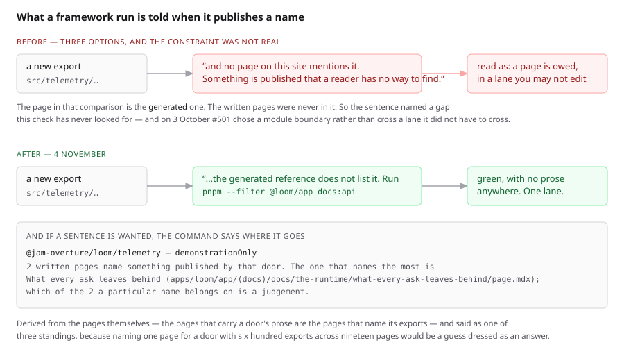

# 4 November 2026 — a published name has a derived home, so publishing one is not a two-lane operation

**Routine:** `Loom docs` · **Branch:** `docs-77-where-a-new-name-lands` ·
**Section:** §4c

No open pull request from this lane at the start of the run. #758 merged
yesterday as `bc289e3`. Four were open — #762 (`Loom marketing`), #761 and #759
(`Loom daily build`), #760 (`Loom signals`) — none of them this lane's. #759
touches one file inside the `(docs)` route group, which is
`_lib/api/reference.generated.json`: a generated file, regenerated by the
command its own failing test names, and no prose on this surface was changed.

**No maintainer comment is outstanding for this lane.** Every non-bot comment on
#758–#762 opens with the mention this lane's procedure requires, which makes it
a routine's own.

Branch cut from `origin/main` at `bc289e3` (#758), after `git fetch origin main`.



## The plain version

When the framework publishes a new name, that name appears on this site
automatically: the API reference is generated from the package's own
declarations, so the signature and the sentence the author left on it are there
the moment somebody runs one command. What a generated page cannot do is explain
the thing in a paragraph. That is prose, prose lives in an MDX file, and
somebody has to decide **which** file.

`Loom daily build` filed a finding on 3 October saying that this made publishing
a name a two-lane job: the framework can add the export and regenerate the
reference, and it cannot write a page under `(docs)`. So a run that wanted to
publish something had three options — leave it unpublished, cross a lane
boundary, or file a finding and wait a day. It recorded that **#501 had picked
its module boundaries under that constraint rather than on merit.** The entry
asked this lane for one thing: *say which page takes a new runtime export by
default.*

**The first half of the answer is that the constraint does not exist, and the
sentence that made it look like it does was in this directory.**

## Nothing on this site requires prose for a published name

`offered.ts` holds a published door against the **generated** page.
`extract.test.ts` asks whether the generated file is current. The written pages
are in neither comparison. A framework run may add an export, run
`pnpm --filter @loom/app docs:api`, and be green with no prose anywhere — which
is the state the large majority of this package's published names are in, and
the normal case rather than a backlog.

The sentence the finding quotes is `not-listed`'s:

> `@jam-overture/loom` hands back a object called `irreversibilityReasonSchema`
> and **no page on this site mentions it. Something is published that a reader
> has no way to find.**

Every clause of that is about the written pages. **The written pages are not in
the comparison.** It described a gap this check has never looked for, and it is
the only reason the finding exists. It now reads:

> `@jam-overture/loom/telemetry` hands back a function called
> `demonstrationOnly` and **the generated reference for that door does not list
> it.** Run `pnpm --filter @loom/app docs:api` and commit the result; if the
> name is still missing afterwards, the generator cannot see it in the published
> declarations, which is the harder half. **Nothing here asks for prose.**

That is the real sentence, taken off a run with a name temporarily published in
`src/telemetry/journal.ts` and the generated file left as it was. The harder
half is named because regenerating is the remedy for the common case and not for
all of it — a name the generator cannot see in the declarations survives the
command, and a reader who runs it and gets the same failure needs to be told
that is a different problem rather than left to run it again.

## The second half: where a sentence goes, if one is wanted

`_lib/api/prose-home.ts` answers the smaller question that survives. It is
**derived**, from the one piece of evidence that cannot drift — the written pages
already print these names, so the pages that carry a door's prose are the pages
that name its exports. A hand-written map from door to page is exactly what §4c's
rule about a generated reference exists to refuse, and it would be wrong within
a week in the quietest possible way.

It answers as one of three **standings** rather than always naming one page,
because naming one page for `@jam-overture/loom` — six hundred exports across
nineteen written pages — would be a guess dressed as an answer.

| standing | what it means | doors |
| --- | --- | --- |
| `one` | one written page names anything on that door, so there is nothing to decide, and the entry names the `page.mdx` | **6** |
| `several` | more than one does; the shortlist is given commonest first and the judgement is named as a judgement | **10** |
| `none` | no written page names anything on it, so a sentence would be the first on the site — a page rather than a line, and this lane's work | **1** |

### Delivered where the question is asked

Not in a file somebody has to find. `docs:api` prints it after a regeneration
that published something — this is the real output of the run described above:

```
loom: wrote 17 entry points and 1917 exports to reference.generated.json
loom: 1 name is new, and the generated reference is where it appears.

Nothing on this site requires prose for a published name: the gate holds the
generated page against the package and asks nothing of the written pages. Most
published names have a signature and the sentence on their declaration, and
nothing else.

If you want a sentence for one of these, or are filing one for `Loom docs`,
this is where it would go:

  @jam-overture/loom/telemetry — demonstrationOnly
    2 written pages name something published by @jam-overture/loom/telemetry.
    The one that names the most is What every ask leaves behind
    (apps/loom/app/(docs)/docs/the-runtime/what-every-ask-leaves-behind/page.mdx);
    which of the 2 a particular name belongs on is a judgement, so say what the
    name is for and let `Loom docs` place it.
```

The staleness assertion carries the same block when it fails, because **that is
the message a run sees before it has run the command** — which is the moment the
3 October belief was held. Confirmed red, with the same block, on the same
temporarily published name.

**The opening sentence is load-bearing rather than a pleasantry**, and it is
asserted as such: a block that listed homes without saying nothing is required
would reproduce the belief in a friendlier font. One test holds that the
no-prose-required sentence comes before the where-it-goes list, by index.

## The reader-facing half

Each row on the reference's front door now says how much of this site writes
about that import. It is the one thing a reader choosing an import cannot see
from the inside: each reference page says it about its own door, and by the time
they are reading it the choice is made.

**Nought is the answer that earns the line.** Sixteen rows reading *named on
four written pages* would be decoration; one reading *No written page names
anything published by this import* is the whole reason a reader is shown this,
and it is only legible beside the others.

It says *names* rather than *explains*, which is the restraint the per-door band
already keeps: what the site knows is that the page prints the name in code, and
whether the page teaches the export is a judgement nobody made.

### It costs the search index nothing, and that was measured rather than assumed

The prose index sits **338 bytes under its total cap** — the open finding of
26 October, and the binding constraint on this site. These are seventeen
near-identical lines on one page, so they were measured both ways:

| | gzipped total | the `api-reference` section |
| --- | --- | --- |
| `origin/main` | **79,662** | 3,789 |
| this branch, lines indexed | 79,728 | 3,855 |
| this branch, `data-search="off"` | **79,662** | 3,789 |

**66 bytes gzipped, a fifth of the whole site's remaining headroom**, on text
nobody will ever type into the box: *named on four written pages* is a label
beside a row rather than a query. Off, the index is **byte-identical to `main`**.
The claim a reader might actually search for is the one each reference page
already makes in prose under its own door, and that one is indexed.

## Decisions taken that were not specified

- **The answer is a standing rather than one page.** The alternative — always
  name the page that reaches most of the door — is decisive for six doors and a
  guess for the widest, where nineteen pages name something and a new export
  about trees belongs on a different one from a new export about models. A
  shortlist with the judgement named as a judgement is the strongest thing the
  evidence supports.
- **The `not-listed` sentence was replaced rather than added to.** Keeping the
  old clause beside the new one would leave the words that cost another lane a
  module boundary on the page, in a message read by somebody who does not know
  the code.
- **`homes` is a required argument to `doorwayOf`, not a defaulted one.** This
  lane's 2 November lesson: an argument that defaults to an empty list makes
  every assertion over it true. An empty default would have answered *nought*
  for all seventeen doors with nothing red.
- **A door with no prose home is refused rather than drawn as a door with no
  prose.** The two are a long way apart — the first is a list that has stopped
  covering the doors, the second is a fact about the site — and printing the
  second in place of the first would put *no written page names anything on this
  import* under a door a dozen pages talk about.
- **The CLI door's missing page was filed, not written.** It is the one door in
  the `none` standing, and the question is not where a paragraph goes but
  whether the terminal half of Loom is documented as a tool or as a published
  import, and which section owns it. Both answers are defensible and produce
  different pages; a run picking one on its own would be writing the section's
  shape into a page.

## Records

None added, none superseded. Nothing here touches the tree schema, the delta
model or an `Accepted` record, and nothing is escalated as `ARCHITECTURAL`.

## Cross-lane diff

**None.** Every file changed is inside `apps/loom/app/(docs)/`, plus
`FINDINGS.md`, this report and its visuals. Nothing in `src/`, nothing in
another surface's route group, and no primitive was wanted that does not exist.

`src/telemetry/journal.ts` was **mutated and restored** as part of the two
measurements above — a temporary `export const demonstrationOnly`, to publish a
real name and read the real messages. `git diff origin/main -- src/` is empty,
and `reference.generated.json` is byte-identical to `main`.

## Findings

**One closed** — the 3 October entry, with both halves of the answer written
into it, including the sentence that its own premise was wrong.

**Two filed:**

- **Closed on filing** — the general version of the defect, which is not about
  this sentence. 3 November's entry asked of a *test*: which two things does it
  compare? The same question has to be asked of a **message**: which two things
  does it say it compared? A message is the only part of a test read by somebody
  who does not know the code, and the only part nothing checks by default. The
  remedy taken is to assert the sentence wherever a reader is expected to act on
  it. The remedy **not** taken, with the reason, is a sweep over every fault
  message in the directory: a message is prose about a comparison and there is
  no way to state that as a fact.
- **Open** — `@jam-overture/loom/cli` publishes twenty-five names and no written
  page on this site names any of them. It is the only door in that state, it is
  now visible to a reader rather than only to a measurement, and the
  recommendation and the reason it was not taken today are in the entry.

### Standing entries this run met again and did not duplicate

- **`*.vercel.app` is denied by the environment's egress policy** (12 October,
  open). Every picture below was taken against a build in this container.
- **The composed preview URL** (16 October). The URL below is taken from the
  `vercel[bot]` comment rather than guessed from the branch name.
- **The commit author line** (23 October). `git config user.email` checked
  before the first commit: `noreply@anthropic.com`, the session default.
- **Mutation testing before the first commit** (27 October). Followed — the unit
  was committed as `b5b9254` before the first mutation, every restore was
  `git restore --source=HEAD -- "apps/loom/app/(docs)"`, and the whole set was
  **re-run in full against the branch head** after two mutations caused code
  changes.
- **A screenshot taken while the merge gate is running turns the gate red**
  (29 October, this lane's own). Followed: every picture was taken and shrunk,
  and `FINDINGS.md` and this report were written, **before** the gate was
  started.
- **`pnpm reports:shrink` reads the git index** (30 October, open, owned by
  `Loom daily build`). Worked around as that entry describes: the PNGs were
  `git add`ed before `reports:shrink` ran.
- **Never let anything run after the gate on the same line**
  (`docs/routines.md`). Followed — the status was written to a file as the last
  thing on its line and read in a separate command.
- **A number taken from another lane's growth is not this lane's number**
  (2 November, this lane's own). Met, and met in a new place: **three stale
  figures were found in one docblock** and removed. See below.
- **The prose index is near its total cap** (26 October, open). Met: the new
  lines are out of the index and the index is byte-identical to `main`.

### Three stale numbers in one comment

`api-reference.tsx`'s band docblock said *three of the eleven doors*, *nine
pages is the most any door draws* and *three hundred and sixty exports*. All
three were true when they were typed. All three were measured wrong on
4 November — every one of them **understating** the package, because the package
only grows. They are gone, replaced by the relation and a dated note saying what
happened.

It is this lane's 2 November finding's third instance and the first in a comment
rather than an assertion, which is the quieter place: an assertion that goes
stale goes red, and a comment that goes stale is read by the next person as
true.

## Test numbers

### What the check is worth, measured on a real published name

A temporary `export const demonstrationOnly` was added to
`src/telemetry/journal.ts`, which `src/telemetry/index.ts` re-exports, and the
package rebuilt. Both messages were then read off the real tree.

| | what it said |
| --- | --- |
| `docs:api` after the regeneration | `1 name is new…` and the door's own sentence, naming `what-every-ask-leaves-behind/page.mdx` — quoted in full above |
| `extract.test.ts`, generated file left stale | **red**, carrying the same block under the remedy |
| `offered.test.ts`, same state | **red**, with the corrected `not-listed` sentence, quoted in full above |

`src/` was then restored with `git restore --source=HEAD -- src/` and the
package rebuilt. `git diff origin/main -- src/` is empty.

### Eighteen mutations, eighteen killed

Each applied on its own against the branch's committed code, restored with
`git restore --source=HEAD -- "apps/loom/app/(docs)"`, with the suite re-run
between. **Run in full again against the branch head `3dcbf3d`**, because two of
them caused code changes and a mutation run that precedes a fix no longer
describes the code.

| what was put in | what failed |
| --- | --- |
| the three standings collapse — `several` reads as `one` | 2, including the real site's own standings |
| a landing page's file gets a segment of its own | 2, including the file-path case |
| an unresolvable mention is dropped rather than refused | the unlisted-address case |
| `namesArrived` compares the two references the other way round | **7** |
| `namesArrived` keeps a door with no new names | 3, including the real reference against itself |
| `whereProseGoes` counts a name on two doors twice | the two-doors case |
| the *nothing requires prose* sentence dropped from the block | the ordering case |
| the block is printed when no name is new | the nothing-new case |
| `doorwayOf` answers nought for a door with no home | the refused-door case |
| the `not-listed` sentence put back as it was | **2 — both of the new sentence's tests** |
| the row stops saying nought and prints the digit | the nought case |
| the candidates stop being ordered commonest first | 3, two of them this unit's |
| a candidate is offered that names nothing on the door | **6** |
| `proseHomes` drops a door rather than answering for it | 4 |
| `generatorSays` drops the where-prose-goes block | 2 |
| a missing committed file reads as a comparison that found nothing | the first-run case |
| the script stops writing what `generatorSays` returns | the source assertion |
| `staleReferenceMessage` stops carrying the block | 2 |

**One survived on the first pass and the code changed rather than the test.**
Deleting the where-prose-goes block from `generate.ts` killed nothing: a script
is the one kind of module nothing imports. The whole of `docs:api`'s standard
output is now `generatorSays`, which has ordinary tests, and the script is one
expression. The same move was then made for the staleness message, which had
the same exposure for the same reason — a message built inline in a test file is
a message no test can read.

What remains uncovered after that is one line in each of two files: that the
script writes what the function returns, and that the assertion passes what the
function returns. The first is held by a source assertion, the instrument
`portability.test.ts` uses on git argvs and for the same reason. The second is
not, and it is stated here rather than left to be discovered.

### The gate

`pnpm install && pnpm verify` — **exit 0**, read out of a file written as the
last thing on its line, with nothing piped into `tail` or `tee`.

