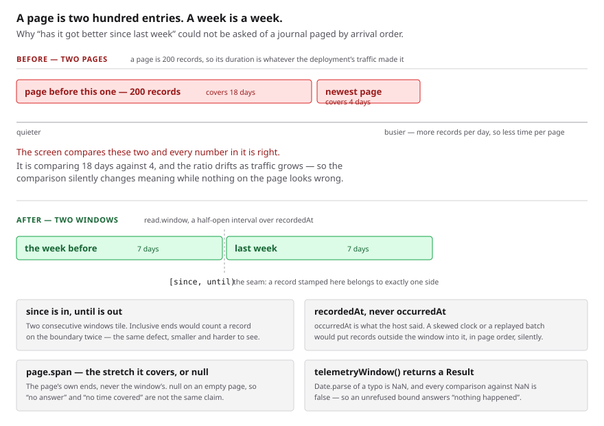

# A window of time

**Date:** 2026-11-04 · **Routine:** `Loom framework` (`Loom daily build`) ·
**Section:** §2 (the runtime's record of itself) · **Branch:**
`framework-81-a-window-of-time-a-journal-can-be-asked-for`

**Preview:** to be taken from Vercel's own comment on the pull request rather
than composed from the branch name, which is the 16 October entry. **Nothing on
this branch changes a page** — the unit is a read shape in `src/telemetry/` and
no surface consumes it yet — so there is nothing on the preview to look at that
is not on `main`. The diagram is the visual.



## What was completed

One open finding owned by this lane, filed by `Loom portal` on 6 October: **a
telemetry journal could be read by position and never by time.**

A journal is append-only and paged by `seq`, which is arrival order.
`TelemetryReadRequest` held `treeId`, `cursor`, `direction` and `limit`, and
nothing about time — so `/portal/trust`, which answers *is the AI getting better
at judging itself*, had to fold the newest page against the page before it. That
is a true statement about **two hundred entries** rather than about any stretch
of time. Worse, it degrades quietly: a deployment that gets busier covers less
time per page, so the same comparison sets a shorter window against a longer one
and changes meaning while every number in it stays right. The screen says so in
a sentence and deliberately never says *last week*, which is the thing a person
would have asked.

Both halves the entry asked for are now built:

- **`read({ window })`** — a half-open interval over `recordedAt`, built by
  `telemetryWindow({ since, until })`.
- **`page.span`** — the stretch a page covers, `{ from, to }` as the journal
  stamped them, and `null` when the page holds nothing.

Recorded as
[0345](../decisions/0345-a-journal-is-asked-for-a-half-open-window-over-when-it-learned-of-a-record-and-a-page-reports-the-stretch-it-covers.md).
Nothing in `(portal)` was touched and no surface changed.

## Decisions taken that were not specified

**Four, and the first is the one judgement call that departs from what the
finding asked for.**

**1. The bounds are not two optional strings on the read request.** The entry
asked for *`since` and `until` beside `cursor`*. Instead `telemetryWindow()`
builds a window and returns a `Result`, and the window holds epoch milliseconds
rather than the strings a caller held.

The reason is the entry's own argument carried one step further. It warned that
a bound on the dodgeable field hands back records from outside the window *with
nothing saying so*. **A bound that cannot be parsed does the same thing from the
other direction:** `Date.parse` of a typo is `NaN`, every comparison against
`NaN` is false, and the page comes back empty — which, on a screen whose entire
job is to say whether anything changed, is indistinguishable from the truth. The
three other fates of a bad bound are all worse: ignoring it is the documented
hazard, throwing is not something Loom does across a module seam, and widening
`TelemetryError` contradicts its own doc comment, which argues at length that
`unavailable` is the only way a journal fails. A typo in a caller's bound is not
a journal being unavailable. The constructor costs a caller one line and removes
all four.

Holding instants rather than strings is the second half of the same choice: one
instant may be written two ways — `2026-01-01T02:00:00Z` and
`2026-01-01T04:00:00+02:00` — and an implementation comparing those as text
orders them backwards.

**2. The window is half-open — `since` in, `until` out.** The finding did not
say. Consecutive windows tile without overlapping, which matters to this reading
specifically: it is a comparison of two consecutive windows, so inclusive ends
would have double-counted a record on the seam — the same defect the window was
built to remove, smaller and harder to see. `since` equal to `until` is
therefore empty by construction, and allowed, because a caller slicing a range
produces it at the edges.

**3. `span` is the earliest and latest stamp, not the first and last record.**
`seq` is allocated at insert and `recordedAt` is a clock's reading, so two
writers whose transactions overlap can land a lower stamp at a higher position,
and first-and-last would report a span running backwards. A page is bounded by a
clamped limit, so scanning it costs nothing worth saving.

**4. `span` is `null` on an empty page rather than two nulls.** *There is no
answer* and *the answer covers no time* are different claims, and a pair of
nulls cannot tell them apart. It is also the page's own ends and never the
window's: a window may be wider at both ends than anything that landed in it, so
a screen naming the window would overstate what it is describing.

**The one thing the finding required and did not leave open was taken as
required:** the window is measured against `recordedAt` and never `occurredAt`.

## Every new assertion was confirmed to fail first

Five mutations were planted on a green tree and each was confirmed to fail
before the tests were left green. None survived.

| planted | caught by | where |
| --- | --- | --- |
| `until` made inclusive | 4 tests, incl. *tiles: a boundary splits the journal with nothing lost and nothing counted twice* | memory |
| `until` made inclusive in the SQL (`lt` → `lte`) | 2 tests, same two claims | Postgres |
| window bound on `occurredAt` instead of `recordedAt` | 5 tests, incl. *measures the window against when it learned of a record, not against what the host said* | memory |
| `span` taken from first-and-last instead of earliest-and-latest | *reports the earliest and latest, not the first and last* | `window.ts` |
| bounds compared as text instead of instants | *gives one window for two spellings of the same instant* | `window.ts` |

The `occurredAt` mutation is the one worth naming: every record in the contract
fixture carries an `occurredAt` months in the past, so a window taken from the
journal's own stamps holds them all — and an implementation bounded on what the
host said answers with nothing at all. That is what makes the rule checkable
rather than merely written down.

**Every bound in the contract suite is taken off the journal's own stamps, never
off the clock in this process.** A journal in memory stamps from a clock it was
handed; a journal in Postgres stamps from `now()` on the database server, whose
reading of the hour is its own. A suite composing a bound locally would be
asserting that two machines agree about the time, which is the one thing a
`recordedAt` exists because they do not.

## One thing the gate caught, and it was mine

The first full `pnpm verify` on this branch went **red**, on
`tools/decisions/decisions.test.ts`:

```
decisions/0345-….md links 0018 to
0018-a-consumer-reaches-the-runtime-through-published-entry-points.md,
which is not a record here
```

I cited 0018 by a filename I had reconstructed from what the record *says*
rather than read off disk; the real name is
`0018-the-portal-is-a-consumer-not-an-insider.md`. Fixed, and the second run is
green. Recorded here because the citation gate is the only thing that would have
caught it and it is worth knowing it does.

## Records

**Added:**
[0345](../decisions/0345-a-journal-is-asked-for-a-half-open-window-over-when-it-learned-of-a-record-and-a-page-reports-the-stretch-it-covers.md)
— *A journal is asked for a half-open window over when it learned of a record,
and a page reports the stretch it covers.* It records all five rejected
alternatives, including the finding's own recommendation and why the doubt behind
it is answerable.

**Superseded:** none. Nothing here contradicts an `Accepted` record, nothing
touches the tree schema or the delta model, and no built code migrates.

**Numbering: 0345, and there is a live collision below me that is not mine.**
`main` holds up to 0343. **Both open branches — #759 (`framework-80`, this
lane's) and #760 (`signals-72`) — claim 0344**, confirmed by listing
`decisions/` on each remote branch rather than by reading the titles. 0097 makes
two records sharing a number fatal, so whichever lands second has to renumber,
exactly as 0343 did on 3 November. I took the next free number after both.
`pnpm decisions:index` regenerated.

## Findings

**Closed, by this branch:**

- *2026-10-06 — a telemetry journal can be read by position and never by time,
  so "has it got better" can compare two pages and never two weeks*, filed by
  `Loom portal`. Closed with both remedies, and with the first one taken
  differently than the entry asked; the entry's status now says so in writing
  rather than silently.

**Filed: two**, both for other lanes and both deliberately not crossed into.

- **`Loom portal` (paused)** — the trend can now be two windows instead of two
  pages, and the four lines of `spanOf` the entry itself named can go. A new seam
  plus a migration of its consumer in one pull request is unreviewable, and those
  are not this lane's files.
- **`Loom docs`** — seven names are published from
  `@jam-overture/loom/telemetry` and the generated reference is the only place
  they appear. This is the 3 October entry's own case arriving with a concrete
  set of names for the first time; three of the seven are worth a reader's
  attention and four are not, and which page takes them is that lane's call.

## Test numbers

`pnpm verify`, read from a file written as the last thing on the line:

| | root suite | app suite | gate |
| --- | --- | --- | --- |
| `main` at `bc289e3`, before | 254 files, 6,113 tests | 394 files, 6,363 tests | **`EXIT=0`** |
| this branch | 255 files, **6,147 tests** | 394 files, 6,363 tests | **`EXIT=0`** |

**+34 tests**: 18 in one new file (`src/telemetry/window.test.ts`) and 16 in the
shared contract suite — 8 of which run against the in-memory journal and 8
against Postgres, being the same eight tests. **12,510 tests pass in total.**

`findings:check` reports 1,417 findings, 0 malformed. `reports:check` reports
2,065 visuals, 146.2MB, none over 1.1MB.

**Nothing failed in the final run and nothing was skipped. No test was weakened
and none was deleted.** The only pre-existing assertions that changed are four
empty-page expectations in the contract suite, which now also assert
`span: null` — a widening, not a loosening. The red run described above was a
citation I got wrong, fixed rather than worked around.

## Open questions

**Nothing in this unit is blocking.**

**Two items are repeated rather than re-filed, both unanswered since #752.**

1. **The largest open thing in the repository, and it is the maintainer's
   reported performance problem.** `/why-use-it` serves 2.4MB, of which 93% is
   one 47KB stylesheet carried 42 times by `libraryStylesheet()` in
   `src/primitives/`. That directory belongs to `Loom primitives`, whose last
   report is 11 October, so this lane has not touched it. Measured to its cause
   and waiting on a scheduling call: unpause that lane, or hand that one function
   to this one.

2. **This routine's stored prompt still describes the one-application migration
   as its next unit.** `apps/loom` has existed since 19 August with all four
   route groups, `vercel.json`, and both retired packages gone; `(portal)` and
   `(docs)` are in it. The prompt also claims `src/signals/` and `app/(demo)/`,
   which `docs/routines.md` gives to `Loom signals` and `Loom demo`. This run
   resolved it the way the last two did — the prompt names `routines.md` as its
   governance file, so `routines.md` won — and the cost is the few minutes at the
   top of each run spent confirming the migration is already done. The 2 November
   entry owns this.

**One new question, and it is small.** `telemetryWindow` returns a `Result`,
which makes a caller handle a fault it will almost never hit. If that turns out
to be a line of ceremony at every call site rather than a guard that earns
itself, the alternative is a second entry point that takes two `Date`s and
cannot fail — and `Date` arithmetic is what a caller computing *last week* is
doing anyway. I have not built it, because one consumer is not a pattern and the
portal is paused, so nothing can yet say whether the ceremony is real.
