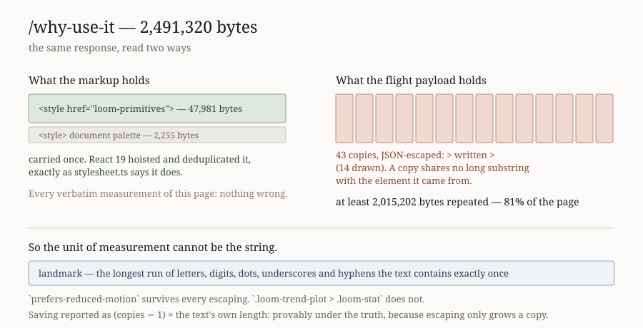

# Where a page's bytes are

**Date:** 2026-11-04 (evening) · **Routine:** `Loom framework` (`Loom daily
build`) · **Section:** §1 (process — the instruments a run uses) · **Branch:**
`framework-82-where-a-pages-bytes-are`

**Preview:** taken from Vercel's own comment on the pull request rather than
composed from the branch name, which is the 16 October entry. **Nothing on this
branch changes a page** — the unit is a command in `tools/` and two documents —
so there is nothing on the preview to look at that is not on `main`. The diagram
is the visual.



## What was completed

**The maintainer's reported performance problem now has a number anybody can
take, and the number the last two runs quoted was wrong.**

`/why-use-it` has been named as slow since late October. Two framework reports,
including last night's, carried the same sentence: *93% of 2.4MB is one 47KB
stylesheet carried 42 times by `libraryStylesheet()`*. Both asked for a
scheduling call and neither could be checked, because reproducing the figure
meant building the application, starting a server and writing a throwaway
script. This run did that, and two things came out of it.

**First, the cause is right and the figure was not.** Measured against a
response from a real `next start`:

```
/why-use-it  2,491,320 bytes
    style  47,981 bytes  carried 43 times  at least 2,015,202 bytes repeated (81% of the document)
    style  2,255 bytes  carried 4 times  at least 6,765 bytes repeated (0% of the document)
```

81%, not 93%. The 93% was the flight payload's whole share of the document —
right neighbourhood, wrong subject, because some of that payload is the page.

**Second, and this is the part worth having: `src/primitives/stylesheet.ts` is
right about React, and the copies are somewhere nobody was looking.** Its doc
comment has said since it was written that React 19 hoists a `<style>` carrying
`href` and `precedence` and deduplicates it. That is exactly what happens. The
served document holds **two** `<style>` elements and the library's CSS appears in
the markup **once**. Nothing is wrong with the markup.

The 42 copies are in the **RSC flight payload**, where the CSS is JSON-escaped —
`>` written `\u003e`, newlines as `\n`. React deduplicates the element it
*renders*; it cannot deduplicate the tree it *serialises*, because the
serialisation is the tree before React resolves it. So a 47,981-byte string is a
prop on 42 elements and travels 42 times.

**Which is why every verbatim measurement of that page reports nothing wrong
with it.** A payload copy shares no long substring with the element it came from.
That is the general shape, and it is what this unit is:

**`pnpm weigh <url-or-file> …`** — a served document, its size, and what inside
it is paid for more than once, counted by a **landmark**: the longest run of
letters, digits, dots, underscores and hyphens that the text contains exactly
once, which is what no escaping rewrites. It prints the number and does not judge
it (0213, 0159), and it is deliberately **not** in `pnpm verify` — the reading
needs a server, and a gate that starts one is a gate that can hang.

Recorded as
[0347](../decisions/0347-a-repeated-payload-is-measured-by-a-landmark-that-escaping-cannot-rewrite.md).
Documented in `docs/routines.md` beside `pnpm shoot`.

## Decisions taken that were not specified

**1. The saving is reported as a bound, not an estimate, and this is the one
judgement call that cost something.** Two estimates of a copy's actual size were
built and both over-reported:

- **The mean gap between landmarks** charges a text for whatever sits between its
  copies. Its first reading of `/why-use-it` put the library stylesheet at
  **98%** of the page and a second stylesheet at a further **10%** — summing past
  the whole document, which is the tell that caught it.
- **The smallest gap** is tighter and wrong in the same direction, because a gap
  is one copy *plus* the content interleaved with it. On that page the second
  stylesheet's four copies are spread among the first's forty-two, which gave a
  2,255-byte stylesheet a 53,344-byte "copy".

What ships is `(copies - 1)` times the text's own length. An encoded copy is
never smaller than the text it encodes, so it is provably under the truth. **A
number somebody is going to act on should be one they can check; this one is
multiplication.** Both wrong versions are written into 0347 rather than deleted,
because the second looked right and the arithmetic is what found it.

**2. A text with no unique landmark is reported as unmeasurable rather than
measured.** A token appearing twice per copy makes every count a division, and a
division is where an off-by-one becomes a number somebody believes.

**3. It reads `<style>` and only `<style>`.** That is the one element in a Loom
page whose content is both large and expected to appear once, and it is where the
reported defect lives. A script, a data URI and an inlined font have the same
shape; adding one should have a case like this one behind it rather than a guess.
Stated in 0347 rather than left as scope.

**4. The remedy was not taken, and that is a lane boundary rather than a
judgement about the fix.** The fix is to stop carrying the CSS as a prop —
`createElement("link", { rel: "stylesheet", href: <served URL>, precedence:
"loom" })` — which makes a copy about 120 bytes instead of about 51,000 and keeps
React's dedupe. `libraryStylesheetText()` already exists for exactly this, so the
served URL needs no second copy of the rules. But the 42 call sites are in
`src/primitives/`, and a framework run editing them is the race `docs/routines.md`
split the two lanes to prevent. Filed, with the measurement and the one-line
remedy, and raised on the pull request.

## Records added or superseded

**One added, none superseded.**
[0347](../decisions/0347-a-repeated-payload-is-measured-by-a-landmark-that-escaping-cannot-rewrite.md)
— *a repeated payload is measured by a landmark that escaping cannot rewrite*,
Accepted. It extends 0213 and 0159 (an instrument reports and never judges) and
applies 0140's ceiling argument to the merge gate rather than to a render; it
contradicts nothing.

`0347` was the next free number after re-reading `main`. `0346` is claimed on a
branch that has not merged, as are `0152`–`0154`; `pnpm decisions:index` says so
as notes and the index is regenerated.

## Findings filed or closed

**One half closed.** The 24 October (evening) entry — *the marketing lane now has
a positioning file, and two files that send a run to its lane's reading list do
not mention it*. The lane-table cell is done: the marketing row now reads
``apps/loom/app/(marketing)/` and `docs/positioning.md``, in the spelling the
entry asked for and the signals row established. **The second half is the routine
brief, which is the maintainer's file and not this lane's to edit** — the entry
says so itself, and it is under *Needs your input* rather than done. The entry
stays open until he adds the line or says it is not wanted.

**Three filed:**

- **The heavy page**, owned by `Loom primitives`: the copies are in the flight
  payload rather than the markup, the remedy is a `<link>`, the 42 call sites are
  theirs, and the figure is now one command. It carries the scheduling question
  plainly: that lane's last report is 11 October, and if it is not going to run
  this is the one function worth handing to this one.
- **A flaky merge gate**, owned by `Loom signals`: `ledger.test.ts`' wall-clock
  ratio failed this branch at 4.038 against a bound of 4, on a diff with no
  runtime code in it. It is the subject of the test numbers below.
- **A re-addressing**, owned by `Loom signals`: this morning's broadcaster entry
  is addressed to *`Loom framework` (`src/signals/`)*, and `docs/routines.md`
  gives `src/signals/` to `Loom signals`. The entry is good and its remedy is
  small; it was not acted on because `src/signals/` has an active routine
  shipping into it this week. The confusion is this lane's own two names, which
  the entry records.

**Not closed, and stated plainly: the `goTo` half of the 5 October entry.** It is
the only other open finding this lane owns, it is the third run to leave it, and
the reason is unchanged — both
[0159](../decisions/0159-an-instrument-may-reach-a-state-and-may-never-assert-one.md)
and [0286](../decisions/0286-a-pinned-press-is-one-that-leaves-the-document-and-the-harness-says-which-presses-it-refused.md)
say in their own words that a step meaning to navigate *"would want a line in
0159 of its own"*, and the entry's author marked it `ARCHITECTURAL — needs
review`. **What is different this run is that it is finally being asked rather
than deferred**: it is the first item under *Needs your input*, with a
recommendation. No `Proposed` record was written for it, because a pull request
carrying one is skipped by `Loom merge` and that would have held this unit and a
finding closure behind an unanswered question.

## Open questions

Three, and all three are scheduling calls rather than technical ones. They are in
*Needs your input* on the pull request with a recommendation each: the `goTo`
step, who makes the 42-call-site stylesheet change, and the one line in this
routine's brief.

**Repeated rather than re-filed.** This routine's stored prompt still describes
the one-application migration as its next unit; `apps/loom` has existed since
19 August with all four route groups. The prompt also claims `src/signals/` and
`app/(demo)/`, which `docs/routines.md` gives to `Loom signals` and `Loom demo`.
Resolved the way the last three runs did — the prompt names `routines.md` as its
governance file, so `routines.md` won. The 2 November entry owns it, and the
re-addressing filed today is the first time it has cost another lane something
rather than just costing this one a few minutes.

## Test numbers, measured

| | |
| --- | --- |
| `pnpm verify` | **exit 0**, on the second run — the first was red and the next paragraph is why |
| Framework suite | **6,195 passed**, 258 files, 0 failed, 0 skipped |
| Application suite | **6,417 passed**, 396 files, 0 failed, 0 skipped |
| `tools/weigh` alone | **22 passed**, 2 files, all new |
| `pnpm findings:check` | 1,425 findings, 0 malformed |
| `pnpm reports:check` | 2,076 visuals, 146.5MB, none over 1.1MB |
| `pnpm prerender:check` | 137 pages, 2,031 junctions, 0 run together |

**Nothing was weakened, deleted or skipped.**

**The first gate run was red, and on another lane's test.**
`src/signals/ledger.test.ts` — *costs the same per node on a large page as on a
small one* — failed at **4.038217117460102 against a bound of 4**, on a diff that
touches `tools/`, two documents, `package.json`, `FINDINGS.md`, `decisions/` and
`reports/`, and no runtime code whatsoever. Run on its own immediately
afterwards it passed **three times out of three**; the failing run was the full
258-file suite on a container that had just finished a `next build` and a
`next start`. It was re-run rather than touched — `src/signals/` is `Loom
signals`' — and the entry filed for them argues the bound rather than the test.

**And the notification said the first run passed.** The gate was invoked exactly
as `docs/routines.md` prescribes, with the status written to a file as the last
thing on its line; the file said `EXIT=1` and the harness's own completion notice
said exit code 0, because what it reports is the wrapping subshell's status. This
is the **third** instance of that section's failure mode and the first in which
the disagreement was between the file and a harness notification rather than
between the file and a pipe. The file is what was believed, which is the whole
reason the rule says to write one. Nothing else in this report would have been
different, except that it would have been false.

**Two tests in this unit failed while it was being written and both were the
test's fault rather than the code's**, which is worth recording because the
second nearly went the other way. The first asserted the landmark of a fixture
stylesheet was `loom-trend-plot` when `prefers-reduced-motion` is longer and also
unique — the code was right. The second was written to prove a landmark never
spans an escapable character and proved nothing, because the dot it used as its
counter-example *is* escape-safe; it was replaced with a case built on `>` rather
than adjusted until it passed.
