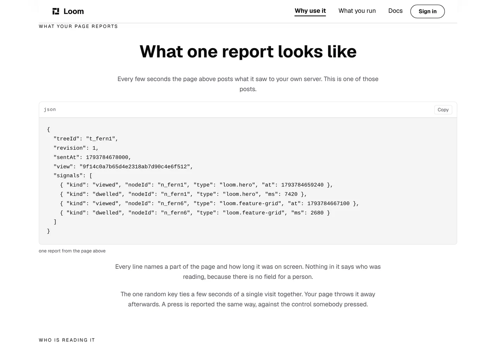
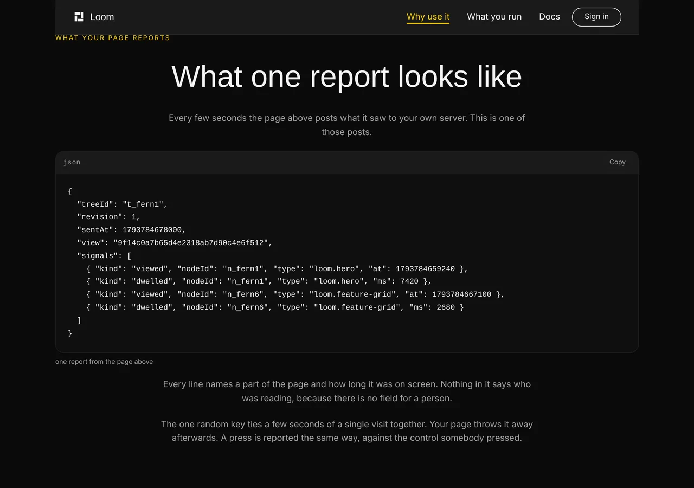
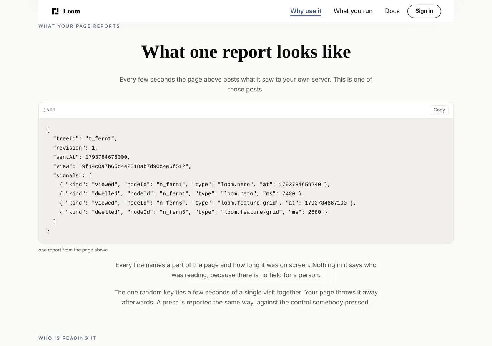
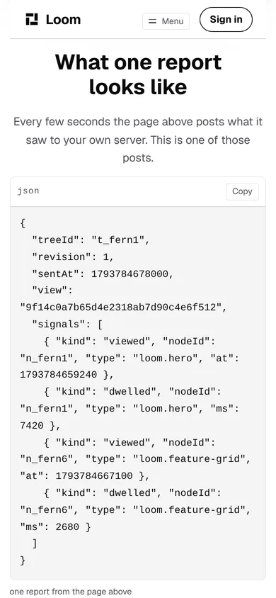

# What your page reports

**4 November 2026 · `Loom marketing` · branch `marketing-27-what-your-page-reports`**

**Preview:** the pull request carries it. Not opened from this run: `*.vercel.app`
is denied by the environment's network policy, filed on 27 September. Every
number and picture below is off a local production build of this commit
(`built 2026-11-04T11:31:34.730Z`).

**No maintainer comment was outstanding.** #757 merged with no reply, and the
two questions it carried — the *What is Loom?* band on the front door, and what
becomes of `/what-you-run` — are still his and still open. Nothing in
`FINDINGS.md` names this lane. So this run went to the plan, and the plan is
`docs/positioning.md`.

**One note on the brief, because a stale line in it would send the next run
somewhere this one deliberately did not go.** The standing brief for this lane
still names *the record* as the differentiator and describes a site that rewrites
itself in front of a visitor with the Gate's verdict beside it. Both were
overtaken on `main`: `docs/positioning.md` reverses the first (24 October, his
words), and
[0328](../decisions/0328-the-marketing-site-has-no-demonstration-and-no-mechanism-page.md)
removes the second at his instruction of 31 October. This run followed the
repository.

---

# What shipped

A band on `/why-use-it` that prints **one reader-signal delivery, exactly as a
server receives it** — and the fourth link of the maintainer's chain now lands
on it.



## The hole, which was in the middle of the argument

`/why-use-it` is the maintainer's six links in his order. *What stays yours* is
the first, *What you write* the second, *On a page* the third, and *The same
page arranged for someone else* the fifth.

Between the third and the fifth a reader was asked to make a jump:

> here is a page built out of the set · **(nothing)** · here is that page
> arranged for somebody else

The question in the gap is the obvious one — **how did it know** — and his
fourth link is the answer: *Signals broadcasting to your AI model*. It had a
rung on the front door and nowhere on this page to land, so the chain sent a
reader to the band on `/what-you-run` that says what **this** deployment counts
about the person reading.

That band is a disclosure and it is the right band for a visitor wondering what
is being collected about them. It is the wrong one for the reader
`docs/positioning.md` names — *"the casual web developer… junior level"* — who
has just been told their page will report what readers do with it and wants to
know **what they get**. A promise of data with a privacy notice under it is the
same gap *What you write* closed for the second link yesterday: something
concrete, argued in prose.

## It prints data rather than arguing about data

Four observations, two parts, one visit. Twelve lines a developer reads at a
glance, and the claim under it is one a reader can check against the panel
rather than take on trust:

> Every line names a part of the page and how long it was on screen. Nothing in
> it says who was reading, because there is no field for a person.

**That is the privacy argument made by the shape of the object.** This site has
made it in prose on three pages. A reader who scans the panel can see for
themselves that the only things in it are a part of a page, a time and a
duration, and that nothing else would fit.

## The report is checked against the thing that receives it

`reported.test.ts` parses the panel's text and puts it through
`readerSignalBatchSchema` — **the same schema the ingest endpoint validates a
real delivery with**. So what a stranger is shown is a report this product would
*accept*, not a plausible-looking object somebody typed into a page builder.

It paid for itself inside this run. The first draft called the correlation key
`viewKey`, which is the name of its *type* and not of the field; the real field
is `view`. The schema is `.strict()`, so the test went red and named the key.
**A snippet typed into the page would have shipped a report the product refuses.**

Three further properties are held, and each is a way the panel could have gone
quietly wrong:

| | |
| --- | --- |
| **every part it names is on the page above it** | the test walks `example.ts`' coffee page and fails if the report names a type that page does not render |
| **it reports no press, because that page has nothing to press** | the registry is asked, through the published `isInteractiveWith`, whether any node on that page renders a target — and the report is held to the answer |
| **it carries no field about a person** | every key in it is pinned, so a field added upstream that named a reader makes this lane red rather than landing on the page under a sentence saying it cannot exist |

The second is the one worth a reviewer's eye. `example.ts` carries no control
deliberately and gives three reasons for it, so a report from that page cannot
honestly contain an `activated`. The day the example grows a button, that test
fails and asks for a press to be added to the panel instead of letting the two
drift apart.

## Why the text is authored and the object derived, rather than the other way round

The obvious arrangement is a typed `ReaderSignalBatch` printed with
`JSON.stringify(batch, null, 2)`. It was tried first and it is wrong twice.

A pretty-printer puts every field of every signal on its own line, which turns
four observations into **thirty-one lines** of panel. And a value derived from
the thing it describes cannot notice that thing changing —
`readers/asked.ts` carries the same argument for pinning rather than computing,
and names the two funnel mutations that passed because a list was computed from
its own subject.

So the lines are a reader's, written once in `reported.ts`, and every claim
about them is an assertion over the parsed value. `reported.test.ts` pins the
one-observation-a-line formatting too, because a pretty-printer is exactly what
the next run reaches for.

## The random key is in it rather than left out

`view` is optional in the schema: a deployment that wants totals and no funnel
sends nothing there, and leaving it out would have made the panel shorter and
the band's last line easier to write.

It would also have been the wrong call twice. The broadcaster mints one by
default, so a report without it is **not the shape a reader would actually
get** — and a site arguing that Loom can say what really happened does not get
to drop the one field that raises a question. It is in the panel, and one
sentence says what it is:

> The one random key ties a few seconds of a single visit together. Your page
> throws it away afterwards.

---

# The coverage this change broke, and the sweep that replaces it

**This is the part of the branch a reviewer should read.** The band is the easy
half.

Repointing the fourth link moved every chain destination onto one page, and
`chain.test.ts`' per-destination sweep is parameterised by the **distinct paths
the chain points at**. Two became one, so that file went from 18 cases to 17 —
and the case that disappeared was the one that happened to assert that
`/what-you-run` still declares `what-we-count`.

Nothing was weakened: the five anchors are still checked, now inside one case
instead of two. But **the footer of every page links to that band**, and
`anchors.test.ts` is same-page by a scoping decision of 4 October. So after the
repoint, the one cross-page fragment this site renders on every page was held by
nothing at all.

**A check that covers something by accident uncovers it by accident too.** So
the property is now stated for itself rather than left to the chain:
`crossPageFragments` in `anchors.test.ts` collects every fragment a control
points at on **another page of this site**, resolves the page that serves it,
and asserts that page declares the id. It is the anchor half of what `routes.ts`
did for paths in October.

The 4 October scoping still holds where it was right: a fragment on another
*surface*'s address — `/docs#something` — is that lane's promise and is still
out of scope.

**Falsified rather than assumed.** With the disclosure band's anchor changed to
a literal nothing links to, the new sweep fails and names it:

```
- "declared": true,
+ "declared": false,
  "fragment": "what-we-count",
```

The guard under it is a floor over the site rather than a claim about each page,
and `/what-you-run` is why: the footer's link to its own disclosure band is a
cross-page fragment from the other two pages and a same-page one there, where
the existing sweep already reads it. A rule demanding one on every page would be
asking each page to point away from itself.

---

# What it looks like, on three palettes and a phone





No colour is named anywhere in the band. The panel takes the palette the address
asked for, including the dark one.



## The phone is better here than it is two bands up, and the reason is the prop

*What you write* says `wrap: false`, because a wrapped line of TypeScript reads
as two statements — so on a phone it scrolls sideways and shows about the first
forty characters. That was this lane's finding of 3 November and it stands.

This panel wraps, which is `nodes.ts`' default and the case that prop was
written for: **a wrapped line of pretty-printed JSON loses nothing a reader
needed**, because the structure is in the punctuation rather than in the line
breaks. Every one of the twelve lines is readable at 390 and nothing is cut off.

Measured with `pnpm shoot`'s `measure`, landing on
`/why-use-it#what-your-page-reports`:

| | band | heading | panel | page overflow |
| --- | --- | --- | --- | --- |
| 1280 wide | `y 48` `1080×761` | `y 108` ✓ | `y 304` `1078×326` | `scrollWidth 1280 / innerWidth 1280` |
| 390 phone | — | `y 71` ✓ | `y 292` `361×527` | `scrollWidth 390 / innerWidth 390` |

The heading clears the sticky bar on both. The eyebrow does not, on the phone —
that is **this lane's open finding of 3 November**, filed for `Loom primitives`
(`anchoredStyle`'s scroll margin is a fixed length and the bar it has to clear
is not). It reproduces here, on a second anchored band, which is what that entry
predicted.

---

# The tests

**No test was weakened and no ceiling was raised.** The `(marketing)` route
group is **57 test files and 963 tests**, measured against `origin/main` at
**56 and 953** in the same session.

| | |
| --- | --- |
| `reported.test.ts` | **+11** — the report is a delivery this product accepts, names only parts of the page above it, reports no press against a page with no target, carries no field about a person, and has a budget |
| `anchors.test.ts` | **+2** — the cross-page fragment sweep, and the guard that it is reading something |
| `chain.test.ts` | **−1** — the per-destination `it.each` collapsed from two paths to one. Set out above; the assertions are unchanged |
| `pages/pages.test.ts` | the pinned panel list extended, naming `THE_REPORT` rather than a second copy of it |
| `voice.test.ts` | the panel sweep now asserts the data panel is among what it reads |

The pinned list earns its line again: *"is the install line and the two source
panels, counted rather than assumed"* went red on this branch and named the new
panel, which is exactly the job it was written for on 3 November.

`words.ts`' `SOURCE_PANEL` note is updated rather than widened. The exclusion is
unchanged — the same two rules, the same one element type — and what moved is
the sentence naming what bounds it: `written.test.ts` for the two source panels,
`reported.test.ts` for the one that prints data, and the pinned list so a third
kind cannot arrive without one.

`pnpm install && pnpm verify`, exit code read out of a file written as the last
thing on its line:

```
Test Files  254 passed (254)      Tests  6113 passed (6113)    # framework
Test Files  395 passed (395)      Tests  6377 passed (6377)    # @loom/app
1416 findings, 0 malformed
2068 visuals in reports/, 146.3MB, none over 1.1MB
137 prerendered pages, 1948 text junctions, 0 run together
EXIT=0
```

Both marketing routes still report `ƒ` in the build, so
[0331](../decisions/0331-a-marketing-page-is-served-per-request-because-the-store-governs-it.md)
holds and nothing here froze a governed page.

**The copy budget, measured before and after.** `/why-use-it` went from **880 to
976 words** against a ceiling of 1,500, and the site from **2,727 to 2,823**
against 3,900. The band's own prose is 96 of those words against a plain band's
ceiling of 120; the twelve lines of JSON are not among them, and
`reported.test.ts` is what bounds them instead.

Nothing skipped, nothing weakened.

---

# Findings

**One filed, none closed.** Nothing in the queue named this lane.

**Filed for `Loom framework`:** *the broadcaster takes the page's root element
and publishes no way for a browser-side host to find one, so four places in this
repository hard-code `"[data-loom-tree]"`.* `LOOM_TREE_ATTRIBUTE` exists and is
exported from `@jam-overture/loom/react`, which is the render seam — importing
one string from it undoes the entry-point split
[0136](../decisions/0136-a-published-page-broadcasts-reader-signals-when-its-host-asks.md)
made for the broadcaster's sake, so no host that actually ships one does it.

**It is filed rather than worked around, and the band is smaller for it.** This
run wanted a second panel beside the report: the few lines a reader writes to
switch counting on, as real compiled modules in the shape `written.ts` already
prints a registration. The honest lines contain the attribute, `tree` is in
`RESERVED_VOCABULARY`, and `voice.test.ts`' panel sweep refuses it — **correctly**,
because a junior developer meeting `data-loom-tree` on a marketing page has met
a word this site promised not to say. The two ways round were a second exemption
beside `withoutPackageNames` (which is safe only because of a property about
itself that a framework attribute name does not have) or printing an import this
lane would not make itself. Neither was worth a panel. The entry names the two
shapes that would close it.

# Decisions

**None taken and none recorded.**

The one judgement that might have wanted a record — the chain's fourth
destination moving from `/what-you-run` to `/why-use-it` — is a link inside one
route group, reversible by one line, and the reasoning is on the rung in
`chain.ts` beside the reasoning for the move before it. A record for it would be
a record nobody outside `(marketing)` could act on.

# Open questions

In the pull request comment. Nothing about this change is blocking. The two
standing positioning questions from #749 and #757 are unchanged and still his.
