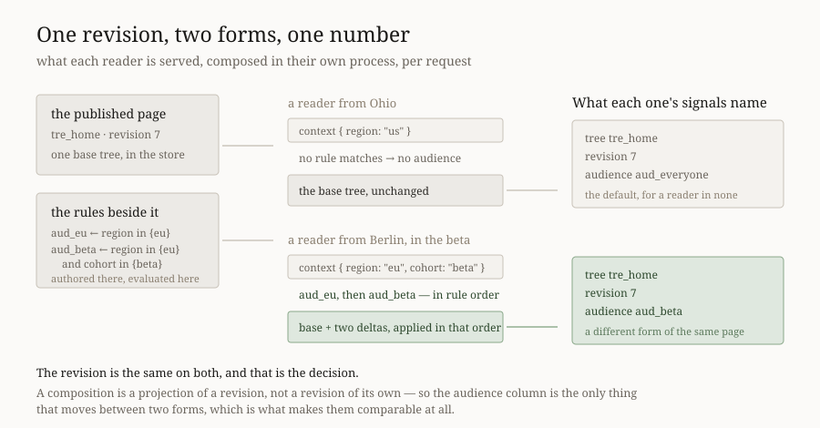

# A page per audience

**Date:** 2026-11-05 (evening) · **Routine:** `Loom framework` (`Loom daily
build`) · **Section:** §1, §3 · **Branch:** `framework-85-a-page-per-audience`

**Preview:** taken from Vercel's own comment on the pull request rather than
composed from the branch name, which is the 16 October entry. **Nothing on this
branch changes a page** — the unit is three modules in `src/` and no surface
consumes them yet — so there is nothing on the preview to look at that is not on
`main`. The diagram is the visual.

## What was completed

**0263 clauses 1 to 4 are built.** That record is Accepted since 13 October, it
is *"the largest engineering commitment of the five accepted that day"* by its
own note, and the only part of it that had shipped was clause 5 — the signal
dimension, as 0284. The rest had nothing: `treeSourceFromStore` still answered
one tree per id whoever was asking, and `src/audience/audience.ts` held an id
and a default and said in its own words that *"none of that predicate is here"*.

Three modules, published through `./store`:

| | what it does |
| --- | --- |
| `src/audience/rule.ts` | `audiencesFor(rules, context)` — which audiences this reader is in, in rule order |
| `src/audience/compose.ts` | `composeTreeForContext(base, overlay, context)` — the base plus the deltas those audiences earned |
| `src/store/source.ts` | `composingTreeSourceFromStore` — the composing sibling 0263 said `treeSourceFromStore` would gain |

Recorded as
[0355](../decisions/0355-an-audience-rule-is-a-conjunction-of-scalar-clauses-and-a-composed-page-is-a-projection-of-a-revision.md).
`docs/portal.md` unit 9 asks for *a record before any build*; this is that
record, with the build it describes.

**Nothing about any deployment changes.** `treeSourceFromStore` is untouched, a
deployment with no rules composes to the base, and a request with no context
matches nothing — which is every request this repository makes today.

## Decisions taken that were not specified

0263 settles what a page **is** and leaves three things open that nothing which
runs can leave open. All three are in 0355 with their rejected alternatives;
these are the two that were not obvious and the one that was a conflict to
resolve first.

**1. The apparent conflict between 0263 and 0284, resolved before a line was
written.** 0284 says *the predicate... lives in the control plane's rules* and
*no column holds a rule, an expression, a context key or a matched value*. 0263
clause 4 says the match is evaluated *in the customer's app, on every request*.
Read naively the predicate may not be in `src/` at all, and then clause 4 is
unimplementable.

The resolution is that 0284's sentence is about **storage**: Loom's reader
tables hold an opaque id and never a rule. A rule is authored in the control
plane, **shipped** to the data plane, and evaluated there — the only place it can
be evaluated without a request to Loom in front of every page view (0262). So
`src/` holds an evaluator and stores no rule. Written into `rule.ts`'s own
module comment, because the next reader of that file will have the same question
and 0284's sentence is the one they will find first.

**2. A composed page keeps the base's revision, and the measurement is why.**
The tempting answer is that applying two deltas produces revision *n+2*. 0284
made a counter's identity `(application, audience, tree, revision)` — so if a
composition carried its own revision, the audience dimension and the revision
dimension would move together, and *compare these two audiences on this
revision* would have nothing to compare. A composition is a **projection** of a
revision: same `treeId`, same `revision`, no entry in any log, and the audience
column is the only thing that differs between two forms. That is the whole
diagram above.

It has a mechanical consequence that decided how composition is written:
`applyDelta` refuses a delta whose `baseRevision` is not the tree's current one,
and every delta here is authored against the same published revision — so the
second one would be refused for being one behind a number composition had just
moved. Composition therefore walks operations with `applyOperation`, which
exists for exactly this, and checks each delta's revision **against the base and
never against the accumulator**.

**3. An uncomposable page is refused, whole, rather than falling back to the
base.** The gentler behaviour — drop the stale delta, serve the base — is what a
cache would do and it is the one failure mode that corrupts the measurement
instead of interrupting the page: the reader is served the base, the deployment
has already decided they are in `aud_eu`, and the signals that page sends are
filed under `aud_eu` anyway. The comparison 0263 clause 5 exists for would then
be between one audience's form and another audience's *name over the base's
form*. All-or-nothing per request for the same reason: two matched deltas of
which one applied is a form nobody authored.

**4. The order is the rule list's, so the last matching rule wins.** It had to
be something a deployment sets and reads back rather than something a map's
iteration or an id's spelling decides. Filed for `Loom portal` as the one thing
a rule editor has to teach.

**5. The store dimension is deliberately not here.** 0263 says the store gains
an audience dimension and that is a schema change on top of 0260's — over a
store `Loom portal` is shipping against several times a day. The composition
needs none of it, so `composingTreeSourceFromStore` takes an
`AudienceOverlaySource`: a seam a module satisfies today and the store satisfies
later. Said in the record so it reads as a split rather than an omission.

## Six mutations planted, five caught, and the one that survived was mine

Planted on a green tree, against the 42 new assertions.

| planted | caught by |
| --- | --- |
| `audiencesFor` stops deduplicating | 1 test |
| rule order reversed | 5 tests |
| the revision checked against the accumulator, not the base | 4 tests |
| an uncomposable page falls back to the base | 7 tests |
| a composition bumps the revision | 3 tests |
| **the scalar narrowing removed from clause matching** | **nothing — survived** |

**The survivor was a test whose name claimed credit for something `===` does.**
It read *"never matches a context key holding an object or an array"*, and the
implication is that the narrowing in `clauseMatches` is what produces that
answer. It is not: `anyOf` can only hold scalars, so `includes` compares an
array against a scalar with `===` and answers `false` whatever the narrowing
does. The narrowing is there so the comparison typechecks.

The assertion is kept — it is the behaviour a host sees, and it is worth pinning
that structure is *unmatched* rather than an error — but renamed to *"does not
match"* and given a comment saying the mutation survived and why, so the next
reader does not think the guard is load-bearing. This is the second run in three
where a test named a mechanism it was not testing; the first was last night's
`DOMParser` realm case.

**The revision mutation nearly got away, and that is a note about method.** Its
first planting reported all 45 tests passing, which would have been a real hole.
The patch script's string replacement had silently not matched — the mutation was
never in the file. Re-applied with the match asserted, it failed 4 tests. **A
mutation that reports *survived* has to be confirmed present before it is
believed**, and a `print('MATCH' if old in s else 'NO MATCH')` is the whole cost
of that.

## One test was passing for the wrong reason, found while fixing a type error

The staleness case appends a change to the base so that the audience's delta is
left behind. `pnpm verify` rejected the append — `attribution` is not a field of
`AppendRequest`; it wants `proposalId`, `provenance` and `appliedAt` — which
means the append was malformed the whole time the test was green.

It is now written correctly, and the test asserts `store.head` reports revision
1 **before** asking the composition for anything. A page that never moved
refuses for no reason at all, so without that line the test could pass while
proving nothing about staleness. Caught by the typechecker rather than by
reading, which is the argument for `pnpm verify` being the gate rather than the
suite alone.

## A defensive branch was written, shown unreachable, and deleted

`composeTreeForContext` is the first place in this repository where operations
from **two separate deltas, each judged against the same base**, are applied to
one tree. The fear is a pair that each insert the same node id: fine alone,
together a tree with two of one id. So it shipped with `validateTreeInvariants`
over the composed root and a `collides` error beside it.

A planted mutation removing the check changed nothing. `insert` already refuses
a node whose id the tree holds, so the second insert fails as
`duplicate-node-id` before a tree exists to invalidate — and duplicate ids are
the only invariant that function has. The check and its error code are deleted
rather than kept, which is what *no dead code* means when the dead code is
defensive and reads as prudent. The reasoning is a comment where the check was,
and filed, because nothing in `src/` says *unique ids are the only structural
invariant* or *`insert` is where it is enforced*, and the next thing that
composes two logs will have the same fear.

## Records

**Added:**
[0355](../decisions/0355-an-audience-rule-is-a-conjunction-of-scalar-clauses-and-a-composed-page-is-a-projection-of-a-revision.md)
— *An audience rule is a conjunction of scalar clauses, and a composed page is a
projection of a revision.* Seven alternatives recorded, including an expression
language, a host-supplied predicate function, bumping the revision per delta,
and widening `TreeSourceError`.

**Superseded: none.** Nothing here contradicts an `Accepted` record — it
implements one. Nothing touches the tree schema or the delta model: no stored
shape changes, no built code migrates, `applyDelta` and `TreeDelta` are
untouched, and composition adds a projection rather than a new kind of change.
So this is not `ARCHITECTURAL — needs review` under the escalation rule, and the
store dimension that *would* be is explicitly not in it.

**Numbering: 0355.** `main` holds up to `0354`; `0353` is claimed on #778, which
is open. `pnpm decisions:index` regenerated and reports `0151`–`0154` and `0353`
as claimed on unmerged branches.

## Findings

**Closed:** none. The two open entries this lane owns are
`docs/publishing-primitives.md`'s file count (1 November) and the types-printed-whole
constraint (8 October); neither was touched, and both are smaller than this
unit.

**Filed: two.**

- **`Loom portal` and `Loom framework`** — what unit 9 still needs after 0355:
  the store dimension (this lane's, a schema change) and a rule editor
  (theirs), with the one thing that screen has to teach — rules are ordered,
  general to specific — and a note that audience deltas will want the same
  *stale / conflicts* reading 0340 gave proposals.
- **`Loom framework`** — the unreachable invariant check, the mutation that
  settled it, and the sentence that would stop the next composer writing it
  again.

## Test numbers

`pnpm verify`, read from the log.

| | framework suite | application suite | gate |
| --- | --- | --- | --- |
| `main`, baseline | 261 files, **6,280 tests** | — | — |
| this branch, third run | 263 files, **6,322 tests** | 409 files, **6,616 tests** | **`EXIT=0`** |

**12,938 tests pass in total. Nothing failed in the final run and nothing was
skipped.** No test was weakened and none was deleted, and **no pre-existing
assertion changed** — the only file edited outside `src/` and `decisions/` is a
generated one.

**+42 tests, all new and all this lane's**, in two new files —
`src/audience/rule.test.ts` (20) and `src/audience/compose.test.ts` (16) — and 6
appended to `src/store/source.test.ts`.

`findings:check` reports 1,439 findings, 0 malformed. `reports:check` reports
2,093 visuals, 147.4MB, none over 1.1MB.

**Two full `pnpm verify` runs went red before this one, and neither was worked
around.**

- **The first**, on the `AppendRequest` type error described above. A defect in
  a new test rather than in the unit, and fixing it is what exposed the test that
  was passing for the wrong reason.
- **The second**, on two checks in `(docs)` — `extract.test.ts` and
  `offered.test.ts` — both saying the generated reference and the package
  disagree, and both printing the command to run. **Fifteen published names is
  what `./store` gained**, so `pnpm --filter @loom/app docs:api` was run and
  the result committed: 123 lines added to
  `(docs)/_lib/api/reference.generated.json`, which is the one file this branch
  touches outside its own lane. **Nobody's judgement — the gate's message says
  to run it**, and the generator says in its own words that no written page is
  required for a published name. Unlike last night's door, no counted claim and
  no written page moved, because `./store` already existed and only its name
  list grew; nothing is filed for `Loom docs` as a result.

**Fifteen names is a wide door and worth stating.** Fourteen are what a host
needs to wire this: the rule types and their schemas to write and parse rules,
`AudienceOverlay`/`AudienceForm`/`AudienceOverlaySource` to supply them,
`composingTreeSourceFromStore` to wire it, `audiencesFor` to name the audience
on the signals a page sends (0355 clause 7), and
`composeTreeForContext`/`ComposedTree`/`ComposeError`/`describeComposeError` for
a host composing without a store. The fifteenth is `ruleMatches`, which
`audiencesFor` could have kept private; it is published because a rule editor
previewing one rule against one sample context is exactly that question, and
that editor is filed in this run.

## Open questions

**Nothing in this unit is blocking.** 0263 is Accepted, 0355 implements it, and
the two halves that remain are filed with owners.

**One question for the maintainer, and it is a scheduling one rather than a
design one.** The store dimension is this lane's next obvious unit and it is a
schema change over a store `Loom portal` is shipping against several times a
day. It wants a quiet moment or a coordinated one, and this lane has no way to
pick either.

**Two items are repeated rather than re-filed, both unanswered since #752.**

1. **The maintainer's reported performance problem**, measured to its cause on
   #776 and unchanged: `/why-use-it` serves 2,491,320 bytes, of which 81% is one
   47,981-byte stylesheet carried 43 times in the flight payload, because the
   CSS is a prop on 43 elements. The remedy is one function body in
   `src/primitives/stylesheet.ts` — a `<link>` instead of a `<style>`, about 120
   bytes a copy — and that directory is `Loom primitives`', whose last report is
   11 October. Asked twice already, so it is stated here rather than argued
   again: **unpause that lane, or hand that one function to this one.** This run
   deliberately did not take it.

2. **This routine's stored prompt still names the one-application migration as
   its next unit**, and `apps/loom` has had all four route groups since
   19 August. The prompt also claims `src/signals/` and `app/(demo)/`, which
   `docs/routines.md` gives to `Loom signals` and `Loom demo`. Resolved the way
   the last four runs did, with `routines.md` winning because the prompt names
   it as the governance file. The 2 November entry owns this.
