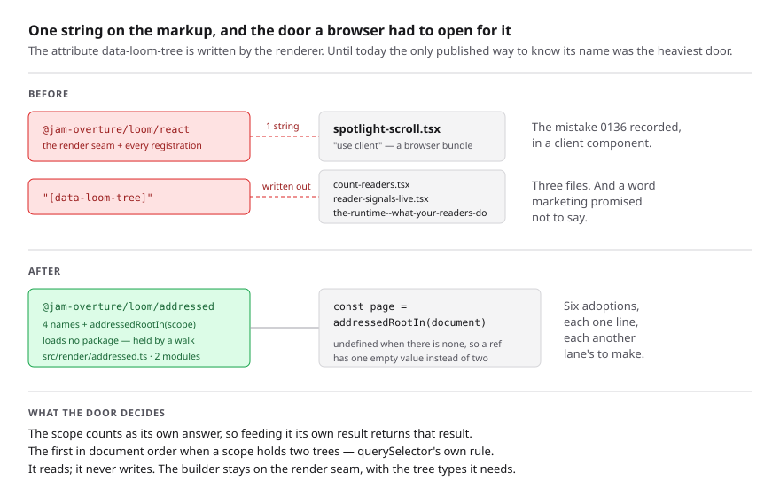

# The names on a page

**Date:** 2026-11-05 · **Routine:** `Loom framework` (`Loom daily build`) ·
**Section:** §3 (rendering) · **Branch:**
`framework-84-the-names-a-render-writes-on-a-page`

**Preview:** taken from Vercel's own comment on the pull request rather than
composed from the branch name, which is the 16 October entry. **Nothing on this
branch changes a page** — the unit is a published entry point in `src/render/`
and no surface consumes it yet — so there is nothing on the preview to look at
that is not on `main`. The diagram is the visual.

## What was completed

One open finding owned by this lane, filed by `Loom marketing` on 4 November:
**a host that wants to find a published Loom page has no light way to learn what
identifies it.**

`addressed: true` stamps four names onto the markup of a live page —
`data-loom-node` and `data-loom-type` on each decorated element,
`data-loom-tree` and `data-loom-revision` on the root. Everything that reads a
published page afterwards needs them, and everything that reads a published page
runs in a visitor's browser. The only door that published them was
`@jam-overture/loom/react`, which carries the render seam and every primitive's
registration.

So a host had two options and both were wrong, and the measurement is six files
in `apps/loom`:

| file | what it does today |
| --- | --- |
| `(demo)/demo/_components/spotlight-scroll.tsx` | **a `"use client"` component** importing `LOOM_NODE_ATTRIBUTE` from `/react` |
| `(demo)/_lib/spotlight.ts` | the same constant from `/react` |
| `(marketing)/_components/count-readers.tsx` | `const TREE_ROOT = "[data-loom-tree]"` |
| `(docs)/_components/reader-signals-live.tsx` | `querySelector("[data-loom-tree]")` |
| `(docs)/_lib/fences/compiled/the-runtime--what-your-readers-do.tsx` | the same line again |
| `(portal)/_lib/connecting.ts` | the constant from `/react`, interpolated into generated source |

**The first row is the finding's own argument arriving as a defect rather than a
tidiness complaint.** It is a client component that pulls the render seam and
every registration into a browser bundle so that one `useEffect` can build a
selector — the mistake 0136 split the broadcaster's own door out to prevent,
sitting in a `"use client"` file, invisible in a diff. The finding was filed
about four hand-written literals; the sixth consumer is the one that is paying
for it.

**`@jam-overture/loom/addressed` now publishes the four names and
`addressedRootIn(scope)`**, which answers the root element or `undefined` and
loads no package. Recorded as
[0350](../decisions/0350-the-names-a-render-writes-on-a-published-page-are-published-on-the-light-side-of-the-split.md).
`/react` still exports the four names, so this is additive and no consumer
breaks.

**No call site was changed.** All six are in route groups this lane does not
own, so the finding is closed at the seam and the six one-line adoptions are
filed for `Loom marketing`, `Loom docs`, `Loom portal` and `Loom demo`.

## Decisions taken that were not specified

**Five, and the first is a departure from what the finding asked for.**

**1. A door of this lane's own, rather than the broadcaster finding its own
root.** The finding offered two shapes and called the second the smaller. The
first — `broadcastReaderSignals` taking a `Document` — is the better API for a
broadcast, and the finding's argument for it is correct: the broadcaster already
refuses an element with no addresses, so the failure it would report for a
document with no addressed page is a failure it has.

It was not built, for two reasons. `src/signals/` is `Loom signals`' lane
(`docs/routines.md`), and that routine ships daily, so it is neither this lane's
file nor an idle one. And it answers one consumer out of six: `(demo)`'s
spotlight wants a node address and starts no broadcast, so a door was needed
anyway, and building both would be building the door twice. It is filed for its
owner, which can now call `addressedRootIn` without changing what the
browser-weight sweep holds it to.

**The finding named the owning directory as `src/signals/` and the names are
written by `src/render/`, which is this lane's.** That is why this closed as a
framework unit rather than as a referral.

**2. The scope counts as its own answer.** `querySelector` searches descendants
only, so a host holding the root and asking for the root would be told there is
none — the one answer that is never useful. Including the scope makes the
function idempotent instead: feeding it its own result returns that result. Two
of the six callers pass a container and two pass `document`, and the shape that
serves both is the shape that also serves a caller holding the root already.

**3. `undefined` rather than `null`.** *There is no addressed page here* is the
absence of an answer rather than an answer. The concrete gain is at
`(docs)/_components/reader-signals-live.tsx`, which today writes
`root === null || root === undefined` because it reaches through an optional
ref into a DOM that answers `null`.

**4. The guard is a node type and not `instanceof Element`.** An iframe's
document has an `Element` of its own, so `instanceof` is false for an element
from it, and a page inspecting a frame it rendered is exactly a host for this
door. This one was found by a planted mutation rather than by thinking — see
below.

**5. `DISCLOSED_ATTRIBUTE` is not in the door.** The disclose control stamps it
whether a page asked to be addressed or not, so it is not part of this
vocabulary, and the thing that reads it is a stylesheet, which imports nothing.
A door meaning *the names `addressed: true` writes* can be held to that; *the
names Loom writes anywhere* is a bag that grows.

## Every new assertion was confirmed to fail first — and two did not

Six mutations were planted on a green tree. **Four were caught and two
survived**, and the two that survived were the useful part of the exercise.

| planted | caught by |
| --- | --- |
| the scope stops counting as its own answer | 2 tests, incl. *counts the scope as its own answer* |
| `null` instead of `undefined` | 3 tests |
| last in document order instead of first | *takes the first in document order when a scope holds two trees* |
| one value import of the render seam | both weight assertions |
| **`instanceof Element` instead of the node type** | **nothing — survived** |
| **the node attribute instead of the tree attribute** | **nothing — survived** |

**The first survivor was a test telling a lie in its own name.** It said *"works
on an element belonging to another document, which an `instanceof` check would
refuse"* and built that document with `DOMParser` — which shares the realm, so
`instanceof` works and the test proved nothing about the guard. Replaced with an
iframe, which in jsdom genuinely has its own `Element`, and the test now asserts
`scope instanceof Element` is `false` before asking anything else, so it is
about the realm rather than about iframes. The `DOMParser` case is kept, with
its name corrected to what it actually checks.

**The second survivor was a real hole.** Every addressed element carries
`data-loom-node`, and the root is first in document order, so
`querySelector("[data-loom-node]")` returns the same element as
`querySelector("[data-loom-tree]")` on every page the tests had. Nothing
distinguished *find the page* from *find the first addressed thing*. Closed with
a test that renders an addressed page, removes the tree attribute from its root,
and asserts `undefined` — a page whose nodes are addressed and whose root is not
is the state `editableAttributes` produces for every element that is not the
root.

Both mutations were re-planted after the two new tests and both now fail.

## The gate caught something, and it is the cost of a new door

**The first full `pnpm verify` on this branch went red**, on five assertions in
`(docs)` and one in `(marketing)`; the second went red on one more in `(docs)`
that the first run's failures had been standing in front of. None of them is a
defect: a published door is
derived from the manifest by four separate checks on the documentation site, and
`entry-points.ts` says in its own words that it *"will drift the day someone adds
an export"* and that the drift should be a red test rather than a page that
quietly stops being true. It was.

That left a choice between a red merge gate for four surfaces and four lines in
another lane's files. **Four lines, and they are declared rather than quiet:**

| file | what was done | whose judgement |
| --- | --- | --- |
| `(docs)/_lib/api/reference.generated.json` | regenerated with `pnpm --filter @loom/app docs:api` | nobody's — the gate's message says to run it |
| `(docs)/_lib/entry-points.ts` | one `EntryPoint`, `audience: "host"`, with a one-line summary | **`Loom docs`'** — prose on their site, written by this lane |
| `(docs)/_lib/api/extract.test.ts` | *"fourteen of the other sixteen"* became *"fifteen of the other seventeen"*, in the name, the paragraph and both numbers | nobody's — arithmetic over the manifest |
| `(docs)/_lib/weight.test.ts` | the count of generated pages, eighteen to nineteen | nobody's — one door is one page |

The `entry-points.ts` row is the only one that is a judgement, and it is filed back to
`Loom docs` with the sentence quoted and an invitation to rewrite it. The
generator's own message is explicit that **no written page is required** for a
new published name, so nothing was filed asking for one; whether the door
deserves prose is that lane's call.

Worth knowing for the next door this lane opens: adding one costs a manifest
entry in two places, a line in `dist.smoke.test.ts`, a regeneration, a line of
prose and a counted claim. The first three are this lane's. The last two are not.

## Records

**Added:**
[0350](../decisions/0350-the-names-a-render-writes-on-a-published-page-are-published-on-the-light-side-of-the-split.md)
— *The names a render writes on a published page are published on the light side
of the split.* It records five rejected alternatives, including the finding's own
first choice and why it is still available.

**Superseded:** none. Nothing here contradicts an `Accepted` record, nothing
touches the tree schema or the delta model, and no built code migrates.

**Numbering: 0350.** `main` holds up to 0349. The one open pull request, #766,
is a `FINDINGS.md` entry with no record in it, confirmed by listing `decisions/`
on that branch rather than by reading its title. `pnpm decisions:index`
regenerated.

## Findings

**Closed, by this branch:**

- *2026-11-04 — the broadcaster takes the page's root element and publishes no
  way for a browser-side host to find one*, filed by `Loom marketing`. Closed
  with the second of its two shapes, and with the owning directory read as
  `src/render/` rather than `src/signals/`; the entry's status now says both in
  writing.

**Filed: three**, all for other lanes.

- **`Loom marketing`, `Loom docs`, `Loom portal`, `Loom demo`** — the six
  adoptions, one line each, with the file and the available change in a table.
  The `(demo)` client component is called out as the one with a cost rather than
  a tidiness gain. `(docs)/_lib/signals/markup.ts` is deliberately excluded and
  the entry says why.
- **`Loom signals`** — the broadcast that finds its own root, which is still the
  better API for a broadcast and is now cheap to build, with the weight argument
  it would have to answer.
- **`Loom docs`** — the four lines this run wrote in their files to keep the
  tree green, with the one that is a judgement quoted in full and handed back.

## Test numbers

`pnpm verify`, read from a file written as the last thing on the line.

| | framework suite | application suite | gate |
| --- | --- | --- | --- |
| this branch, third run | 260 files, **6,231 tests** | 398 files, **6,456 tests** | **`EXIT=0`** |

**12,687 tests pass in total. Nothing failed in the final run and nothing was
skipped.** No test was weakened and none was deleted. The only pre-existing
assertions that changed are the two counted claims in `(docs)` described above,
both of which went up.

**+32 tests, in two halves.** Sixteen are new assertions in two new files —
`src/render/addressed.test.ts` (13) and `src/render/addressed.weight.test.ts`
(3). The other sixteen are in the application suite and are not written by
anyone: the generated reference gained a door, and the suites that run over
every door ran sixteen more times.

**No separate baseline run on `main` was made.** Three full `pnpm verify` runs
had already been spent on this branch — two of them red, for the reasons above —
and the delta is readable off the two new files rather than needing a fourth.

`findings:check` reports 1,432 findings, 0 malformed. `reports:check` reports
2,080 visuals, 146.6MB, none over 1.1MB.

**The two red runs are described in full above and neither was worked around.**
The first was the cost of a new published door; the second was one more counted
claim that the first run's failures had been standing in front of.

## Open questions

**Nothing in this unit is blocking.**

**One new question, and it is a scheduling one.** The `(demo)` client component
is the only consumer whose import costs a reader anything, and `Loom demo` owns
it. Nobody has measured what `/demo` carries today. If that lane is slow to pick
it up it is worth measuring, because `pnpm weigh` now exists and the answer
would either close the question or make it the second reported performance
problem in this repository.

**Two items are repeated rather than re-filed, both unanswered since #752 and
both named again on #766.**

1. **The largest open thing in the repository, and it is the maintainer's
   reported performance problem.** `/why-use-it` serves 2.4MB, of which 93% is
   one 47KB stylesheet carried 42 times by `libraryStylesheet()` in
   `src/primitives/`. That directory belongs to `Loom primitives`, whose last
   report is 11 October, so this lane has not touched it. Measured to its cause
   and waiting on a scheduling call: unpause that lane, or hand that one function
   to this one.

2. **This routine's stored prompt still describes the one-application migration
   as its next unit.** `apps/loom` has existed since 19 August with all four
   route groups, `vercel.json`, and both retired packages gone. The prompt also
   claims `src/signals/` and `app/(demo)/`, which `docs/routines.md` gives to
   `Loom signals` and `Loom demo` — and on this branch that was not an
   abstraction: the finding this run closed named `src/signals/` as the owning
   directory, and both of the findings filed are for lanes the prompt says are
   this one's. This run resolved it the way the last three did, with
   `routines.md` winning because the prompt names it as its governance file. The
   2 November entry owns this.
