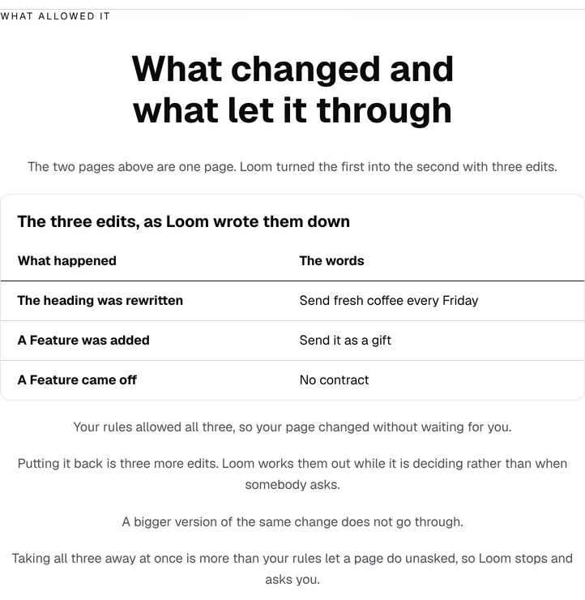
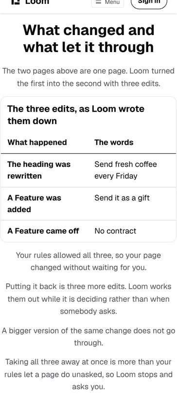

# Marketing — what changed and what let it through

**Branch** `marketing-28-what-allowed-it` · **Date** 5 November 2026 ·
**Section** §4d, the marketing site · **Lane** `apps/loom/app/(marketing)/`

---

# What was built

**The site now shows a reader what stood between the two pages.** It never has.

`chain.ts` holds the maintainer's six links as data and says, for each one,
where a visitor can watch it being true. His fifth is *AI reacting to signals
and redesigning page*, and this site renders it as two sentences:

> *"It reads what your page saw and proposes a different arrangement. Loom
> checks that against your rules before anything moves."*

The band that rung lands on — *Who is reading it*, two frames of a coffee page
side by side — shows the first sentence and has never shown the second. A
reader met two frames and had to take on trust that anything at all stood
between them. On the one surface arguing that Loom can say what really
happened, that is the weakest place on the site for a claim to be
unevidenced.

So there is a new band under it, and **everything in it is computed**:

| the band says | where the number comes from |
| --- | --- |
| three edits | `THE_EDITS.operations.length` |
| the heading, a part added, a part taken off | the three operations, read as English |
| your rules allowed all three | `gate(…).kind === "accepted"` |
| putting it back is three more edits | the way back the framework computed while deciding |
| a bigger version does not go through | `gate(…).kind === "requires-confirmation"` on the same policy |
| taking all three away | `analysis.removedNodeCount` |



## The assertion the band rests on

The band claims the second frame is the first frame after these three edits.
That is checkable in exactly one way and `allowed.test.ts` does it: apply the
operations to the built page and compare what a reader reads, word for word,
against the arrangement the band above renders. It passes, and it fails when
the insert moves one position — checked by doing it.

`example.ts`' screen builder is now exported and **both bands call it**, so the
pair being described and the pair being shown are the same nodes rather than
two builders that agree today.

## It is one policy and two verdicts

A band showing only the acceptance would be showing a check with no teeth: a
rule that has never refused anything is indistinguishable from no rule. So the
same policy judges a second, larger change — clear the row of tiles instead of
swapping one of them — and holds it for a human.

Neither verdict is chosen. Both come back from `gate`, under one policy
fingerprint, and the test fails if either stops being what the band says.

**Two thirds of that policy is read off the library rather than written.**
`registeredPrimitiveTypes` and `interactiveTypes` come from the same registry
this site is built with, through the SDK readers a host is told to use.
Everything else is the framework's default, which is the honest setting for a
band claiming *your rules*: a reader installing this tomorrow and writing no
policy at all gets these thresholds and therefore these two verdicts.

The hold depends on the change arriving as `system-signal` — nobody asked —
which is exactly the fifth rung's situation. The same change from a developer's
own hand comes back accepted, and a band that had drifted onto that origin
would be showing a reader a verdict their page will never get. Pinned.

# Where this sits against positioning

`docs/positioning.md` records the maintainer's instruction of 24 October that
the governance is **under the hood** and is not the pitch, and its own reading
keeps the record *"worth saying on a page somebody reads after they want the
product."*

This band is that page and that position: the **last** band before the closing
one, on the second page of a three-page site, one screen under a frame the
reader has just watched rearrange itself. It does not open on an audit case and
nothing above it was changed to make room. It answers the question the band
above creates — *the model just rewrote my page?* — which is the only moment on
this site where a stranger wants the rules.

The two standing positioning questions are unchanged and still the
maintainer's.

# Two corrections, both found by building

## The report panel named parts that are not on the page

`reported.ts` prints one reader report under *What your page reports*, and the
parts it named were authored. Three assertions held it — that it is a delivery
the product would accept, that every **type** in it is on the page, that it
carries no field about a person — and all three passed while two of its four
observations named parts that do not exist.

Building the page as a tree for this band gave the real names. The panel said
`n_fern1` for the opening and `n_fern6` for the row of tiles; the page's own
are `n_fern6` and `n_fern10`, so one of the two names belonged to a different
part of the same page and the other to its words. `revision` went from 1 to 0
for the same reason: a page as its author built it is at its first revision,
which is what both bands are describing.

Nothing a reader could see was wrong. What it cost is the thing this band
needs — **the two panels on that page are one page's story**, the fourth link
reporting on these parts and the fifth link editing them. `reported.test.ts`
now reads both names off the built page and fails when one drifts, checked by
breaking it.

## The opening line was wrong on a phone

The band's first sentence read *"The page on the right is not a second page."*
`loom.split` stacks at 390 with the order kept, so there is no right-hand side
to point at. It now reads *"The two pages above are one page. Loom turned the
first into the second with three edits"*, which is true at every width.



# Decisions

**None taken and none recorded.** Nothing here touches the tree schema, the
delta model or an Accepted record. The band composes registered primitives,
adds no component, and the only framework code it reaches is the public API a
host calls.

Two judgements worth naming that did not want records, because both are one
line inside one route group:

- **The band is `readable` rather than `wide`.** At the page's full width the
  table's two columns sit 1,078px apart with four words in each. Measured, then
  changed; the reasoning is on the call site.
- **The band has an anchor nothing links to.** `ALLOWED_ANCHOR` is its own
  constant rather than an entry in `WHY_USE_IT_ANCHOR`, whose first line says
  it is *the bands the chain points at*. What the anchor buys is that the band
  is addressable: a report can send the maintainer to it and `pnpm shoot` can
  photograph it by name.

# Findings

**One filed, none closed.** Nothing in the queue named this lane.

**Filed for this lane:** *the comparison band tells a reader to look right, and
on a phone there is no right.* The band above this one has the sentence shape
this run removed from its own. It is a two-line fix and was deliberately not
taken in the same pull request: the sentence is load-bearing for a different
band with twelve lines of argument above it, and rewriting another band's
central line inside a pull request about the band under it is what makes a
marketing diff unreviewable. The entry names the fix and the general version,
which is worth more than the instance — **copy that names a position is copy
that is wrong at one of the two widths this site is photographed at**, and
nothing checks it.

# Test numbers

`pnpm install && pnpm verify`, read out of the file the status was written to
rather than off a notification:

```
Test Files  258 passed (258)      Tests  6215 passed (6215)    # framework
1430 findings, 0 malformed
2086 visuals in reports/, 147.0MB, none over 1.1MB
Test Files  404 passed (404)      Tests  6555 passed (6555)    # @loom/app
137 prerendered pages, 2030 text junctions, 0 run together
EXIT=0
```

`@loom/app` gained 22 cases on one new file: 20 in `allowed.test.ts` and 2 in
`reported.test.ts`. The framework suite is untouched by this branch.

Both marketing routes still report `ƒ` in the build, so
[0331](../decisions/0331-a-marketing-page-is-served-per-request-because-the-store-governs-it.md)
holds and nothing here froze a governed page.

**The copy budget, measured before and after.** `/why-use-it` went from **976
to 1,105** words against a ceiling of 1,500, and the site from **2,823 to
2,952** against 3,900. The band is a run rather than a plain band, so its
ceiling is 300 and it is at **129** — the widest band on that page is *What you
build with* at 175, and this is the third widest.

**Two checks were proved by breaking them**, which is the part of this worth a
second pair of eyes: moving the insert one position fails the word-for-word
comparison, and changing one name in the report panel fails the new sweep over
it. Neither is a check that passes because it has nothing to look at.

Nothing skipped, nothing weakened. The only test file changed outside this
run's own is `balance.test.ts`, which gained two classifications — `loom.table`
is not a row of equal cells and `loom.table-row` is — because that file fails
on a container the site renders and nobody has classified, which is what it is
for.

# Open questions

In the pull request comment. Nothing about this change is blocking.
