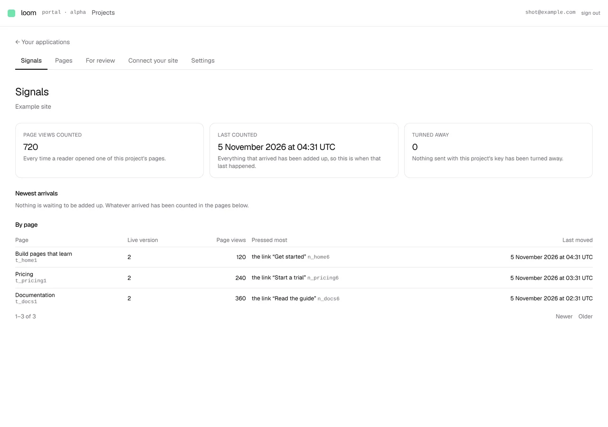
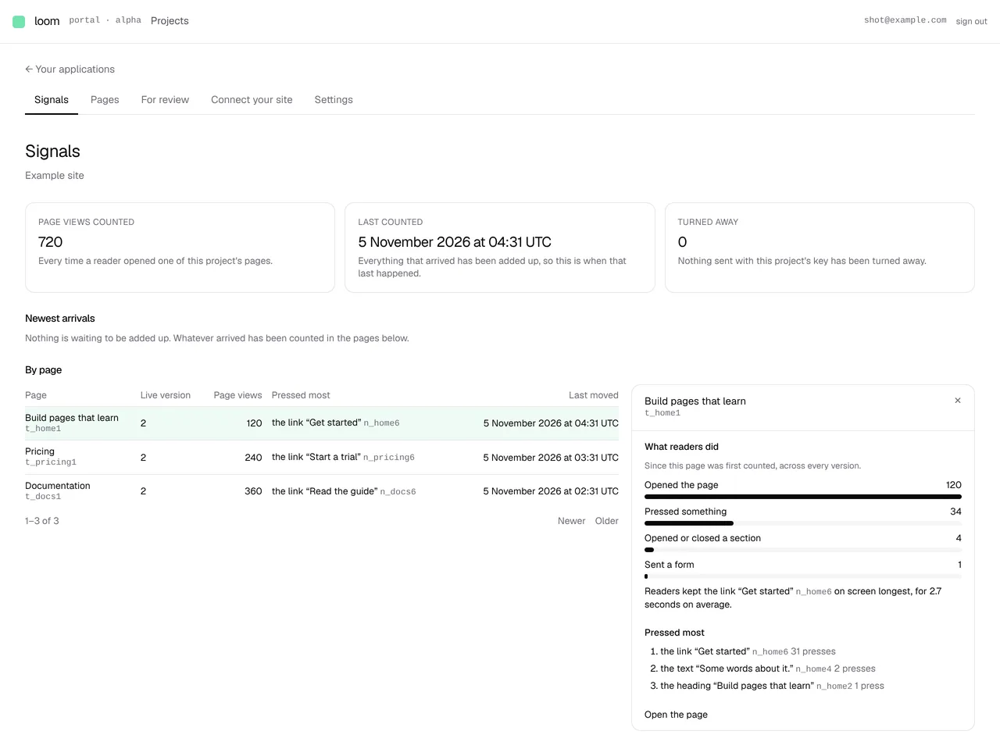
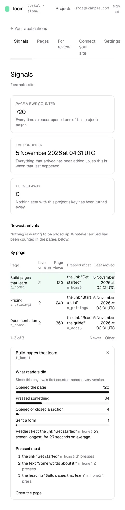

# Signals, page by page, with a drawer that opens on one

**Lane:** `Loom portal` · **Date:** 5 November 2026 ·
**Branch:** `claude/project-thread-1ae75w` ·
**Record:** [0349](../decisions/0349-a-projects-reader-events-are-kept-thirty-days-by-default-and-the-tallies-stay-the-durable-record.md) ·
**Plan:** [`docs/portal.md`](../docs/portal.md) row 8a ·
**Target:** [`docs/portal-wireframes.md`](../docs/portal-wireframes.md) *1 · Signals*

## What shipped

The first half of 8a, the half whose data is on `main`: **By page**.

- **One row per page**, added up across its versions and audiences from the
  tallies: the page by its published heading with its id beneath, its live
  version (the one the site last published, or the newest one counted), page
  views, the part pressed most, when it last moved, and a *N waiting* badge
  when changes wait for it.
- **Newest first, 50 rows a page**, *Newer* and *Older*, with the cursor in
  the URL (`from`). The cursor is a position (when the row last moved, then
  its id), so a link to the second page stays the second page when a row
  moves to the top in between.
- **A right drawer** whose subject is in the URL (`?page=<tree id>`): a bar
  per kind of thing readers did (opened the page, pressed something, opened
  or closed a section, sent a form), the part kept on screen longest on
  average, the three parts pressed most, a band linking to *For review* when
  changes wait, and *Open the page*. Beside the list on a wide screen, below
  it on a phone.
- **What it replaced:** the old *By page* table, one row per page *and
  version*, busiest first, with no drawer. `arrivals.ts` lost the fold it no
  longer needs.

The screenshots are of a local build against Postgres, with three pages
published and counters written straight to the stores. Every figure in them is
that staging data.

## Decisions taken and why

- **Figures are *since counting began*, not a range.** The tallies keep no
  time, so a 24 hours / 7 days / 30 days picker would have been a control
  that changes nothing. The drawer says so in a sentence. The range arrives
  with the kept events.
- **Time on a part is a sentence, not a bar.** It is milliseconds, not a
  count, and a part's dwell overlaps the parts inside it, so a total would
  mislead. The drawer names the part with the longest average over the page
  views that reached it.
- **A page is listed once a page view of it was counted.** A published page
  nobody opened is on *Pages*; a row of noughts here answers nothing.
- **The changes waiting cost only the badge if they cannot be read.** The
  tallies failing is a failed screen, as before.
- **The kind words live in `vocabulary.ts`** (`SIGNAL_KINDS`), the one
  registry for words (rule 3).
- **No *Events* tab is drawn.** Rule 2: no screen before its data.

## Records and findings

- **0349, Accepted:** reader events are kept 30 days by default, as
  per-deployment configuration, and the tallies stay the durable record. It
  writes down the maintainer's 5 November choice, which until now lived only
  in the wireframe spec.
- **Finding filed for `Loom signals`:** the intake has to keep events for the
  window, behind a scoped reading handle, and the reader-facing notice of
  0313/0320 has to state the new window.

## Tests

- `pnpm verify` exit 0: 257 files / 6,213 tests passed (2 skipped) at the
  root, 398 files / 6,455 tests passed in `apps/loom`.
- New: `_lib/by-page.test.ts` (16), `signals/_components/by-page.test.tsx` (6).
  `arrivals.test.ts` lost the three tests for the fold it no longer has.

## Against the wireframe, what is still missing on *Signals*

- *Events*, its kind chips, page picker and search, and the event drawer
  with *the rest of this page view*: wait on the intake keeping events.
- The range picker, the hourly bar chart and *Live*: the same.
- *Reached the primary goal* (figure, column and the goal rates in the
  drawer): wait on 8b.
- *Page history* and *Events on this page* in the drawer: wait on 8c and
  *Events*.
- The left rail replacing the tab row: not started; it can land with
  whichever unit next touches the frame.
