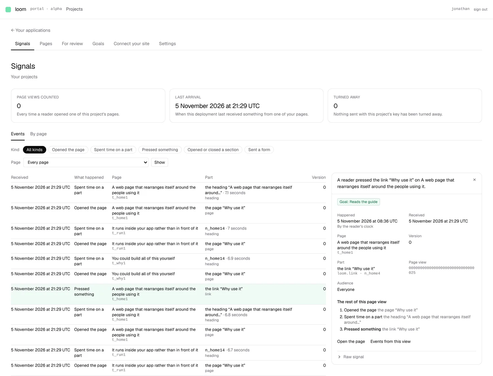
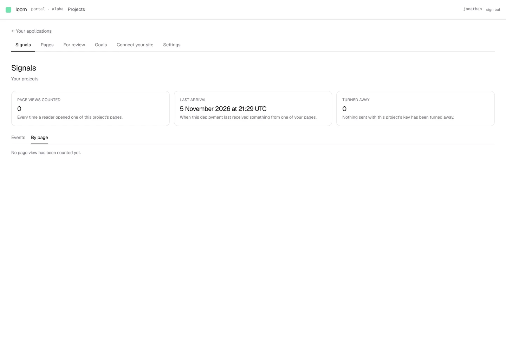
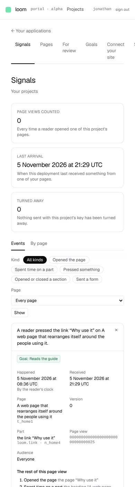

# Signals opens on Events: what readers did, one row each, with a drawer for one of them

**Lane:** `Loom portal` · **Date:** 5 November 2026 ·
**Branch:** `claude/project-thread-910q5p` ·
**Records:** none new; the tab reads what [0349](../decisions/0349-a-projects-reader-events-are-kept-thirty-days-by-default-and-the-tallies-stay-the-durable-record.md)
decided and what 0351 (#775) built ·
**Plan:** [`docs/portal.md`](../docs/portal.md) row 8a ·
**Target:** [`docs/portal-wireframes.md`](../docs/portal-wireframes.md) *1 · Signals*

## Why this, and why now

The last portal run left *Events* waiting on `Loom signals`' finding of 5
November. #775 landed that morning: the intake keeps each counted delivery for
the window (thirty days by default, `LOOM_SIGNAL_KEPT_MS`), sweeps what is
older and tells readers both ages. The finding's fourth point asked for a
scoped reading handle, and the one the portal already held,
`readingsFor(application).journal`, turned out to be it: scoped to the
application, paging kept deliveries newest first by cursor, and narrowing to
one page by `treeId`. So *Events* was buildable without touching `src/`, and it
comes before unit 8 in the agreed order. The finding is closed with that
explanation.

## What shipped

- ***Signals* is two tabs.** *Events* at `/portal/<project>/signals`, the
  default, and *By page* moved unchanged to `/portal/<project>/signals/pages`.
  The heading, the three figures and what was turned away are one frame both
  tabs share (`signals/_components/signals-frame.tsx`), read once by
  `signals/_lib/reading.ts`, which also says once for both tabs when the store
  did not answer, the project has no single site, or nothing has arrived.
- **The Events list** (`_lib/events.ts`, pure; `_lib/events-reading.ts`, the
  reading). One row per signal: when it was received, what happened in the
  vocabulary's words, the page by its published name with its id beneath, the
  part by its name (and how long, for a stay), the version. Newest first,
  fifty to a page. An event's address is its delivery's place and its own
  place in the delivery (`12.3`), and the address carries the last event shown
  (`?before=`), so a page can end half way through a delivery and the next
  page picks up inside it. Nothing is skipped or shown twice; a test walks
  every page.
- **Filters above the list**, all in the address: a chip per kind (*All kinds*
  and the five), a page picker (`?on=`, pushed down to the journal read), and
  `?view=` for one page view, with a way back to all of them.
- **A read has a budget**: at most four reads of 500 deliveries. Where a
  narrow filter has not filled a page by then, the page says *Looked through
  everything received since …* and *Older* resumes below the oldest delivery
  read, so *not looked at yet* never reads as *nothing older*.
- **The drawer** (`?event=`): the event as a sentence (*A reader pressed the
  link “Read the guide” on Home*), a goal chip for each goal it counts toward
  (same kind, same part, a page the goal covers; *Opens it* counts openings
  only, as 0350 reads it), then *Happened* by the reader's clock (a stay has a
  length instead), *Received*, *Page*, *Version*, *Part*, *Page view*,
  *Audience*. Below that, the rest of its page view in the order it happened,
  each one a link, this one marked. Actions: *Open the page*, *Events from
  this view*, and the raw signal behind the technical-detail disclosure. An
  event the sweep has deleted says so.
- **By page's drawer links to *Events on this page*.**
- **The *Newest arrivals* table is gone.** It listed the same deliveries,
  and since #775 its empty-state sentence (*Nothing is waiting to be added up*)
  was no longer true. `arrivalsOf` keeps the figure it fed, *Last arrival*.
- **`FilterChips` moved** from *For review* to the portal's shared components,
  with an optional count, because *Events* uses it too.

## Decisions taken, all reversible

- **The page view is looked for among the 200 deliveries either side.** A page
  view's deliveries are minutes apart, but on a busy site they interleave with
  others; reading the whole window for one drawer is not bounded. Where there
  were more deliveries beyond, the drawer says *a long page view may have
  more*.
- **A row's time is when it was received**, not the reader's clock: the
  reader's clock is the browser's and may be wrong, and a dwell has none. The
  drawer shows both.
- **The cursor is the journal's own:** a delivery's place, read strictly
  either side (`src/paging.ts`). One place above a delivery is the cursor
  whose *older* read includes it; that is the one arithmetic on a cursor and
  it is named (`through`) and explained where it is written.

## Tests

New: `events.test.ts` (17: addresses, ordering, the filter and its address,
each kind's sentence, the reader's clock and a stay's length, goals counted,
the page view, the page picker), `events-reading.test.ts` (9, against the
memory journal: fifty to a page across a split delivery, every event once
across all pages, each filter, the budget and *Older* after it, the opened
event and its page view, an event no longer kept, a cut neighbourhood),
`events.test.tsx` (12), `signals-frame.test.tsx` (3), one more in
`filter-chips.test.tsx`; `by-page.test.tsx` checks the new link and
`arrivals.test.ts` the newest delivery.

`pnpm verify` exit 0: framework 261 files, 6,278 passed, 2 skipped;
application 413 files, 6,685 passed. The first full run was red on one
portal test, `destinations.test.ts`, which reads every link the group writes
and could not follow a tab address built from two template pieces; the tabs
now write each address whole. Nothing skipped or weakened.

The screens below were taken against a local Postgres with this deployment's
own pages published and 80 deliveries sent straight into the project's
journal, so *Page views counted* reads 0: those deliveries did not pass
through the door, which is what counts page views. The phone screenshot led
to three fixes before this report: the page picker and a page view's key no
longer run off a narrow screen, the list scrolls inside its own box, and the
drawer sits above the list on a phone instead of below fifty rows.

## Where this leaves the wireframes

*1 · Signals*: *Events* with its list, kind chips, page picker and drawer
done; *By page* done. Still missing: the range picker (24 hours, 7 days,
30 days), the hourly bar chart, the *Live* toggle, the search over part and
page, the figure for *page views in the range* with the change on the period
before, and the share reaching the primary goal; on *By page*, the primary
goal rate column and the bars for a range. All of these now have their data
(the kept events), so they are the next Signals piece.

**Next portal unit:** unit 8, the pull request, needs a decision on how Loom
reaches a site's repository; the range picker and chart above are the
fallback if that is still open.

## Screens

