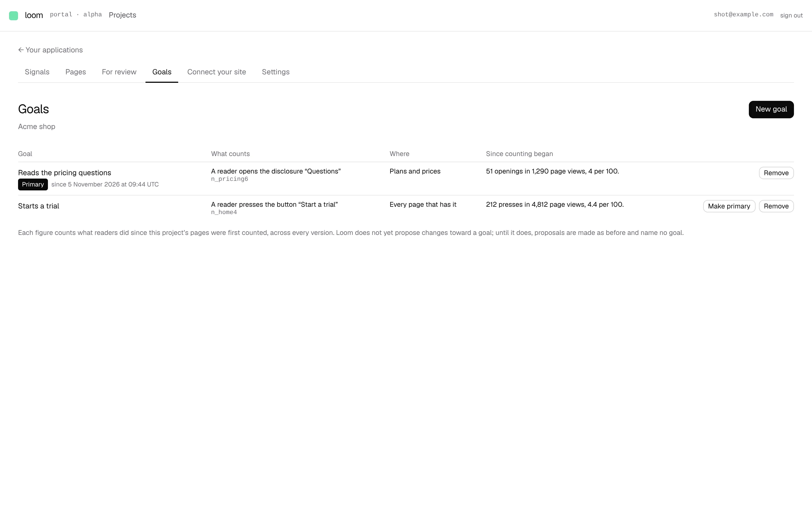
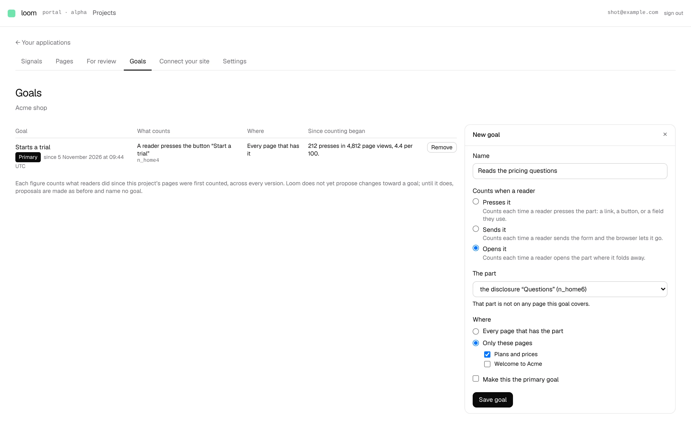
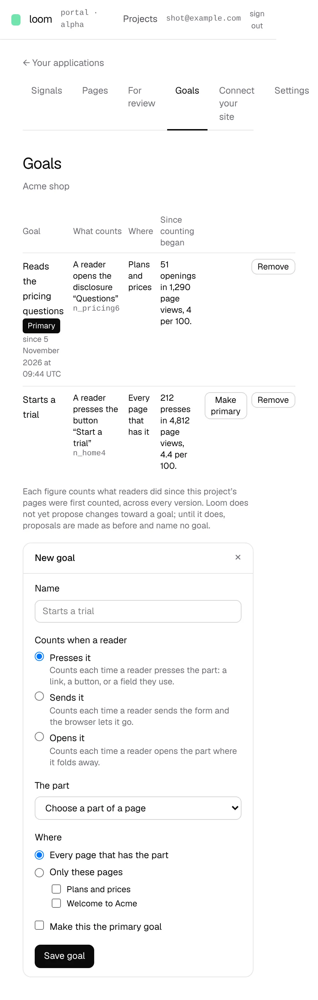

# Goals: a project says what it wants readers to do

**Lane:** `Loom portal` · **Date:** 5 November 2026 ·
**Branch:** `claude/project-thread-f07q3q` ·
**Record:** [0350](../decisions/0350-a-project-sets-goals-from-signals-already-collected-and-one-of-them-is-primary.md) ·
**Plan:** [`docs/portal.md`](../docs/portal.md) row 8b ·
**Target:** [`docs/portal-wireframes.md`](../docs/portal-wireframes.md) *3 · Goals*

## What shipped

The first half of 8b: goals are kept, measured and managed. The proposer does
not read them yet; that is the second half.

- **A *Goals* tab**, after *For review*. One row per goal, the primary one
  first with *Primary since …*, then the rest oldest first: the name, what
  counts in words (*A reader presses the button “Start a trial”*, with the
  part's id beneath), where (*Every page that has it*, or the pages by name),
  and what it counted since counting began (*212 presses in 4,812 page views,
  4.4 per 100*).
- **New goal in a drawer** (`?goal=new`), for an owner: a name; *Presses it*,
  *Sends it* or *Opens it*; the part, picked from what the site published,
  page by page, by name with its id; every page that has the part or chosen
  pages; *Make this the primary goal*. The part must be on a page the goal
  covers. A refused form is drawn again with everything typed still in it.
  With nothing published, the drawer says to connect the site first.
- **Make primary** and **Remove** on each row, for an owner. Removing the
  primary goal passes the mark to the oldest left. Everybody else in the
  project reads the list.
- **Stores:** `GoalStore` with a memory and a Postgres implementation, one
  contract run against both (PGlite). Table `loom_goals`, added to
  `scripts/db-push.ts`. Until it exists the screen says goals cannot be read
  and names `pnpm db:push`; nothing else reads the table yet.

Screenshots are of a local build against Postgres, with two pages published
and counters written straight to the stores; both goals were made through the
form. Every figure is that staging data.

## Decisions taken and why (0350, Accepted)

The shape is the wireframes the maintainer set as the target on 5 November.
Within it, four defaults he has not ruled on, each reversible without a
migration:

- **Three kinds, not four.** *Stays on it* needs readers counted past a time
  threshold; the tallies keep one total per part, so it waits for the kept
  events (0349).
- **The figure is a count over page views, since counting began**, not the
  wireframes' 7-day rate and trend: the tallies keep no time. It says
  *presses*, not *readers*, because the counter counts presses.
- **Only an owner sets, moves or removes goals**, as with the model key.
- **At most 20 goals per project.**

Exactly one goal is primary whenever any exists, moved in one SQL statement so
no read sees two or none.

## Tests

- `pnpm verify` exit 0: 257 files / 6,213 tests passed (2 skipped) at the root, 403 files / 6,533 tests passed in `apps/loom`.
- New: `goals/goal.test.ts` (form reading, ordering, ids), `goals/goal-view.test.ts`
  (part choices, counting, sentences), `goals/goals-memory.test.ts` and
  `goals/goals-postgres.test.ts` (8-test contract each, plus RLS, idempotent
  migration, project isolation), `goals/_components/goal-form.test.tsx` (3).
  `project-tabs.test.ts` gains the tab.

## Against the wireframe, what is still missing

- **The proposer reading the primary goal** (or a page's own), proposing
  nothing for a page no goal covers, every proposal naming its goal, and the
  goal chip and goal picker on *For review*: the second half of 8b, next.
- *Changes for it* (*2 waiting · 3 shipped*) on each row: needs proposals to
  name goals.
- The 7-day rate, its trend, *Stays on it*, and the drawer's *what it would
  have counted over the last 7 days*: need the kept events (0349, a finding
  for `Loom signals`).
- *Pick the part on the page* (a small outline of the page): the picker is a
  list for now.
