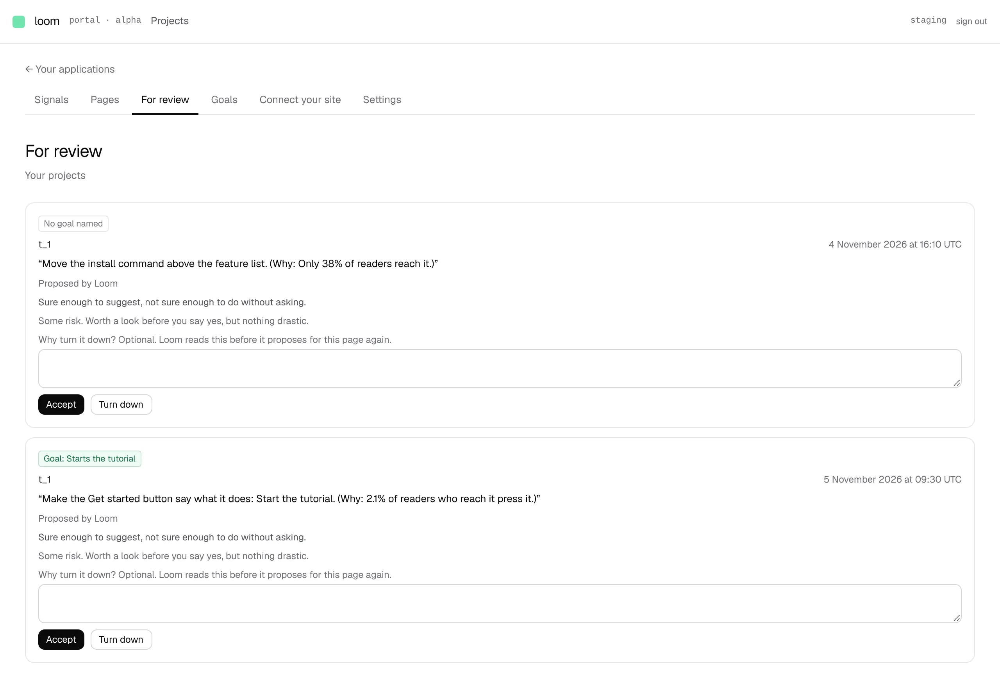
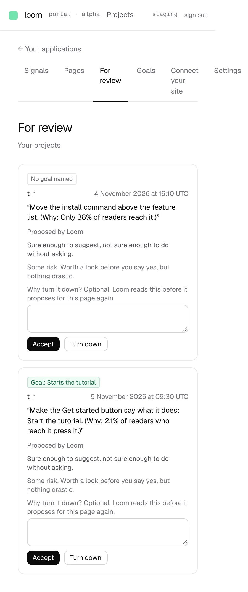

# Proposals serve a goal: Loom aims at what the project wants readers to do

**Lane:** `Loom portal` · **Date:** 5 November 2026 ·
**Branch:** `claude/project-thread-xvo4dr` ·
**Record:** [0352](../decisions/0352-every-proposal-serves-one-goal-and-a-page-no-goal-is-on-gets-none.md) ·
**Plan:** [`docs/portal.md`](../docs/portal.md) row 8b ·
**Target:** [`docs/portal-wireframes.md`](../docs/portal-wireframes.md) *2 · For review* and *3 · Goals*

## What shipped

The second half of 8b, apart from the goal picker: the proposer reads goals.

- **Which goal a page has** (`goals/serving.ts`, pure): a goal is on a page
  when it covers the page (every page, or the page among those chosen) and the
  page has the part it counts. The page's own goal comes first, then the
  primary, then the oldest.
- **No goal, no proposal.** The proposer passes a page no goal is on before
  asking the model, so no key is spent, and *Look now* says: *No goal is on
  this page, so Loom proposes nothing for it… set one under Goals.*
- **The model is told the goal.** The brief now names it (*The goal, "Starts
  the tutorial", counts each time a reader presses n_…*) and asks for the change
  most likely to get more readers to do it.
- **Every proposal names its goal.** Before the change goes to the write path,
  the goal is recorded in `loom_proposal_goals`, keyed by the intent id the
  portal mints. The goal's name, kind and part are kept as they were. If that
  record cannot be written, nothing is proposed.
- ***For review* leads each card with a green goal chip**; a change raised
  before today says *No goal named*. *Look now* shows the chip on what it
  proposed. While the table is missing, *For review* says so, names
  `pnpm db:push`, and lists the changes without chips.
- **Stores:** `ProposalGoalStore`, memory and Postgres, one contract run
  against both (PGlite). Table `loom_proposal_goals`, added to
  `scripts/db-push.ts`.

Screenshots are of a local build against Postgres after `pnpm db:push`, with
one goal and two held changes written straight to the stores; every figure in
them is that staging data.

## Decisions taken and why (0352, Accepted)

The rule itself is the wireframes' (*"Loom proposes toward [the primary] unless
a page has its own. A page with no goal on it gets no proposals"*). Within it,
three reversible defaults the maintainer has not ruled on:

- **A goal counted on every page is only on pages that have its part.** A
  change cannot raise a count of a part the page does not have.
- **Among several goals on a page**, its own goal first, then the primary,
  then the oldest.
- **The goal is kept by intent, not proposal**, so it is recorded before the
  change exists and no change ever waits without one. The framework's
  `loom_holds` is not touched.

## What changes for the live deployment

- **Needs `pnpm db:push`** (creates `loom_proposal_goals`). Until then,
  proposing stops with *the store did not answer* (which now names
  `pnpm db:push`), and *For review* shows changes without their goal.
- **A project with no goal now gets no proposals.** That is the spec, but it is
  a change in behaviour: set a goal on *Goals* and proposing resumes.

## Tests

- `pnpm verify` exit 0: 257 files / 6,213 tests passed (2 skipped) at the root,
  406 files / 6,561 tests passed in `apps/loom`.
- New: `goals/serving.test.ts` (6: which goal a page has, what is kept),
  `goals/proposal-goals-memory.test.ts` (3) and
  `goals/proposal-goals-postgres.test.ts` (6: contract, idempotent migration,
  RLS, project isolation).
- Changed: `proposing/propose.test.ts` (+3: records the goal by intent, asks
  no model for a page no goal is on, proposes nothing when the record cannot be
  written), `proposing/brief.test.ts` (the goal in the message), `queue.test.ts`
  (+2: the goal on a card, and none for an older change),
  `proposing/report.test.ts` (the no-goal sentence, the `db:push` line).

## Against the wireframe, what is still missing

- **The goal picker on *For review*** (filter by goal) and ***changes for it***
  on each goal (*2 waiting · 3 shipped*): both read `loom_proposal_goals`, next.
- *What it expects* (a predicted range on the goal) on a change.
- The 7-day rate, its trend and *Stays on it* on *Goals*: need the kept events
  (0349, the open finding for `Loom signals`).
