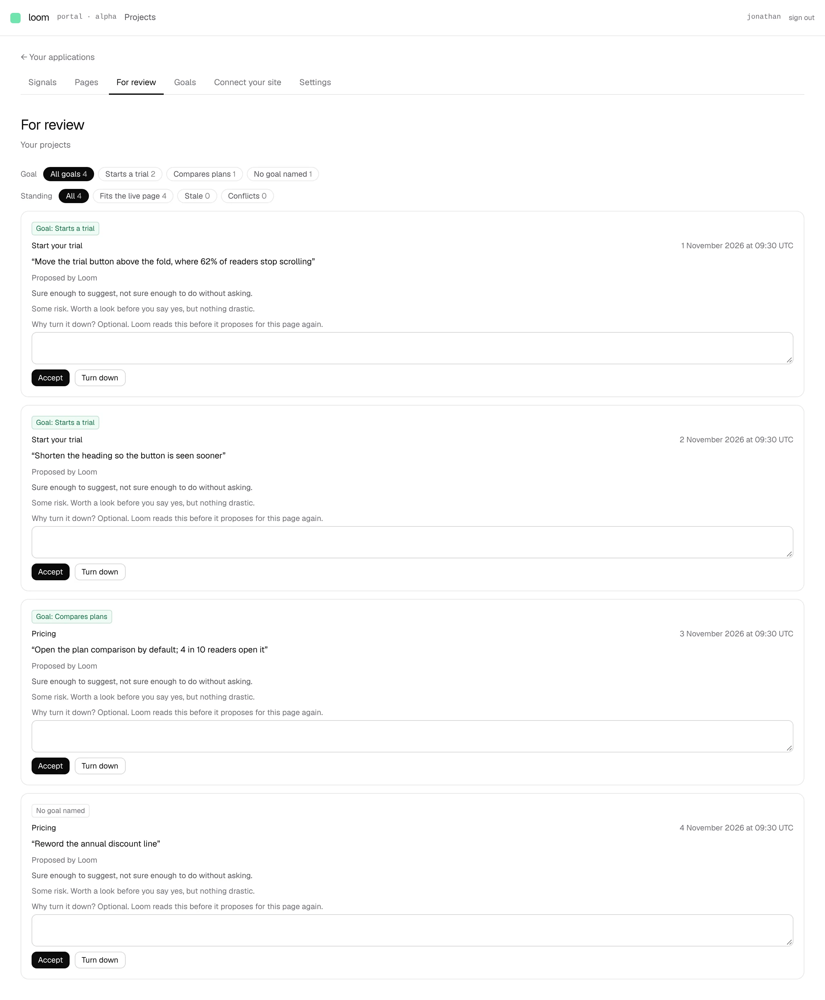
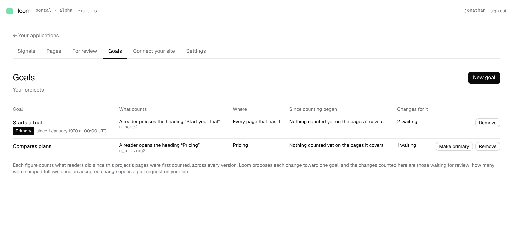
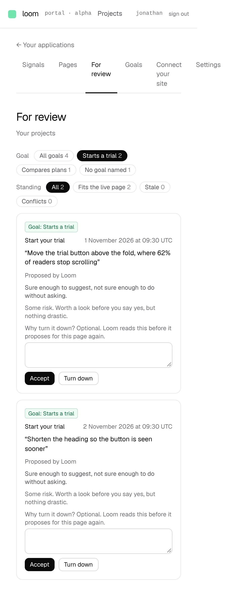

# For review filters by goal and standing, and each goal counts the changes waiting for it

**Lane:** `Loom portal` · **Date:** 5 November 2026 ·
**Branch:** `claude/project-thread-pdsu59` ·
**Records:** none new; the filters read what [0340](../decisions/0340-a-pages-copy-starts-again-from-a-newer-published-version-and-a-waiting-change-is-checked-against-it.md)
and [0352](../decisions/0352-every-proposal-serves-one-goal-and-a-page-no-goal-is-on-gets-none.md) already keep ·
**Plan:** [`docs/portal.md`](../docs/portal.md) row 8b ·
**Target:** [`docs/portal-wireframes.md`](../docs/portal-wireframes.md) *2 · For review* and *3 · Goals*

## What shipped

The last two pieces row 8b listed as owed, so 8b is done.

- ***For review* filters** (`_lib/review-filter.ts`, pure). A goal picker:
  *All goals*, then every goal of the project, primary first, by its name now
  (a goal nothing waits for is still offered, with 0); then a goal removed
  since, by the name its changes recorded, marked *(removed)*; then *No goal
  named* where a change was raised before proposals named one. Standing chips:
  *All · Fits the live page · Stale · Conflicts*. Each choice carries its
  count under the other filter, so a count is exactly the number of cards that
  choice would show. Both filters are in the address (`?goal=`, `?standing=`),
  so a filtered list is a link; anything unreadable in the address is no
  filter. A filter that matches nothing says so, with a link back to
  everything.
- **The goal picker is left out** where which goal a change serves, or the
  goals themselves, cannot be read (for instance before `pnpm db:push`),
  rather than offering every goal as *(removed)*. The standing chips stay.
- **The standing words** are in `vocabulary.ts` as `HOLD_STANDINGS`, the one
  place a state is named.
- ***Goals* has *Changes for it*:** the changes waiting for review raised for
  each goal (`waitingByGoalOf` in `goals/serving.ts`, pure), linking to *For
  review* filtered to that goal; *None waiting* at zero; *Cannot be read just
  now* when the queue or the goal records do not answer. The sentence under the
  list that said Loom did not yet propose toward a goal was out of date since
  #777 and is replaced.
- **`QueueRow` carries `goalId`**, so a card can be placed by goal.

No table, no column, no environment variable: nothing for `pnpm db:push`.

Screenshots are of a local production build against Postgres after
`pnpm db:push`, with two published pages, two goals and four held changes
written straight to the stores; every figure and sentence in them is that
staging data (including the primary mark's 1970 date, from a staging
`createdAt` of 1). No staged change was proposed for an older version, so
*Stale* and *Conflicts* read 0.

## Decisions taken and why

No record: nothing here decides anything the wireframes and 0340/0352 did not.
Three small reversible choices:

- **Chips, not a dropdown, for the goal picker.** Links work without script and
  put every count in view; at the 20-goal ceiling (0350) the row wraps. Easy to
  change to a select if the maintainer prefers.
- **A removed goal's changes stay findable** under the name they recorded,
  because those changes are still waiting and someone has to answer them.
- **Shipped is not shown.** The wireframe's *changes for it* reads *2 waiting
  · 3 shipped*. Nothing an accepted change does reaches the site until unit 8
  turns it into a pull request the site publishes, so *shipped* has nothing
  honest to count yet. The screen says so in one sentence.

## Tests

New: `review-filter.test.ts` (12 tests: reading and writing the address,
filtering, the goal choices and their order and counts, the standing chips),
`filter-chips.test.tsx` (1), `waitingByGoalOf` in `serving.test.ts` (2), and
`queue.test.ts` now checks `goalId` on both its goal tests. The portal's own
suite: 90 files, 1,702 tests, all passing.

`pnpm verify` exit 0: framework 260 files, 6,278 passed, 2 skipped;
application 409 files, 6,616 passed. The first run was red on one test outside
this lane, `src/signals/ledger.test.ts`'s wall-clock linearity bound (10.37
against 8, under load); it passed alone and on the second full run. Nothing
skipped or weakened.

## Where this leaves the wireframes

*2 · For review*: filters done. Still missing: the drawer for one change
(before and after outlines, *what it expects*, the turned-down notice band),
*Accept and open a pull request* (unit 8), *Turned down recently*.
*3 · Goals*: still missing the 7-day rate and trend, *stays on it*, picking
the part on a page outline, the 7-day preview band (all wait on kept events),
and *shipped* (unit 8).

**Next portal unit:** *Signals · Events* is still waiting on `Loom signals`'
reading handle (its own finding of 5 November, after #775 kept the events).
So the next unit in order is **8, the pull request**, which needs a decision on
how Loom reaches a site's repository.
