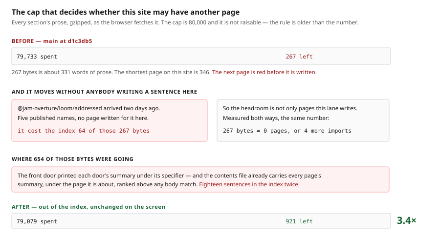
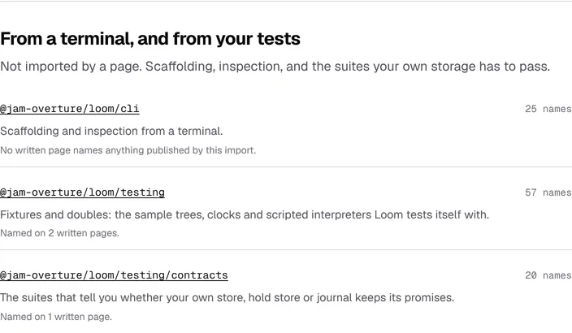
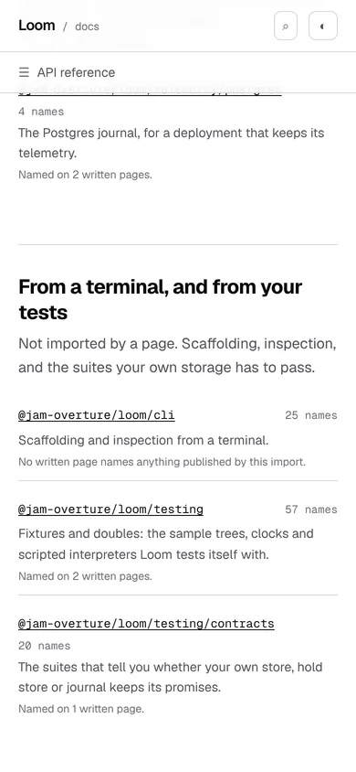

# 6 November 2026 — the search box held eighteen sentences twice, and the cap it was spending moves when another lane publishes

**Routine:** `Loom docs` · **Branch:** `docs-79-the-index-pays-twice-for-one-sentence` ·
**Section:** §4c

One open pull request from this lane at the start of the run — **#778**, opened
5 November, carrying `0353` as `Proposed`. Three others were open: #787
(`Loom marketing`), #786 (`Loom signals`), #781 (`Loom daily build`). None of
them this lane's and none of them touching the `(docs)` route group.

**No maintainer comment is outstanding for this lane.** The only non-bot comment
on #778 is this lane's own, which opens with the mention the procedure requires;
everything else on the four is `vercel[bot]`. **#778's question is still
unanswered and that is reported below rather than worked around** — nothing here
depends on the answer.

Branch cut from `origin/main` at `d1c3db5` (#780), after `git fetch origin main`.
**`origin/main` had been force-updated** since this container was cloned, so the
local `main` at `68058c1` was not the branch point; see *The hour lost to a
stale `dist/`* below, which is the one real cost of the run.

## The plain version

The search box on this site holds the sentences of every page, so that a reader
typing a phrase finds the page it is on. There is a ceiling on that — 80,000
compressed bytes — and for nine runs this lane has reported the same thing: the
ceiling is nearly reached, so **this site cannot take another page.**

Two things are true today that were not said before.

**The first is a duplicate.** The front door of the API reference lists the
eighteen imports, and under each specifier it printed that import's one-line
summary. Every page on this site already contributes its summary to a different
file — the one the box fetches first, and ranks first — so **those eighteen
sentences were in the index twice.** The second copy is not a second chance at
the right answer; it is the wrong page. A reader searching a phrase from the
`@jam-overture/loom/signals` summary got the signals door, and under it *the
page that lists the doors*.

Taking them out, with the counts beside them, gives back **654 compressed
bytes** — against 267 that were left. The headroom is **3.4 times** what it was,
and nothing a reader can see has changed.

**The second is worse and is not fixed.** The cap does not only move when
somebody writes a page here. It moves when another lane publishes an import.

## Where the bytes were going

The box ranks in four bands. The first three — a page's **title**, the
**section** it is in, its one-line **summary** — all come from the contents
file, which is the one file every reader waits for and which covers every page
on the site. The fourth band is the **words on a page**.

So a summary is in the index the moment the page exists, under that page, above
any match in anybody's body. A body that prints another page's summary adds a
second, lower-ranked, wrong-page copy of a sentence the box already had.

**The argument was already written down here, about a different list.** Each
reference page carries a band naming the written pages beside it, and that list
is `data-search="off"`, with the reason in `generated.test.ts` since the day it
shipped:

> *"Those page titles are in the index already, each under the page it names. A
> reference page that carried them too would answer a query about another
> page."*

It was a comment on one assertion. The next list of pages anybody drew on a
generated page did it again, on the one page that holds all eighteen of them —
which is what a comment is for and what a comment cannot do.

### So the rule is stated over the index, not over the page that broke it

`search/generated.ts` now carries it: **no generated page's body repeats a
summary the contents file carries.** It is a sweep over every page's summary
against every generated body, it costs nothing to keep, and it is what notices
the third instance.

The eighteen counts came out on a different argument, which is `WrittenAbout`'s
own and already on this page: *600 names* is a label beside a row rather than a
query. Nobody types a number. And every one of those eighteen digits is read
off the package, which is the second half of this report.

## The half that is not fixed: the cap is partly another lane's to spend

The *api-reference* section's words are not read off files — there are no files.
They are walked off the bands the pages render, and those bands print figures
read from `reference.generated.json`: a door's name count, *18 imports, 1,897
names*, *153 pairs of imports, and 147 of them share no name at all*, *47 of the
1,897 names carry a British spelling*.

**So the index grows when `src/` publishes, with nothing written here.**

### What one import costs, measured

`@jam-overture/loom/addressed` was published between 4 and 6 November — the
eighteenth door, five names. Measured by removing its entry from the generated
reference and its row from `entry-points.ts`, everything else held fixed, on
`main` at `d1c3db5`:

| | gzipped | raw |
| --- | --- | --- |
| the whole site's prose, 18 doors | 79,733 | 256,168 |
| the same, 17 doors | 79,669 | 254,782 |
| **one import** | **64** | **1,386** |

**The headroom on `main` was 267 bytes: four more imports, or nought pages.** A
door of five names took a quarter of what was left, two days ago, and the lane
that published it had no way to know.

That is the same mistake `search/build.test.ts` already names — *this lane's
number about somebody else's growth* — reached from the other direction. The cap
is this lane's and should be. What is wrong is that part of the number it holds
is another lane's, and nothing says so where it would be read.

**After this branch it is 921 bytes: fourteen imports.** At the rate of the last
two days that is a fortnight, and it is still nought pages — so the page this
lane came for, the CLI door with no prose anywhere on the site, still does not
fit. **654 bytes buys time. It settles nothing**, and what settles it is the
one-word answer on #778.

## Decisions taken that were not specified

- **The summary came out of the index and stayed on the screen.** The cheaper
  way to the same byte count is to delete the sentence, and it is the one a
  saving measured in bytes would congratulate. Two assertions exist only to go
  red if somebody takes it: the row is asserted to *show* the sentence and the
  count, as well as to keep both out of the index. *Out of the index, and still
  on the screen* is the pair, and neither half is the claim.
- **The specifier stays indexed.** It is the one thing in a row a reader types.
  A mutation that marked the whole `<li>` instead of its two parts is killed by
  that, from both sides.
- **The whole-package figures stay indexed.** *This package publishes 1,897
  names in all* is a sentence somebody wrote here, and the argument around it —
  the imports do not nest, a name you cannot find is behind a door you have not
  opened — is the one thing only this page says. The count assertion is written
  as *no specifier is followed by a number*, which is the shape of a row and of
  nothing else on the page, rather than as *no digits anywhere*.
- **The import-cost figure was filed rather than built.** It belongs beside the
  word figure in `_lib/search/room.ts`, and `room.ts` is on #778. A second
  branch of this lane's touching one file is a conflict the lane would have
  created for itself, which is exactly what the procedure's rule about a second
  open branch is for. The recommendation and both measurements are in the
  finding.
- **The cut of `/docs/api-reference/signals` was not started**, although it was
  measured on the way past: 490,672 bytes of text today against the 452,513 the
  1 November entry recorded, which is **+38,159 in five days**. The cap is
  600,000 and `weight.test.ts` asserts the heaviest generated page stays under
  **90% of it**, which is 540,000 — about six days out at that rate. Its own
  comment pre-agrees the remedy (*cut the page along the line it grows on*), and
  cutting it would put a band of prose on each of the module groups it would cut
  into — fifty-nine of them on the signals door — which the prose cap cannot pay
  for. **The two caps are interlocked and the lock
  opens on #778.** Said here rather than acted on.

## Records

**None added, none superseded.** Nothing here touches the tree schema, the delta
model or an `Accepted` record. `0347` is **applied**, not amended — and the
second finding below is about getting its application wrong the first time.

Nothing is escalated as `ARCHITECTURAL`.

## Cross-lane diff

**None.** Every file changed is inside `apps/loom/app/(docs)/`, plus
`FINDINGS.md`, this report and its visuals. Nothing in `src/`, nothing in
another surface's route group, and no primitive was wanted that does not exist.

`reference.generated.json` and `entry-points.ts` were **mutated and restored**
for the one-import measurement — both inside this lane. `git diff origin/main`
shows neither.

## Findings

**Two filed, one of them closed on filing. None closed from the queue**, and the
reason is worth a line: the entry this run would have closed is the 26 October
cap entry, and 654 bytes does not close it. Its number is updated by this
report rather than by an edit to somebody's argument.

- **Open** — the cap moves when another lane publishes an import, with the
  64-byte measurement, the four-imports-of-room figure, and the one-line
  recommendation for `room.ts`.
- **Closed on filing** — 0347 applied wrongly, which cost two rounds of
  mutation testing. Below.

### Getting 0347 right took two attempts

The new rule's honest answer about the real site is **an empty list**, which is
the state `plain.ts` has twice written down as the one where every assertion is
true by accident. `0347` is this surface's own record for exactly that: *nothing
to fix* and *nothing to fix it with* are two answers, so an empty answer names
its subject.

It was applied as a count beside the answer — `pages: number`, `bodies: number`,
`repeats: []` — and **three mutations walked through it**: the comparison handed
an empty map while the counts went on reading the real arguments, and either
count replaced by the literal its own test asked it to exceed.

**A count beside a comparison is a claim about the comparison, and a claim can
lie.** There is now one function returning one value, where `pages` and
`bodies` are the addresses themselves, derived in the same expression from the
very arguments `repeats` is computed from. The site assertions ask for
**membership** rather than a count, because membership cannot be fabricated
without naming the real answer. All three are killed by the shape rather than
by an added assertion.

### The hour lost to a stale `dist/`

`origin/main` was **force-updated** between this container's clone and the first
`git fetch`, so the local `main` was `68058c1` and the real one was `d1c3db5`.
`pnpm build` ran before the fetch. The suite then failed in
`api/extract.test.ts` with *the runtime's published surface has moved*, naming
a field (`view?: ViewKey`, #780) that was in `src/` and not in `dist/`.

It read exactly like the stale-generated-file failure `docs/routines.md` warns
about, whose remedy is to regenerate and commit — and **committing that would
have been wrong**: the generated file was current and the build was not. The
tell is the direction. The freshly extracted reference was *missing* a field the
committed one had, and a stale committed file is missing fields the fresh one
has. **Every index measurement taken before the rebuild was re-taken after it**,
and the baseline came back byte-identical, which is why the figures above are
the ones at `d1c3db5`.

### Standing entries this run met again and did not duplicate

- **`*.vercel.app` is denied by the environment's egress policy** (12 October,
  open). Every picture below was taken against a build in this container.
- **The composed preview URL** (16 October). The URL below is taken from the
  `vercel[bot]` comment rather than guessed from the branch name.
- **The commit author line** (23 October). `git config user.email` checked
  before the first commit: `noreply@anthropic.com`.
- **Mutation testing before the first commit** (27 October). Followed, and so
  was the sentence #778 added to it: the unit was committed as `1efdc1a` before
  the first mutation, and **both times a mutation caused a code change the fix
  was committed before the next mutation ran** (`9e02e1c`, `50c7fbc`). The whole
  set of fifteen was then re-run against the branch head.
- **A screenshot taken while the merge gate is running turns the gate red**
  (29 October, this lane's own). Followed: every picture was taken and shrunk,
  and `FINDINGS.md` written, before the gate was started.
- **`pnpm reports:shrink` reads the git index** (30 October, open, owned by
  `Loom daily build`). Worked around: the PNGs were `git add`ed before
  `reports:shrink` ran.
- **Never let anything run after the gate on the same line**
  (`docs/routines.md`). Followed — the status was written to a file as the last
  thing on its line and read in a separate command, and the number below is the
  one in the file.
- **A number taken from another lane's growth is not this lane's number**
  (2 November, this lane's own). This run is the entry read **forwards**: not a
  stale figure to remove, but a cap whose growth is another lane's, which is the
  same observation about a number that is still live.
- **The prose index is near its total cap** (26 October, open). Met, and moved:
  267 bytes to 921.

## Test numbers

### Fifteen mutations, fifteen killed

Each applied on its own against the branch's committed code, restored with
`git restore --source=HEAD -- "apps/loom/app/(docs)"`, with the suite re-run
between. **Run in full again against the branch head `50c7fbc`**, because two of
them caused code changes and a mutation run that precedes a fix no longer
describes the code. The table is the final run.

| what was put in | what failed |
| --- | --- |
| the summary's `data-search` attribute dropped | **4**, including the real site's own answer |
| the count's attribute dropped | 2 |
| the sentence **deleted** from the row instead | 2, one of them the reader's |
| the count **deleted** from the row instead | 3, one of them pre-existing |
| the attribute put on the whole row | 2, from both sides |
| the rule finds nothing, ever | 3 |
| the empty-summary guard removed | the every-body-matches-nothing case |
| the comparison the other way round | 3 |
| `everyPageSummary` skips the generated pages | the both-sides-real case |
| the fault sentence stops naming the remedy | the sentence case |
| the audit compares against no bodies | the both-sides-real case |
| the pages named are a fabricated list | 2 |
| the bodies named are a fabricated list | the both-sides-real case |
| only the first repeat of a sentence is reported | the two-bodies case |
| the fault sentence names the two pages the other way round | the sentence case |

**The last five are the second round.** Three of them — no bodies, and either
fabricated list — are the mutations that *survived* the first shape and are
killed by the second. They are in the table as kills because the table is of
the branch head; what they were is in the finding.

### The gate

GATE_PLACEHOLDER

### The search index

| | gzipped | raw |
| --- | --- | --- |
| `main` at `d1c3db5` | 79,733 / 80,000 | 256,168 / 260,000 |
| **this branch** | **79,079** | **254,404** |
| of which the `api-reference` section | 3,206 (was 3,860) | 27,160 (was 28,924) |

**654 compressed bytes, 1,764 raw.** Headroom **267 → 921**, which is 3.4 times
what it was and is still nought pages. Every figure measured in this container,
both sides at `d1c3db5`, with the whole index built the way the route serves it.

## The pictures

Taken with `pnpm shoot --serve apps/loom` against a production build in this
container — `built 2026-11-06T14:08:02.200Z`. Both viewports measured no
overflow: `scrollWidth 1280 / innerWidth 1280` at wide and `390 / 390` on the
phone.

**These are pictures of a page that did not change, and that is the claim they
are making.** The failure this branch is one keystroke away from is the sentence
disappearing, so what is worth photographing is the sentence.

### The rows, with every sentence and every count still under its specifier

The harness measured the first of those sentences at
`text=The tree, the delta, the ids, the builders, the Gate and the pipeline. Start here. x 304 y 611 704x23`
— on the page, 704 pixels wide, and no longer in the search index. The counts
on the right are likewise there and likewise not indexed.

### The band where the counts earn their place, unchanged

`@jam-overture/loom/cli` is still the one import this site has never written a
paragraph about — the open finding of 4 November, and the page that 654 bytes
does not pay for.

### The phone

`scrollWidth 390 / innerWidth 390`.

## Needs your input

**One thing, and it is the same thing as yesterday, with a deadline it did not
have.**

**0353 — what the search box sends.** Four candidates, each measured, in #778's
comment and in the record. The recommendation has not moved: **C**, the reader's
own section's sentences and the rest of the site by title, which takes the bill
from 79,414 to 35,928.

What is new is that the question is no longer only *how many pages may this site
have*. **The cap moves when another lane publishes an import — 64 bytes a door,
measured — so it is now four imports from red on `main` and fourteen after this
branch, with nobody writing a word.** When it goes red it will go red on
whichever lane's branch happens to be running, with a failure about a cap that
lane has never heard of, and it is the merge gate for four surfaces.

**One word is still enough.** If it is C I build it next run and the CLI page
after it.

Three carried, none blocking, none changed: `baseRevision` has nowhere on this
site to be looked up and still waits on whether the reference pages are being
cut up — which the *generated* page cap now has an opinion about, six days out,
and the two locks open together; whether a list-shaped export may have a
list-shaped presentation (22 October); whether a produced table should be
composed from the library rather than arranged locally (#709).

## The preview

PREVIEW_PLACEHOLDER
