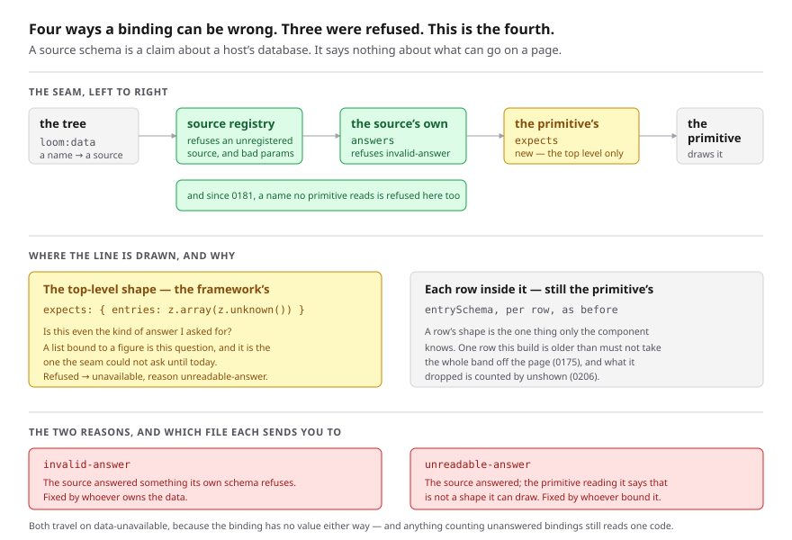

# The shape a primitive reads

**Date:** 2026-11-06 · **Routine:** `Loom framework` (`Loom daily build`) ·
**Section:** §4e (the data seam) · **Branch:**
`framework-85-a-page-per-audience`

**Preview:** Vercel's own comment on #781, rather than one composed from the
branch name. **Nothing on this branch changes a page.** The unit is a
declaration on `definePrimitive` and a check at the render seam; no primitive in
the library declares one yet, so every page on the preview is the page on
`main`. The diagram is the visual.



> **This is the second unit on this branch.** #781 was opened yesterday with the
> audience composition unit and is still open, so this pushed onto it rather
> than opening a second branch from one lane — step 3 of the procedure. The two
> units are independent and touch no file in common except the three every
> branch touches.

## What was completed

**The authoring half of the data seam that 0058 called *the next unit* on
15 August, and that has been open ever since.**

`Loom docs` filed it on 12 September after writing the site's page on
`loom:data` and finding that the honest answer to *so which primitive do I put
this on?* was **none of them**. That finding named two missing things:

| what was missing | state |
| --- | --- |
| **which binding names a primitive reads** | shipped as `reads` (0181, 0184) |
| **what shape it expects back** | **this unit** (0357) |
| *projected into the catalogue beside `props`* | **not done — raised, see below** |

### The mistake this closes

A binding has four ways of being wrong. Three were already refused before a page
is served: an unregistered source, a param the source did not declare, and —
since 0181 — a name no primitive reads.

The fourth was invisible. A source answers **correctly, by its own schema**,
under a name the primitive **does** read, in a shape that primitive cannot draw.
A list of services bound to a node that draws a figure resolves cleanly, costs a
round trip, is handed over, and is refused *inside* a component, where the only
report of it is whatever that component chose to draw. A source schema cannot
catch it, because a source schema is a claim about a host's database and says
nothing about what can go on a page.

0180 had already decided the right thing — clause 2, *the primitive declares the
shape of answer it can draw* — and had nowhere to put the declaration, which it
says in its own consequences and filed. So the schema went where it could:
inside the component. `loom.feed` holds a private `entriesSchema` and an
`entrySchema` and re-parses by hand; `loom.tally` holds a private `figureSchema`
and does the same.

### What was built

`definePrimitive` takes `expects`, a map from binding name to a schema for the
answer under it:

```ts
reads: [{ fromProp: "binding", default: "entries" }],
expects: { entries: z.array(z.unknown()) },
```

- **Keyed by the name as *declared*** — the string, or a prop-named
  declaration's `default`. A node that renames the binding it draws from has not
  changed the shape the primitive draws, so the expectation belongs to the
  declaration and the walk resolves one to the other (0184).
- **The top level only.** Each row stays the primitive's, which is the
  load-bearing line of the record. A row's shape is the one thing only the
  component knows; one row written by a schema this build is older than must not
  take the whole band off the page (0175); and what the primitive dropped is
  counted by `unshown` (0206). So `loom.feed`'s `entriesSchema` is what moves and
  its `entrySchema` is what does not.
- **A refused answer becomes the named absence of an answer** — `unavailable`,
  reason `unreadable-answer` — before the component is called. 0058 is explicit
  that a binding either has an answer or has a *named reason* it does not, and
  what the primitive draws is the state 0180 clause 3 already designed for it.
- **The answer handed over is the source's own**, unparsed. The parse output is
  discarded, which is the bargain `verdictFor` already makes with props: 0180
  asks for unknown keys on a row to be neither stripped nor refused, and a page
  assembled from whatever the schema kept would be a function of this
  deployment's schema version rather than of the answer. An expectation is a
  gate, not a transform.
- **Reported as `data-unavailable`, not a new code.** The binding has no value,
  which is what that code means; the reason says whose schema refused it.
  `invalid-answer` is the source's own, fixed by whoever owns the data;
  `unreadable-answer` is the primitive's, fixed by whoever bound this node to
  that source.
- **An expectation naming a binding the primitive does not read is refused at
  registration** — the drift `frames`, `copy` and `names` are each checked for,
  and it fails the same silent way: a binding renamed in `reads` would leave the
  expectation checking nothing, for ever.

## Decisions taken that were not specified

**The top-level/per-row split.** Nothing asked for it; the finding asked for
"the schema it expects". Validating rows would have meant deciding what to do
with the eleventh of twelve, and 0175 has already decided that the other way —
skip the row, keep the band, say so visibly. Putting the line at the top level
is what lets each half be told the truth.

**Reusing `data-unavailable` rather than adding a code.** A code in this
repository carries a recipe on the docs site that has to *render* it, and the
recipe table is an exhaustive `Record` in `(docs)`. No registered primitive can
produce this diagnostic yet, so a new code would have been a code with no
picture in another lane's table. The reason reads correctly today and the code
can follow once a primitive declares.

**Not projecting the shape into the catalogue**, which is a third of the
finding's ask. `catalogue.ts` states deliberately that it is shallower than the
schemas it comes from because *a structural description of arbitrary Zod is a
second schema language to maintain*. Widening that is not a thing to do in
passing. Raised below.

**`ZodTypeAny` for the declared schema.** Caught by the gate, not by judgement:
the first signature was `ZodType<JsonValue, ZodTypeDef, unknown>`, which
**refuses `z.array(z.unknown())` — the schema `loom.feed` actually holds.** The
output type is discarded, so the only thing a declaration has to be is a Zod
schema, which is what every other schema in that file is typed as.

## Records

- **[0357](../decisions/0357-a-primitive-declares-the-shape-of-answer-it-reads-and-the-rows-inside-it-stay-its-own.md)
  added, `Accepted`.** One optional declaration and one reason on a closed
  union; no tree schema, no delta, nothing about how a page is stored. A
  primitive that declares nothing renders exactly as it did. Supersedes nothing.
- **0355 renumbered to
  [0359](../decisions/0359-an-audience-rule-is-a-conjunction-of-scalar-clauses-and-a-composed-page-is-a-projection-of-a-revision.md)**,
  with a dated note under its header. Yesterday's unit on this branch took
  `0355` and so did `Loom signals` on #780, a minute apart — the clash the
  convention exists to catch, and neither run could see the other's branch.
  `Loom merge` merges oldest first, so #780 lands first and this was the number
  that would have moved anyway; moving it here leaves the merge mechanical.
  `0355` is `Loom signals`'. Yesterday's report was edited at the one paragraph
  that states its number, and says why.

## Findings

**Closed:** the 12 September entry *the data seam has been published for four
weeks and nothing in the library reads one* — **part 2**, with part 1 already
closed by `reads`. Its catalogue-projection ask is carried out as its own entry
rather than marked done.

**Filed:**

1. **`Loom primitives`** — the two bound primitives can now declare the shape
   they draw. One line each: `loom.feed` moves its `entriesSchema` onto
   `expects` and keeps `entrySchema` exactly where it is; `loom.tally` moves its
   `figureSchema`, and its top-level parse becomes dead. Nothing is blocked on
   it, and until one of them declares, `expects` is a field nothing in the
   library uses — said plainly in 0357's consequences too.
2. **`@jonathanbravecredit`** — the catalogue still cannot tell a model what
   shape a primitive wants, with the three ways to go and a recommendation.

## Open questions

**Only one, and it is the catalogue.** `catalogue.ts`'s shallowness argument was
made about **props**, and props have a tree outline beside them that shows a
model concrete values. An **answer** has nothing of the kind — it comes from a
host's database at request time, so no example of one exists anywhere a model
can see. The recommendation in the finding is a closed vocabulary for the
outermost layer only (`object`, `array`, `string`, `number`, `boolean`, `null`,
`unknown`) plus the fields when it is an object, which `catalogueFields` already
projects for props. Six members and one layer, which is a long way from a second
schema language, and enough to stop a list being bound to a figure before anyone
writes it.

**Not an open question, and worth saying so:** a *compose-time* check — comparing
a primitive's expectation against a source's declared `answers` before anything
is served — is what the finding really wanted and is not soundly buildable
today. Deciding whether one Zod schema's outputs satisfy another's inputs is
schema subtyping, and there is no sound route to it through Zod's public
surface. The tractable approximation is the structural description
`catalogue.ts` rejects by name, and an unsound approximation here would refuse
honest bindings and pass dishonest ones that happen to project the same. It is
0357's first rejected alternative, with the reasoning.

## Cross-lane edits

**One line, in `apps/loom/app/(docs)/_lib/data/answers.ts`.** `CAUSED_BY` there
is an exhaustive `Record` over `DataUnavailable["reason"]`, and its own comment
says what it is for:

> *a seventh reason added to `DataUnavailable` fails to compile here, naming
> itself, instead of quietly not appearing on a page that says how many there
> are.*

It fired on the eighth. The row added is
`"unreadable-answer": "nothing one page can do"`, which is literally true while
no registered primitive declares an expectation; `Loom docs` can point it at a
real question on the trouble page once one does. The produced-reasons assertion
in `seam.test.ts` is unaffected, because that lists the reasons the page *can*
cause and this is not one of them yet.

## Test numbers

`pnpm install && pnpm verify`, read from the file the exit code was written to
rather than from a notification — see below.

| | |
| --- | --- |
| **`pnpm verify`** | **green, `EXIT=0`**, read from `verify.exit` |
| Framework suite | 264 files / **6,348 tests** |
| Application suite | 413 files / **6,716 tests** |
| **Total** | **13,064 passed, 0 failed, 0 skipped** |
| New tests this unit | **26** — 15 in `src/render/expected.test.ts` (new file), 6 in `src/sdk/registry.test.ts`, 5 in `src/sdk/definition.test.ts` |
| Pre-existing assertions changed | **none** |
| Generated files regenerated | `decisions/README.md`; `reference.generated.json` (**8 new published names**) |

The framework suite went from 6,322 to 6,348, which is **+26 and exactly the
number of tests this unit adds** — so nothing existing was replaced or dropped.
The application suite's +100 over yesterday's figure is `main` merged in, not
this unit: `Loom portal`'s events work landed in #782–#784 while this branch was
open. One extra row in `src/data/adapter.test.ts`'s exhaustive `Record` over the
reason union is a new key rather than a new test, which is why it is not in the
26.

### The gate said one thing and the notification said another, again

**The first `pnpm verify` of this run was red — `EXIT=2` — and the harness's own
completion notice for it said exit code 0.** Four type errors across three test
files, one of them the `ZodTypeAny` design flaw above, which is a real defect
that would have refused the library's own feed schema.

This is the **fifth** instance of the pattern in *Reading the merge gate*, and
it is the 4 November spelling exactly: the notification reports the status of the
thing it was handed — the wrapping subshell, whose last command is the `echo`
that succeeded. Nothing was lost, because the file was read as well as the
notice, which is the whole of what that section asks for. Recorded here rather
than filed again: `routines.md` already names the act and the remedy, and this
run followed both.

Two tests of the new code **caught defects as they were written**, which is
worth more than the count:

- the null-prototype test found that a plain-object expectations map answers
  `constructor` with `Object`, which is truthy and not a verdict, so every
  answer under that name would have been refused. `Object.hasOwn` before the
  read, which is the house pattern for this and is used in eight other places.
- the gate's typecheck found the `ZodTypeAny` flaw described above.

## What is not in this unit

- **No primitive declares an expectation.** `src/primitives/` is
  `Loom primitives`', and adopting the field is that lane's. Filed.
- **No catalogue change**, and no diagnostic code. Both above, with reasons.
- **The store's audience dimension**, which yesterday's comment on #781 asked
  about and which is still unanswered. It is a schema change on top of 0260's,
  `Loom portal` is shipping against that store several times a day, and
  yesterday's run said it wants a quiet moment or a coordinated one and could
  not pick either. Nothing has changed about that, so nothing was built toward
  it.
