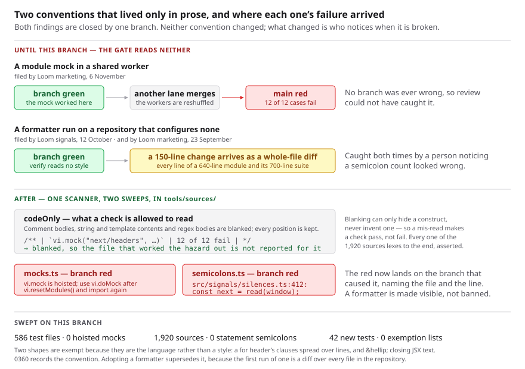

# What a lane may not do, said where it goes red

**Date:** 2026-11-06 (evening) · **Routine:** `Loom framework` (`Loom daily build`) ·
**Section:** §1 (process) · **Branch:** `framework-86-what-a-lane-may-not-do`

**Preview:** Vercel's own comment on the pull request. **Nothing on this branch
changes a page** — two sweeps, one decision record and two docblocks — so every
page on the preview is the page on `main`. The diagram is the visual.

## What was completed

**Two open findings owned by this lane, closed by one branch**, because they are
the same shape: a convention this repository holds, written down in prose, that
`pnpm verify` cannot read — so the run that breaks it is told by a person, or by
`main`.

| finding | filed | what was missing |
| --- | --- | --- |
| an order-dependent module mock | `Loom marketing`, 6 November | a sweep, and a sentence in the pool configuration |
| a formatter run on a repository that configures none | `Loom signals`, 12 October | the half prose cannot do |

Neither convention is new and neither has changed. What changed is who notices.

### The module mock

Both suites run their node half on `forks: { isolate: false }`, deliberately:
those files are functions of their arguments, and isolating each one cost 175s
of loading against 180s of testing. **A file that installs a module mock is
exactly the file that is not a function of its arguments.** `vi.mock` is hoisted
and replaces a module as it is evaluated, so a module an earlier file in the same
worker already evaluated is not replaced.

The consequence is the reason this was worth a run rather than a note: the mock
works or does not according to which files the suite happened to put in that
worker, so **the failure arrives when an unrelated lane's merge reshuffles them
— on `main`, with no branch having been wrong.** A hazard whose failures land
there cannot be caught by review. `(marketing)/_lib/serving.test.ts` has the
measurement that made this concrete: 12 of 12 render cases failed one way, 4 of
12 the other.

`tools/sources/mocks.ts` refuses `vi.mock` outright and allows `vi.doMock` only
where `vi.resetModules()` appears above it — the pattern
`(portal)/_lib/write.test.ts` already uses and explains in its own docblock.
That was the filer's recommendation 1; recommendation 2, a sentence in the pool
configuration, is in both `vitest.config.ts` files. Recommendation 3, isolating
the node project, stays rejected for the reason the finding gives: 175s against
180s to prevent what ten lines catch.

### The formatter, and a correction to the finding

`Loom signals` wrote a module on 12 October, ran `npx prettier --write` on it and
on two files it had edited, and got prettier's defaults — a semicolon on every
statement, a rewrap at 80 columns where this code sits at about 100. A 150-line
change became a diff over every line of a 640-line module and its 700-line
suite. **Nothing in `pnpm verify` would have failed.**

The finding says the expensive part is that *the question has no answer in the
repository*. **That was true when it was filed and is not now, and the real
history is worse than the finding knew.** `docs/routines.md` has carried the
answer in prose under **Standards** since 1 November (#742) — and that paragraph
credits an **earlier** instance, `Loom marketing`'s on 23 September, which cost
that run a full revert and the re-application of eight files' worth of edits.

So: two instances nineteen days apart, prose arriving twenty days after the
second, and both caught by a person noticing that a semicolon count looked
wrong. Prose was not the missing piece. **The missing piece is that nothing goes
red**, and that is what shipped.

`tools/sources/semicolons.ts` holds the one property a reformat cannot avoid
changing: **no statement in this repository ends in a semicolon.** Measured over
every source under `src/`, `tools/` and `apps/loom/` — 1,920 sources, zero.

## Decisions taken that were not specified

**A detector rather than a style rule.** The finding's first option was a
`.prettierrc` stating the current style plus `format:check` in `verify`, and it
is the obvious one. It is rejected in 0360 and the reason is worth repeating
here: no formatter reproduces a hand-maintained style exactly, so adopting one
is not a configuration change but **one reformat of every file in the
repository** — an unreviewable diff, in a week when four surfaces merge against
one gate. The semicolon is checked because it is the signature a reformat cannot
avoid leaving. Quoting and wrapping are not checked, and 0360 says so rather
than leaving it to be re-derived.

**One shared scanner, and its failure mode chosen on purpose.** Both sweeps have
the same way of being wrong: the construct appears in **a docblock explaining
the construct**. `(marketing)/_lib/serving.test.ts` is the case that forces it —
the file that worked out why a mock in a shared worker is order-dependent prints
two `vi.mock(…)` calls in its table of measurements, and a grep would report the
one file in this repository that already understands the hazard.

So `tools/sources/code.ts` blanks everything that is not code — comment bodies,
string and template contents, regex bodies — keeping every position, so a line
number is the file's line number. **Blanking can only remove a construct, never
invent one**, which means a mis-read makes a check pass rather than fail: these
checks can be wrong about `main` only by being too quiet. There is no JSX mode,
which is the known mis-read, and `unterminated` is how the sweeps assert that no
source here ends mid-construct — 1,920 of 1,920 lex to the end.

**The mock rule is wider than its hazard, deliberately.** It covers every
`*.test.ts`, including the Postgres suites, which run isolated and could hold a
hoisted mock safely. Which files those are is a list in two config files, so a
rule carved to the hazard would come apart the moment a file was renamed into or
out of one — and the remedy costs nothing in an isolated worker either.
`*.test.tsx` is excluded with the finding's own reason: those run isolated
because Testing Library binds to a document, nine of them install mocks, and
none can hit this.

**No exemption list anybody maintains.** The two shapes that look like statement
semicolons are exempt because they are the language rather than a style — a
`for` header's clauses spread over lines (`src/signals/broadcast.ts`, the only
one) and an HTML entity closing JSX text (`&hellip;`, four times in
`(lessons)`). Both are derived from the source, not listed: the `for` exemption
is the header's own extent, so a semicolon on the line after it closes is still
reported, and there is a test for exactly that.

**Where it lives.** `tools/`, which is this lane's, rather than
`apps/loom/test/` as the finding suggested. Both are in-lane and one place that
states the property once is better than two. It matters for the finding's own
objection — *a marketing file sweeping three other lanes' test files is the
cross-lane shape `docs/routines.md` is hardest about* — and the answer is that
nothing here edits another lane's file; it reads the repository, which is what
the lane that owns the repository's tooling is for. It also publishes no name:
`./testing` is a published door and `tools/` is not, and a new published name
costs `Loom docs` bytes it does not have this week.

## Records

**[0360](../decisions/0360-the-style-of-this-repository-is-maintained-by-hand-and-what-is-checked-is-that-no-statement-ends-in-a-semicolon.md)
added, `Accepted`.** §1 (process). It writes down what the repository has always
done, adds one check over it, and supersedes nothing. `Accepted` rather than
`Proposed` because it changes no source, no dependency and no `verify` step —
and recorded at all because **reversing it is expensive in exactly the way the
format exists to flag**: adopting a formatter is one diff over every file.

**Why 0360.** `0359` was the highest on `main` at `44b0ee3`, and `0353` is
claimed by the open #778. Both free.

## Findings

**Closed:** both of the above, each by editing its Status in place and naming
this branch. The formatter entry's close carries the correction to its premise,
because the next lane to read it should not re-derive a history that is now
twenty days out of date.

**Filed:** none. Nothing outside this lane was found wrong, and the two things
worth saying are below rather than filed — one is a question for the maintainer
and the other is this lane's own tidying.

## Open questions

**One, and it is small.** `sourcesUnder` now exists three times: in
`tools/git/portability.test.ts`, in `(portal)/guarded-pages.test.ts`, and in
`tools/sources/files.ts` as of this branch. The first is this lane's and could
adopt the third in a line. It was left alone on purpose — *refinement inside
finished sections is reactive*, and nothing is wrong with either copy. Recorded
here so the next run that touches `tools/git/` for a real reason knows there is
a tidy-up beside it rather than discovering a fourth copy.

**Not an open question, and worth saying so.** The `.test.tsx` exclusion rests on
`threads: { isolate: true }` staying true in both configs, and nine files'
mocks depend on it. That precondition is now asserted rather than assumed —
see the test numbers below.

## Cross-lane edits

**None.** Two files outside `src/` and `tools/` are touched and both are this
lane's by the rule `docs/routines.md` states: `apps/loom/vitest.config.ts` is
named in the mock finding as this lane's own, and `docs/routines.md`'s
**Standards** paragraph is extended by one sentence pointing at 0360 — it is not
restated, because it was already right.

## Test numbers

`pnpm install && pnpm verify`, with the exit code read from the file it was
written to rather than from a notification.

| | |
| --- | --- |
| **`pnpm verify`** | **green, `EXIT=0`**, read from `verify.exit` |
| Framework suite | 268 files / **6,478 tests** |
| Application suite | 418 files / **6,808 tests** |
| **Total** | **13,286 passed, 0 failed, 0 skipped** |
| New tests this unit | **42** — 16 in `code.test.ts`, 12 in `semicolons.test.ts`, 14 in `mocks.test.ts` |
| Pre-existing assertions changed | **none** |
| Sources swept | **1,920**, all lexing to the end |
| `*.test.ts` swept for mocks | **586** |
| Hoisted or unreset mocks found | **0** |
| Statement semicolons found | **0** |
| Generated files regenerated | `decisions/README.md` |

The three new files are the only test files on this branch —
`git diff --stat origin/main -- '*.test.ts' '*.test.tsx'` names those three and
nothing else — so **no existing assertion was replaced, weakened or dropped**.
That is the claim worth making rather than arithmetic on the suite totals: the
framework suite reads 6,478 against this morning's 6,348, and most of that
difference is `main`, not this branch. The counts reconcile exactly either way —
1,913 sources tracked on `main` plus the seven files added here is the 1,920
swept, and 583 `*.test.ts` plus three is 586.

### The defect matrix

Nine mutations, **nine killed** — run one at a time against
`npx vitest run tools/sources/`, each restored with
`git restore --source=HEAD` before the next, from a committed tree.

| what was broken | killed by |
| --- | --- |
| comments not blanked | 8 assertions |
| template-literal text not blanked | 7 |
| the HTML-entity exemption always taken | 5 |
| the `for`-header exemption removed | 3 |
| the `for`-header exemption covering every line | 5 |
| `vi.mock` allowed through | 3 |
| the reset check always passing | 2 |
| the reset searched for in the whole file rather than above the call | 1 |
| the generated-`.d.ts` exclusion removed | 1 |

The last two are the ones worth having. *Reset searched in the whole file* is
the plausible wrong version of this check — it passes every test about a mock
except the one that puts the reset **after** the call, which is the case that
silently does nothing. And the `.d.ts` row kills a mutation that would only
fail after a `next build`, which is how the real defect arrived.

**Four defects were caught by these checks rather than by review**, which is
worth more than the count — and one of them was caught by the check failing on
itself:

- **a line number off by one.** The mock regex consumed the character before
  `vi` to prove it was not `harness.vi.mock`, so a call on the line after a
  newline was reported on the line above. A lookbehind instead, which is what
  `match.index` has to point at for the number to be the file's.
- **the sweep reported its own fixtures.** The assertion that the repository
  actually exercises the allowed pattern read raw source, so this test file's
  own examples counted as usage. It reads `codeOnly` now, like everything else
  here, and the assertion names the one real file.
- **four expectation strings with the wrong number of blanks.** The scanner
  keeps every position, so the fixtures are exact; four of mine were off by one
  space. The implementation was right in all four cases and was not changed.
- **the semicolon sweep went red on `main`'s own tree, and was right to.**
  `next build` writes `apps/loom/next-env.d.ts`, which is full of semicolons,
  git-ignored, and nothing any lane styles — so the first sweep *after* a build
  reported a file nobody wrote. The earlier measurement had been taken before a
  build existed in this session. Generated declaration files are now outside the
  walk, with the reason in `files.ts`: git tracks no `.d.ts` here, so excluding
  them loses nothing. **This is the shape the whole unit is about** — a hazard
  that only appears once something else has run, found on a branch instead of on
  `main`.
