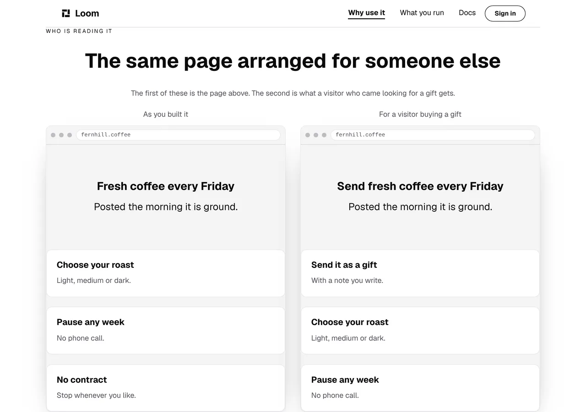
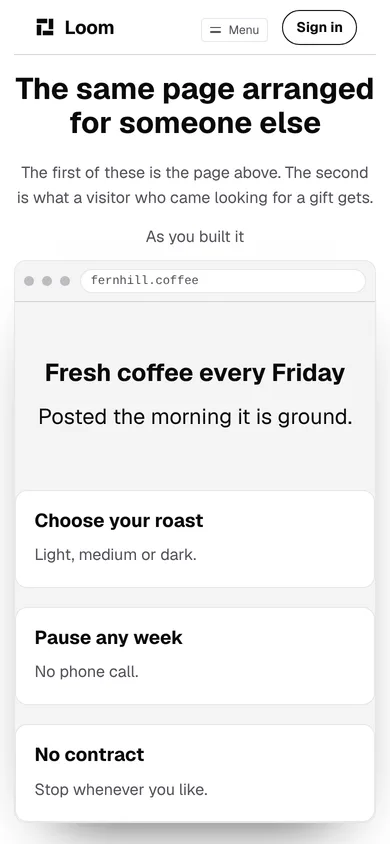
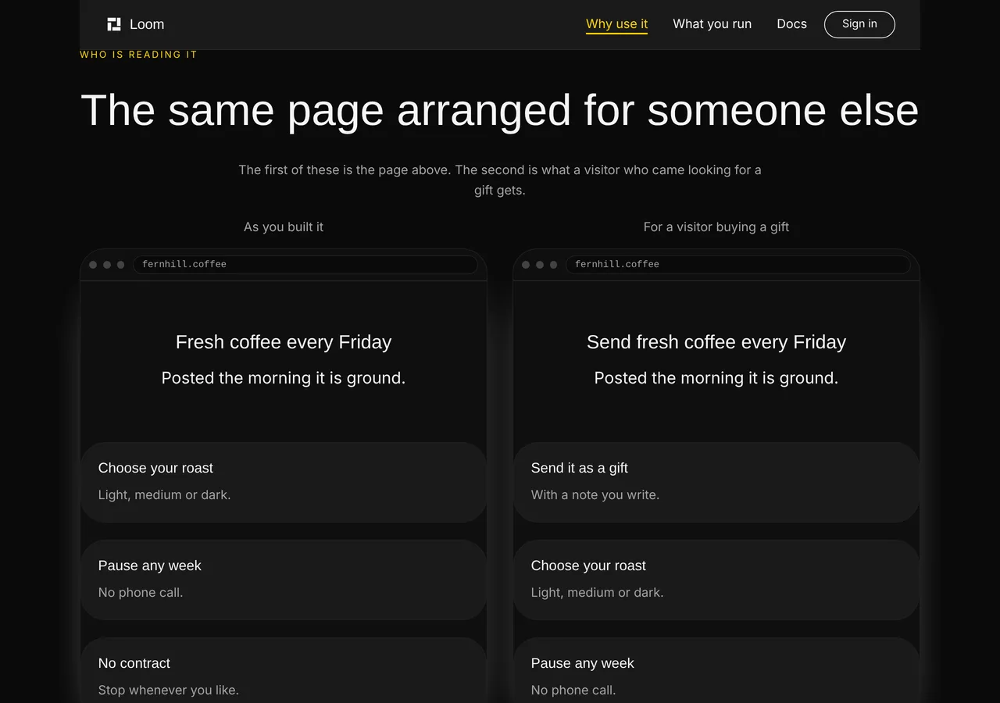
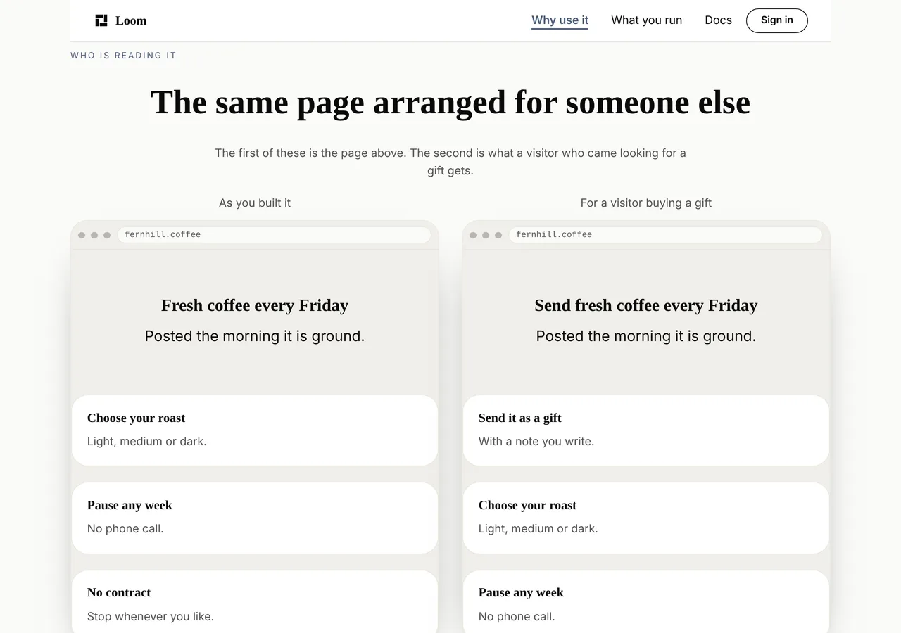

# Marketing — a check that holds whatever ran first, and copy that names the order

**Branch** `marketing-29-a-check-that-holds-whatever-ran-first` ·
**Date** 6 November 2026 · **Section** §4d, the marketing site ·
**Lane** `apps/loom/app/(marketing)/`

---

# What was built

Two checks in this route group that passed while something was wrong. Both now
hold, and both were proved by breaking them.

| | what was wrong | what holds it now |
| --- | --- | --- |
| `addressed.test.ts` | its stub only worked when it ran before a file that loads a page, and the gate for four surfaces went red on `main` when it did not | the function answers for itself, so there is no stub to arrive late |
| the copy on `/why-use-it` | one sentence told a reader to look left and right, and on a phone there is neither | a sweep over every string on every served page, for a phrase that names a side |

The first was asked for by `Loom merge` on #776. The second closes this lane's
own entry of 5 November, which named the instance and the general version and
asked for both.

---

# 1. The gate for four surfaces was a coin toss

## What happened, and how it was reproduced

`Loom merge` reported it after landing #776: the first `pnpm verify` on `main`
after the day's four merges came back red with **12 failures** in
`app/(marketing)/_lib/addressed.test.ts`, every case that renders a page, all
of them `headers was called outside a request scope`. An immediate re-run of
the same tree passed, and nothing was changed to get there.

**It is reproducible, which is the part that was missing.** The suite's node
half runs on `forks: { isolate: false }`, so a worker keeps what the previous
file in it loaded. Forcing a file that imports `../page` to run first in the
worker — padded so the sequencer takes it first, with the vitest stats cache
cleared so size decides — produces the same 12 failures, every time:

```
 ✓ |node| app/(marketing)/_lib/zz-order-probe.test.ts (1 test)
   × '/' serves what its address asked for > ?theme=minimal
     → `headers` was called outside a request scope.
   … 11 more
 Test Files  1 failed | 1 passed (2)
```

The cause is one sentence: **a mock replaces what a module resolves as it is
evaluated, and a page module an earlier file has already evaluated is holding
the real one.** `announced.test.ts` imports all three page modules and stubs
nothing. Whichever of the two files the suite handed a worker first decided
whether the other passed. The hazard arrived with the file in #725; what moved
on 5 November is that the suite went 404 files to 407, which reshuffles which
file lands in which worker — so it can come back on a merge from any of the
four surfaces, with no branch being wrong.

## The recommended remedy does not hold, and that is the measurement worth keeping

`Loom merge` suggested stubbing `./serving` instead, or giving the file its own
worker. The first was tried on this branch, against the reproduction above:

| | |
| --- | --- |
| `vi.mock("next/headers", …)`, as it was | **12 of 12** render cases fail |
| `vi.mock("./serving", …)` | **4 still fail** — the pages the earlier file had already loaded |
| the function answering for itself | nothing left to fail |

Four rather than twelve is the whole lesson. Moving the mock one module closer
narrows the window and does not close it, and **any remedy spelled as a mock
has that property**, because the property belongs to mocking under a warm
module cache rather than to the module being mocked. The second suggestion does
hold and was not taken: it is an edit to the application-root
`vitest.config.ts`, shared by four surfaces, and it would leave the next file
free to make the same mistake.

## What was done instead

`servedOrigin` answers the case the stub stood in for. Where there is no
request it falls back to `siteOrigin()`, which is the same answer a request
carrying no usable host has always received, so **nothing a reader can see
changed.** The docblock used to claim the stub was *"a case the function
already answers"*, which was true of everything except the throw itself.

**A behaviour a test has to fake is a behaviour the function should have.**

The narrowness is the part worth a second pair of eyes. The fallback keys on
Next's message *and* on the error carrying no `digest`:

- a redirect, a not-found and the bail-out from prerendering are all thrown
  with a `digest`, and each is meant to reach the framework;
- swallowing the third would leave a page the portal governs frozen at the
  revision the build read, which is
  [0331](0331-a-marketing-page-is-served-per-request-because-the-store-governs-it.md)'s
  own failure arriving from a direction that record did not have to consider.

It cannot happen on this surface today, because every route here declares
`force-dynamic` and `governed.test.ts` fails if one stops. The check is there
anyway, with cases for each of the three: **a guarantee held in another file is
a reason to be right rather than a reason not to look.**

`serving.test.ts` is new and mocks nothing at all. It asserts the fallback by
calling the real function, and it pins the two properties the discriminator
rests on against the installed Next rather than against memory — that the
message still says *called outside a request scope*, and that it carries no
`digest`. **A Next upgrade that rewords it makes that file red rather than
making the fallback quietly stop working**, which is the direction brittleness
should fail in.

One thing found while writing it: `headers()` returns a promise and throws
**synchronously**, so `await expect(headers()).rejects.toThrow(…)` fails
carrying the very error it is looking for. `servedOrigin` is unaffected — an
`await` inside a `try` catches both — and the test says so rather than relying
on it.

## The class, not just the instance

After this branch the node project contains **zero** `vi.mock` calls and
**one** `vi.doMock`, in `(portal)/_lib/write.test.ts`, which calls
`vi.resetModules()` first and re-imports. That pattern is order-independent by
construction and its own docblock says why. The nine `.test.tsx` files that
mock modules are on `threads` with `isolate: true` and cannot hit this.

So the class is empty today, and nothing keeps it empty. That is filed for
`Loom daily build`, with a ten-line sweep as the recommendation: fail on
`vi.mock(` in a `.test.ts` under `apps/loom/app/`, allow `vi.doMock(` only
below a `vi.resetModules()`. It is not written here because a marketing file
sweeping three other lanes' test files is the cross-lane shape this lane's
brief is hardest about.

---

# 2. Copy that names a side

The band *Who is reading it* on `/why-use-it` opened with:

> *"The page on the left is the one above. On the right is what a visitor who
> came looking for a gift gets."*

`loom.split` wraps to one column when there is no room — by flex-basis, which
is why it needs no media query and is the reason the band works on a phone at
all. So at 390 there is no left and no right. It now reads:

> *"The first of these is the page above. The second is what a visitor who came
> looking for a gift gets."*



**The harness measured the thing the sentence was wrong about**, which is
better than asserting it. The same band, same build, two widths:

| | the two frames | the second frame |
| --- | --- | --- |
| **1280** | `x 100` and `x 656` | beside the first |
| **390** | `x 14` and `x 14` | **236px past the fold** |



## The sweep, and why it is the shape it is

`positions.test.ts` reads every string a reader reads on every served page and
fails on a phrase that names a side. Two decisions in it were measured rather
than chosen, and the measurement is the reason the rule is worth having:

**It is the horizontal pair only.** Over the three served pages before the fix,
one string matched a horizontal phrase — this instance — while **seven** matched
`above` and **seven** matched `top`, and all fourteen were true. Bands stack
down the page at every width, so *"the page above"* is right at 390 and at 1280
alike, and *"built on top of"* is not about layout. A rule over them would flag
fourteen good sentences to catch nothing, which is `docs/positioning.md`' own
lesson about the headline rule arriving a second time.

**It is phrases and not words.** `right` is the ordinary English word for
correct and the front door uses it that way: *"That is not the same as being
right."* The word hits 2 strings; the phrases hit the 1 that was wrong. The
source panel on `/why-use-it` is excluded first, by the constant `voice.test.ts`
already uses, because the primitive source it prints contains `beside` in a
comment.

## The second reason, which is this product's own

`loom.split` takes `reverse`, and its whole design is that a model asked to swap
the sides emits one `configure` rather than two `move`s. So on this site a
sentence naming a side is a sentence **an accepted change can falsify without
touching the sentence** — on the one surface whose argument is that Loom can say
what really happened. Naming the order survives both the phone and the swap:
document order is what a screen reader follows and what `configure` does not
move.

That is also why the rule is stated site-wide rather than over the bands that
stack. Every horizontal arrangement this site composes reflows to a column, so
scoping it to those is scoping it to all of them, with a classification to
maintain and a way to be wrong.

---

# Both palettes





No hard-coded colour; the band is unchanged but for the one sentence.

---

# Decisions

**None taken and none recorded.** Nothing here touches the tree schema, the
delta model or an Accepted record. No primitive was added and none was needed;
the only framework code reached is the public API a host already calls.

Two judgements worth naming that did not want records:

- **`isNoRequestScope` is exported for its test.** A copy of those three lines
  written out in `serving.test.ts` would be an assertion that this lane's logic
  equals itself, which is this lane's own finding of 21 October about two sweep
  floors that were hand-written copies of another module's arithmetic. Nothing
  else imports it.
- **The sweep's floor is hand-written at 150** against the 437 strings this
  site serves, for `sweepShare`'s reason: a floor computed from the thing it
  guards passes when that thing goes to nothing.

# Findings

**Two filed, two closed.**

- **Filed, and closed in the same branch:** the `next/headers` stub and the
  ordering it depended on. Filed because `Loom merge` asked for it in writing
  on #776 and could not file it itself, and because the correction to its
  recommended remedy is worth more than the fix.
- **Filed, open, for `Loom daily build`:** nothing stops the next
  order-dependent mock. The class is empty only because this run emptied it.
- **Closed:** 5 November, *the comparison band tells a reader to look right*.
  Three corrections are recorded at its foot — the measured boundary of the
  sweep, phrases rather than words, and the `reverse` argument.

Nothing in the queue named this lane otherwise.

# Test numbers

`pnpm install && pnpm verify`, read out of the file the status was written to
rather than off a notification or a pipe:

```
Test Files  261 passed (261)      Tests  6280 passed (6280)    # framework
1440 findings, 0 malformed
2104 visuals in reports/, 148.2MB, none over 1.1MB
Test Files  416 passed (416)      Tests  6756 passed (6756)    # @loom/app
138 prerendered pages, 2067 text junctions, 0 run together
EXIT=0
```

`@loom/app` gained **29 cases on two new files**: 13 in `serving.test.ts` and
16 in `positions.test.ts`. The framework suite is untouched by this branch.
`addressed.test.ts` keeps all 17 of its cases and loses its mock.

**Three checks were proved by breaking them**, which is the part worth a second
pair of eyes:

| broken how | what went red |
| --- | --- |
| the fix reverted, a page-loading file forced first | 12 of `addressed.test.ts`' cases |
| the old sentence put back | 2 cases of `positions.test.ts` |
| the sweep's floor set to an impossible number | it reported **437** strings read |

The three marketing routes still report `ƒ` in `next build`, so
[0331](0331-a-marketing-page-is-served-per-request-because-the-store-governs-it.md)
holds and nothing here froze a governed page. The build the shots were taken
from is `built 2026-11-06T11:33:47.116Z`.

**The copy budget.** `/why-use-it` is one word longer than it was. Nothing else
on the site changed a word.

Nothing skipped, nothing weakened. No test file outside this run's own was
changed.

# Open questions

In the pull request comment. Nothing about this change is blocking.
