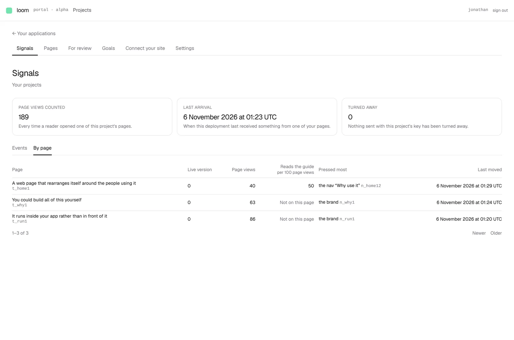
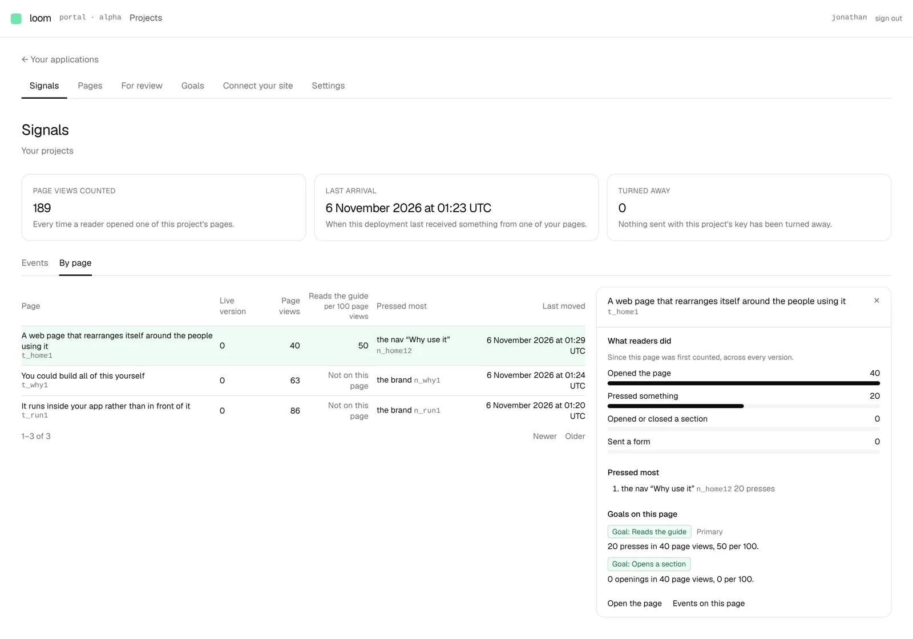

# By page measures each goal on each page

**Lane:** `Loom portal` · **Date:** 6 November 2026 ·
**Branch:** `claude/project-thread-dwq185` ·
**Records:** none new; the rates are [0350](../decisions/0350-a-project-sets-goals-from-signals-already-collected-and-one-of-them-is-primary.md)'s measure, taken one page at a time ·
**Plan:** [`docs/portal.md`](../docs/portal.md) row 8a ·
**Target:** [`docs/portal-wireframes.md`](../docs/portal-wireframes.md) *1 · Signals*, *By page*

## Why this, and why now

No portal pull request was open. The first row of the agreed order that is not
done is 8a: the last run left the range picker, the hourly chart, the range
figures, *Live*, search, and on *By page* the primary goal rate and the bars
for a range. Unit 8 after it still needs a decision on how Loom reaches a
site's repository.

The range pieces were the obvious next step and they are **not buildable
honestly on `main`**. The tallies keep no time; the kept deliveries do, but the
only way to read them is `journal.read`, a page of deliveries at a time. A
30-day chart would read every delivery of thirty days on every render, and a
chart cannot do what *Events* does under its 2,000-delivery cap (say how far
back it looked), because a bar drawn from part of an hour is a wrong number,
not a shorter list. So this run filed a finding for `Loom signals` asking for
page views counted by hour over a range, through a scoped handle, and built
the piece of 8a whose data is on `main`: the goal figures on *By page*. Goals
(8b) landed after By page did, which is why they were still owed there.

## What shipped

- **A primary goal column on *By page*.** Headed with the goal's name and
  *per 100 page views*; each row is the goal's count on that page over that
  page's own page views (*3.5*, with the sentence *7 presses in 200 page
  views, 3.5 per 100* on hover). A page the goal does not cover says *Not on
  this page*, never a nought: a page without the part would be readers scored
  on something they were never shown. The column is drawn only once a primary
  goal exists, so a project with no goal gets no column of blanks.
- **Goals in the page drawer.** *Goals on this page* lists every goal covering
  the page, the primary first and marked, each with its goal chip and what it
  counted there, in the same sentence *Goals* uses. No goal covering it says
  so with a link to *Goals*; goals that could not be read say that instead.
- **One measure, not two.** `_lib/goals/goal-view.ts` now measures a goal page
  by page (`goalReadingsByPage`), and the project-wide figure on *Goals* is the
  sum of those, so the two screens cannot disagree. Coverage (the pages a goal
  names, or every page with the part) is unchanged and now private to that
  file; `per100Of` is the one rounding both screens use.
- **The goals are a figure *By page* can do without.** Read on the portal's
  budget beside the waiting changes; a failure costs the column and the
  drawer's section, which says so, and nothing else.

No table, no column, no environment variable, no `db:push`. Nothing in `src/`.

## Decisions taken

- **Rate per 100 page views, since counting began**, as *Goals* shows it. The
  wireframes' *trend* needs time, which waits on the same read as the range.
- **No column without a primary goal**, rather than a column saying *No goal*
  on every row. The drawer still says *No goal covers this page*.

## Findings

Filed: *Signals' range picker and hourly chart need page views counted by
hour, and the kept deliveries can only be walked one page at a time* (owner
`Loom signals`). Closed: none.

## Tests

New: `goal-view.test.ts` (per-page readings, a named page with nothing done
yet, the sum, `per100Of`), `by-page.test.ts` (the primary goal on a page, no
rate where it does not cover the page or there is no primary or goals were not
read, the drawer's goals in order, unread versus none), `by-page.test.tsx`
(the column and its absence, *Not on this page*, *Nothing counted*, the
drawer's goal list, its two empty states).

`pnpm verify` exit 0: framework 261 files, 6,278 passed, 2 skipped; application 413 files, 6,703 passed. Nothing skipped or weakened.

## Where this leaves the wireframes

*1 · Signals*: *Events* and *By page* done, now with the primary goal rate and
each page's goals. Still missing: the range picker, the hourly chart, the
range figures (page views in the range with the change on the period before,
the share reaching the primary goal), *Live* and the search over part and
page; on *By page*, the bars for a range and each goal's trend. The range
pieces wait on the finding above; *Live* and search do not, and are the next
Signals piece if unit 8 is still undecided.

## Screens

Taken against a local Postgres with three of this deployment's own pages
published, 189 deliveries sent straight into the project's journal and folded,
the page-view rows written to match, and two goals: one primary on the home
page's nav link (every page that has it, which is only the home page) and one
named on the home page alone. The figures are that seed, not anybody's
readers.

