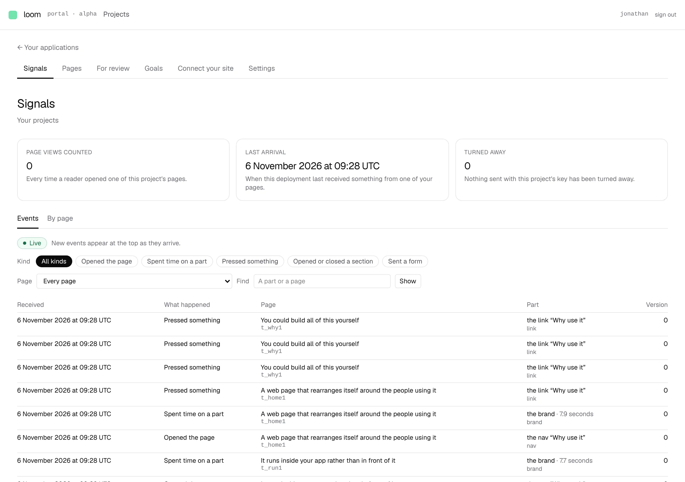
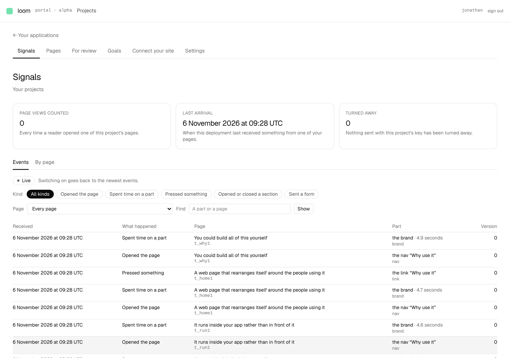

# Signals · Events goes live

**Lane:** `Loom portal` · **Date:** 6 November 2026 ·
**Branch:** `claude/project-thread-h7sg6v` ·
**Records:** none ·
**Plan:** [`docs/portal.md`](../docs/portal.md) row 8a ·
**Target:** [`docs/portal-wireframes.md`](../docs/portal-wireframes.md) *1 · Signals*, the header's *Live* toggle

## Why this, and why now

No portal pull request was open. In the agreed order, 8a still owes the range
picker, the hourly chart, the range figures and *Live*. The range pieces wait
on the `Loom signals` finding of 6 November (page views counted by hour).
Unit 8 still needs the maintainer's call on how Loom reaches a site's
repository. *Live* needs nothing new, so it is this run's piece.

One portal-owned finding was open: the 5 November entry offering
`addressedRootIn` from `@jam-overture/loom/addressed` for the *Connect your
site* snippet. It is not taken, and the finding now says why: the snippet
runs on a customer's site against the version they installed, and 0.2.0 has
no `/addressed` entry, so the import would break every site that pasted it.
The row waits for a release that carries the entry.

## What shipped

- **A *Live* switch above the Events facets.** `?live=on` makes the screen
  draw itself again every five seconds (the interval a page's broadcast sends
  at) while its tab is looked at. New events appear at the top, and the
  figures above update with them. While it is on, a sentence says *New events
  appear at the top as they arrive*.
- **Live is the newest page only.** An address with `before` is never live,
  whatever it says. From an older page, the switch goes to the newest page,
  and the sentence beside it says so before anyone presses it.
- **Every link carries it.** The kind chips, the search and page form
  (a hidden field), *Clear the search*, the drawer, and *Events from this
  view* all keep it. *Older* drops it, by the rule above.
- **The only client code is the refresh.** `live-refresh.tsx` calls
  `router.refresh()` on an interval and skips while the tab is hidden. The
  list, figures and drawer are still drawn on the server from the address.
  `EventView` (the filter plus `live`) is what every address is built from,
  and `eventsHref` drops `live` wherever a cursor is named.

No table, column, environment variable or `db:push`. Nothing in `src/`.

## Decisions taken

- **Five seconds**, matching the broadcaster's default send interval, so a
  reading rarely finds nothing new. Reversible: it is one constant,
  `LIVE_EVERY_MS`.
- **On *Events* only.** *By page* reads tallies, which change only when
  collection runs, so making it live would only cost reads.
- **No range picker beside it yet.** The wireframes put both in the header;
  the switch sits above the facets until the range picker exists.

## Findings

Updated: the 5 November `/addressed` finding, which now gives the portal
row's reason to wait. Filed: none. Closed: none.

## Tests

New: `events.test.ts` (live read from the address only as `on`, never with a
cursor; `eventsHref` keeps it except where a cursor is named),
`events.test.tsx` (the switch off, from an older page, on with its sentence
and hidden field, kept across kind chips), `live-refresh.test.tsx` (refreshes
each tick while visible, never while hidden, stops on unmount).

`pnpm verify` exit 0: framework 261 files, 6,278 passed, 2 skipped;
application 414 files, 6,727 passed. Nothing skipped or weakened.

Checked in the built app against a local Postgres: with *Live* on, a delivery
written into the project's journal appeared in the list within seven seconds,
with no reload.

## Where this leaves the wireframes

*1 · Signals*: *Events* (with search and *Live*) and *By page* are done.
Still missing: the range picker, the hourly chart and the range figures, and
on *By page* the bars for a range and each goal's trend. All of them wait on
the `Loom signals` finding. After that, the order moves to unit 8, which
waits on the maintainer.

## Screens

Taken against a local Postgres with three of this deployment's own pages
published and 41 deliveries written into the project's journal. The figures
come from that seed, not from real readers. *Page views counted* reads 0
because the seed was never collected.

