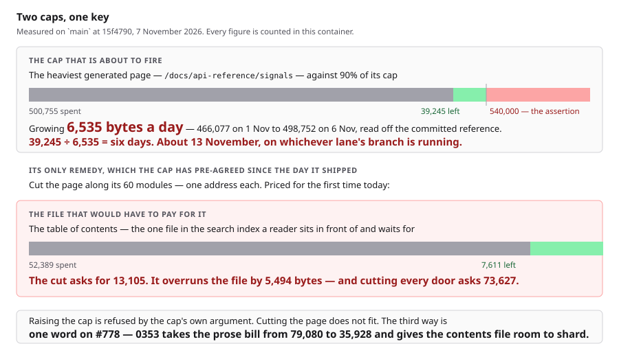
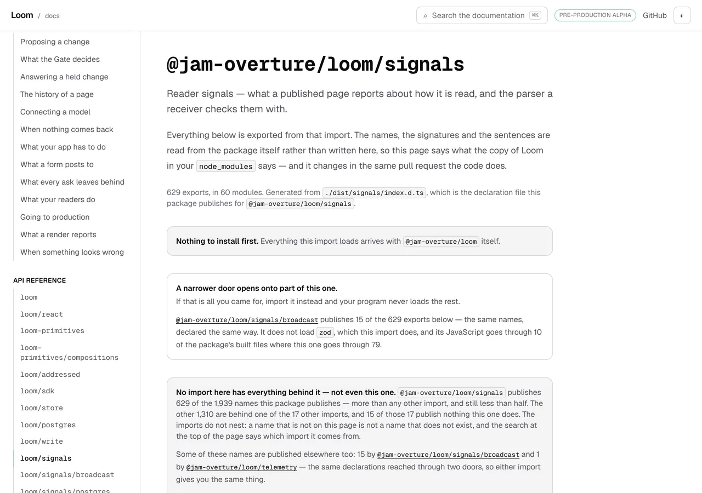
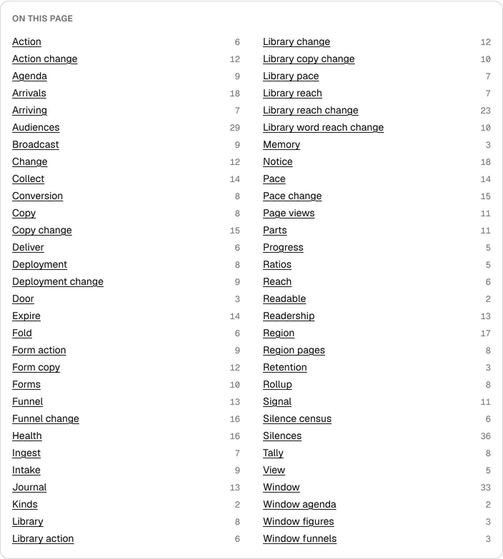
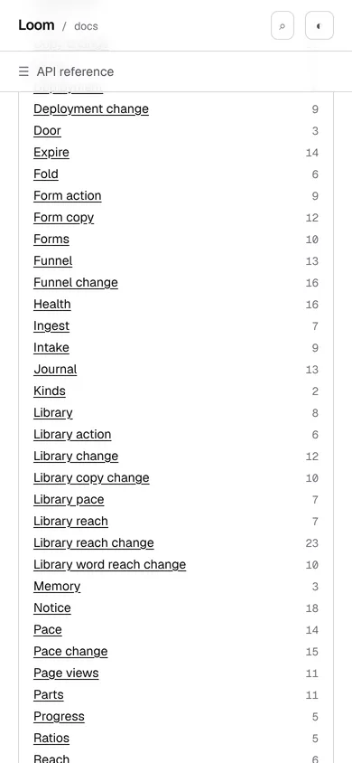

# 7 November 2026 — the cap that is about to break the gate for four surfaces has six days on it, and the remedy it has pre-agreed since March does not fit

**Routine:** `Loom docs` · **Branch:** `docs-80-the-cap-that-names-the-cut` ·
**Section:** §4c

One open pull request from this lane at the start of the run — **#778**, opened
5 November, carrying `0353` as `Proposed`, **still unanswered**. Four others
were open: #799 (`Loom marketing`), #798 (`Loom framework`), #794 and #793.
None of them this lane's, none touching the `(docs)` route group.

**No maintainer comment is outstanding for this lane.** The only non-bot comment
on #778 is this lane's own; everything else on the five is `vercel[bot]`.
#778's question is still unanswered and **this run is about what that now
costs**, which is a different thing from working around it.

Branch cut from `origin/main` at `15f4790` after `git fetch origin main`. The
previous run's branch merged as `c03b564` (#790).



## The plain version

This site holds caps on what it sends a reader. One of them says **no single
generated page may put more than 540,000 bytes in front of somebody**. The
reference page for `@jam-overture/loom/signals` is at **500,755** and climbing
by **6,535 bytes a day**, because that is the rate `src/signals/` publishes.

**That is six days. About 13 November.** When it goes, it goes on whichever
lane's branch happens to be running, and `pnpm verify` is the merge gate for
all four surfaces — so a marketing copy change will fail on a documentation
number about a package neither of them touched.

The cap has always named its own remedy: *cut the page up along its modules*.
**Nobody had ever priced it. I priced it, and it does not fit** — the cut needs
13,105 bytes in a file that has 7,611 left.

So this run shipped the half that does not depend on anybody's answer: **the
cap now fires with the remedy and the remedy's price attached**, so the lane
that trips it does not spend half a day discovering what I discovered this
morning.

## The number, and where it came from

`weight.test.ts` has asserted since it shipped that the heaviest generated page
stays under 90% of `GENERATED_PAGE_CAP`. The cap is 600,000, so **the line that
fires first is 540,000** — and it is the 90% assertion rather than the cap that
a run will meet, which is worth saying because the comment on the constant
reads as though 600,000 were the deadline.

| | bytes |
| --- | --- |
| `/docs/api-reference/signals`, prose | 2,003 |
| the same page, published signatures (629 of them, in 60 modules) | **498,752** |
| **total** | **500,755** |
| the assertion | 540,000 |
| **room** | **39,245** |

### The rate is exact, not estimated

The previous two reports quoted the growth off their own measurements taken days
apart. It can be done better: **`reference.generated.json` is committed**, so
every past value is in the repository and the curve is a fact.

| date | commit | modules | symbols | signature bytes |
| --- | --- | --- | --- | --- |
| 1 Nov | `749e4c15` | 57 | 587 | 466,077 |
| 2 Nov | `314fb9f0` | 57 | 588 | 469,505 |
| 3 Nov | `702e9569` | 58 | 591 | 474,237 |
| 4 Nov | `8d34cdca` | 58 | 594 | 478,610 |
| 5 Nov | `ac599889` | 59 | 610 | 488,669 |
| 6 Nov | `33d59038` | 60 | 629 | **498,752** |

**+32,675 in five days: 6,535 bytes a day.** 39,245 ÷ 6,535 is **six days**.

It is lumpy rather than smooth, and the lumps matter more than the average: **6
November alone was +9,037**, nineteen names in one commit. One busy day in
`src/signals/` takes a quarter of what is left.

**Not one byte of this is mine and no editing here reduces it.** That is the
property `search/build.test.ts` already names — *this lane's number about
somebody else's growth* — and it is the third cap this week to have it.

## The remedy the cap pre-agreed, priced for the first time

`weight.ts` on the constant, unchanged by this branch:

> *"When it fires, the answer is not to raise it. It is the answer the search
> index reached twice: cut the page up along the line it grows on. A reference
> page is already fifty-four groups with a heading each, the groups are modules
> rather than an invented grouping, and the browser already knows which group a
> reader is on."*

I checked the premise first, because the whole remedy rests on it: **is the
module a real line or an invented one?** `src/signals/` is sixty published
modules in one flat directory, no subdirectories, so there is no coarser
grouping to cut at that the package itself would recognise. **The module is the
only honest line**, which also means the cut is sixty addresses and not four.

### What sixty addresses cost, and it is not on the page

Every page on this site has a row in the **table of contents** — the one file
in the search index a reader sits in front of and waits for. A cut puts one
more row in it per module.

Measured as the rows `searchContents` would really publish, not as an estimate
of them:

| | addresses | bytes of contents rows |
| --- | --- | --- |
| cutting `/docs/api-reference/signals` | **60** | **13,105** |
| cutting every door | 337 | 73,627 |

The contents file holds **52,389 of its 60,000 raw bytes**. **The cut of the one
page over the line overruns it by 5,494**, and cutting every door asks for more
than the whole file is permitted to be.

**The previous run reached the same conclusion by reasoning and was right.** It
said the cut *"would put a band of prose on each of the module groups it would
cut into — fifty-nine of them on the signals door — which the prose cap cannot
pay for."* The mechanism it named turns out to be the wrong one — a group's
whole `<section>` is already `data-search="off"`, so the groups are not in the
prose index and moving them would not put them there — **but the answer was
correct, in a different file, by a larger margin.** The bill lands on the table
of contents, not on the prose, and it is 13,105 against 7,611 rather than
anything close.

### All five caps, since the two that matter are not the two that were being watched

| cap | spent | room |
| --- | --- | --- |
| prose index, five sections together | 79,080 / 80,000 gz | **920** |
| table of contents | 52,389 / 60,000 raw · 10,024 / 12,000 gz | **7,611** · 1,976 |
| published names | 37,872 / 40,000 raw · 10,653 / 12,000 gz | 2,128 · 1,347 |
| code blocks | 37,471 / 60,000 raw · 9,795 / 12,000 gz | 22,529 · 2,205 |
| heaviest generated page | 500,755 / 540,000 | **39,245** |
| heaviest written page | 19,255 / 21,600 | 2,345 |

**Nine runs of this lane have ended on the prose cap. The two that are about to
fire are the generated page and, if anybody tries the remedy, the table of
contents.**

## What shipped

**A generated page is now weighed per module, and a fault about one carries the
cut.** The sentence the lane that trips it will read, produced by lowering the
cap to 490,000 against the real site:

```
/docs/api-reference/signals renders 500755 bytes against a cap of 540000, and
498752 of it is 629 published signatures; cutting it along its modules is 60
more addresses and 13105 bytes of rows in the table of contents every reader
waits for, heaviest first: signals/library-reach-change (18574),
signals/copy-change (17477), signals/library-word-reach-change (17468)
```

Four things in that sentence that were not available before it: **which modules
carry the page** (the three heaviest are 53,519 bytes between them, 11% of it),
**how many addresses the remedy is**, **what the remedy costs**, and **which
file pays**. It does not stop the cap firing. It stops the next lane rediscovering
this report.

### Decisions taken that were not specified

- **The cut's address is the whole module path with its slashes flattened**, not
  the last segment. The leaf reads better and is wrong on three of the eighteen
  doors: `@jam-overture/loom/runtime` publishes eighty-six modules whose leaves
  are seventy-six distinct words, so a leaf-spelled cut would serve ten modules
  at an address another one already had. The assertion is *the addresses of a
  cut are distinct, on every door*, which is what kills it — and it only kills
  it because it is over every door rather than over the one the cap fires on.
- **`weightFaults` takes the cut reader as a third argument.** Reading the real
  package inside it would have made the one pure function in this module impure,
  and a reader held only against today's package is a reader whose sentence is
  whatever today's package publishes. Same shape as the caps argument beside it.
- **`pageCutOf` takes the modules as an argument too**, and that was forced by a
  mutation rather than chosen: the *door with no modules* guard is unreachable
  against the real reference, so deleting it was invisible. Reachable by
  argument beats a guard no test can hold, and beats deleting a guard that
  prevents a fault ending on a colon.
- **The affordability is in this report and the finding, and not in an
  assertion.** The obvious test is *the cut costs more than the contents file
  has left*, and it would be a second copy of a cap that lives in
  `search/build.test.ts` — and it would be a test that goes **red the day the
  remedy becomes available**, which is backwards. What is asserted instead is
  that the cap can never fire without naming a cut, held against whichever page
  is heaviest rather than against `signals` by name.
- **I did not attempt the cut.** It is measured as not fitting, the measurement
  is in the report, and building 60 addresses that the table of contents cannot
  carry would have been half a day spent to arrive at a red build on a different
  cap. Said here rather than left as an absence.
- **I did not raise the cap**, which is the other thing that makes the gate green
  today. The constant's own comment refuses it — *"raising the number instead
  buys one more quiet doubling of what a reader downloads to read one sentence"*
  — and a run that routes around a rule its own lane wrote is the failure the
  rule exists to prevent.

## Records

**None added, none superseded.** Nothing here touches the tree schema, the delta
model or an `Accepted` record: `weight.ts` is this surface's own module and the
cap is this surface's own number.

Nothing is escalated as `ARCHITECTURAL`.

## Cross-lane diff

**None.** Every file changed is inside `apps/loom/app/(docs)/_lib/`, plus
`FINDINGS.md`, this report and its visuals. Nothing in `src/`, nothing in
another surface's route group, no primitive was wanted that does not exist, and
no file on #778 was touched — **checked rather than assumed**: #778 changes
`search/build.ts`, `search/model.ts`, `search/room.ts`, `search/room.test.ts`,
`_components/search.test.tsx` and the prose route, and this branch changes
`weight.ts` and `weight.test.ts`. The 6 November finding declined to touch
`room.ts` for exactly this reason and the same rule applied here.

`reference.generated.json` was **read at thirteen past commits** with
`git show` for the growth curve. Nothing was checked out and nothing was
mutated to get it; `git diff origin/main` shows the file untouched.

## Findings

**Two filed, none closed.** The 26 October prose-cap entry stays open and its
number is unchanged at 920; this run did not spend any of it.

- **Open, owned by this lane and the maintainer** — the gate for four surfaces
  goes red about 13 November, with the exact curve, the priced remedy and the
  five caps in one table.
- **Open, owned by `Loom signals`** — the page is 629 names behind one door, and
  the package already publishes the narrower door that would fix it. Addressed
  to `Loom signals` rather than `Loom daily build` on the strength of the 4
  November re-addressing, which is the entry that says `docs/routines.md` gives
  `src/signals/` to that lane.

### Standing entries this run met again and did not duplicate

- **`*.vercel.app` is denied by the environment's egress policy** (12 October,
  open). Every picture below was taken against a build in this container.
- **The composed preview URL** (16 October). The URL below is taken from the
  `vercel[bot]` comment rather than guessed from the branch name.
- **The commit author line** (23 October). `git config user.email` checked
  before the first commit: `noreply@anthropic.com`.
- **Mutation testing before the first commit** (27 October), with the sentence
  #778 added to it. Followed: the unit was committed as `afea210` before the
  first mutation, and **both times a mutation caused a code or test change the
  change was committed before the next mutation ran** (`37b50d6`, and the
  commit after it). The whole set of sixteen was then re-run against the branch
  head.
- **A screenshot taken while the merge gate is running turns the gate red**
  (29 October, this lane's own). Followed: every picture was taken and shrunk,
  and `FINDINGS.md` written, before the gate was started.
- **`pnpm reports:shrink` reads the git index** (30 October, open, owned by
  `Loom daily build`). Worked around: the PNGs were `git add`ed before
  `reports:shrink` ran.
- **Never let anything run after the gate on the same line**
  (`docs/routines.md`). Followed — the status was written to a file as the last
  thing on its line and read in a separate command.
- **A number taken from another lane's growth is not this lane's number**
  (2 November, this lane's own). The reason the growth curve is read off
  committed files rather than asserted anywhere: the rate belongs in a report,
  which goes stale honestly, and not in a test, which would go stale green.
- **The stale `dist/` of 6 November.** `pnpm install` and the framework build
  ran **after** `git fetch origin main` this time, so the direction that cost an
  hour last run could not arise.

## Test numbers

### Sixteen mutations, sixteen killed

Each applied on its own against the branch's committed code, restored with
`git restore --source=HEAD -- "apps/loom/app/(docs)"`, suite re-run between.
**Run in full three times**, because two rounds caused changes and a mutation
run that precedes a fix no longer describes the code. The table is the final run
against the branch head.

| what was put in | what failed |
| --- | --- |
| the cut's address takes the module's leaf | 2, including every door's distinctness |
| the clause prints a sentence for no cut | 2 |
| the clause drops the file the price is paid in | 2 |
| the modules are not sorted | the heaviest-first order |
| `addresses` is the literal 60 | every door but `signals` |
| a module's weight forgets the summary bytes | the modules-add-up-to-the-page case |
| a cut row is not under the page being cut | the rows-under-the-page case |
| a fault names no modules | the three-figures case |
| the clause goes on a written page instead | the generated-and-not-written case |
| the modules are never found | 5 |
| a cut row drops the family it came off | the row-shape case |
| the price is measured off the bare modules | the price-is-the-rows case |
| the empty-door guard is deleted | the stated-door case |
| the fault ignores the cut reader it is given | the reader-is-an-argument case |
| the module summaries are never read | the price-is-the-rows case |
| a cut row is a heading rather than a page | the row-shape case |

**Five of those sixteen survived a first or second shape and are kills only
against the head.** What they were and what fixed them is in the two commits
between: *heaviest first* was a word in a sentence with no order behind it,
`addresses` was a figure beside a derivation, the price had no stated source,
and the empty-door guard was dead code. Every one of the four was invisible
because the assertion around it was about the page the cap is going to fire on
rather than about all eighteen doors.

### The gate

**Still running as this commit was made**, and the numbers below are filled in
by the commit that follows rather than guessed here. `pnpm install && pnpm
verify`, with the status written to a file as the last thing on its line and
read in a separate command.

*(gate numbers pending — see the commit that follows this one)*

**+15 tests, all of them this lane's**, all fifteen in
`_lib/weight.test.ts`, which went from 15 to 30. No pre-existing assertion
changed its claim and none was removed — this branch adds a reading beside the
one that was there and extends one sentence, so the three tests that already
held `weightFaults` still hold exactly what they held.

- `findings:check`: **1,456 findings, 0 malformed**
- `reports:check`: **2,125 visuals, 148.7MB, none over 1.1MB** (414 cited by no
  file, all pre-existing — this run's four are cited by this report)
- `prerender:check`: *pending with the gate*

### The caps, before and after

**Unchanged, every one of them.** This branch adds a `_lib` module and its
tests; it renders nothing, so it spends nothing.

| cap | before | after |
| --- | --- | --- |
| prose index, five sections | 79,080 / 80,000 | **79,080** |
| table of contents | 52,389 / 60,000 | **52,389** |
| heaviest generated page | 500,755 / 540,000 | **500,755** |

That is the point of it rather than a happy accident: **the thing that was
needed was not bytes, it was knowing where the bytes go.**

## The pictures

Taken with `pnpm shoot --serve apps/loom` against a production build in this
container — `built 2026-11-07T14:03:34.009Z`. Both viewports measured no
overflow: `scrollWidth 1280 / innerWidth 1280` at wide and `390 / 390` on the
phone.

**These are pictures of a page this branch does not change**, and that is what
they are for: they are the page the cap is about, and the band and the list in
them are the two things the fault's new sentence is derived from.

The harness needed one thing it could not find — `playwright-core` is not a
dependency of this repository and is not supposed to become one. It is
pre-installed in this container at `/opt/node-tools/node_modules`, so the run
pointed `LOOM_PLAYWRIGHT` at that rather than installing anything. Noted
because the tool's own message recommends installing it into a scratch
directory, and in this container that step is unnecessary.

### The band the cap is a number about



The harness measured that line at
`text=629 exports, in 60 modules. x 304 y 341 704x40` — **629 exports in 60
modules** is the sentence the page has always said, and as of today it is also
the shape of the remedy: 60 modules is 60 addresses.

### The sixty modules, which are the line the cut runs along



This panel is `data-search="off"` and always has been — a page's own table of
contents is navigation — which is the fact that moved the cut's price out of the
prose index and into the contents file. Each of those sixty rows is one address
a cut would have to mint and one row the contents file would have to carry.

### The phone



`scrollWidth 390 / innerWidth 390`.

## Needs your input

**One thing, and it is the same thing as the last three runs. It now has a
date.**

**0353 — what the search box sends.** Four candidates, each measured, in #778's
comment and in the record. The recommendation has not moved: **C**, the
reader's own section's sentences and the rest of the site by title, which takes
the prose bill from 79,080 to 35,928.

What is new is that it is no longer only about whether this site may have
another page.

- **The gate for four surfaces goes red about 13 November**, on a cap this
  surface holds, about a page nobody here wrote a byte of.
- **The remedy that cap has pre-agreed does not fit** — 13,105 bytes of contents
  rows against 7,611 of room, measured this run.
- **Raising the cap is refused by the cap's own argument**, and I did not do it.
- **0353 unlocks both**, because the sharding argument that gives the prose index
  room is the same one that gives the contents file room to carry a cut.

**One word is still enough.** If it is C I build it next run, the cut after it,
and the CLI page after that.

**And one thing that is not yours and may arrive first.** The second finding
asks `Loom signals` for what the package has already done once — another
narrower door, as `@jam-overture/loom/signals/broadcast` already is. A door that
takes fifteen names off that page moves the date out and helps a reader twice.
It is asked without a deadline on purpose: **a door published to make a
documentation page shorter is the tail wagging the dog, and I would rather the
cap fired.**

Three carried, none blocking, none changed: `baseRevision` has nowhere on this
site to be looked up and still waits on whether the reference pages are being
cut up — which now has a measured answer of *not yet, and here is the price*;
whether a list-shaped export may have a list-shaped presentation (22 October);
whether a produced table should be composed from the library rather than
arranged locally (#709).

## Found while writing

**The 90% assertion is the deadline and the constant reads as though 600,000
were.** `GENERATED_PAGE_CAP` is 600,000 and its comment is written about that
number — *"today's heaviest is 452,513 bytes, so the headroom is about a third
of that page again, which at the rate `src/signals/` has been publishing is
months rather than years."* The test that fires is the one holding the heaviest
page under **90%** of it, so the real line is 540,000 and the real headroom is
39,245 rather than 99,245 — **six days rather than fifteen.** Both numbers are
right about their own subject and the comment is about the wrong one. Not fixed
in this branch because editing that comment is a one-line change that belongs
with whatever answers the cap, and it would have been the only prose change in a
branch about measurement; noted here so the next run of this lane does not read
it and relax.

## The preview

*Taken from the `vercel[bot]` comment after the pull request was opened, not
composed from the branch name.*

PREVIEW_URL

The page the pictures are of:

PREVIEW_URL/docs/api-reference/signals

Every picture above was taken against a build in this container, not fetched
from the preview: `*.vercel.app` is denied by the environment's egress policy,
which is the open finding of 12 October and still true.
