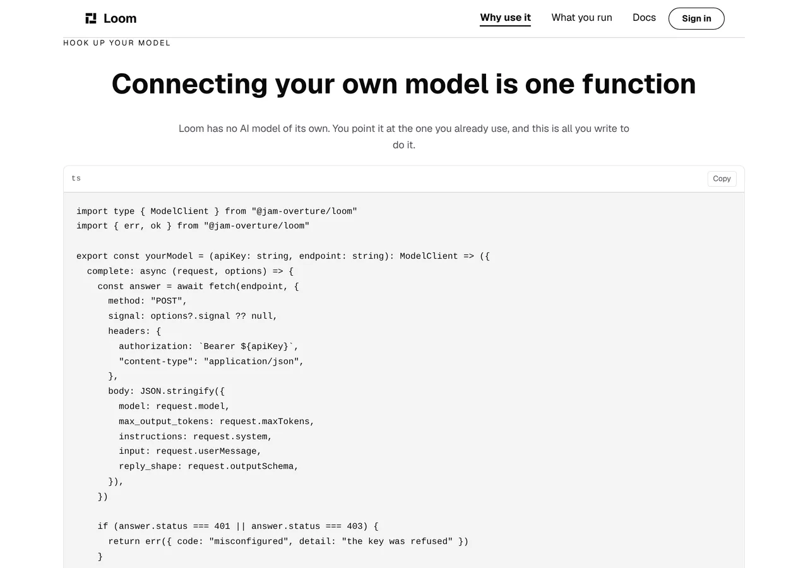
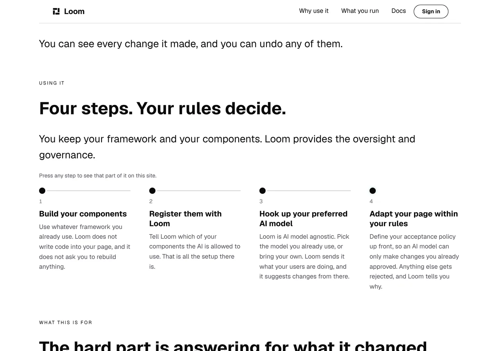
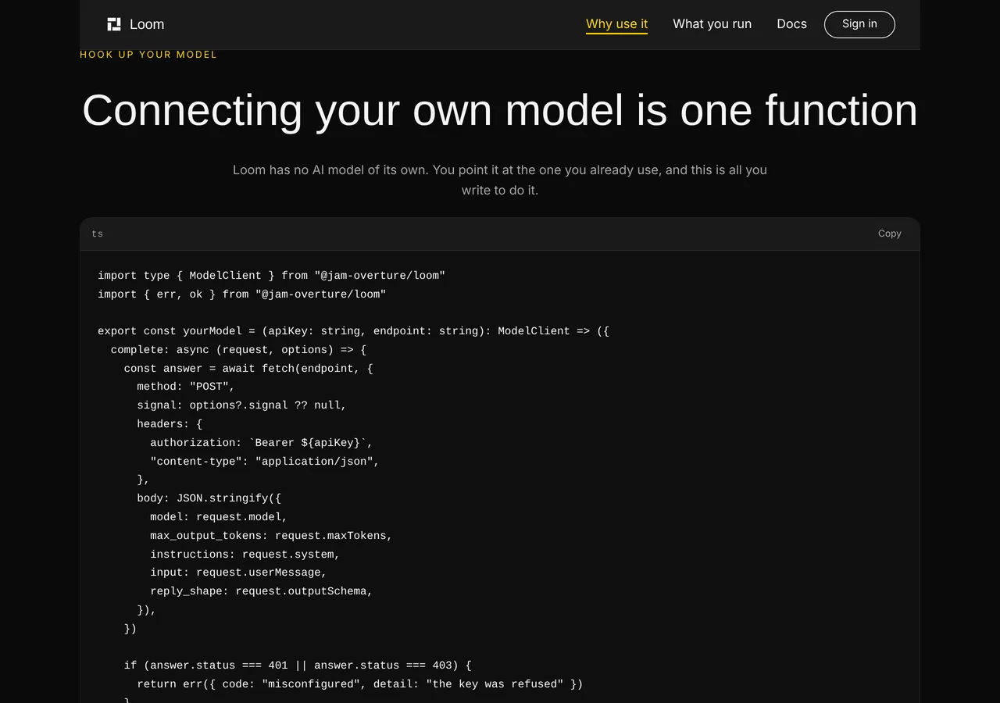
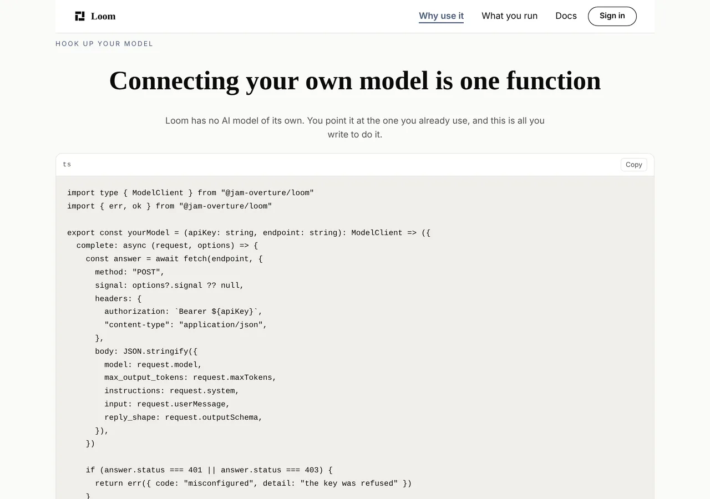
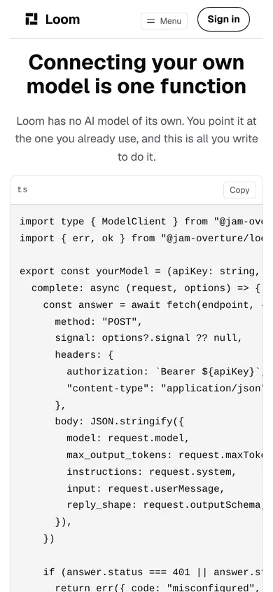

# Marketing — the step that had nothing behind it

**Branch** `marketing-30-bring-your-own-model` · **Date** 7 November 2026 ·
**Section** §4d, the marketing site · **Lane** `apps/loom/app/(marketing)/`

---

# What was built

The front door states four steps and makes a claim about what each one costs.
**Three of the four could be checked somewhere on this site and one could not**,
and a reader had no way to find any of them.

| step | what a reader can now go and see |
| --- | --- |
| 1. Build your components | *What stays yours* |
| 2. Register them with Loom | *What you write*, two files |
| 3. Hook up your preferred AI model | **new: one function, driven over HTTP in the test** |
| 4. Adapt your page within your rules | *What changed and what let it through* |

The third is the work. The other three are a link each.



---

# 1. The claim, and why it was the weakest one on the site

Step three reads:

> *"Loom is AI model agnostic. Pick the model you already use, or bring your
> own. Loom sends it what your users are doing, and it suggests changes from
> there."*

The first sentence is the maintainer's of 1 October. `copy.ts` records that the
rest is this lane's built on his, which is why it is held to every rule the site
is held to rather than sitting in `MAINTAINERS_OWN`.

It is a claim about **what it takes**, and this lane keeps arriving back at the
same rule: the only honest way to back a claim about quantity is to show the
quantity. `/why-use-it` argued the band above it (*What one report looks like*)
and the band below it (*The same page arranged for someone else*) and had
nothing in between about the part a reader would actually write. A visitor was
asked to take *agnostic* on trust, on the one page whose whole argument is that
this product can show its working.

So there is a band between those two, and it prints one function.

## It is one panel and that is the honest number

`whatYouWrite` prints two files because adding a component really is two files.
Connecting a model is **one interface with one method**, so a second panel
would have had to be invented to fill the space.

What is in the panel is the shortest true version rather than the smallest one.
Two things are in it that a shorter specimen would have dropped, and both are
the reason the panel is worth printing:

- **The field names are the provider's**, so a reader sees the translation they
  have to write. `request.maxTokens` becomes `max_output_tokens`,
  `request.system` becomes `instructions`, and so on. That mapping is the only
  part that changes between providers and it is the only part of this a reader
  has to think about.
- **The two refusals come back as different words.** `client.ts` records that
  the framework itself collapsed its failure codes into one until day 37, and
  that a request the API rejected outright was then reported as *ask again
  later*, which is a lie downstream cannot detect. A specimen that collapsed
  them would be teaching a stranger the mistake the framework already made.

---

# 2. The panel is driven, not type-checked and left

This is where it goes further than the panels under *What you write*. Those are
put through the door a deployment uses, which proves the registration is
accepted. This one claims something stronger — that a model connected this way
produces a change Loom can act on — so that is what is tested.

`connected.test.ts` starts a server on an ephemeral port, points the published
function at it, and hands what comes back to `modelInterpreter`:

| what the server answers | what the interpreter reports |
| --- | --- |
| 200 with the framework's own `INSERT_NOTE_REPLY` | `ok` — a change it understood |
| 401 | `interpreter-misconfigured` |
| 503 | `interpreter-unavailable` |

And the request is read back off the wire: the header is `Bearer a-key`, and the
body carries exactly `input`, `instructions`, `max_output_tokens`, `model` and
`reply_shape`. The sentence under the panel claims Loom treats those two
refusals differently; the test is what makes that a fact rather than a flourish.

**Nothing is mocked and nothing is stubbed.** That is deliberate and it is this
lane's finding of 6 November applied one file later: a mock replaces what a
module resolves as it is evaluated, so a suite with a warm module cache decides
whether the mock arrived in time, and the 12 failures `addressed.test.ts` was
producing on `main` were exactly that. There is no such window here. The
specimen takes its endpoint as an argument because **a reader needs it to** —
every provider has its own address — and that is also what lets the test be
real.

`INSERT_NOTE_REPLY` is the framework's published fixture rather than a reply
written here, so a change to what the interpreter accepts goes red in `src/`
where it belongs instead of passing against a copy this lane keeps.

## The arrangement around the file is `written.ts`' and is unchanged

`connected/your-model.ts` is a real module the gate compiles against the
published `ModelClient`. `connected.ts` holds the text the page renders.
`connected.test.ts` holds the two together and fails if either moves. The
reason the page does not read the file from disk is
[0331](0331-a-marketing-page-is-served-per-request-because-the-store-governs-it.md):
every marketing route is `force-dynamic`, so a `readFileSync` would run in a
deployed function with no repository under it and fail only in production.

---

# 3. Four steps, four places to go

The band on the front door is unchanged in every word. What it has now is an
`href` on each step and one sentence above the rail.



**That picture is the argument for a finding rather than for this change.** It
is the band with all four steps linked and it is indistinguishable from the band
before this run. A `loom.milestone` carrying an `href` renders `.loom-underline`,
whose rest state is `background-size: 0% 2px`, so a linked step is
pixel-identical to an unlinked one until a pointer touches it — and on a phone
nothing ever does. That was filed for `Loom primitives` on 30 October when the
chain band hit it, and the dated note added today says the blast radius has
doubled: two rails of invisible links on one screen, and two sentences of prose
standing in for the affordance.

The sentence here says **any** step where the chain's says **a**, and the
difference is load-bearing. The chain's last rung has nowhere to go, so a
universal would be a promise that band breaks the one time a reader tests it.
All four of these land somewhere, `using-it.test.ts` holds that they do, and the
day one stops that sentence is what goes red.

## What the test holds, and what it could not

Three assertions, which are `chain.test.ts`' three applied to the steps: the
address is one this application serves, it is never the front door, and **the
band at the other end still declares the `id` the press is aimed at** — read off
the markup a browser receives rather than off the tree that built it. The last
is the one nothing else reports. A link that scrolls nowhere renders perfectly
and goes green everywhere.

## One judgement worth naming, and it is a question for the maintainer

Steps 1, 2 and 4 now point at bands the **chain** band already points at, one
screen above. That is the same destination offered twice on one page. It is
deliberate — the two bands enumerate different things, and a reader scanning
*what would I do* should not have to go back up to find the evidence — but it is
a judgement about the page rather than a fact, and it is in the pull request
comment as such.

---

# Both palettes





No hard-coded colour anywhere in the band. The panel is `loom.code` with
`tone` left to the library.

# The phone, and the number that is not good



Measured rather than eyeballed, on the production build:

| viewport | panel | the code inside it | behind the gesture |
| --- | --- | --- | --- |
| 1280 | 1078 | 655 | **0** |
| **390** | **361** | **655** | **294px** |

`scrollWidth` is exactly 390 at 390, so the document never scrolls sideways and
this is contained inside the panel. It is still the case that a reader with a
phone sees roughly **the first 44 of a 78-character line** with nothing saying
the line continues.

**There is nothing the composition can do about it**, and that is why it is a
finding rather than a fix. `wrap: false` is correct here for the reason the
`wrap` prop exists — a wrapped line of TypeScript reads as two statements — and
the finding closed on 12 September was the *other* half of this, where wrapping
loses nothing. What this lane has instead is `CHARACTERS_IN_A_LINE = 80` in
`connected.test.ts`, which bounds how far the overflow runs and is explicitly
not a promise that nothing scrolls. The specimen was cut to it by hand, which is
what took `authorization` and `content-type` onto their own lines.

---

# Decisions

**None taken and none recorded.** Nothing here touches the tree schema, the
delta model or an Accepted record. No primitive was added and none was needed:
the band is `loom.section`, `loom.prose`, `loom.code` and `loom.code-span`, and
the only framework code reached is the published interface a host already
implements.

Two judgements that did not want records:

- **The specimen takes its endpoint as an argument.** A factory with the URL
  written into its body would be showing a shape nobody can use — several
  providers have one address per region — and it is also the thing that lets
  the test drive it against a real server instead of faking `fetch`.
- **`REFUSAL_CODES` is read by the copy rather than typed into it.** The
  sentence under the panel names two words that appear in the code above it, and
  a sentence naming a string by spelling it again goes stale silently.

# Findings

**Two filed, one annotated, none closed.**

- **Filed, for `Loom primitives`:** a source panel a phone cuts in half has no
  rest state saying so, with the measurement above and three costed shapes. The
  recommendation is a fade at the trailing edge.
- **Filed, for this lane, against its own entry of 26 October:** the word
  ceiling is no longer what blocks a fourth page. The site is **2,950 of 3,900**
  authored words, which is 950 of headroom, because 0328 took `/how-it-works`
  off on 31 October. The ceiling has not moved and must not. The shape question
  underneath that entry is unchanged and still the maintainer's.
- **Annotated:** the 30 October entry on linked milestones, with today's
  photograph and the doubled blast radius.

**One open entry of this lane's was read and deliberately not taken.** The
2 November entry asks `DocumentTheme` to swap `themeDocumentCss(theme)` for
`themeGroundCss(theme)`, worth about 1,976 bytes a page. It is described there
as one line and it is not: `document-theme.test.tsx` is 353 lines whose central
argument is that the variables on `:root` match the ones the root primitive
mounts, and after the swap there are no variables on `:root` to compare. It also
changes what every page of this site puts in its document, so it wants its own
branch and the three palettes re-photographed to show the scrollbar and the
overscroll canvas are still right. Nothing is blocked on it.

# Test numbers

`pnpm install && pnpm verify`, read out of the file the status was written to
rather than off a notification:

```
Test Files  265 passed (265)      Tests  6436 passed (6436)    # framework
1456 findings, 0 malformed
2121 visuals in reports/, 148.6MB, none over 1.1MB
Test Files  428 passed (428)      Tests  6943 passed (6943)    # @loom/app
138 prerendered pages, 2071 text junctions, 0 run together
EXIT=0
```

**The first run of the gate was red and is worth recording**, because it was the
check doing its job. `pages.test.ts` pins every source panel this site serves,
by name, so a panel added to a page the sweep forgot cannot read as the same
green as a panel that wraps. It went red naming the new function. That pin has
now caught **every** panel this site has grown — the two on 3 November, the
report on 4 November, this one today — each on the run that grew it. The list
was extended, not relaxed.

**And the notification for that run said exit code 0.** The file said `EXIT=1`.
That is the fourth instance of the thing `docs/routines.md` has a section about
and the remedy held: the file was read in its own command and the two
disagreed.

This branch's own additions: **17 cases**, 13 on the new `connected.test.ts` and
4 in `using-it.test.ts`. One existing assertion changed, which is the panel
census above. The framework suite is untouched by this branch.

**Proved by breaking them**, which is the part worth a second pair of eyes:

| broken how | what went red |
| --- | --- |
| the published region edited away from the file | `your-model.ts is the published region` |
| the server answering 200 for every case | both refusal cases, naming the code they got |
| an `href` taken off one step | the link count, and the anchor sweep |
| the hint sentence removed | `still tells a reader the steps can be pressed` |

All three marketing routes still report `ƒ` in `next build`, so
[0331](0331-a-marketing-page-is-served-per-request-because-the-store-governs-it.md)
holds and nothing here froze a governed page. The build the shots were taken
from is `built 2026-11-07T11:37:59.041Z`.

**The copy budget.** The new band is **98** authored words. The site goes from
**2,950 to 3,060 of 3,900** — the band, plus the hint sentence and the four
addresses on the front door, which take `/` from 1,366 to 1,378 and
`/why-use-it` from 1,103 to 1,201. No ceiling in `budget.test.ts` was touched
and none is near enough to need to be.

Nothing skipped, nothing weakened. No file outside `app/(marketing)/` was
changed.

# Open questions

In the pull request comment. Nothing about this change is blocking.
