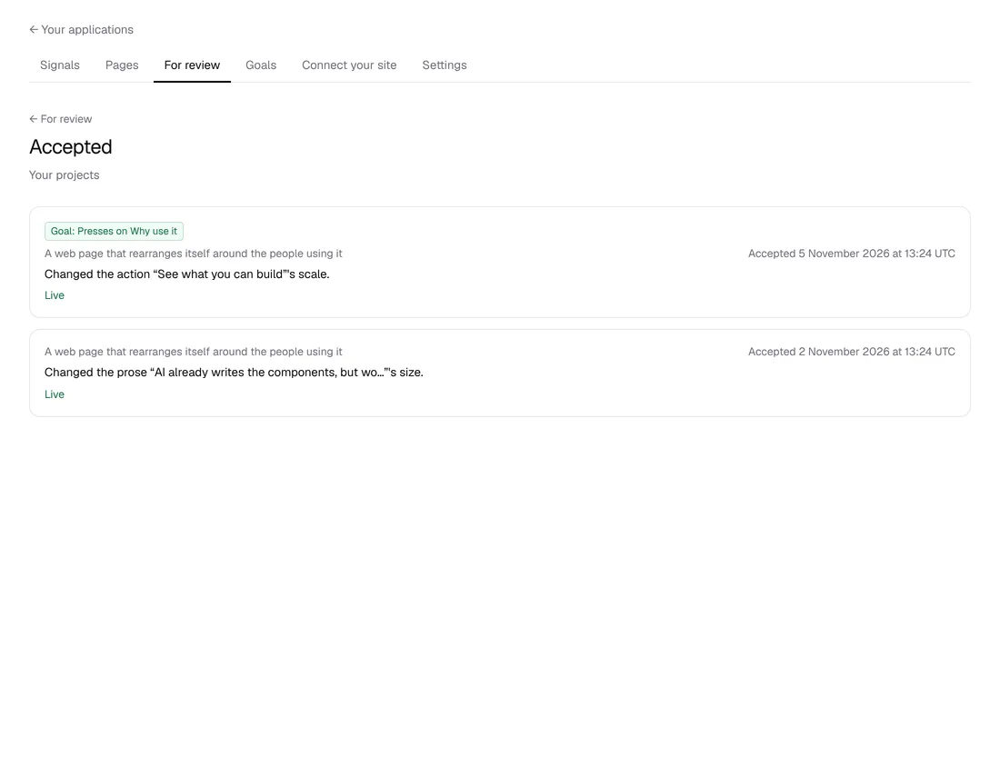
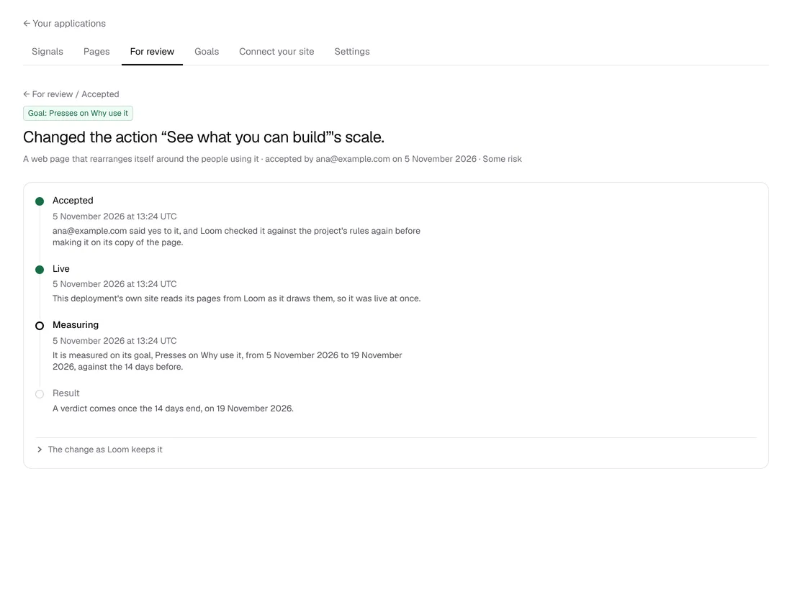
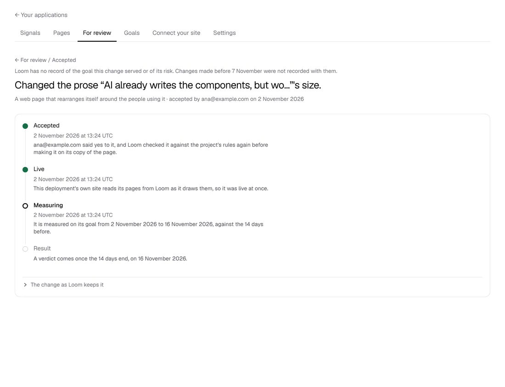

# An accepted change leads with the goal it served, and says its stake

**Lane:** `Loom portal` · **Date:** 7 November 2026 ·
**Branch:** `claude/project-thread-sudnu7` ·
**Records:** none new ·
**Plan:** [`docs/portal.md`](../docs/portal.md) row 8 ·
**Target:** [`docs/portal-wireframes.md`](../docs/portal-wireframes.md) *4*, the
heading of the timeline from *Accept*

## Why this, and why now

No portal pull request was open, and the maintainer had left no comment on the
last one (#797). The first unfinished row is still unit 8: the timeline from
*Accept* was on `main` without what section 4 of the wireframes puts above it,
*the change as a heading with its goal chip, and page · accepted by <who> on
<date> · stake*. #797 named this as the next piece. The rest of 8a still waits
on `Loom signals` (#794 is open in that lane), and 8c needs unit 8 first.

## What shipped

- **What a made change was made from is kept.** A change on a copy's record
  carries its proposal id and nothing of the hold it came from: not the intent,
  which is what the goal it serves is kept by (0352), and not the stake the
  Gate put on it. Both were gone once the hold was answered. Now, when a change
  is made, by *Accept* or by the Gate outright when the proposer raised it, its
  intent and stake are kept by its proposal id in `loom_made_changes`. Memory
  and Postgres stores held to one contract.
- **Keeping it never decides the change.** It is written after the change is
  made, and a failure to write it leaves the change made, as a turned-down
  change is turned down whether or not it is remembered (0341). The timeline
  then says no record was kept.
- **The timeline leads with the goal chip**, the line under the heading ends
  with the stake (*… · accepted by ana@example.com on 5 November 2026 · Some
  risk*), and *Measuring* names the goal: *It is measured on its goal, Presses
  on Why use it, from … to …, against the 14 days before.*
- **_Accepted_ leads each change with its goal** where one was kept.
- **Where nothing can be said, the screen says so instead of a chip**: a change
  made before today has *Loom has no record of the goal this change served or
  of its risk. Changes made before 7 November were not recorded with them.*; a
  deployment without the table has *The goal this change served could not be
  read …*. The rest of both screens stands either way.

## Decisions taken

- **A row of its own, not a column on `loom_proposal_goals`.** A new column
  would be selected by every read of that table, so *For review* and the
  proposer would fail on production until `pnpm db:push` ran. A new table only
  leaves this one chip unread until then.
- **Keep the intent and the stake, not a copy of the goal.** The goal stays
  where 0352 keeps it, by intent, with its name as it was when the proposal was
  raised; the new row only joins a proposal to it. One fact, one place.
- **Recorded on every made change, not only on *Accept*.** A change the Gate
  makes outright is on the same timeline, and would otherwise always read as
  unrecorded.
- **The stake is the one the Gate gave when it made the change.** `confirmHeld`
  judges the change again on *Accept*; that judgment is the one the change was
  made under.
- **No decision record.** It draws what section 4 already specifies and
  changes no rule.

## Tests

- 16 new tests: the store contract (3 cases, against memory and against PGlite,
  so 6) and Postgres specifics (4: the migration twice, row level security,
  one project's rows kept from another's, a row this build did not write left
  out); the proposer keeping what a change it made outright was made from and
  nothing for one it held (1); `servedOf` and its words (4); *Measuring* naming
  the goal in each of its three states (1). The existing timeline tests now
  pass a change with nothing recorded and read as before, with the reworded
  *Measuring* line.
- `pnpm verify` exit 0 on this branch: framework 6,434 passed (2 skipped), app 6,942 passed across 429 files.
- By hand, against a local Postgres and `next start`: one change with a goal
  and stake kept, and one made before; the screenshots below.

## Screens

## Needs `pnpm db:push`

`loom_made_changes` is new. Until it is pushed, every change is still made, the
timeline says the goal could not be read, and nothing made meanwhile is
recorded.

## Where this leaves section 4 of the wireframes

- Done: the heading with its goal chip and *page · accepted by <who> on <date>
  · stake*; the timeline (#797); the site's connection (#796). **Unit 8 is done
  in the portal.**
- Still missing: the **verdict** under *Result*, and the dropped change listed
  on the page's history, which are 8c's. The **pull client** is `Loom daily
  build`'s (#798 is open in that lane).
