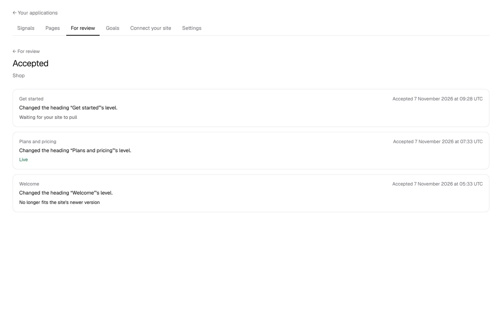
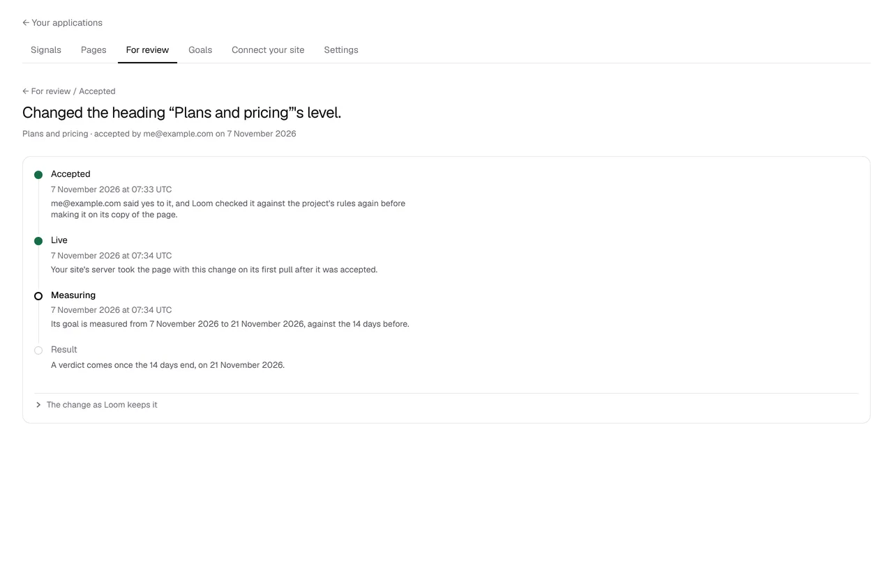
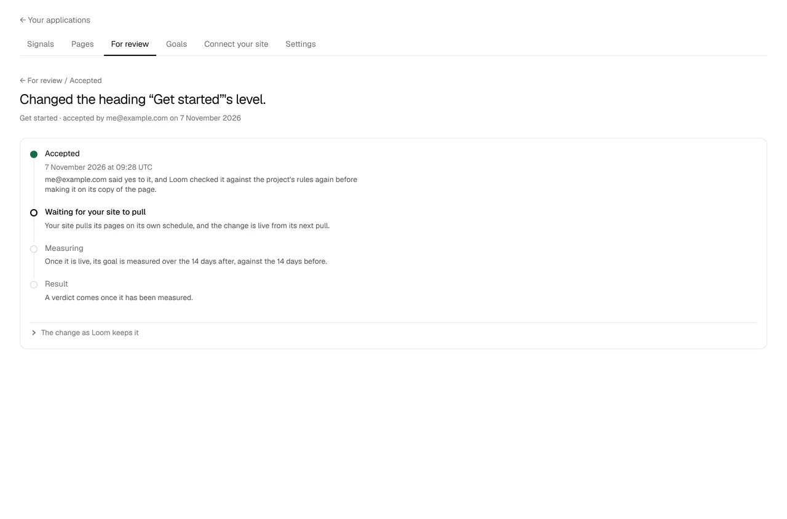
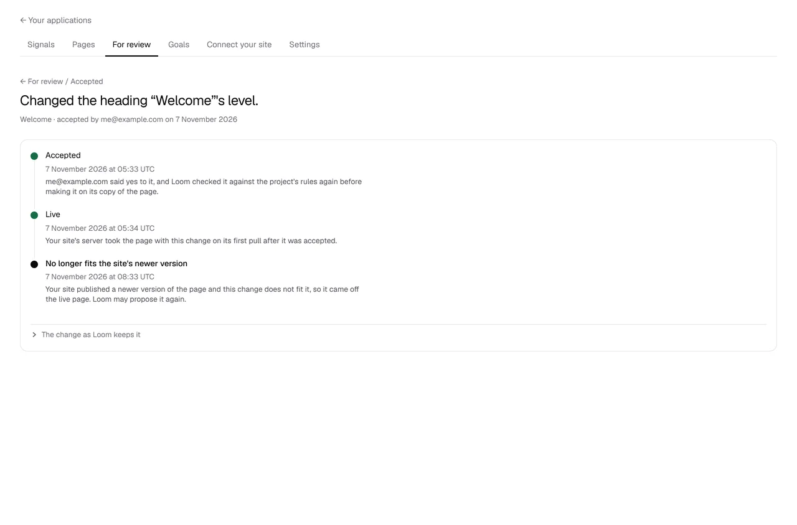

# An accepted change can be followed from *Accept* to live, and on to its result

**Lane:** `Loom portal` · **Date:** 7 November 2026 ·
**Branch:** `claude/project-thread-ey872l` ·
**Records:** none new ·
**Plan:** [`docs/portal.md`](../docs/portal.md) row 8 ·
**Target:** [`docs/portal-wireframes.md`](../docs/portal-wireframes.md) *4*, the
timeline from *Accept*

## Why this, and why now

No portal pull request was open, and the maintainer had left no comment on one.
The first unfinished row is still unit 8, *Accept goes live*
([0358](../decisions/0358-an-accepted-change-goes-live-from-the-portal-and-the-site-pulls-it-with-no-pull-request.md)).
The replay (#792), the read door (#795) and the record of each pull (#796) are
on `main`; the piece the last run named next was the screen that follows an
accepted change from *Accept* to live, with the changes the replay dropped
listed. The rest of 8a still waits on the `Loom signals` finding for what
readers did counted by hour (#794 is open in that lane).

## What shipped

- **_Accepted_** (`/portal/<project>/review/accepted`), linked under the *For
  review* heading: every change accepted on the project's pages, newest first,
  fifty to a page with the last one shown in the address (`before`). Each row
  says the page, when it was accepted, what it did in a sentence, and where it
  has got to: *Live*, *Waiting for your site to pull*, *Your site is not pulling
  yet*, *No longer fits the site's newer version* or *Undone*.
- **The timeline for one change** (`/review/accepted/<change>`), with *For
  review / Accepted* above it, the change as its heading, and *page · accepted
  by <who> on <date>*:
  - *Accepted*, with who said yes, and when.
  - *Live*: the site's first pull of a new answer after the change was
    accepted, read from the per-tag rows #796 keeps; at once for this
    deployment's own site (0259). Until then *Waiting for your site to pull*
    (and, after an hour without a pull, that the site may have stopped), or
    *Your site is not pulling yet* in the words *Connect your site* uses, with a
    link there. A change that came off the page before any pull says *Never
    live*.
  - *Measuring*: the 14 days from when it went live, on its goal, against the
    14 before, with the dates.
  - *Result*: when the verdict comes. The verdict itself is 8c's, and the step
    says it is not shown yet rather than inventing one.
  - Where a change came off the page the timeline ends there instead: *No
    longer fits the site's newer version* (when the newer version's copy
    started; Loom may propose it again), or *Undone*.
  - The change as Loom keeps it, one click down.
- **_Accept_ links to the timeline.** Once a change is made, the answer on
  *For review* offers *Follow it to live*.
- **Two sentences that 0358 made wrong are corrected.** The answer to *Accept*
  said a customer's site "keeps serving what it published", and a page's screen
  said "Your site still serves the published one". Both now say the site serves
  the copy from its next pull.
- **The pulls store answers one more question**: `firstTakenSince(application,
  since)`, when each answer first taken at or after a moment was first taken,
  earliest first. One read serves a whole page of changes. No new table and no
  `db:push`.

## Decisions taken

- **_Live_ is the first answer first taken at or after *Accept*.** Accepting
  changes the live pages and so their entity tag, so that answer is the pages
  with the change on them. An answer first taken before and again after is the
  pages from before, and does not count.
- **A change is found by its proposal, across every copy of its page.** The
  replay keeps the proposal id when it applies a change to a newer version
  (0358 clause 6), so the copy a change first appears on says when it was
  accepted and by whom, and its absence from the current copy says it was
  dropped, as of when that copy started. No new record is kept; it is all read
  from the copies' own records.
- **Measuring starts when the change went live.** The wireframes say the window
  starts "when the accepted change goes live (from *Accept*, per 0358)". For
  this deployment's own site that is *Accept* itself; for a pulling site it is
  the first pull after it, usually a minute later. Counting from *Accept* where
  the site had not pulled would measure days on which no reader saw the change.
- **Undo is shown as an ending.** An undone change is not on the live page, so
  a timeline that went on to *Measuring* would misstate it.
- **No decision record.** It builds the screen 0358 and the wireframes
  describe and changes no rule.

## Tests

- 33 new tests: the timeline (21: which changes were accepted and how each
  ended, the reach of the site, every step in each state, the list's pages,
  and the sentences), reading a project's accepted changes (4, against the
  memory tree store, including failing whole when one page cannot be read), the
  timeline's render (2), and the pulls contract's new question (3 cases, run
  against memory and against PGlite, so 6).
- `pnpm verify` exit 0 on this branch: framework 6,434 passed (2 skipped), app
  6,924 passed across 427 files, prerender check clean.
- By hand, against a local Postgres and `next start`: a registered project with
  three published pages, a change accepted on each, a newer version of one page
  that dropped its change, and pulls before and after; the list and each
  timeline read as the screenshots below.

## Screens

## Where this leaves section 4 of the wireframes

- Done: the timeline (*Accepted* → *Live* → *Measuring* → *Result*), reached
  from *Accept* and from the change afterwards; the ending where a change no
  longer fits; the site's connection (#796).
- Still missing: the **goal chip and the stake** on the timeline. An accepted
  change keeps its proposal id but not its intent, and which goal a proposal
  serves is kept by intent (0352), so naming it needs the goal kept by proposal
  when the change is accepted: a column or a row, and a `pnpm db:push`. The
  **verdict** under *Result*, and the dropped change listed on the page's
  history, are 8c's. The **pull client** is a finding for `Loom daily build`.
