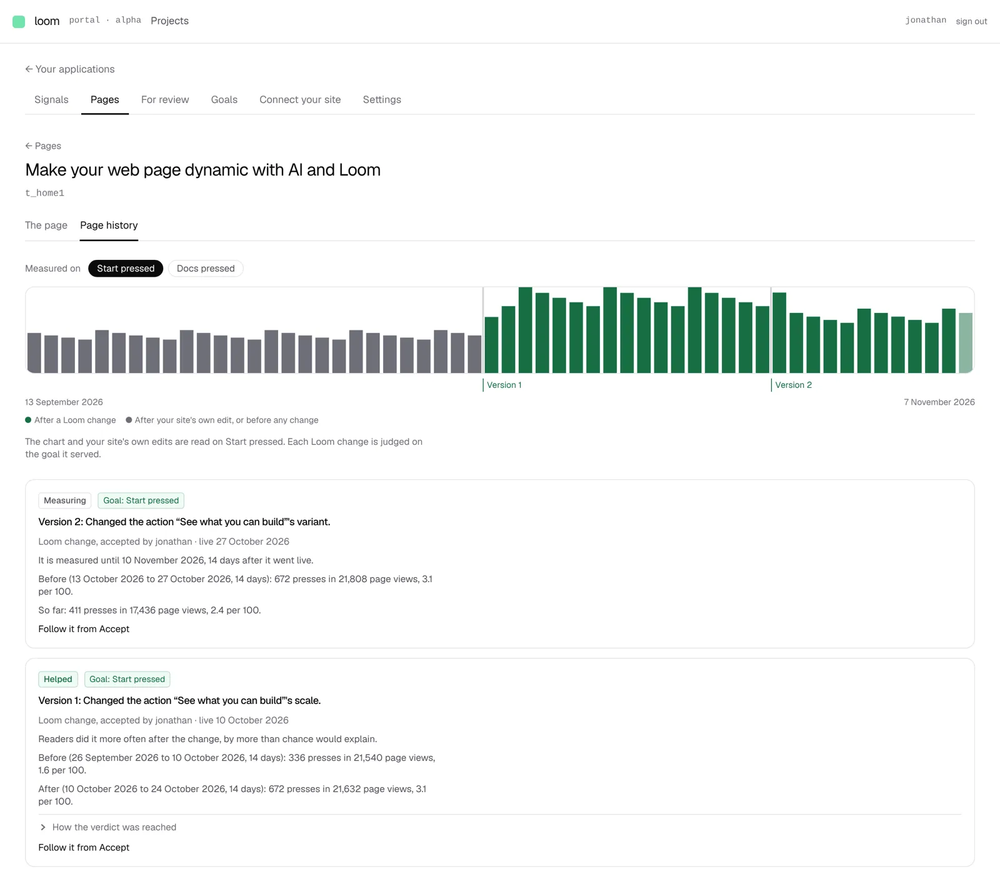

# A page's history leads with its goal by day, and *Measured on* picks the goal

**Lane:** `Loom portal` · **Date:** 7 November 2026 ·
**Branch:** `claude/project-thread-0sbbyx` ·
**Records:** none new ·
**Plan:** [`docs/portal.md`](../docs/portal.md) row 8c ·
**Target:** [`docs/portal-wireframes.md`](../docs/portal-wireframes.md) *5 · Pages · History*

## Why this, and why now

No portal pull request was open or claimed, and no portal-owned finding is
open. Units 8a (short of what waits on `Loom signals`), 8b and 8 are done; the
first row with work left is 8c, whose *Still owed* named the 8-week chart, the
*Measured on* picker, *Propose reverting* and *Compare*. The chart and the
picker read only what is already on `main` (the hourly counters of 0356 and
`acted.ts`), need no table and no decision, and belong together: the picker
says which goal the chart is drawn on.

## What shipped

- **The *Measured on* picker** above the cards: a chip for every goal on the
  page (the primary first), in the address as `?on=`. With none named it starts
  on the goal a change to the page serves (0352's rule), and that chip's link is
  the bare address. A goal named that is not on the page falls back the same way.
- **The goal by day over the last 8 weeks**: one bar per UTC day, the goal's
  count over that day's page views, read from the same hourly counters a
  verdict reads (one read of each, plus when the project first counted anything
  readers did, so a day before presses were counted never reads as none).
  Green where the page was on a Loom change when the day ended, grey after the
  site's own edit or before any change Loom knows of; today lighter; each
  version named under the bar it started on; each bar says its day and figures
  when pointed at; one sentence for a screen reader. The chart starts where
  counting began and says so; counters that do not answer cost the chart alone.
- **The site's own edits are read on the picked goal**; a Loom change is always
  judged on the goal it served, and the screen says so in one line.
- `goalsOnPage` and `measuredOnFor` in `goals/serving.ts` (`goalForPage` now
  built on the first). `marksOf` in `page-history.ts`. The pure chart is
  `_lib/daily-rate.ts`; the read is `readDailyChart` in `accepted/measurement.ts`.
- **Tidy:** the query helper `single` was written out in three screens; it is
  now `_lib/query.ts`, used by those three and this one.

## Decisions taken

- **A day takes the colour of the version the page was on when it ended**, and
  a change that went live mid-day is marked on that day. Splitting a day would
  need sub-day bars and the cards already carry the exact measurement; the
  chart is for the trend.
- **UTC days**, as every date the portal prints.
- **The picker does not re-judge Loom changes on another goal.** The
  maintainer's rules measure a change on the goal it served; re-judging it on
  another goal would be a second verdict with no rule behind it. Reversible: if
  he wants it, the cards can read the picked goal.
- **No decision record**: it draws what the wireframe specifies and changes no rule.

## Tests

- 23 new tests: the chart (9: its range, days, rates, colours, boundaries, today,
  counting began, empty, summary), the marks (2), the goals on a page and the
  pick (6), the query helper (2), and the chart's render (4).
- `pnpm verify` exit 0: framework 6,604 passed (2 skipped), app 7,090 passed
  across 437 files, prerender check clean. One earlier run timed out
  `tools/sources/semicolons.test.ts` while a local Postgres was being set up
  beside it; it passes alone and in the clean rerun.
- By hand against a local Postgres and `next start`, with two accepted changes
  and eight weeks of counters seeded: the screen below; `?on=` the second goal
  redraws the chart on it and moves the selected chip.

## Screen

## Where this leaves section 5 of the wireframes

- Done: tabs, the chart, *Measured on*, one card per version with its verdict,
  the dashed not-live card, site edits as *Not a Loom change*.
- Still missing: *Propose reverting* on a Loom change, *Compare*, and a
  *For review (N)* tab on the page.
