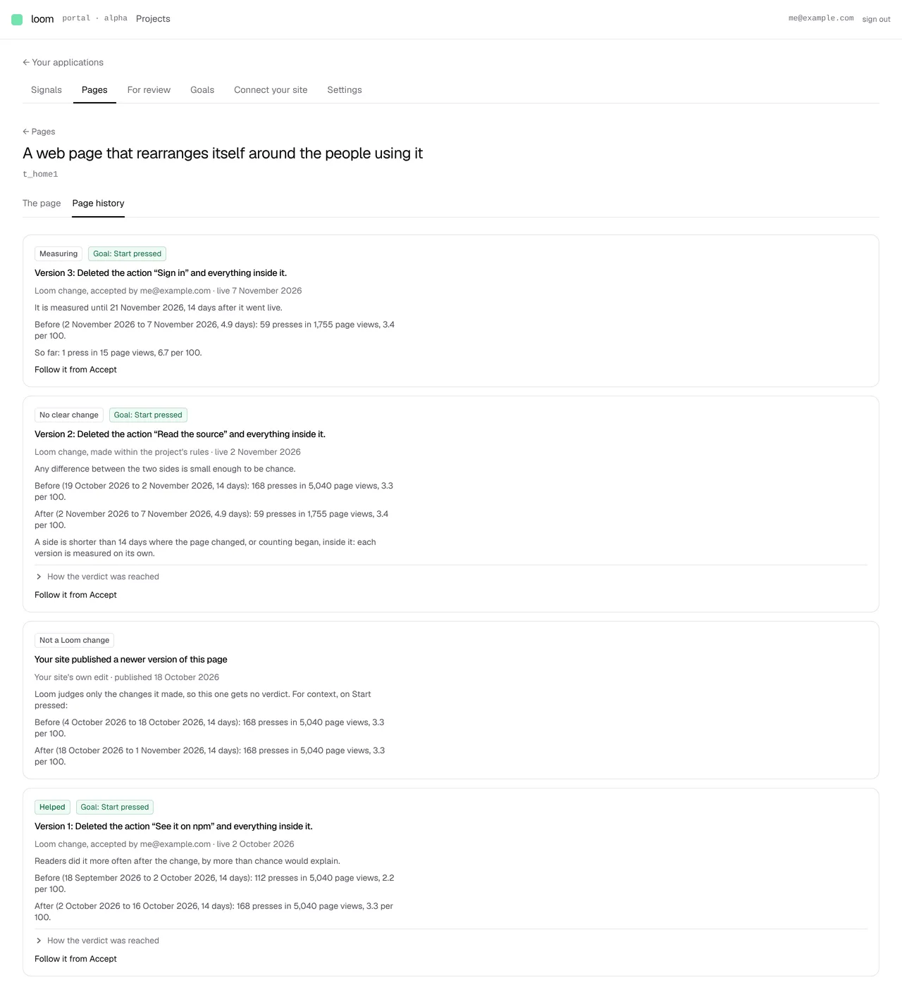

# A page's history: one card per version, with what it did to the goal

**Lane:** `Loom portal` · **Date:** 7 November 2026 ·
**Branch:** `claude/project-thread-xosvst` ·
**Records:** none new ·
**Plan:** [`docs/portal.md`](../docs/portal.md) row 8c ·
**Target:** [`docs/portal-wireframes.md`](../docs/portal-wireframes.md) *5 · Pages ·
History*

## Why this, and why now

No portal pull request was open and no `portal-*` or portal run branch had
been pushed in the last three hours (the last, #803, merged at 17:32 UTC).
Unit 8 is done in the portal and 8c's verdict shipped this afternoon (#803)
on an accepted change's own timeline, so the first unfinished piece in the
agreed order is the page's own *History* tab, which draws that verdict per
version. Its inputs are all on `main`: accepted changes and when each went
live (#797), the goal each served (#800), the site's newer versions (each
time a page's copy started again, 0358 clause 6), and the hourly counters
(#794).

## What shipped

- **A page has two tabs**, *The page* and *Page history*
  (`/portal/<project>/pages/<page>/history`).
- **One card per version, newest first.** A version starts when the page
  changed for its readers: a change accepted on it going live, or the site
  publishing a newer version of the page.
- **A Loom change's card** leads with its verdict, exactly as its timeline's
  *Result* gives it (*Helped*, *Hurt*, *No clear change*, *Too early*), with
  its goal chip, *Version N* and what it did in a sentence, who accepted it
  and when it went live, the before and after it rests on, and the test one
  click away under *How the verdict was reached*. While its 14 days run it
  says *Measuring*, until when, and the figures so far. One with no goal
  recorded says *Not measured*; one that came off the page says where
  (*Undone*, *No longer fits the site's newer version*). Every Loom card links
  to *Follow it from Accept*, its timeline.
- **A change accepted and not yet taken by the site** sits on top, dashed,
  saying where it has got to (*Waiting for your site to pull*, or *Your site
  is not pulling yet*), as the wireframe's *Not live yet* card.
- **The site's own edit says *Not a Loom change*** and gets no verdict: Loom
  does not judge changes it did not make. For context it shows its before and
  after on the goal on the page now (the page's own goal, else the primary,
  as 0352 picks it), each side ending where the page changed again. A page no
  goal is on says there are no figures to show.
- **Nothing on the page is invented**: a store that does not answer says so,
  and counters that do not answer cost only the figures on the card they were
  for.

Pure logic in `(portal)/_lib/page-history.ts` (`historyOf`, `loomOutcomeOf`,
`siteOutcomeOf`, `originOf`). `going-live.ts` gained `changedAtOf` and
`boundsAround`, which `boundsOf` now uses, so a change and a site edit are
bounded by the same rule. The two readers both screens share moved from under
`review/accepted/_lib/` to `(portal)/_lib/accepted/`, and the counter read
behind `readMeasurement` is now `readSides`, which the site's edits use too.

## Decisions taken

- **The tab says *Page history*, not *History*.** `History` alone is the
  former name of `/portal/history` in `_lib/screen-names.ts`, and
  `every-screen.test.ts` fails any screen that uses it, so that the word never
  means two things. *Page history* is the same subject without reviving it.
  See *Needs your input*.
- **A site edit is measured on the goal on the page now.** It served no goal
  of its own, and the wireframe asks for its before and after for context.
  The card names the goal it used.
- **A site version is dated from when its snapshot arrived** (when the copy
  started), as the wireframe's settled rules say: *"counted from when the
  snapshot with the new version arrives"*.

## Needs your input

- **The tab's name.** The wireframe says *History*. Using that word means
  retiring `History` from the old `/portal/history` screen's former names in
  `screen-names.ts` (that screen no longer exists). I'd keep *Page history*;
  say if you want *History* and a run will retire the old name.
- Nothing blocking.

## Tests

- 21 new in `page-history.test.ts`: the history (empty, live changes and site
  versions newest first, a change not taken yet on top and nowhere else, one
  that came off before any reader had it, other pages left out, a tie ordered
  the same every read), the Loom outcome (*Helped*, *Hurt*, *Too early* with
  how many short, *Measuring* with the figures so far, *Not measured*, figures
  unreadable, not live yet, undone), the site's outcome (no verdict, figures for
  context, so far, no goal, unreadable), and where each version came from.
- 2 new in `going-live.test.ts` for `changedAtOf` and `boundsAround`; the
  existing `boundsOf` tests pass unchanged on the refactor.
- 4 new component tests: `version-card.test.tsx` (verdict, goal chip and
  timeline link; a site edit with none of them; dashed when not live yet) and
  `page-tabs.test.tsx`.
- `pnpm verify` exit 0 on this branch: framework 6,604 passed (2 skipped)
  across 272 files, app 7,036 passed across 434 files.
- By hand, against a local Postgres and `next start`, seeded with 50 days of
  hourly page views and presses on the home page, three accepted changes (one
  replayed onto the site's newer version) and that newer version: the
  screenshot below. On this deployment's own site a change is live at once, so
  the dashed card is covered by the tests rather than the screenshot.

## Screens

## Where this leaves section 5 of the wireframes

- Done: the tabs, one card per version newest first with origin, before and
  after and the verdict, *Not a Loom change* for the site's own edits, and the
  dashed *Not live yet* card.
- Still missing: the 8-week chart of the goal's daily rate coloured by where
  each version came from, *Propose reverting* on a Loom change, *Compare*, the
  *Measured on* goal picker, and the *For review (N)* tab for one page.
