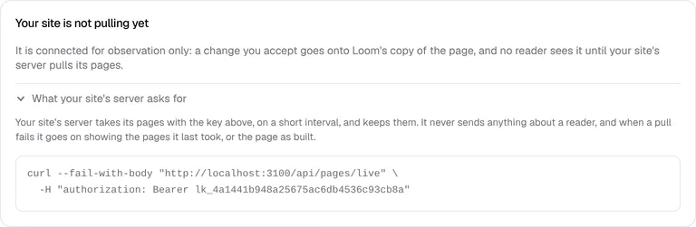
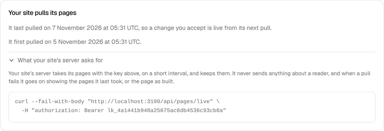
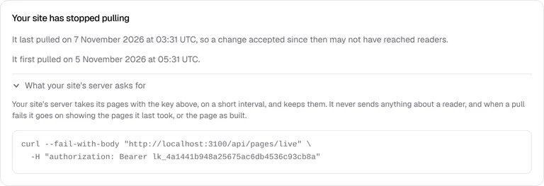
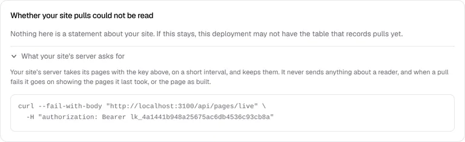

# The door records each pull, and *Connect your site* says whether the site pulls

**Lane:** `Loom portal` · **Date:** 7 November 2026 ·
**Branch:** `claude/project-thread-ru6n3n` ·
**Records:** none new ·
**Plan:** [`docs/portal.md`](../docs/portal.md) row 8 ·
**Target:** [`docs/portal-wireframes.md`](../docs/portal-wireframes.md) *4*, the
site's connection and the *Live* step of the timeline from *Accept*

## Why this, and why now

No portal pull request was open, and the maintainer had left no comment on one.
The order's first unfinished row is still unit 8, *Accept goes live*
([0358](../decisions/0358-an-accepted-change-goes-live-from-the-portal-and-the-site-pulls-it-with-no-pull-request.md)).
The replay (#792) and the read door (#795) are on `main`; what the screen from
*Accept* to live needs next is to know whether a site pulls at all, because
until one does *Accept* reaches no reader. The rest of 8a still waits on the
`Loom signals` finding for what readers did counted by hour (#794 is open in
that lane).

## What shipped

- **The door records every answer a site took**, `200` and `304` alike, after
  the answer is sent (`after()`), so a pull never fails on its own record and a
  record that fails is simply made again by the next pull. Refused pulls (no
  key, closed project, a query, a store down) are never recorded, so a site that
  is turned away is not said to pull.
- **`loom_site_pulls`**, one row per project and entity tag with when that
  answer was first and last taken. A site pulling every minute is mostly told
  `304`, so a row per request would be a row a minute saying nothing new; a row
  per tag is the same facts, and it keeps the one the next screen needs: when
  the pages an accepted change made were first taken, which is the *Live* step.
  Memory and Postgres implementations, one contract run against both (PGlite).
  Added to `scripts/db-push.ts`. **Needs `pnpm db:push` on production.**
- **The last section of *Connect your site* says whether the site pulls**, in
  one of five states:
  - *Your site is not pulling yet*: connected for observation only, an accepted
    change goes onto Loom's copy and no reader sees it (0275 clause 1, in those
    words).
  - *Your site pulls its pages*: when it last and first pulled, and that a
    change accepted now is live from its next pull.
  - *Your site has stopped pulling*: no pull for over an hour, so a change
    accepted since may not have reached readers.
  - *Your site serves Loom's pages directly*: this deployment's own site (0259),
    which reads the store and never pulls.
  - *Whether your site pulls could not be read*: the table is missing (before
    `db:push`) or the store is slow. Only that section says so; the key, the
    snippet and the publish key above still work.
- **The request the site's server makes**, one click away under *What your
  site's server asks for*: `curl` against `/api/pages/live` with the project's
  key, which a person can run to see what their site would be handed.

## Decisions taken

- **An hour without a pull is "stopped".** The interval is the site's to choose
  and the client's finding suggests a minute, so an hour is sixty missed pulls:
  generous enough not to cry wolf, short enough to be told the same day. One
  constant (`QUIET_AFTER_MS`) if the maintainer wants another.
- **Kept per entity tag, not per request and not one row per project.** One row
  per project would say when the site last pulled but not when it first took a
  given change, and the timeline's *Live* step needs that; adding it later would
  be a second `db:push`.
- **No decision record.** It builds what 0358 decided ("the screen says plainly
  that the site is not pulling") and changes no rule.

## Tests

- 31 new tests: the pulls contract (5, run against memory and against PGlite,
  plus the migration twice and row security), the door telling of `200`s and
  `304`s and of no refusal (2), the state and the words for each (8), the pull
  command (2), and the section's render (2).
- `pnpm verify` exit 0 on this branch: framework 6,434 passed (2 skipped), app
  6,864 passed across 424 files, prerender check clean.
- By hand, against a local Postgres and `next start`: a registered project
  pulled with its key (`200`, `{"pages":[]}`), again with the tag (`304`), and
  with a query (`400`); one row was kept for the two answers. With the table
  dropped, the pull still answered `200` and the section said it could not be
  read.

## Screens

The last section of *Connect your site*, in each state a customer project can
be in (this deployment's own site only shows once it has a key):

## Where this leaves section 4 of the wireframes

- Done: *the site's connection* (whether it pulls, when it last did, and the
  request that makes it pull, until the framework's client exists).
- Still missing: the timeline screen itself (*Accepted* → *Live* → *Measuring*
  → *Result*), reached from *Accept*, reading its *Live* step from the first
  pull of the answer the change made; the changes the replay dropped, listed;
  and the pull client, a finding for `Loom daily build`.
