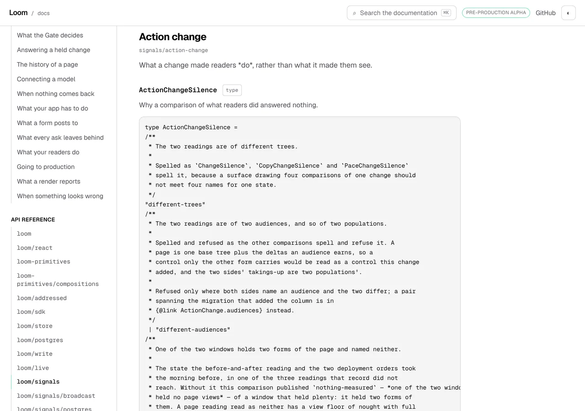
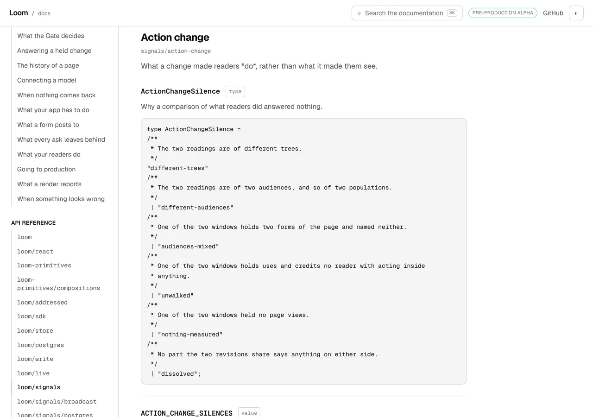
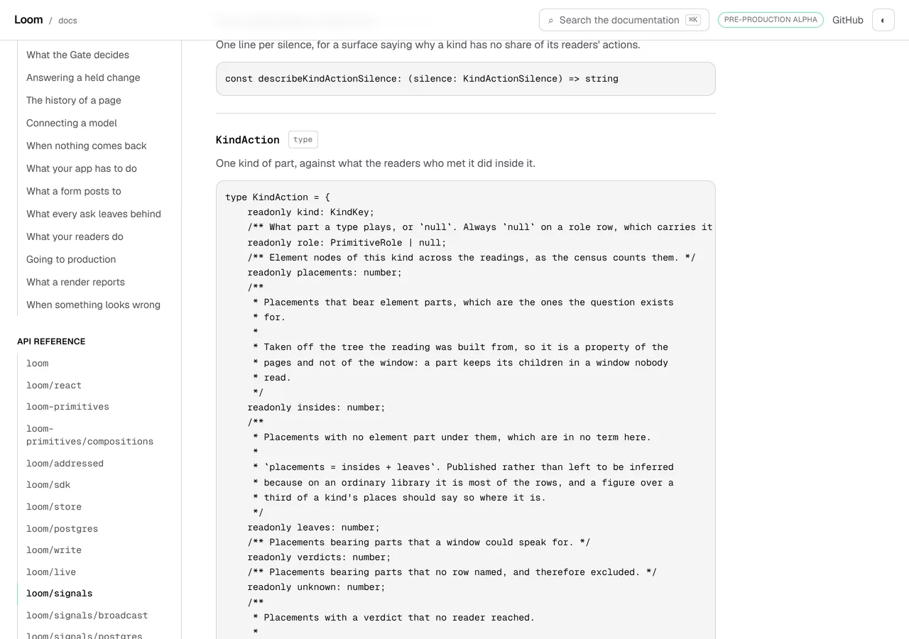
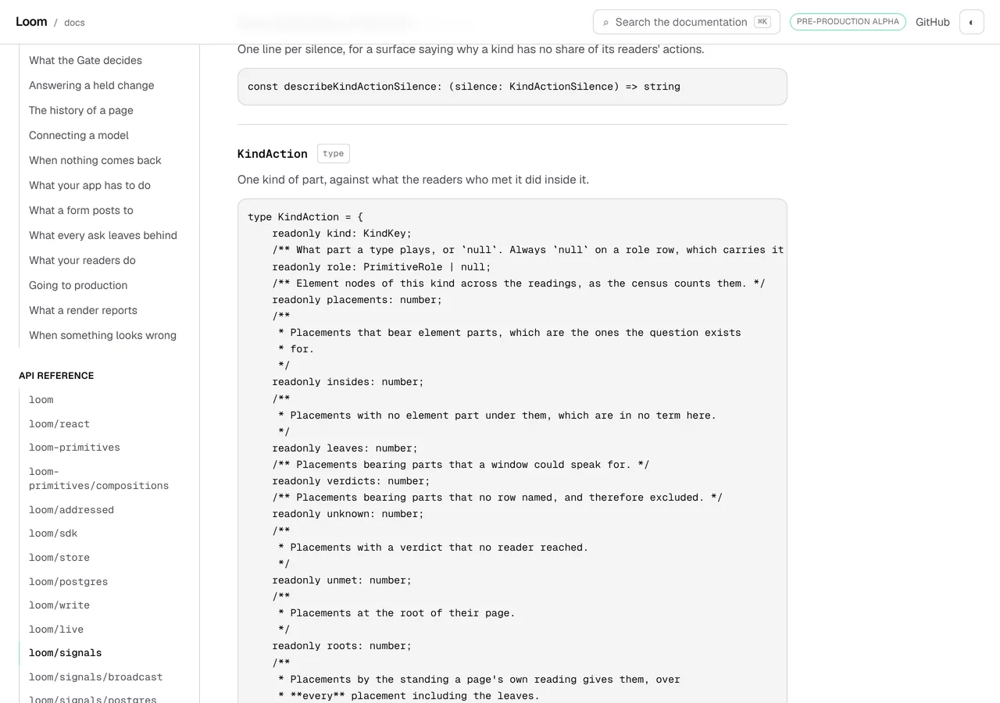
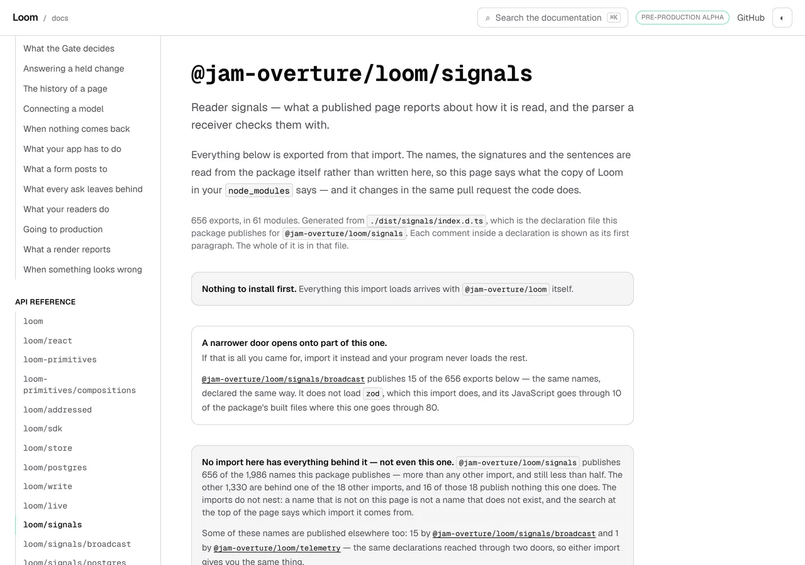
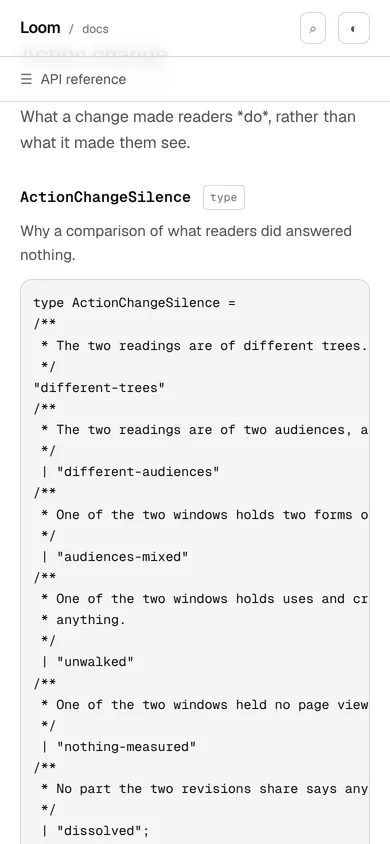

# 8 November 2026 — four fifths of the heaviest page was commentary under a first paragraph, and the rule for it was already in the file

**Routine:** `Loom docs` · **Branch:** `docs-81-the-first-paragraph-inside-a-declaration` ·
**Section:** §4c

One open pull request from this lane at the start of the run — **#778**, opened
5 November, carrying `0353` as `Proposed`, **still unanswered after three days**.
Five others were open: #819 (`Loom portal`, draft), #818 (`Loom marketing`),
#816 and #802 (`Loom signals`), #815 and #808 (`Loom framework`), #806 (a
project thread). None of them touches the `(docs)` route group.

**No maintainer comment is outstanding for this lane.** The only non-bot
comment on #778 is this lane's own; everything else on the open set is
`vercel[bot]`.

Branch cut from `origin/main` at `62f43df` after `git fetch origin main`. The
previous run's branch merged as `c03b564` (#790).

## The plain version

`pnpm verify` is the merge gate for four surfaces. The heaviest page this
surface generates was **509,948 bytes** against an assertion that fires at
540,000, growing 6,535 bytes a day. That was **four days**, and when it went it
would have gone on whichever lane's branch happened to be running.

The last two runs of this lane read that cap as *a package has published too
many names into one page* and priced its one stated remedy — cut the page along
its modules — at 60 new addresses and 13,105 bytes of rows in a contents file
with 7,611 left. That arithmetic is right. **Nobody had asked what the bytes
were.**

| `/docs/api-reference/signals`, this morning | bytes |
| --- | --- |
| the declarations themselves | 95,398 |
| doc comments the package wrote against their members | **375,803** |
| the sentence each author left on the export | 38,747 |
| **the page** | **509,948** |

Four fifths of it was commentary **inside** the declarations. And this
directory has had the rule for that since the day the file was written — it was
just never pointed inward.

`api/extract.ts` publishes a symbol's own doc comment as its **first
paragraph**, and says why beside it:

> *One paragraph rather than all of them, because a reference is a place a
> reader lands mid-question: the sentence that says what this is belongs on the
> page, and the six paragraphs of reasoning behind it belong in the source,
> which is where a reader who wants them is going anyway.*

The comments a declaration carries against its own members were never held to
it. Nothing decided they should not be. The rule had been applied where a
comment was read as prose and not where the same comment was read as code.

## What shipped

`toItsFirstParagraph` truncates each comment inside a declaration at its first
blank line and closes it again at the margin it closed at.

| | `main` | this branch |
| --- | --- | --- |
| the signals page | 509,948 | **266,753** |
| room under the assertion that fires | 30,052 · four days | **273,247** · six weeks |
| every signature in the reference | 772,426 | **487,366** |
| signatures changed, of 2,042 | — | 274 |
| declarations cut off at an ellipsis | 12 | **2** |
| member comments withheld whole for a citation they no longer carry | 40 | **0** |
| `reference.generated.json`, committed | 1,324,981 B | **1,033,272 B** |

**The two lines under the byte count are worth more than the byte count.**

- **Ten declarations are published whole that used to stop at an ellipsis.**
  `SIGNATURE_CAP` counts what the page shows, and what it was spending its six
  thousand characters on was commentary. `PrimitiveDefinition`, `KindAction`,
  `CopyReading`, `SilenceCondition`, `KindReachChange`, `LibraryCopyChange`,
  `PairReach`, `ChangeAnalysis`, `LoomRenderContext` and `RegistryAudit` are
  complete on a page for the first time. *Cut short here* appeared **six times**
  on the signals page before this branch and appears **none** after.
- **Forty member comments reach a page that reached none.** A comment whose
  grammar needs a decision-record number is withheld whole, and for forty of
  them the number was in the fourth paragraph. Shortening runs before the
  citation rule, so the first paragraph survives a citation it no longer
  contains.

**The lines kept are the source's own.** The block is truncated and re-closed;
nothing is re-wrapped, re-flowed or rewritten, so what stays on the page is
characters the package wrote in the order it wrote them. That is the property
a generated reference lives on, it is held by a test of its own, and an
implementation that joined the paragraph into one line passes the obvious case
and fails that one.

**No tag is dropped.** No published declaration in this package carries
`@param`, `@returns` or `@deprecated` in any paragraph — checked over all 2,042
symbols rather than assumed. `{@link}` appears in 225 dropped paragraphs and
117 kept ones.

### One sentence on the page, and what it cost

> Each comment inside a declaration is shown as its first paragraph. The whole
> of it is in that file.

*That file* is the declaration file the sentence before it already names, which
a reader has in their own `node_modules` and which carries every comment whole.

It is on all nineteen door pages, so the prose index carries nineteen copies of
it: **+67 compressed bytes**, taking the five-section prose cap from 79,110 to
79,177 of 80,000. The room there goes from 890 bytes to **823**.

Spending 7% of the tightest budget on this site to make a 285,060-byte removal
honest to a reader is the trade, said plainly because nine runs of this lane
have ended on that cap. It is indexed rather than marked `data-search="off"`,
and that was the harder call: the paragraph it joins is the same kind of
caption and **is** indexed, so exempting my own sentence would have been
inventing an exemption to dodge a cap.

### Decisions taken that were not specified

- **The first paragraph, not the first sentence.** The sentence rule saves more
  — 262,044 bytes against 256,321, measured both ways before choosing. The
  paragraph rule is `firstParagraph`'s, which already governs every symbol
  summary on the site, and one rule spelled once in two places beats two rules
  that happen to agree. A second idea of where a comment ends would be a second
  idea to keep true.
- **Truncate at the blank line; do not re-wrap.** The alternative produces
  lines the package never wrote, on the one artefact whose whole claim is that
  it is what the package declares. It also puts 341-character sentences on one
  line inside a `<pre>` on a phone.
- **Shortening runs before the citation rule and before the cut**, which is the
  order `publishedSignature` already keeps and for the same reason: nothing is
  cleaned after being cut. Put shortening last and the forty withheld comments
  stay withheld. That order has a mutation of its own.
- **The caption is one sentence on the page and not a note under each block.**
  274 shortened signatures would be 274 captions.
- **The cap in `weight.ts` was not raised and its remedy was not deleted.** The
  cut is still the answer if this fires again, `pageCutOf` still prices it, and
  the only thing the comment gained is today's numbers and the warning the
  previous run filed: the line that fires is 540,000 and not the 600,000 the
  constant is named for.
- **I did not add the declaration/commentary split to `weight.ts` as a third
  reading.** It was the first thing I designed and the measurement made it
  unnecessary: a fault that says *four fifths of this is commentary* is useful
  on a page where that is true, and after this branch it is 49%. The figure is
  in a finding, where it is dated, which is the rule this lane wrote for
  numbers about another lane's growth.

### Two assertions changed their claim, and here is both

**This is the part to read sceptically**, because one of them is a floor coming
down.

`fields.test.ts` held that the names below a cut declaration are a real limit on
what `publishedFields` can see, as two floors: more than five cut declarations,
and more than 400 lines hidden between them. After this branch there is **one**
cut type hiding **80** lines.

- **The first floor is now 1.** The number fell because of a change inside this
  lane's own directory, which is the one direction a floor may be lowered in:
  ten of the eleven cut types are now published whole, so the gap the floor
  stood over is genuinely smaller and genuinely this lane's doing. `toContain`
  on `RenderDiagnostic` and *every cut one hides lines* are unchanged.
- **The second floor is gone and a different claim is in its place.** It was a
  second floor on the same number — the exact shape that test's own comment
  calls the mistake to avoid, *"this lane's number about somebody else's
  growth"*. What is asserted instead is this module's own rule, which was
  unasserted until today: `cutDeclarations` holds the cut declarations that
  **declare names**, and a cut `value` is not one of them. `LIBRARY_CLASS` is
  the live case, it hides 325 lines, and it must not be in that list.

That is one claim about another lane's growth removed and one claim about this
module's rule added. The test count is unchanged at two. Said at length rather
than in a line because *the floor went down and the suite went green* is the
sentence a reader should be suspicious of.

`extract.test.ts`' `citedMembers` fixture went from 30 members to 90. Its
second paragraph is dropped before the cap is counted now, so a member costs
about 123 characters where it cost about 270. **The example changed and the
claim did not** — the fixture still stands for a member whose reasoning is
longer than the member, which is still what these declarations look like.

## Records

**None added, none superseded.** Nothing here touches the tree schema, the
delta model or an `Accepted` record. `api/extract.ts` is this surface's own
module, the rule it extends is this surface's own, and no published name
changed: the generator's own line says so — *no name is new, nothing is
published now that was not published before.*

Nothing is escalated as `ARCHITECTURAL`.

## Cross-lane diff

**None.** Every file changed is inside `apps/loom/app/(docs)/`, plus
`FINDINGS.md`, this report and its visuals. Nothing in `src/`, nothing in
another surface's route group, no primitive was wanted that does not exist.

`reference.generated.json` is regenerated and is 291,709 bytes smaller. It
holds the **same 2,042 names on the same 19 doors**; what moved is signature
text only, which is checked by `offered.test.ts` passing untouched.

**No file on #778 was touched** — checked rather than assumed. #778 changes
`search/build.ts`, `search/model.ts`, `search/room.ts`, `search/room.test.ts`,
`_components/search.test.tsx` and the prose route. This branch changes
`api/extract.ts`, `api/extract.test.ts`, `api/fields.ts`, `api/fields.test.ts`,
`api/reference.generated.json`, `_components/api-reference.tsx`,
`_components/api-reference.test.tsx` and `_lib/weight.ts`. No overlap. The two
can land in either order; #778 will see the prose cap 67 bytes tighter than its
own report quotes, which is in this report's table.

`git show origin/main:…` was used to read main's generated reference for the
before/after figures and for the before pictures. Nothing was checked out;
`git diff origin/main --stat` shows only the eight files above.

## Findings

**Two filed, none closed by a Status edit.**

- **Closed for its deadline, owned by this lane** — the 7 November entry about
  the gate going red on 13 November. The date is gone and the entry's subject
  is not: `0353` is still unanswered, the prose index still has 823 compressed
  bytes, and this lane still cannot write another page. The new entry says
  which half was answered rather than marking the old one closed, because half
  of it is still true.
- **Open, owned by `Loom signals` and `Loom daily build`** — a declaration's
  first paragraph is now a reader-facing sentence and was not written as one.
  The spread is 204 bytes of member comment per name on `sdk` and 198 on
  `signals` against 45 on `runtime`, which is the biggest door in the package.
  Filed as a reading with no date on it, and explicitly not as a byte target:
  nobody should shorten a true comment to move a figure in that table.

### Standing entries this run met again and did not duplicate

- **`*.vercel.app` is denied by the environment's egress policy** (12 October,
  open). Every picture below was taken against a build in this container.
- **The composed preview URL** (16 October). The URL at the foot is taken from
  the `vercel[bot]` comment, not guessed from the branch name.
- **The commit author line** (23 October). `git config user.email` checked
  before the first commit: `noreply@anthropic.com`.
- **Mutation testing before the first commit** (27 October), with #778's
  sentence added to it. Followed: the unit was committed as `b27ee2a` before
  the first mutation, and **both times a mutation caused a change the change
  was committed before the next mutation ran**. The set was then re-run in full
  against the branch head.
- **A screenshot taken while the merge gate is running turns the gate red**
  (29 October, this lane's own). Followed: every picture was taken and shrunk,
  and `FINDINGS.md` written, before the gate was started.
- **`pnpm reports:shrink` reads the git index** (30 October, open, owned by
  `Loom daily build`). Worked around: the PNGs were `git add`ed before
  `reports:shrink` ran.
- **Never let anything run after the gate on the same line**
  (`docs/routines.md`). Followed — the status was written to a file as the last
  thing on its line and read in a separate command.
- **A number taken from another lane's growth is not this lane's number**
  (2 November, this lane's own). It is why the per-door commentary table is in
  a finding and in this report rather than in an assertion, and why one of the
  two floors in `fields.test.ts` is gone rather than lowered twice.
- **`playwright-core` is not a dependency of this repository.** Pointed
  `LOOM_PLAYWRIGHT` at `/opt/node-tools/node_modules`; nothing was installed.

## Test numbers

### Fourteen mutations, fourteen killed, two discarded as dead code

Each applied on its own against the branch's committed code, restored with
`git restore --source=HEAD -- "apps/loom/app/(docs)"`, the suite re-run between.
**Run in full three times**, because two rounds caused changes. The table is
the final run against the branch head, where the baseline is 194 passing.

| what was put in | what failed |
| --- | --- |
| the rule never runs | 5 |
| the kept paragraph is joined into one line | the lines-are-the-package's case |
| the margin is everything before the closing delimiter | the ends-on-the-closing-line case |
| the margin is a fixed one space | 3 |
| the one-paragraph guard is dropped | the ends-on-the-closing-line case |
| the empty-first-paragraph guard is dropped | the blank-first-line case |
| the last blank line is taken rather than the first | the first-paragraph case |
| the blank line is kept in the block | 3 |
| the margin asterisk is not stripped off a line | 5 |
| shortening runs after the citation rule | 2, including the forty-comments case |
| the page says nothing about the shortening | the caption case |
| the kept lines lose their last line | 9 |
| the block is closed with a bare delimiter | 3 |
| the margin is read off the opening line | 3 |

**Four survived the first round and the four split two and two.**

- **Two were dead code and are gone.** A guard for a comment written on one
  line, and an `index > 0` on the blank-line search. Neither changed an outcome
  on any input: the opening delimiter can never read as blank, because the
  function takes one asterisk off the front of a line and `/**` leaves `/**`
  behind, and a one-line comment has no blank line in it and leaves by the
  guard below. Both were written as guards on the way in and neither was ever
  reachable. They are discarded rather than counted as kills, which is the
  precedent #815 set last night.
- **Two were real gaps and are two new cases.** A one-paragraph comment whose
  text ends on the closing line, and a block whose first paragraph is itself
  empty.

**And the first of those two cases was wrong the first time**, which is worth
the sentence. Written as a two-line comment it passed against an
implementation with no `-1` guard at all: the slice the guard looks at is
empty, `every` is vacuously true, and the mutation survived a test written
specifically to kill it. Three lines kills it. Found by re-running the
mutation rather than by reading the test.

### The gate

`pnpm install && pnpm verify` — **`EXIT=0`**, read out of a file written
as the last thing on its line and read in a separate command.

| | measured | tests |
| --- | --- | --- |
| framework and tools | 272 files | **6,606** |
| application | 441 files | **7,171** |
| of which `(docs)` | 144 files | **2,262** |

****13,777** pass in total. Nothing failed, nothing was skipped, and no test
was weakened.**

**+11 tests, all of them this lane's.** Ten in `_lib/api/extract.test.ts`
(87 → 97) and one in `_components/api-reference.test.tsx`. `fields.test.ts` is
unchanged at 18 — one assertion out, one in. The `(docs)` baseline on `main` is
**2,251 across the same 144 files**, measured on this branch before any test
was written, and the application total of 7,171 is 11 above the 7,160 #818
reported for `main` this morning. **The framework is untouched by this branch**
and its 6,606 is the figure #818 and #815 both report for `main`. No
pre-existing assertion was removed except the one named above, and none
changed its claim except the two named above.

- `findings:check`: **1,468 findings, 0 malformed**
- `reports:check`: **2,152 visuals, 150.3MB, none over 1.1MB** (413 cited by no
  file, all pre-existing — this run's six are cited by this report)
- `prerender:check`: **139 prerendered pages**, 2,043 text junctions, 0 run
  together; 3 metadata conventions, 0 unserved. The junction count was 2,099
  on `main`: 56 fewer junctions is 56 fewer places two sentences meet, and
  every one of them was inside a dropped paragraph.

### Every cap on this surface, before and after

| cap | `main` | this branch | room |
| --- | --- | --- | --- |
| **heaviest generated page** | 509,948 / 540,000 | **266,753** | **273,247** |
| prose index, five sections together | 79,110 / 80,000 gz | **79,177** | **823** gz |
| table of contents | 52,662 / 60,000 raw · 10,095 gz | **unchanged** | 7,338 · 1,905 |
| published names | 38,730 / 40,000 raw · 10,877 gz | **unchanged** | 1,270 · 1,123 |
| code blocks | 37,471 / 60,000 raw · 9,795 gz | **unchanged** | 22,529 · 2,205 |
| heaviest written page | 19,255 / 21,600 | **unchanged** | 2,345 |

The three *unchanged* rows are measured and not reasoned: the branch's four
cap readings were taken, then `main`'s generated reference and the component's
sentence were put back, the readings taken again, and three of the four came
back byte-identical. The prose row is the only thing this branch spends.

**The two caps that were about to fire are no longer the two that are closest.**
The published-names file has 1,270 raw bytes of room and nobody here holds that
number down either.

## The pictures

Taken with `pnpm shoot --serve apps/loom` against production builds in this
container — `built 2026-11-08T14:06:56.525Z` for the *after* set. Both
viewports measured no overflow: `scrollWidth 1280 / innerWidth 1280` wide and
`390 / 390` on the phone.

**The before pictures are of the same two symbols at `origin/main`'s generated
reference**, taken by putting that file back, rebuilding, photographing, and
restoring. The page's code is this branch's in both; the only variable is the
signature text, which is the thing being argued about.

### A union of six keys, before and after

Measured by the harness rather than eyeballed:

| `#s-ActionChangeSilence` | height | the code block | past the fold |
| --- | --- | --- | --- |
| at `origin/main` | 2,258 px | 2,139 px | 1,518 |
| on this branch | **695 px** | **575 px** | none |

The declaration is 142 bytes. It carried 4,821 bytes of comment.

### A declaration that used to stop at an ellipsis

`#s-KindAction pre` is 2,772 px at `origin/main` and 1,716 px here. The harness
was asked for `text=Cut short here` on both: **six matches** before, spread
down the page, and **`no match`** after. That line is the measurement, and it
is the one in the output that cannot be argued with.

### The sentence, and the phone

The harness measured that sentence at
`text=Each comment inside a declaration is shown as its first paragraph. x 304 y 341 704x60`.

`scrollWidth 390 / innerWidth 390`. The phone is the viewport the *do not
re-wrap* decision was taken for: a paragraph joined into one line puts a
341-character line in this block.

## Needs your input

**One thing, and it is the same thing as the last four runs. What has changed
is that it is no longer urgent.**

**0353 — what the search box sends.** Four candidates, each measured, in #778's
comment and in the record. The recommendation has not moved: **C**, the
reader's own section's sentences and the rest of the site by title, which takes
the prose bill from 79,177 to about 35,995.

What is different today:

- **The gate is not about to go red.** Six weeks of room on the generated page
  rather than four days. The part of last run's ask that had a date on it is
  answered, by this lane, with no decision needed.
- **The prose cap is unchanged and still the thing in the way**, 67 bytes
  tighter than last run quoted because of the one sentence above. 823
  compressed bytes is still less than a page.
- **So 0353 is now about whether this site may grow, and nothing else.** That
  is a cleaner question than the one that was in front of you yesterday, and it
  does not need answering this week.

**One word is still enough.** If it is C I build it next run and the CLI page
after it.

Three carried, none blocking, none changed: `baseRevision` has nowhere on this
site to be looked up; whether a list-shaped export may have a list-shaped
presentation (22 October); whether a produced table should be composed from the
library rather than arranged locally (#709).

## Found while writing

**`@jam-overture/loom/postgres` publishes 24 names and 27,921 bytes with no
member commentary at all**, which makes it the fourth-heaviest page on this site
off declarations alone. Nothing here can shorten those: they are generated
database row types, every byte is shape, and the first paragraph rule has
nothing to take. Noted because the next run that reads the cap and reaches for
this rule should know it only works where there is prose to shorten, and one
door in four has none.

**The cut notice's link is now almost unused.** `CutShort` names the file and
the line the whole declaration is in, which was written against twelve cut
declarations and is now two. The component is right and the sentence under it
is right; what has gone is most of its traffic. Not changed, and not filed
either: a notice that fires twice instead of twelve times is a notice working.

## The preview

*Taken from the `vercel[bot]` comment after the pull request was opened, not
composed from the branch name.*

https://loom-git-docs-81-the-first-p-e93799-jpizzolato36-6341s-projects.vercel.app

The page the pictures are of:

- https://loom-git-docs-81-the-first-p-e93799-jpizzolato36-6341s-projects.vercel.app/docs/api-reference/signals

Every picture above was taken against a build in this container, not fetched
from the preview: `*.vercel.app` is denied by the environment's egress policy,
which is the open finding of 12 October and still true.
