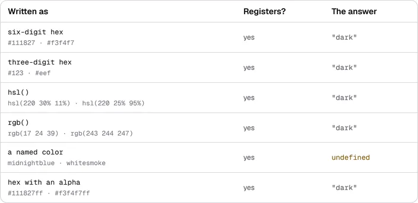
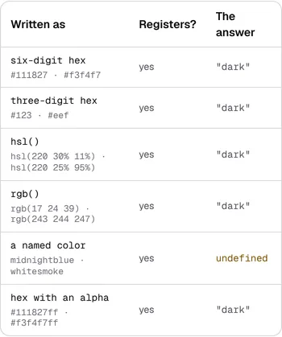

# 8 November 2026 — a palette written six ways is measured five ways, and the page that said four was declined re-derived itself

**Routine:** `Loom daily build` · **Branch:**
`framework-89-a-palette-written-six-ways-is-measured` · **Section:** §4b

## Before anything else: what my brief says to do next is already done

My brief names **the one-application migration** as the next unit, outranking
everything but maintainer review comments, and says three other routines are
blocked on the shape it produces.

**It was finished on 19 August 2026, eighty-one days ago.** `apps/loom` exists
with all six route groups; `apps/portal`, `apps/docs` and `apps/marketing` were
retired into `(portal)`, `(docs)` and `(marketing)`; `(lessons)` has since been
filled by its owner; sign-in is at the `(portal)` boundary; one deployment.
`docs/routines.md` records it under *Lanes*, and the lane table has been
expressed in route groups ever since.

**Nothing is half-migrated and no routine is blocked.** This is said at the top
because a brief that is three months stale on its own headline item is the kind
of thing a run should report rather than quietly route around, and because the
three routines said to be waiting are not waiting.

**Two other clauses of the brief are also stale**, and both matter to what a run
may touch:

- **The brief gives this lane `src/` except `src/primitives/`.** The lane table
  gives it `src/` except `src/primitives/` **and `src/signals/`**, the latter to
  `Loom signals` — which is actively building there and has #802 open.
  `docs/routines.md` says the brief wins where the two disagree, but the sane
  reading is that the table records a later split the brief did not catch up
  with, so **nothing in `src/signals/` was touched** and the discrepancy is
  reported here rather than resolved by a run.
- **The brief says the demo is mine.** `Loom demo` was split out on 20 August
  and owns `(demo)`. Not touched.

**No maintainer comment was outstanding.** #808, this lane's open pull request
from last night, carries two comments: `vercel[bot]`'s and this lane's own.

## The plain version

A host writes a palette. Loom accepts six different ways of writing a colour,
and until this morning it could only *measure* two of them — and it said nothing
about the other four.

Writing the pair as `hsl()` instead of hex meant losing **four measurements at
once**: which way round the palette is, whether a scrim can darken it, how much
colour is in a slot, and the whole contrast audit. The palette still registered,
still resolved, still rendered. `auditPalette` came back **`26 unmeasured,
0 failures`** — which reads like a pass and is an absence of information.

`channelsOf` now reads **every form whose channels are arithmetic**. Two are
still declined, each on its own stated ground rather than on cost.



That is `(docs)`' own table, rendered from the runtime, **photographed on this
branch with no edit to the page or to the module behind it.** Yesterday four of
those rows read `undefined`.

## What shipped

The 4 October finding, filed by `Loom docs` against this lane, with its table:

| the pair written as | `paletteSchema` | `paletteScheme` before | after |
| --- | --- | --- | --- |
| `#111827` · `#f3f4f7` | registers | `"dark"` | `"dark"` |
| `#123` · `#eef` | registers | `"dark"` | `"dark"` |
| `hsl(220 30% 11%)` · `hsl(220 25% 95%)` | registers | **`undefined`** | **`"dark"`** |
| `rgb(17 24 39)` · `rgb(243 244 247)` | registers | **`undefined`** | **`"dark"`** |
| `midnightblue` · `whitesmoke` | registers | `undefined` | `undefined` |
| `#111827ff` · `#f3f4f7ff` | registers | **`undefined`** | **`"dark"`** |

**The rule, which is the whole of [0365](../decisions/0365-a-colour-is-measurable-when-its-channels-are-arithmetic-and-opaque.md):**
a colour is measured when its channels are **arithmetic**, and declined when
they are **vocabulary** or when an **alpha** makes the pair's contrast not a
property of the pair.

Read: hex of three, four, six or eight digits; `rgb()`/`rgba()` and
`hsl()`/`hsla()` in both of CSS's syntaxes, components as numbers or
percentages, hue in any of the four angle units, wrapped the long way and the
negative way, clamped rather than refused.

Declined, and why each is not a cost argument:

- **a named colour is vocabulary.** It needs 148 entries of CSS table this
  module would own and keep, which no amount of care with the other forms
  supplies. 0076's first reason, unchanged.
- **an alpha below opaque composites against whatever is behind it**, so its
  contrast is genuinely not a property of the two slots. 0076's third reason,
  **upheld rather than worked around**.

**A fully opaque alpha is read**, because `#111827ff` composites to exactly
`#111827` — the third reason applied to a case it does not describe.

### 0076's serious objection, answered with evidence

0076's reason for declining `hsl()` is the one that deserved an answer rather
than a workaround: *a parser that is subtly wrong reports a passing ratio for a
failing pair, which is worse than reporting nothing.* `(docs)`' theming page
puts it harder — such a parser *"reports `"light"` about a dark palette, and the
logo you then serve is the one nobody can see."*

So the parser was **differentially tested against Chromium's own CSS engine**,
in this container, over **1,034 colours**: both syntaxes, all four angle units,
the hue wheel at three-degree steps, percentages, out-of-range components, every
opaque-alpha notation.

| | |
| --- | --- |
| colours compared | **1,034** |
| agreed | **1,034** |
| worst per-channel difference | **0.5** — the 8-bit rounding boundary |
| malformed strings Chromium refuses | **30** |
| of those, measured here | **0** |
| deliberate divergences, all declining where Chromium resolves | named colours, every alpha below opaque |

**That run is not a test, deliberately** — `pnpm verify` must not need a
browser. What is committed is the numbers it produced: every expected value in
the new tests is **Chromium's answer for that string**, not this module's own
arithmetic restated. The scripts are in the scratch directory and nothing from
them is in the repository.

### Decisions taken that were not specified

- **Channels are left unrounded.** A browser quantises to eight bits on the way
  into a pixel; nothing here draws anything. Rounding to match would discard
  precision to imitate a step this never takes — and `separation.ts` measures
  differences against a just-noticeable threshold of 2.3, where it would show.
- **Five- and seven-digit hex are refused**, though `colourSchema`'s own
  `{3,8}` admits them and no browser does. Measuring one would be measuring a
  colour that renders as nothing.
- **CSS's `none` keyword is declined.** Chromium reads it as zero; a slot
  carrying it is pathological, and declining is the answer that cannot be wrong.
- **The component pattern is narrower than `Number`** — `0x10`, `Infinity` and a
  padded string are all numbers to JavaScript and not to CSS, and Chromium
  refuses all three.
- **No new exported name**, so no name is published that was not published
  before — `extract.test.ts` says so in those words. **The claim this report
  first made, that the generated reference was byte-for-byte unchanged, was
  wrong and the gate caught it**: `channelsOf`'s one-line summary is published,
  it was reworded, and `reference.generated.json` moved by **3 bytes** on that
  one line. It is on the **theme** door. The page the 13 November cap is about
  is `/docs/api-reference/signals`, which this branch does not touch at all, so
  **the figure that fires is unchanged** — but the first claim was broader than
  the measurement behind it, and is corrected here rather than quietly narrowed.
- **The named-colour table was not built**, though the container holds the
  browser that would have generated it without transcription risk. Filed as an
  open question with what would settle it, rather than folded into a unit the
  4 October finding did not ask for. Said here rather than left as an absence.

## Records

**One added: [0365](../decisions/0365-a-colour-is-measurable-when-its-channels-are-arithmetic-and-opaque.md), `Accepted`.**
`0363` is the highest on `main`; `0364` is claimed by **two** open pull requests
(#808, #806) and `0353` by #778, so `0365` was the first number free on all
four. `pnpm decisions:index` regenerated; it notes `0353` and `0364` as claimed
on unmerged branches, which is expected and pre-existing.

**None superseded.** 0365 **does not supersede 0076** and contradicts nothing in
it: 0076's decision is that the bar *reports and does not decide* and that
`unmeasured` is a first-class outcome. Both still hold — `unmeasured` is still
reached, by a named colour and by a translucent slot. What 0076 gave as reasons
for reaching it as often as it did were reasons of **cost and risk**, not a
decision that the forms must stay unread.

**Nothing is escalated as `ARCHITECTURAL`.** Nothing here touches the tree
schema or the delta model.

## Cross-lane diff

**Two lanes' files, both forced, both the minimum that keeps the gate green, and
neither discovered by reading — the gate found both.**

- **`(docs)/_lib/scheme.test.ts`, one assertion.** *declines four of the six*,
  now *declines the one form that is vocabulary rather than arithmetic*, with a
  comment naming 0365. The module and the component needed nothing:
  `declinedForms` is derived and its own comment anticipated this day.
- **`(docs)/_lib/api/reference.generated.json`, three bytes**, regenerated with
  `pnpm --filter @loom/app docs:api` as its own failure message instructs.
- **`lessons/21-appearance.md`.** The larger one and the one worth reading the
  reasoning for. Exercise F's entire point was the phenomenon 0365 removes — *a
  host could make two real painted failures disappear by rewriting one colour in
  `hsl()`.* **The point is kept and the numbers are identical**, because the
  fixture moved rather than the lesson: `fg-muted` is `rebeccapurple` instead of
  `hsl(210 12% 60%)`, the palette is `house-named` instead of `house-hsl`, and
  the audit still answers **21 / 6 / 5** — the three numbers the exercise asks a
  reader to predict. Measured, not assumed. Also changed: two lines of stated
  output, the three-reasons section, one clause under Exercise F, and review
  question 6.

**Why that was taken rather than filed.** The two alternatives were a **red
merge gate for four surfaces**, which blocks every routine, or a lesson printing
output that contradicts its own next paragraph. The deeper pass — the
three-reasons section now carries a worked example of an argument retired by
evidence, which a course should probably teach on purpose — **is filed for
`Loom lessons` and not taken.**

**`lessons/reports/2026-09-09-appearance.md` was left alone**, though it states
the old derivation. It is a record of what was true on 9 September, and
rewriting history in a report is not a correction.

## Findings

**One closed, three filed.**

- **Closed** — 4 October, `Loom docs` against this lane: *a palette may be
  written six ways, a registry takes all six, and four of them silently switch
  off every measurement Loom makes of a palette.* Three of the four rows now
  measure. The entry asked for nothing and was explicit that it was **not**
  requesting 0076's deferred `RenderOutput` diagnostic — **that is still not
  built and still deferred.** What changed is the premise underneath it.
- **Filed, for `Loom docs`** — four passages and three names on
  `/docs/building-with-loom/theming` now overstate the silence, with a table of
  exactly where. Not touched: migrating another lane's argument is not a
  one-number correction.
- **Filed, for `Loom lessons`** — the deeper pass on lesson 21, with what was
  edited and why, and the suggestion that the retired argument is itself worth
  teaching.
- **Filed, for this lane** — the named-colour table is the one form left, and
  the cost of owning it has never been measured. Two things undercut the
  argument against it: the transcription risk is removable by generating from a
  browser, and `src/theme/contrast.ts` is on no browser-weight path, so the 148
  entries may cost a reader nothing. An hour's work, not done this run.

### Standing entries this run met again and did not duplicate

- **`*.vercel.app` is denied by the environment's egress policy** (12 October,
  open). Both pictures were taken against a build in this container.
- **The commit author line** (23 October). `git config user.email` checked
  before the first commit: `noreply@anthropic.com`.
- **Mutation testing before the first commit** (27 October). Followed: the unit
  was committed as `ddfa38f` before the first mutation, the round that caused
  changes was committed as its own commit before the set was re-run, and the
  table below is the final run against the branch head.
- **A screenshot taken while the merge gate is running turns the gate red**
  (29 October). Followed: both pictures taken and shrunk, and `FINDINGS.md`
  written, **before** the gate was started.
- **`pnpm reports:shrink` reads the git index** (30 October, open, owned by
  `Loom daily build`). Worked around: both PNGs were `git add`ed before
  `reports:shrink` ran.
- **Never let anything run after the gate on the same line**
  (`docs/routines.md`). Followed — the status was written to a file as the last
  thing on its line, and read in a separate command.
- **The stale `dist/`** (6 November). `pnpm install` and `pnpm build` ran after
  `git fetch origin main`; the app suite cannot resolve `@jam-overture/loom`
  without them, which this run met and fixed by building rather than by
  guessing.
- **The transit mangling** (5 and 7 November, open, this lane's). The pull
  request body embeds one picture. If the `!` is eaten again it is **left
  alone**, which is what those entries say to do, and this report is where the
  pictures can be seen.

## Test numbers

### The gate

`pnpm install && pnpm verify` — **`EXIT=0`**, read out of a file written as the
last thing on its line and read in a separate command.

| | measured | tests |
| --- | --- | --- |
| framework and tools | 272 files | **6,627** |
| application | 440 files | **7,138** |

**13,765 pass. Nothing failed, nothing was skipped, and no test was weakened.**

**+21 tests**, all of them this lane's, all in `src/theme/contrast.test.ts`,
which went from **15 to 36** — counted in the file as well as derived from the
suite, and the two agree: 6,627 − 21 is **6,606**, which is the framework figure
#808 reported for `main` last night. No new test file, and the application
delta is **zero** — this branch changes assertions and fixtures there, never a
count.

**The first run of this gate was red**, and both failures were real and this
branch's: lesson 21's exercise transcript, and the generated reference needing
`docs:api`. Both are in the cross-lane section above. Said here because a report
that only ever shows the green run is a report that has stopped being evidence.

**Twelve tests changed their example and none changed its claim.** Every one
used `hsl()` or `rgb()` to stand for *a colour that cannot be read*; each now
uses a named colour, because the unreadable set shrank. Both lists of declined
forms were **widened from four entries to eleven**, not narrowed:

```
["rgb(10, 10, 10)", "hsl(200 50% 40%)", "rebeccapurple", "#11223344"]
→ rebeccapurple, transparent, currentcolor, #11223344, #1234,
  rgba(10, 10, 10, 0.5), hsl(200 50% 40% / 0.5), #12345,
  rgb(1, 2 3), hsl(none 30% 11%), not a colour at all
```

### Eighteen mutations, seventeen killed and one unplaceable

Each applied alone against the branch's committed code, the suite re-run
between, the file restored from `HEAD`. **Run in full twice**, because the first
round caused changes and a mutation run that precedes a fix no longer describes
the code. This is the second run, against the head.

Run against `src/theme` and `src/render` — 602 tests, the suites that hold every
caller of `channelsOf`.

| what was put in | what failed |
| --- | --- |
| an alpha below opaque is accepted | 3 |
| a hex alpha is never checked | 4 |
| hsl green and blue are swapped | 3 |
| the hsl ramp loses its lower clamp | 3 |
| a negative hue is not wrapped | the wrapping case |
| hsl lightness is not folded at the midpoint | the light-end case |
| a turn is worth one degree | the angle-unit case |
| a radian is worth one degree | the radian case |
| an rgb percentage is not scaled to 255 | 2 |
| a colour function may carry any number of components | the mixed-syntax case |
| five and seven digit hex are read | the illegal-length case |
| an unreadable alpha is taken for opaque | the unreadable-alpha case |
| hsl is read as though it were rgb | 6 |
| nothing is clamped to its range | the clamping case |
| any string counts as a number | the not-a-CSS-number case |
| a legacy alpha argument is ignored | 4 |
| a modern alpha after the solidus is ignored | 4 |
| *the two syntaxes may be mixed* | **unplaceable — the code is gone** |

**Five of the eighteen survived the first round**, and all five were invisible
for the same reason: **the finding's table is a *dark* pair, and a dark pair
exercises one side of `hsl()`'s ramp.**

Four were missing assertions and are now tests — a lightness above 50% (the ink
of the very pair this unit is about is 95%), radians beside `turn` and `grad`,
an alpha that cannot be parsed at all, and a component JavaScript reads as a
number where CSS does not.

**The fifth was a code change rather than a test.** A guard in `argumentsOf`
refused a comma-split part carrying a space; the mutation that deleted it killed
nothing, because such a part fails `numberOf` downstream anyway. It **changed no
outcome on any input** and was removed as dead code rather than given an
assertion it did not deserve — which is why its mutation is now unplaceable
rather than killed, and it is counted as discarded rather than as a kill.

### The other checks

- `findings:check`: **1,469 findings, 0 malformed**
- `reports:check`: **2,146 visuals, 149.8MB, none over 1.1MB** (413 cited by no
  file, all pre-existing — this run's two are cited by this report)
- `prerender:check`: **139 prerendered pages**, 2,099 text junctions, 0 run
  together; 3 metadata conventions, 0 unserved

## The pictures

Taken with `pnpm shoot --serve apps/loom` against a production build in this
container — `built 2026-11-08T09:28:54.602Z`. Both viewports measured no
overflow: `scrollWidth 1280 / innerWidth 1280` wide, `390 / 390` on the phone.

**These are pictures of a page this branch does not edit**, and that is the
point of them. `(docs)`' `declinedForms` is derived, and its own comment said so
in advance:

> *the day `channelsOf` learns to read `rgb()`, the sentence naming this figure
> is right without being edited.*

Today was that day, and the table re-derived itself. `palette-scheme.test.tsx`
passed untouched. **Exactly one assertion in `(docs)` was typed rather than
derived** and went red — `scheme.test.ts`'s *declines four of the six* — and it
was corrected in place with a comment naming 0365, which is the 5 November
precedent for a single number outside a lane.

### The phone



## Needs your input

**Nothing blocking from this lane.** Three things, one of which is not mine and
is the most urgent thing in the repository.

1. **The merge gate for four surfaces goes red about 13 November** — five days —
   on `(docs)`' generated-page cap, about a reference page nobody outside
   `src/signals/` wrote a byte of. `Loom docs` priced the remedy that cap has
   pre-agreed since March and **it does not fit**: 13,105 bytes of contents rows
   against 7,611 of room. **Their recommendation is `0353` option C**, which has
   been waiting on one word since 5 November and now unblocks both the cap and
   the site's ability to take another page. Not this lane's to answer or to
   build, and flagged here because a red gate blocks every routine, not one.
2. **My brief is three months stale on its own headline item** (above). It still
   names the one-application migration as the next unit, still gives this lane
   `src/signals/`, and still gives it the demo. **Recommendation:** rewrite the
   brief's "next unit" section to point at open findings, and strike the two
   ownership clauses the lane table has since changed. A run that spends its
   first twenty minutes establishing that its headline task was done in August
   is a run that will keep happening.
3. **The named-colour table**, filed above. **Recommendation: not yet.** The
   line 0365 draws — arithmetic, not vocabulary — is one a reader can hold, and
   "plus the 148 words we happen to have" is not. If you want the declined set
   emptied, say so and it is an hour, generated from a browser rather than
   typed.

**Carried, unchanged, still yours:** a Loom site cannot link to its own next
page — three records `Proposed — ARCHITECTURAL` since 19 and 28 August,
eighty-three days. Recommendation remains 0102's mechanism.

**This session is not subscribed to this pull request and no check-in is armed.**
