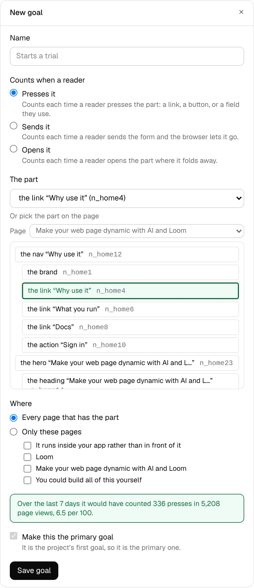

# *New goal* picks the part on an outline of the page

**Lane:** `Loom portal` · **Date:** 8 November 2026 ·
**Branch:** `claude/project-thread-bmu92r` ·
**Records:** none new ·
**Plan:** [`docs/portal.md`](../docs/portal.md) row 8b ·
**Target:** [`docs/portal-wireframes.md`](../docs/portal-wireframes.md) *3 ·
Goals*, the *New goal* drawer

Claimed by a portal run at 2026-11-08 11:19 UTC (#817).

## Why this, and why now

No portal pull request or `portal-*` branch had been pushed in the last three
hours, and the maintainer had left no comment on one. 8a is done; 8b's last
piece owed was *or pick the part on the page (a small outline of the page, the
picked part outlined green)*. Its input, the pages the site published, is on
`main`, and the band from #814 already follows whatever part is picked, so the
outline only had to set the same field.

## What shipped

- **An outline of one page under the list of parts.** *Or pick the part on the
  page* draws a box per part, in the order the page reads, each indented as
  deep as it sits, by its name with its id beside it (the name a person reads
  first, the id never removed).
- **Pressing a box picks that part.** It is outlined green, the list above
  shows it, and the 7-day band says what the goal would have counted, exactly
  as choosing it from the list does.
- **It opens on the right page.** Choosing a part from the list opens the
  outline on that part's page; *Page* draws any other published page. It keeps
  no field of its own, so what is sent and checked is unchanged.

## How it is built

- `_lib/goals/goal-view.ts`: `PartChoice` carries `depth`. `partsOf` walks the
  tree once, recursively, counting only parts (a slot is not a part, so what
  it holds sits at the slot's depth); the list it returns is in the same order
  as before. New `outlinePageOf` (the page the owner chose, else the first with
  the picked part, else the first) and `pageLabelOf` (was a private copy in the
  form; now shared by the form and the outline).
- `goals/_components/page-outline.tsx`: the outline, a client component with
  one piece of state (the page chosen).
- `goals/_components/goal-form.tsx`: the part is held by the form's fields
  component because two controls pick it; a pick on the outline refreshes the
  band from the form's other fields. The outline is keyed by the part last
  chosen from the list, so a choice there opens it on that part's page.

## Decisions taken, and why

- **A list of nested boxes, not a scaled drawing of the page.** The wireframe
  asks for *a small outline of the page*, and the portal never renders the
  customer's page itself (it would mean running their primitives inside the
  portal). The parts in reading order, nested, are what the site published and
  what a goal is filed against, so the outline cannot show a part a goal could
  not count.
- **Depth is drawn to six levels at most**, so a deeply nested page stays
  readable at a drawer's width; deeper parts sit at the sixth level, in order.
- **No record**: this applies 0350 and decides nothing new.

## Tests

- `_lib/goals/goal-view.test.ts`: 2 new (`partsOf` in reading order with depth,
  through a slot; `outlinePageOf`'s three cases and no pages).
- `goals/_components/goal-form.test.tsx`: 2 new (pressing a part picks it,
  outlined, and the list and band follow; the outline opens on the page of the
  part chosen from the list, and *Page* draws another).
- `pnpm verify`, exit 0: the framework's 6,604 tests passed (2 skipped); the
  app's 441 test files, 7,160 tests passed.

## Screen

Local Postgres, the deployment's own pages published, page views and presses on
the home page's link *Why use it* counted by the hour over the last 13 days.
The link was pressed on the outline (125 parts on that page, scrolling inside
the box); the list above shows it and the band counts it.

## Still missing from *3 · Goals*

- *Stays on* waits on time on a part being counted per reader (0349, 0350).

Nothing else on 8b. The next pieces in the order are on *5 · Pages · History*
(8c): *Propose reverting* and *Compare*.
