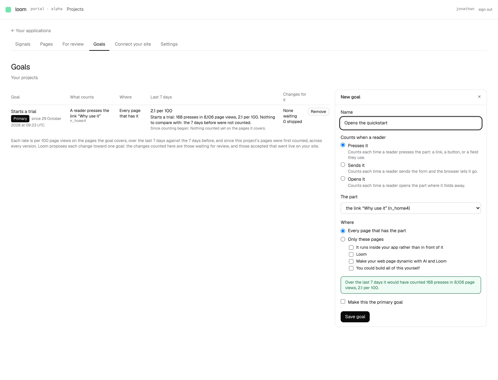

# The New goal drawer previews what a goal would have counted over the last 7 days

**Lane:** `Loom portal` · **Date:** 8 November 2026 ·
**Branch:** `claude/project-thread-l85zhm` ·
**Records:** none new ·
**Plan:** [`docs/portal.md`](../docs/portal.md) row 8b ·
**Target:** [`docs/portal-wireframes.md`](../docs/portal-wireframes.md) *3 ·
Goals*, the *New goal* drawer's *green band previewing what it would have
counted over the last 7 days*

Claimed by a portal run at 2026-11-08 09:20 UTC (#814).

## Why this, and why now

No portal pull request or `portal-*` branch had been pushed in the last three
hours, and the maintainer had left no comment on one. 8a and unit 8 are done
in the portal; 8b's row named two pieces still owed on *Goals*, the drawer's
7-day preview band first. Its input (the hourly counters, 0356 and 0362) is on
`main` and already read by the list's *Last 7 days*, so it was the first owed
piece that was free.

## What shipped

- **A band under *Where* in the *New goal* drawer** says what the goal being
  made would have counted over the last 7 days: *Over the last 7 days it
  would have counted 9 presses in 300 page views, 3 per 100.* It is green, as
  the wireframe draws it, once there is a figure.
- **It follows the form.** Choosing a kind, a part, or *every page / only
  these pages* changes it at once, in the browser, with no round trip.
- **It measures by the saved goal's rule.** The same covered pages
  (`pagesCoveredBy`, 0350), the same kind counters (`actedCountOf`), the same
  start (the later of page views and what readers did by hour), over the same
  168 hours the list's *Last 7 days* reads. The band and the goal's figure on
  the list agree the moment it is saved.
- **It never draws a nought it does not have.** Before a part is chosen it
  asks for one; where the pages it would cover had no page views it says so;
  where counting by the hour began inside the week it says from when; where
  nothing has been counted by the hour, or the counters did not answer, it
  says that, muted, and the form works as before.

## How it is built

- `(portal)/_lib/goals/goal-preview.ts` (new, pure, and free of the counters'
  module so the browser bundle stays small): `RangeTotals`, `previewOf`
  (what a target would have counted on the pages it covers) and
  `previewWordsOf` (the band's sentence and tone).
- `(portal)/_lib/goal-range.ts`: `rangeTotalsOf(counters, range)` folds the
  hourly rows the screen already reads into one total per page and one per
  part (each kind apart), so the drawer is handed totals rather than a row per
  hour.
- `(portal)/_lib/goals/goal.ts`: `readGoalTarget` reads the kind, part and
  pages without the name, and `readGoalForm` is now the name plus that target
  (same faults, same order). The preview reads the target the save would.
- `pagesCoveredBy` takes just the part and the pages, so a target not yet
  saved can be measured by it.
- `goals/page.tsx` passes the totals to the drawer; `goal-form.tsx` keeps what
  is typed on each change of the form and draws the band.
- No table, no column, no environment variable: **no `pnpm db:push`.**

## Tests

- `goal-preview.test.ts` (new, 8 cases): every page that has the part, only
  the pages chosen, only the kind asked for; the sentence, a week clipped
  where counting began, no part yet, no page views, uncounted and unreadable.
- `goal-range.test.ts`: three cases for `rangeTotalsOf` (folding by page and
  part with each kind apart and the period before left out; starting where
  counting began; uncounted).
- `goal.test.ts`: two cases for `readGoalTarget`; the five `readGoalForm`
  cases pass unchanged.
- `goal-form.test.tsx`: the band asks for a part, then follows a part and a
  kind as they change.
- `pnpm verify`, exit 0: the app's 441 test files, 7,153 tests passed; the
  framework's 6,604 passed, 2 skipped.

## Screen

Local Postgres, the deployment's own pages published, page views and presses
on the home page's link counted by the hour over the last 13 days, and one
goal already on it. The band, with *every page that has the part*, reads 168
presses in 8,106 page views, 2.1 per 100: the same figure as the saved goal on
the same part in the list beside it, which is the agreement the band promises.
The green is the portal's `applied` colour (the *affirm* tokens are black).

## Still missing from *3 · Goals*

- Picking the part on a small outline of the page (the band already follows
  whatever part is picked, so the outline only has to set the same field).
- *Stays on* waits for kept events.
