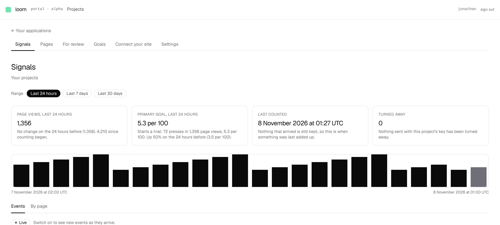

# *Signals* says the primary goal's rate for the range, beside page views

**Lane:** `Loom portal` · **Date:** 8 November 2026 ·
**Branch:** `claude/project-thread-j1qvwr` ·
**Records:** none new ·
**Plan:** [`docs/portal.md`](../docs/portal.md) row 8a ·
**Target:** [`docs/portal-wireframes.md`](../docs/portal-wireframes.md) *1 ·
Signals*, the second of its four figures

## Why this, and why now

No portal pull request or `portal-*` branch was open, and the maintainer had
left no comment on one. The order's first row with something still owed is 8a.
Its last pieces waited on the `Loom signals` finding of 6 November (what readers
did, counted by hour), and that finding was closed by
[0362](../decisions/0362-what-readers-did-is-counted-under-the-hour-they-did-it-in-as-a-seventh-counter-the-fold-writes-for-the-three-delegated-kinds.md)
(#794). So 8a's input is on `main`, and it comes ahead of the rest of 8c.

## What shipped

- **A fourth figure on *Signals***, drawn only once the project has a primary
  goal (the wireframe's *shown only once one exists*): *Primary goal, last 24
  hours* (or 7 or 30 days, following the range picker), its rate per 100 page
  views (*3 per 100*), and beneath it the goal's name, the count and page views
  it rests on, and the change on the period of the same length before (*Up 50%
  on the 24 hours before (2 per 100)*).
- **The pages it covers and no other**, as *Goals* and *By page* measure a goal
  (0350): the pages the goal names, or every page that has its part, as
  published or as counted. `pagesCoveredBy` in `goals/goal-view.ts` is now
  exported and takes the parts and the counted rows, so the since-counting-began
  figure and the range figure share one rule.
- **Counting begins with the later of the two counters**, the rule a verdict
  follows (`measuring.ts`): page views by hour (0356) and what readers did by
  hour (0362). Where that is inside the range, the figure starts there and says
  *Counted by the hour from …*; the period before is compared with only where it
  was counted from its first hour, otherwise *Nothing to compare with*.
- **Each empty case says what it is**: no page views on its pages in the range
  (*No page views*, no rate), no page views in the period before, nobody did it
  in the period before (*None in the 24 hours before, in 100 page views*), and
  nothing counted by the hour at all (*Not counted yet*). Goals or counters that
  do not answer say *Not available* in the figure and cost nothing else on the
  screen.
- One read of each counter over the range and the period before, after the
  goals: page views by page project-wide, what readers did to the goal's part
  on every page, and when the project first counted anything readers did.

## Decisions taken, and why

- **Per 100 page views, not *the share of readers***. The wireframe's words are
  *the share of readers who reached the primary goal*; Loom keeps no reader to
  count a share of (0262), and every other place the portal measures a goal
  says per 100 page views. Saying it the same way here keeps one name for one
  figure.
- **The change is on the rate, not the count**, because the count rises with
  page views alone; *Up 50%* means readers did it half as often again per page
  view.
- **No record**: this applies 0350, 0356 and 0362 and decides nothing new.

## Tests

- `_lib/goal-range.test.ts`: 14 tests (the span read; the goal's kind on its
  part over page views in the range and the period before; pages with the part
  only; chosen pages and the goal's own part only; counting beginning inside the
  range; the later of the two counters; no comparison with a period not counted
  throughout; uncounted; each sentence, including every empty case).
- `signals-frame.test.tsx`: 2 new (the figure beside page views; no figure
  without a goal, and *could not be read*).
- `pnpm verify` exits 0: 6,604 framework tests passed (2 skipped) and 7,106 app tests passed.

## What is still missing from *1 · Signals*

- On *By page*, the drawer's bars per kind **for the range**, and each goal's
  trend there and on *Goals*. Both are now readable from the same counters
  (0362 holds activations, opens, closes and completions by hour; *viewed* and
  *dwelled* are deliberately not hourly, so those two bars stay since counting
  began). That is the next portal piece in the order.

