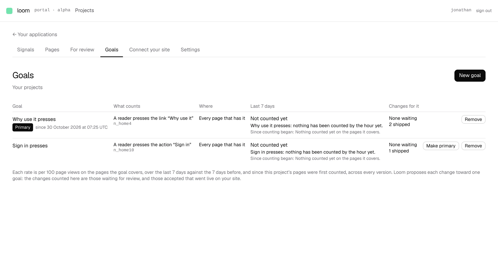

# Each goal says how many of its changes went live

**Lane:** `Loom portal` · **Date:** 8 November 2026 ·
**Branch:** `claude/project-thread-vm8ml6` ·
**Records:** none new ·
**Plan:** [`docs/portal.md`](../docs/portal.md) row 8b ·
**Target:** [`docs/portal-wireframes.md`](../docs/portal-wireframes.md) *3 ·
Goals*, the list's *changes for it (2 waiting · 3 shipped)*

Claimed by a portal run at 2026-11-08 07:18 UTC.

## Why this, and why now

No portal pull request or `portal-*` branch had been pushed in the last three
hours, and the maintainer had left no comment on one. 8a is done; 8b's row
said its *Shipped* counts waited for unit 8, because nothing accepted reached
a site. Unit 8 is now done in the portal (*Accept* goes live, 0358), so the
input is on `main` and this was the first piece in the order that was owed and
free.

## What shipped

- ***Changes for it* says both counts**, one under the other: the changes
  waiting for the goal (linked to *For review* filtered to it, as before) and
  *N shipped*, the changes accepted for the goal that went live.
- **Went live** is the rule the *Accepted* timeline already uses
  (`liveAtOf`): at once on this deployment's own site (0259), and otherwise on
  the site's first pull of a new answer after *Accept*, provided the change
  was still on the page then. A change that went live stays counted if it is
  later undone or no longer fits the site's newer version: it shipped. One
  that came off before any pull never went live and is not counted.
- **No short count.** Where the site's pulls or the goals the changes served
  cannot be read, the cell says *Shipped cannot be read just now* rather than
  a figure that would be too low; the waiting count stands on its own, and
  says so the same way when it cannot be read.
- **A site that does not pull yet is told so** under the list: no accepted
  change has reached its readers, with a link to *Connect your site*.

## How it is built

- `(portal)/_lib/going-live.ts`: new pure `shippedByGoalOf(changes, reach,
  origins)`, counting by the goal each change's proposal recorded (`servedOf`)
  and `liveAtOf`; `undefined` where `reach` or `origins` is unreadable.
- `goals/page.tsx` reads `readAccepted` (the one read both *Accepted* screens
  use) alongside its other reads, and adds `shipped` to its readings.
- No table, no column, no environment variable: **no `pnpm db:push`.**

## Tests

- `going-live.test.ts`: four new cases for `shippedByGoalOf` (counts per goal
  on a pulling site; everything at once on the own site and nothing where the
  site never pulled; an undone change counted only if a pull took it first;
  `undefined` for unreadable pulls or goals).
- `pnpm verify` on the branch: 440 test files, 7,138 tests passed, exit 0.

## Screen

Local Postgres with two goals and four changes accepted on the home page
(two for the primary goal, one for the other, one with no goal recorded), on
this deployment's own site, so each went live at *Accept*.

## Still missing from *3 · Goals*

- The *New goal* drawer's green band previewing what the goal would have
  counted over the last 7 days.
- Picking the part on a small outline of the page.
- *Stays on* waits for kept events.
