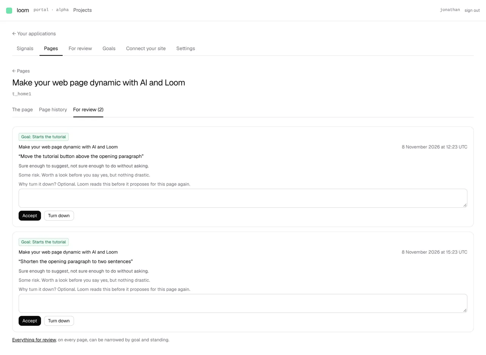

# A page's own *For review (N)* tab

**Lane:** `Loom portal` · **Date:** 8 November 2026 ·
**Branch:** `claude/project-thread-4b7qu2` ·
**Records:** none new ·
**Plan:** [`docs/portal.md`](../docs/portal.md) row 8c ·
**Target:** [`docs/portal-wireframes.md`](../docs/portal-wireframes.md) *5 ·
Pages · History*, the tabs *The page · History · For review (N)*

Claimed by a portal run at 2026-11-08 17:25 UTC (#822).

## Why this, and why now

No portal pull request or `portal-*` branch had been pushed in the last three
hours, and the maintainer had left no comment on a portal pull request (the
one open pull request, #778, is the docs lane's). 8a, 8b and 8c are done in the
portal; the one piece of the wireframe's section 5 the last run left owed was
the page's third tab. Its input, the changes waiting and the page copies they
wait on, has been on `main` since unit 7.

## What shipped

- **A page's third tab**, `/portal/<project>/pages/<page>/review`: the changes
  waiting for a person on this page alone, whichever copy of the page they were
  made to (a change made to an older copy belongs to the page all the same,
  `pageOfCopy`), oldest first, with the same cards, answers, standing and goal
  chip as the project's *For review*. Nothing waiting says so and links to the
  project's list; under the cards the project's list is linked as the place to
  narrow by goal and standing. No filters of their own: one page holds few
  changes.
- **The count on every tab of a page.** *The page*, *Page history* and *For
  review* all say *For review (N)*. Where the changes waiting or the copies
  cannot be read the tab says *For review* with no count, so it never says
  nought for a list it could not read.
- **One reading for both lists**, `_lib/review-reading.ts` (`readReview`), lifted
  out of the project's *For review* screen, so a change is said the same way in
  both places. It fails as a whole only where the changes waiting or the
  copies do not answer, as the screen did; what the site published, which goal
  each change serves and the goals themselves each cost only what they name.
  `readWaitingOn` reads the count alone for the other two tabs.
- **One card**, `review/_components/review-card.tsx` (`ReviewCard`, and
  `ReviewGaps` for the changes and goals that could not be read), lifted out of
  the project's screen unchanged.
- **One heading for every tab of a page**, `pages/[tree]/_components/page-heading.tsx`.
  The three tabs drew it three times; *Page history* named a page with no
  heading by its id, where *The page* said *Untitled page* as `_lib/page-name.ts`
  asks. All three now say *Untitled page*, with the id beneath.

No table, no column, no environment variable, no `pnpm db:push`.

## Decisions taken

- **The tab lists, it does not filter.** The wireframe draws the tab and its
  count, not filters on it. The project's list already filters by goal and
  standing across pages, and is linked. Reversible: the filter module takes a
  list of rows and would take this one.
- **No record.** This applies 0329, 0340 and 0352 to one page and decides
  nothing they leave open.

## Tests

- `review-card.test.tsx`, 6 tests: the card leads with its goal, links its
  page and offers *Accept* and *Turn down*; no *Accept* on a change that
  conflicts; who can answer where the person looking may not; no goal chip
  where goals were not read; the gaps counted, and nothing said when
  everything was read.
- `page-tabs.test.tsx`, 3 tests (was 1): the third tab with its count and
  address; *For review (0)* is said; no count where it could not be read.
- `page-heading.test.tsx`, 2 tests.
- `pnpm verify` exits 0: the framework's 6,700 tests (2 skipped) and the
  app's 7,244 (portal suite 121 files, 2,173 tests).

## Seen working

Built and served against Postgres 16 (`next build` + `next start`), with a
primary goal and three changes held: two on the home page, one on another.
The home page's tabs say *For review (2)* on each, and the tab lists the two
with their goal, standing and answers.

## Where the wireframe stands

*5 · Pages · History* now has every piece it draws: the three tabs with the
count, the *Measured on* picker, the chart, one card per version with its
verdict, *Compare* and *Propose reverting*, and the dashed *Not live yet*
card. Still missing from the section: *Compare* on the site's own versions,
which needs each published version kept (a new table). Elsewhere, *2 · For
review* still owes the drawer for one change (before and after outlines, why
Loom proposes it, what it expects, *Turned down recently*), and the predicted
effect is new data.
