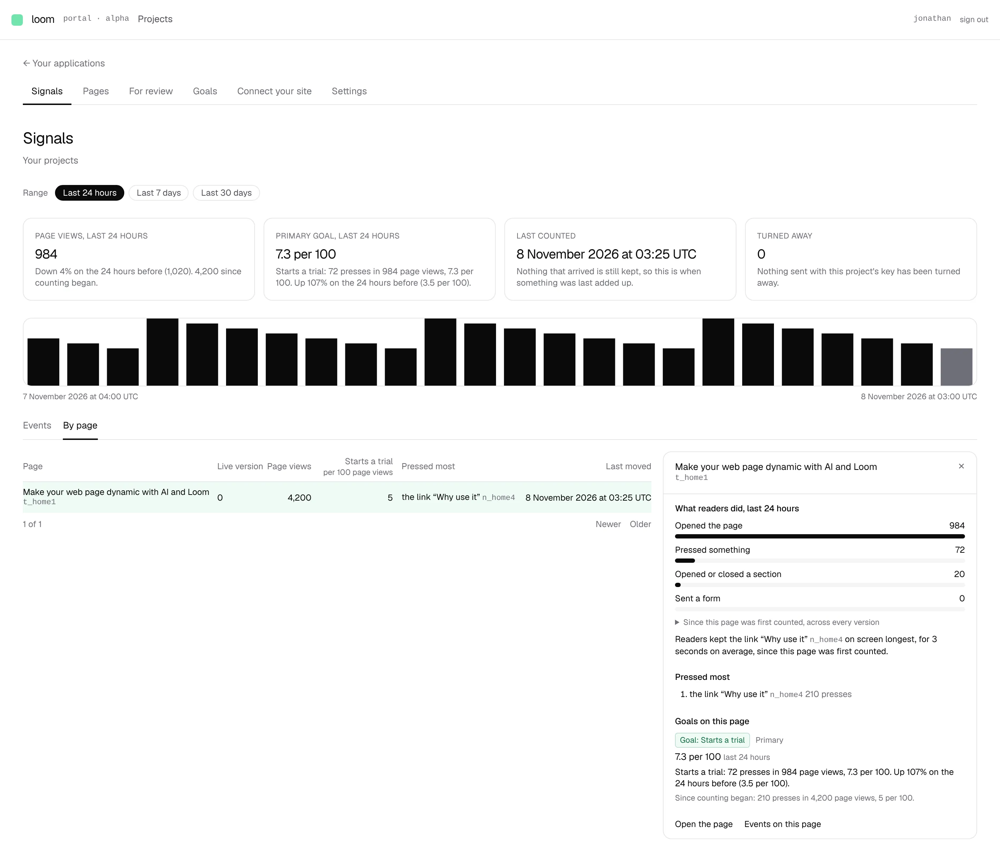

# A page's drawer on *By page* reads the range, with each goal's trend

**Lane:** `Loom portal` · **Date:** 8 November 2026 ·
**Branch:** `claude/project-thread-nz2oh0` ·
**Records:** none new ·
**Plan:** [`docs/portal.md`](../docs/portal.md) row 8a ·
**Target:** [`docs/portal-wireframes.md`](../docs/portal-wireframes.md) *1 ·
Signals*, *By page*, the drawer for one page

Claimed by a portal run at 2026-11-08 03:25 UTC.

## Why this, and why now

No portal pull request or `portal-*` branch had been pushed in the last three
hours, and the maintainer had left no comment on one. The order's first row
with something still owed is 8a, whose last piece was the *By page* drawer's
figures for the range and each goal's trend there. Its input, page views by
hour (0356) and what readers did by hour (0362), is on `main`.

## What shipped

- **What readers did, for the range.** Once a drawer is open, the page's own
  hourly counters are read over the range and the period before it, in one
  read each: its page views, what readers did to any part of it, and when the
  project first counted anything readers did. The drawer draws a bar per kind
  for the range (*Opened the page*, *Pressed something*, *Opened or closed a
  section*, *Sent a form*), each against the longest.
- **Counting begins with the later of the two counters**, the rule the primary
  goal's figure and a verdict follow. Where that is inside the range the bars
  start there and say *Counted by the hour from …, so these start there*.
- **Nothing removed.** The bars since the page was first counted are one click
  away under the range's (*Since this page was first counted, across every
  version*). Where the hours were never counted, or did not answer, those are
  the bars drawn, and the drawer says which and why. Time on a part is not
  counted by the hour, so *kept on screen longest* now says it is since the
  page was first counted.
- **Each goal's rate and trend on this page.** Under *Goals on this page*, every
  goal covering the page leads with its rate here over the range (*7.3 per
  100*, last 24 hours), the count and page views it rests on and its change on
  the period of the same length before, in the words *Signals*' primary goal
  figure uses, with *since counting began* beneath. The words say *on this
  page* rather than *on the pages it covers*, so a goal across several pages
  never claims more than the drawer counted. A goal whose hours did not answer
  says so and keeps its since-counting-began figure.
- *Events on this page* now carries the range, like every other link on the
  screen.

## How it is built

- New pure `(portal)/_lib/page-range.ts`: `pageRangeOf` turns one page's hourly
  counters into counts per kind for the range, or *uncounted* or *unreadable*.
- `goal-range.ts`: `countingBeginsOf` (the later-of rule, now shared by the goal
  figure and the page's bars) and `goalRangeWordsOf` (a goal's figure and
  sentences for a range, with a `GoalScope` of `covered` or `page`).
  `goalFigureOf` uses it, so *Signals* and the drawer cannot word one figure
  two ways.
- `by-page.ts`: `pageDrawerOf` takes the page's hourly reading; the drawer
  carries `range` (bars or why there are none) and each goal's `GoalRange`,
  measured with `goalRangeOf` on this page's counters alone.
- `signals/_lib/reading.ts`: `readPageHourly`, read only when a drawer is open
  and bounded like every portal read; a failure costs the range's figures
  alone.

## Decisions taken, and why

- **The range's bars lead and the lifetime bars sit one click away**, because
  the screen's range picker governs everything above and the wireframe asks
  for *a bar per signal kind for the range*; the lifetime figures are still
  there, per *nothing removed*.
- **No record**: this applies 0350, 0356 and 0362 and decides nothing new.

## Tests

- `_lib/page-range.test.ts`: 4 new (each kind over the range and none from the
  period before; starting where counting began; uncounted; unreadable).
- `_lib/by-page.test.ts`: 4 new (range bars apart from lifetime ones; where
  counting began, uncounted, unreadable; each goal over the range on this page
  with the period before; goals' range unread when the hours were not).
- `by-page.test.tsx`: 4 new or rewritten (range heading and bars with the
  lifetime ones one click away; *Counted by the hour from*; the fallbacks and
  their sentences; each goal's figure, trend and since counting began; *on
  this page*; links carry the range).
- `pnpm verify` exits 0: 6,604 framework tests passed (2 skipped) and 7,122 app
  tests passed.

## What is still missing from *1 · Signals*

Nothing on 8a. On *3 · Goals*, the 7-day rate and its trend per goal can now be
read from the same counters; *Stays on it* still waits on kept events. On
*5 · Pages · History*, *Propose reverting* and *Compare* are still owed (8c).

