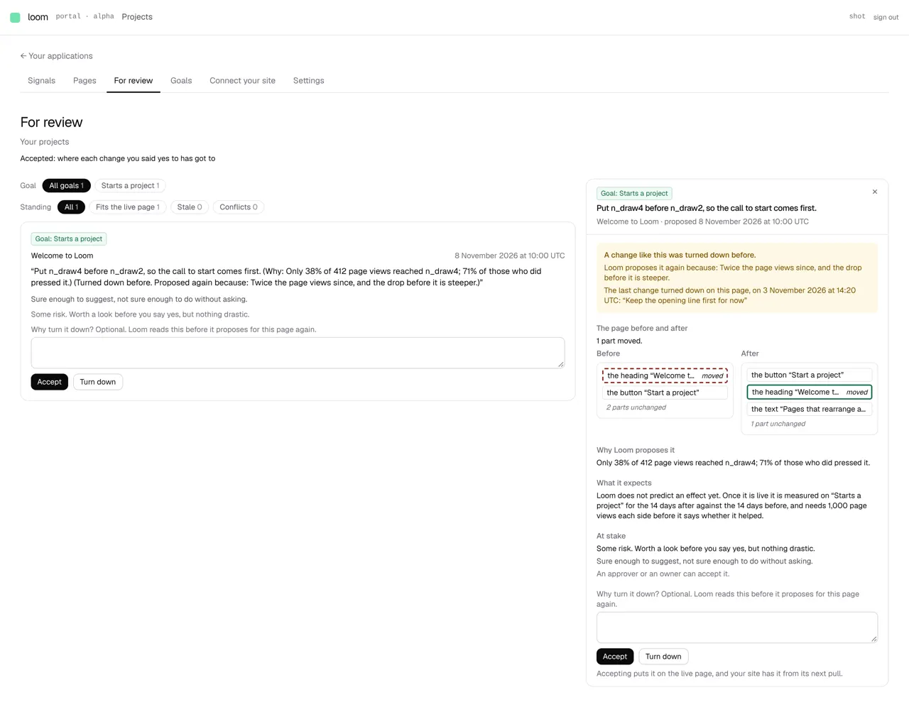

# *For review*: the drawer for one change

**Lane:** `Loom portal` · **Date:** 8 November 2026 ·
**Branch:** `claude/project-thread-ihwxgh` ·
**Records:** none new ·
**Plan:** [`docs/portal.md`](../docs/portal.md) row 8b ·
**Target:** [`docs/portal-wireframes.md`](../docs/portal-wireframes.md) *2 ·
For review*, the drawer for one change

Claimed by a portal run at 2026-11-08 19:30 UTC (#827).

## Why this, and why now

No portal-run pull request or branch had been pushed in the last three hours.
The open portal pull request, #825 (the Signals chart for sparse data), was
opened an hour earlier from its own thread and touches `signals-range.ts`,
`when.ts` and the chart, so this run stayed off those files. 8a, 8b, unit 8 and
8c are done in the portal, and the last run named section 2's drawer as the
next free piece. Its inputs (the changes waiting, the page copies, the goals
changes serve, what was turned down) have all been on `main` since 0340, 0341
and 0352.

## What shipped

- **The drawer**, `review/_components/change-drawer.tsx`, opened from the
  change itself on any card (`?change=` and its proposal id, every filter
  kept; a page's own *For review* tab links to the project's list with the
  drawer open). It sits beside the list on a wide screen and below it on a
  narrow one, as *Compare* does. In order:
  - the goal chip, the change as the heading, and the page with when it was
    proposed (and by whom, for a person's change);
  - a band where it matters: amber for a change proposed for an older version
    that still fits; amber for one turned down before and proposed again,
    saying why it is back and the last change turned down on the page with its
    date and reason (0341); red for one that no longer fits (0340);
  - **the page before and after**, as the same two outlines *Compare* draws;
  - *Why Loom proposes it*: the figure the model gave;
  - *What it expects*: that Loom predicts no effect yet, and how the change is
    measured on its goal once live (14 days a side, 1,000 page views a side);
  - *At stake*: the stake, why the Gate stopped it, and who may accept it;
  - *Accept* and *Turn down*, with a line saying what accepting does next.
  A change no longer waiting says so where the drawer would be, and links to
  *Accepted*.
- **The before and after of a waiting change**, `_lib/held-change.ts`: the
  copy the change waits on as it stands, and the change's operations applied to
  it, re-addressed as accepting and carrying do (0340, `carriedOnto`). A change
  whose parts are gone says it is not drawn, and one that conflicts is not drawn
  against a page the site no longer serves.
- **A request read back into its parts**, `requestPartsOf` beside `requestOf`
  in `_lib/proposing/brief.ts`: the change, the figure behind it, and why a
  change turned down before is back. A request `requestOf` did not write (a
  person's, or a revert) or one cut to length is all change and no figure, so
  nothing is read from half a sentence.
- **One outline pair**, `_components/outline-pair.tsx`, lifted out of
  *Compare*'s drawer unchanged, so both drawers draw a page the same way.

No table, no column, no environment variable, no `pnpm db:push`.

## Decisions taken

- **No predicted effect.** The wireframe draws *What it expects* as a predicted
  range on the goal. Nothing in Loom predicts one today, and rule 1 forbids an
  invented figure, so the section says so and says how the change will be
  measured instead. A prediction needs data and a choice of method; that is the
  maintainer's, and it is listed below.
- **The turned-down band shows the last change turned down on the page**, not
  "a similar one". Loom keeps no judgement of similarity; what it has is the
  model saying the change was turned down before (the `again` clause, 0341) and
  the page's own list. The band shows both and claims nothing more.
- **No *Turned down recently: N · see them* yet.** It needs a list screen of its
  own; left for the next piece.
- **No record.** This draws 0329, 0340, 0341 and 0352 in one place and decides
  nothing they leave open.

## Tests

- `held-change.test.ts`, 8 tests: before and after drawn from the copy as it
  stands, whatever revision the change was proposed for; nothing drawn where its
  parts are gone, where it conflicts, or where the copy cannot be read.
- `brief.test.ts`, 3 new: the request read back with and without the
  turned-down clause, and a request it did not write, or one cut short, kept
  whole.
- `change-drawer.test.tsx`, 8 tests: goal, heading, page and outlines; why,
  expects and who accepts; red band and no *Accept* on a conflict; amber on a
  stale change; the turned-down band with the last reason; no goal and no
  figure; who can answer; the page not read.
- `review-card.test.tsx`, 1 new: the change opens its drawer.
- `review-filter.test.ts`, 1 new: the address names the open change after the
  filter.
- `pnpm verify` exits 0: the framework's 6,700 tests (2 skipped) and the
  app's 7,307 in 452 files.

## Seen working

Built and served against Postgres 16 (`next build` + `next start`), with a
published page, a primary goal, one change held on it (proposed again after
being turned down) and one change turned down on the page before. The drawer
opens beside the list with the amber band, the move drawn as two outlines,
the figure, how it will be measured and who may accept it. A first seed with a
move whose target was not on Loom's copy of the page showed the *not drawn*
sentence instead, as it should.

On a phone the drawer sits below the list:
[phone](2026-11-08-portal-review-drawer-phone.webp).

## Where the wireframe stands

*2 · For review* now has the renamed list, goal-led cards, the goal picker and
standing chips, and the drawer with before and after. Still missing: the
predicted effect (new data, and a method the maintainer has not chosen), the
next time Loom looks at the pages under the title, and *Turned down recently:
N · see them* under the list.
