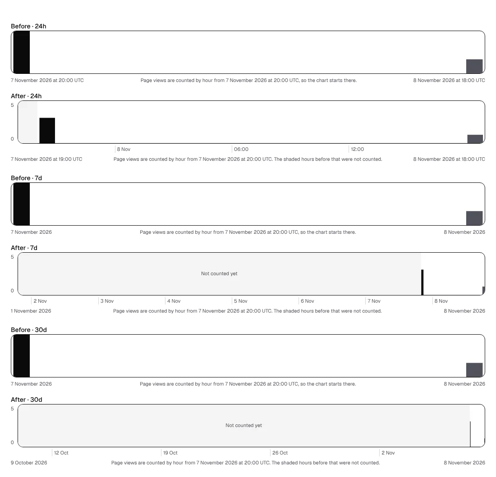
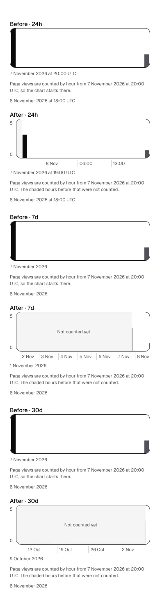

# The Signals chart with little data

**Lane:** `Loom portal` · **Date:** 8 November 2026 ·
**Branch:** `claude/project-thread-1e4r0g` ·
**Records:** none new ·
**Target:** [`docs/portal-wireframes.md`](../docs/portal-wireframes.md) *1 ·
Signals*, the bar chart of page views by hour

Asked for by the maintainer: with a day of counting, the chart's two bars sat
at its two edges, each as wide as an hour stretched across the screen, and the
height had no scale to read it by.

## What was wrong

- **The chart was as wide as the counting, not the range.** Where counting by
  hour began inside the range, the bars started at the left edge, so a day of
  counting on *Last 7 days* filled the week.
- **The tallest hour was always full height.** One page view in an hour drew
  the same bar as a thousand, and nothing said which.
- **No marks on either axis**, beyond the two ends in words.

## What shipped

- **The whole range, always.** Every hour has its place. The hours before
  counting began are a shaded band, named *Not counted yet* where it is wide
  enough, never drawn as noughts (0356). A counted hour nobody arrived in sits on
  a baseline.
- **A scale.** The top of the chart is the tallest hour rounded up to 1, 2 or 5
  times a power of ten, never under 5, and is printed on the left with 0.
- **Times under the bars.** A day every six hours, with the date at midnight; a
  week at each midnight; thirty days at each Monday. All UTC.

Pure in `(portal)/_lib/signals-range.ts` (`rangeChartOf`, `scaleOf`); two
formatters added to `_lib/when.ts`. No table, no db:push.

## Pictures

The same reading before and after, for each range (counting began 7 November
at 20:00 UTC; 3 page views then, 1 in the hour in progress):

