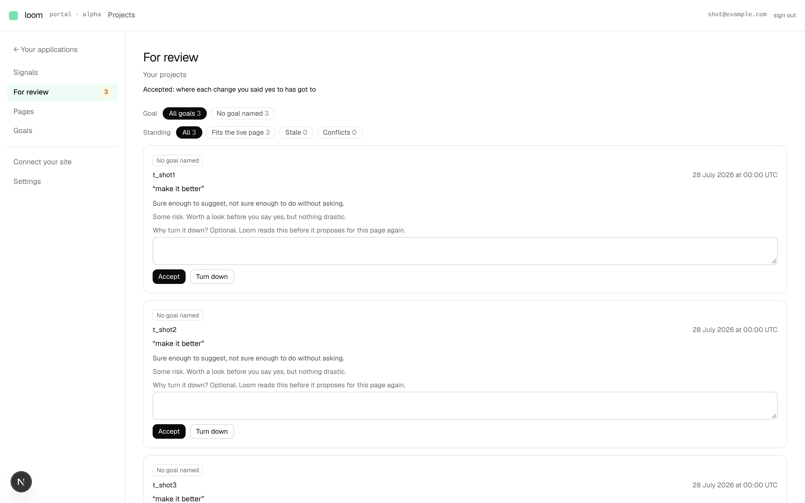
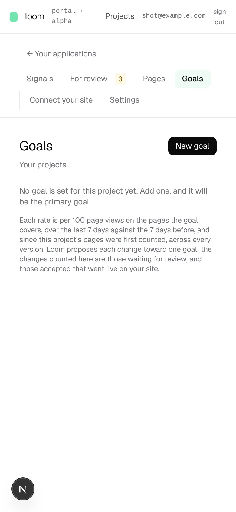

# The portal's chrome: a labelled rail beside a project's screens

**Lane:** `Loom portal` · **Date:** 8 November 2026 ·
**Branch:** `claude/project-thread-diejvq` ·
**Records:** none new ·
**Plan:** [`docs/portal.md`](../docs/portal.md) row 8d ·
**Target:** [`docs/portal-wireframes.md`](../docs/portal-wireframes.md) *The chrome*

Claimed by a portal run at 2026-11-08 23:18 UTC (#830).

## Why this, and why now

No portal-run pull request or branch had been pushed in the last three hours.
The open pull requests near the portal, #825 (the Signals chart) and #826
(publishing on deploy), came from their own threads; this run stayed off their
files. Sections 1 to 5 of the wireframes are built, short of two pieces of
*For review*: a predicted effect, which waits on the maintainer's choice of
method, and the next look time, whose schedule lives only in `vercel.json`.
The wireframes' build order says the chrome lands with whichever unit touches
the frame first; none did, so it lands on its own.

## What shipped

- **The rail.** Every screen of a project has one rail beside it, words at
  rest, in the wireframe's order: *Signals · For review · Pages · Goals*, a
  divider, then *Connect your site · Settings*, with the way back to the
  project list above it. On a narrow screen it is a row above the screen.
  The screen the person is on is tinted green. It replaces the tab row.
  `portal/[project]/_components/project-rail.tsx`, `_lib/project-tabs.ts`
  (each tab now carries its group, and *For review* says it counts).
- **The count on *For review*.** The changes waiting for a person: those the
  list shows and those it says could not be read, since those wait too. Drawn
  only when something waits, as *By page*'s badge is, and never a nought for
  a list that could not be read.
- **Its own read.** A layout is not drawn again when a person moves between
  the screens it wraps, so a count the layout read would still say *3* after
  all three were answered. The rail asks
  `/portal/<project>/review/waiting` each time the address changes. It is
  guarded as a screen is: signed in and a member of the project; one answer
  (404) for *not yours* and *no such project*; no count where the store could
  not say what the person may see; `Cache-Control: no-store`.
  `portal/[project]/review/waiting/route.ts`, `_lib/waiting-count.ts` (the
  body and its schema), `readWaitingCount` in `_lib/review-reading.ts`.

No table, no column, no environment variable, no `pnpm db:push`.

## Decisions taken

- **Segments is not on the rail.** The wireframe marks it *later*; the rule
  *no surface without a unit* means it waits for unit 9.
- **No count at nought.** The wireframe asks for "a count of what waits".
  A badge saying *0* on every screen of a quiet project is noise, so it
  follows *By page*'s *N waiting*, which hides at nought.
- **A route handler, the portal's first.** The other ways to keep the count
  current were a read in every screen (a dozen pages) or a server action
  called for a read. A GET under the project's own *For review* is the plain
  shape for a read.

## Tests

- `_lib/project-tabs.test.ts`: 6 (order, groups, which tab counts, the count's
  address, the landing tab, one tab lit per screen).
- `_lib/waiting-count.test.ts`: 3 (round trip, no count is not nought,
  anything else is no count).
- `portal/[project]/_components/project-rail.test.tsx`: 4 (labels in order and
  the current one marked, the count, no count at nought or unread, asked again
  on a move).
- `portal/[project]/review/waiting/route.test.ts`: 5 (member gets the count,
  never kept; unread is null; signed out reads nothing; not theirs and no such
  project are one 404; an unanswering role store reads nothing).

`pnpm verify` result is in the pull request.

## Screens

## Still missing from the wireframes

- The top bar's `loom / <workspace> / <project>` breadcrumb and search.
- *Segments* (unit 9, a record first).
- On *For review*: a predicted effect (the maintainer's choice) and the next
  time Loom looks at the pages.

Running the portal in `next dev` fails on `main` before this change: Tailwind
picks the text `scroll-mt-[var(…)]` out of `app/(docs)/_lib/chrome.test.ts`
and writes a rule the CSS parser refuses. These screenshots were taken with
that file moved aside. The production build does not hit it.
